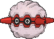

<!-- This file is generated by tools/generate_site.py. Edit the generator, not this file. -->

# #205 Forretress

{ .sprite-lg loading=lazy }

**Bagworm Pokémon**

Bug Steel

[:material-arrow-left: #204 Pineco](204.md) · [Pokédex](index.md) · [#206 Dunsparce :material-arrow-right:](206.md)

!!! info "Changes in Rising Ruby / Sinking Sapphire"

    - **Ability 2:** **Overcoat** 

## Location

[Route 123](../wild/route_123.md)

### Wild encounters

| Area | Method | Level | Note |
| --- | --- | --- | --- |
| [Route 123](../wild/route_123.md) | Tall Grass | 45 |  |

## Type defenses

| Damage taken | Attacking types |
| --- | --- |
| Immune (×0) | Poison |
| Very resistant (×¼) | Grass |
| Resistant (×½) | Normal Bug Steel Psychic Ice Dragon Fairy |
| Neutral (×1) | Fighting Flying Ground Rock Ghost Water Electric Dark |
| Very weak (×4) | Fire |

## Abilities

| Slot | Ability | Effect | Note |
| --- | --- | --- | --- |
| Ability 1 | **Sturdy** | Prevents being KOed from full HP, leaving 1 HP instead.  Protects against the one-hit KO moves regardless of HP. |  |
| Ability 2 | **Overcoat** | Protects against damage from weather. | changed  |
| Hidden | **Overcoat** | Protects against damage from weather. |  |

## Base stats

| Form | HP | Atk | Def | SpA | SpD | Spe | BST |
| --- | --- | --- | --- | --- | --- | --- | --- |
| { .sprite-sm loading=lazy } Normal | 75 | 90 | 140 | 60 | 60 | 40 | **465** |

## Training & breeding

| Property | Value |
| --- | --- |
| EV yield | 2 Def |
| Catch rate | 75 |
| Base friendship | 70 |
| Base experience | 163 |
| Growth rate | medium |
| Egg groups | Bug |
| Hatch counter | 20 |
| Gender ratio | 50% ♂ / 50% ♀ |
| Height / weight | 1.2 m / 125.8 kg |

## Evolution

- { .icon loading=lazy } [Pineco](../pokemon/204.md) → { .icon loading=lazy } **[Forretress](../pokemon/205.md)**: Lv. 31

## Wild held items

None.

## Level-up moves { data-search-exclude }

Moves marked &#42; are not normally learned by level up (they come from egg moves, TMs/HMs or tutors in the official games); moves marked &#42;&#42; cannot normally be learned by this Pokémon at all and are omitted from the legal-moves version of the hack.

| Lv. | Move | Type | Cat. | Power | Acc. | PP | Effect | Note |
| --- | --- | --- | --- | --- | --- | --- | --- | --- |
| 1 | Heavy Slam | Steel | Physical | — | 100% | 10 | Power is higher when the user weighs more than the target, up to a maximum of 120. |  |
| 1 | Zap Cannon | Electric | Special | 120 | 50% | 5 | Has a chance to paralyze the target. |  |
| 1 | Toxic Spikes | Poison | Status | — | — | 20 | Scatters poisoned spikes, poisoning opposing Pokémon that switch in. |  |
| 1 | Tackle | Normal | Physical | 50 | 100% | 35 | Inflicts regular damage with no additional effect. |  |
| 1 | Protect | Normal | Status | — | — | 10 | Prevents any moves from hitting the user this turn. |  |
| 6 | Self-Destruct | Normal | Physical | 200 | 100% | 5 | User faints. |  |
| 9 | Bug Bite | Bug | Physical | 60 | 100% | 20 | If target has a berry, inflicts double damage and uses the berry. |  |
| 12 | Take Down | Normal | Physical | 90 | 85% | 20 | User receives 1/4 the damage it inflicts in recoil. |  |
| 15 | Rapid Spin | Normal | Physical | 20 | 100% | 40 | Frees the user from binding moves, removes Leech Seed, and blows away Spikes. |  |
| 18 | Bide | Normal | Physical | — | — | 10 | User waits for two turns, then hits back for twice the damage it took. |  |
| 21 | Revenge | Fighting | Physical | 60 | 100% | 10 | Inflicts double damage if the user takes damage before attacking this turn. | &#42; |
| 24 | Natural Gift | Normal | Physical | — | 100% | 15 | Power and type depend on the held berry. |  |
| 27 | Spikes | Ground | Status | — | — | 20 | Scatters Spikes, hurting opposing Pokémon that switch in. |  |
| 30 | Payback | Dark | Physical | 50 | 100% | 10 | Power is doubled if the target has already moved this turn. |  |
| 31 | Mirror Shot | Steel | Special | 65 | 85% | 10 | Has a chance to lower the target’s accuracy by one stage. |  |
| 32 | Autotomize | Steel | Status | — | — | 15 | Raises the user’s Speed by two stages and halves the user’s weight. |  |
| 34 | Gyro Ball | Steel | Physical | — | 100% | 5 | Power raises when the user has lower Speed, up to a maximum of 150. |  |
| 38 | Drill Run | Ground | Physical | 80 | 95% | 10 | Has an increased chance for a critical hit. | &#42; |
| 42 | Explosion | Normal | Physical | 250 | 100% | 5 | User faints. |  |
| 46 | Pin Missile | Bug | Physical | 25 | 95% | 20 | Hits 2-5 times in one turn. | &#42; |
| 50 | Iron Defense | Steel | Status | — | — | 15 | Raises the user’s Defense by two stages. |  |
| 54 | Double-Edge | Normal | Physical | 120 | 100% | 15 | User receives 1/3 the damage inflicted in recoil. |  |
| 58 | Magnet Rise | Electric | Status | — | — | 10 | User is immune to Ground moves and effects for five turns. |  |
| 62 | Zap Cannon | Electric | Special | 120 | 50% | 5 | Has a chance to paralyze the target. |  |
| 66 | Heavy Slam | Steel | Physical | — | 100% | 10 | Power is higher when the user weighs more than the target, up to a maximum of 120. |  |

## TM & HM moves { data-search-exclude }

| Machine | Move | Type | Cat. | Power | Acc. | PP | Effect |
| --- | --- | --- | --- | --- | --- | --- | --- |
| HM04 | [Strength](../changes/moves.md#strength) changed | Normal | Physical | 100 | 100% | 10 | Inflicts regular damage with no additional effect. |
| HM06 | [Rock Smash](../changes/moves.md#rock-smash) changed | Fighting | Physical | 65 | 100% | 15 | Has a chance to lower the target’s Defense by one stage. |
| TM06 | Toxic | Poison | Status | — | 90% | 10 | Badly poisons the target, inflicting more damage every turn. |
| TM09 | Venoshock | Poison | Special | 65 | 100% | 10 | Inflicts double damage if the target is Poisoned. |
| TM10 | Hidden Power | Normal | Special | 60 | 100% | 15 | Power and type depend upon user’s IVs.  Power can range from 30 to 70. |
| TM100 | Confide | Normal | Status | — | — | 20 | Lowers the target’s Special Attack by one stage. |
| TM11 | Sunny Day | Fire | Status | — | — | 5 | Changes the weather to sunny for five turns. |
| TM15 | Hyper Beam | Normal | Special | 150 | 90% | 5 | User foregoes its next turn to recharge. |
| TM16 | Light Screen | Psychic | Status | — | — | 30 | Reduces damage from special attacks by 50% for five turns. |
| TM17 | Protect | Normal | Status | — | — | 10 | Prevents any moves from hitting the user this turn. |
| TM21 | Frustration | Normal | Physical | — | 100% | 20 | Power increases as happiness decreases, up to a maximum of 102. |
| TM22 | Solar Beam | Grass | Special | 120 | 100% | 10 | Requires a turn to charge before attacking. |
| TM26 | Earthquake | Ground | Physical | 100 | 100% | 10 | Inflicts regular damage and can hit Dig users. |
| TM27 | Return | Normal | Physical | — | 100% | 20 | Power increases with happiness, up to a maximum of 102. |
| TM28 | Dig | Ground | Physical | 80 | 100% | 10 | User digs underground, dodging all attacks, and hits next turn. |
| TM32 | Double Team | Normal | Status | — | — | 15 | Raises the user’s evasion by one stage. |
| TM33 | Reflect | Psychic | Status | — | — | 20 | Reduces damage from physical attacks by half. |
| TM37 | Sandstorm | Rock | Status | — | — | 10 | Changes the weather to a sandstorm for five turns. |
| TM39 | Rock Tomb | Rock | Physical | 60 | 95% | 15 | Has a chance to lower the target’s Speed by one stage. |
| TM42 | Facade | Normal | Physical | 70 | 100% | 20 | Power doubles if user is burned, paralyzed, or poisoned. |
| TM44 | Rest | Psychic | Status | — | — | 5 | User sleeps for two turns, completely healing itself. |
| TM45 | Attract | Normal | Status | — | 100% | 15 | Target falls in love if it has the opposite gender, and has a 50% chance to refuse attacking the user. |
| TM48 | Round | Normal | Special | 60 | 100% | 15 | Has double power if it’s used more than once per turn. |
| TM64 | Explosion | Normal | Physical | 250 | 100% | 5 | User faints. |
| TM66 | Payback | Dark | Physical | 50 | 100% | 10 | Power is doubled if the target has already moved this turn. |
| TM68 | Giga Impact | Normal | Physical | 150 | 90% | 5 | User foregoes its next turn to recharge. |
| TM69 | Rock Polish | Rock | Status | — | — | 20 | Raises the user’s Speed by two stages. |
| TM72 | Volt Switch | Electric | Special | 70 | 100% | 20 | User must switch out after attacking. |
| TM74 | Gyro Ball | Steel | Physical | — | 100% | 5 | Power raises when the user has lower Speed, up to a maximum of 150. |
| TM76 | Struggle Bug | Bug | Special | 50 | 100% | 20 | Has a chance to lower the target’s Special Attack by one stage. |
| TM78 | Bulldoze | Ground | Physical | 60 | 100% | 20 | Has a chance to lower the target’s Speed by one stage. |
| TM80 | Rock Slide | Rock | Physical | 75 | 90% | 10 | Has a chance to make the target flinch. |
| TM87 | Swagger | Normal | Status | — | 90% | 15 | Raises the target’s Attack by two stages and confuses the target. |
| TM88 | Sleep Talk | Normal | Status | — | — | 10 | Randomly uses one of the user’s other three moves.  Only works if the user is sleeping. |
| TM90 | Substitute | Normal | Status | — | — | 10 | Transfers 1/4 of the user’s max HP into a doll, protecting the user from further damage or status changes until it breaks. |
| TM91 | Flash Cannon | Steel | Special | 80 | 100% | 10 | Has a chance to lower the target’s Special Defense by one stage. |
| TM94 | Secret Power | Normal | Physical | 70 | 100% | 20 | Has a chance to inflict a status effect which depends upon the terrain. |

## Move tutor moves { data-search-exclude }

| Move | Type | Cat. | Power | Acc. | PP | Effect |
| --- | --- | --- | --- | --- | --- | --- |
| Block | Normal | Status | — | — | 5 | Prevents the target from leaving battle. |
| Bug Bite | Bug | Physical | 60 | 100% | 20 | If target has a berry, inflicts double damage and uses the berry. |
| Drill Run | Ground | Physical | 80 | 95% | 10 | Has an increased chance for a critical hit. |
| Giga Drain | Grass | Special | 75 | 100% | 10 | Drains half the damage inflicted to heal the user. |
| Gravity | Psychic | Status | — | — | 5 | Disables moves and immunities that involve flying or levitating for five turns. |
| Iron Defense | Steel | Status | — | — | 15 | Raises the user’s Defense by two stages. |
| Magnet Rise | Electric | Status | — | — | 10 | User is immune to Ground moves and effects for five turns. |
| Pain Split | Normal | Status | — | — | 20 | Sets the user’s and targets’s HP to the average of their current HP. |
| Signal Beam | Bug | Special | 75 | 100% | 15 | Has a chance to confuse the target. |
| Snore | Normal | Special | 50 | 100% | 15 | Has a chance to make the target flinch.  Only works if the user is sleeping. |
| Stealth Rock | Rock | Status | — | — | 20 | Causes damage when opposing Pokémon switch in. |

## Egg moves { data-search-exclude }

No egg moves.

??? note "Trainers using Forretress (5)"

    | Area | Trainer | Level |
    | --- | --- | --- |
    | [Jagged Pass](../trainers/jagged_pass.md#trainers) | Hiker Eric | Lv. 32 |
    | [Route 120 South-West](../trainers/route_120_south_west.md#trainers) | Bug Maniac Brandon | Lv. 47 |
    | [Route 120 South-West](../trainers/route_120_south_west.md#rematches) | Bug Maniac Brandon (7) | Lv. 59 |
    | [Route 120 South-West](../trainers/route_120_south_west.md#rematches) | Bug Maniac Brandon (8) | Lv. 64 |
    | [Route 120 South-West](../trainers/route_120_south_west.md#rematches) | Bug Maniac Brandon (C) | Lv. 75 |

---

[:material-arrow-left: #204 Pineco](204.md) · [#206 Dunsparce :material-arrow-right:](206.md)
