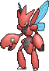
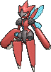

<!-- This file is generated by tools/generate_site.py. Edit the generator, not this file. -->

# #212 Scizor

{ .sprite-lg loading=lazy }

**Pincer Pokémon**

Bug Steel

[:material-arrow-left: #211 Qwilfish](211.md) · [Pokédex](index.md) · [#213 Shuckle :material-arrow-right:](213.md)

!!! note "No documented changes"

    Drayano's documentation lists no stat, type, ability, evolution or held item changes for this Pokémon. Its level-up moves are listed below as they appear in the hack.

## Location

[Route 112 South](../wild/route_112_south.md)

### Wild encounters

| Area | Method | Level | Note |
| --- | --- | --- | --- |
| [Route 112 South](../wild/route_112_south.md) | DexNav | 50 |  |

## Type defenses

| Damage taken | Attacking types |
| --- | --- |
| Immune (×0) | Poison |
| Very resistant (×¼) | Grass |
| Resistant (×½) | Normal Bug Steel Psychic Ice Dragon Fairy |
| Neutral (×1) | Fighting Flying Ground Rock Ghost Water Electric Dark |
| Very weak (×4) | Fire |

## Abilities

| Slot | Ability | Effect | Note |
| --- | --- | --- | --- |
| Ability 1 | **Swarm** | Strengthens Bug moves to inflict 1.5× damage at 1/3 max HP or less. |  |
| Ability 2 | **Technician** | Strengthens moves of 60 base power or less to 1.5× their power. |  |
| Hidden | **Light Metal** | Halves the Pokémon's weight. |  |

## Base stats

| Form | HP | Atk | Def | SpA | SpD | Spe | BST |
| --- | --- | --- | --- | --- | --- | --- | --- |
| { .sprite-sm loading=lazy } Normal | 70 | 130 | 100 | 55 | 80 | 65 | **500** |
| { .sprite-sm loading=lazy } Mega Scizor | 70 | 150 | 140 | 65 | 100 | 75 | **600** |

## Training & breeding

| Property | Value |
| --- | --- |
| EV yield | 2 Atk |
| Catch rate | 25 |
| Base friendship | 70 |
| Base experience | 175 |
| Growth rate | medium |
| Egg groups | Bug |
| Hatch counter | 25 |
| Gender ratio | 50% ♂ / 50% ♀ |
| Height / weight | 1.8 m / 118 kg |

## Evolution

- { .icon loading=lazy } [Scyther](../pokemon/123.md) → { .icon loading=lazy } **[Scizor](../pokemon/212.md)**: Use a Metal Coat changed <small>(vanilla: Trade holding Metal Coat)</small>
- { .sprite-sm loading=lazy } **Mega Scizor**: Mega Evolves by holding the { .item loading=lazy } Scizorite

## Wild held items

None.

## Level-up moves { data-search-exclude }

Moves marked &#42; are not normally learned by level up (they come from egg moves, TMs/HMs or tutors in the official games); moves marked &#42;&#42; cannot normally be learned by this Pokémon at all and are omitted from the legal-moves version of the hack.

| Lv. | Move | Type | Cat. | Power | Acc. | PP | Effect | Note |
| --- | --- | --- | --- | --- | --- | --- | --- | --- |
| 1 | Feint | Normal | Physical | 30 | 100% | 10 | Hits through Protect and Detect. |  |
| 1 | Bullet Punch | Steel | Physical | 40 | 100% | 30 | Inflicts regular damage with no additional effect. |  |
| 1 | Crabhammer | Water | Physical | 100 | 90% | 10 | Has an increased chance for a critical hit. | &#42;&#42; |
| 1 | Quick Attack | Normal | Physical | 40 | 100% | 30 | Inflicts regular damage with no additional effect. |  |
| 1 | Leer | Normal | Status | — | 100% | 30 | Lowers the target’s Defense by one stage. |  |
| 4 | Focus Energy | Normal | Status | — | — | 30 | Increases the user’s chance to score a critical hit. |  |
| 8 | Pursuit | Dark | Physical | 40 | 100% | 20 | Has double power against, and can hit, Pokémon attempting to switch out. |  |
| 12 | Agility | Psychic | Status | — | — | 30 | Raises the user’s Speed by two stages. |  |
| 16 | Fury Cutter | Bug | Physical | 40 | 95% | 20 | Power doubles every turn this move is used in succession after the first, maxing out after five turns. |  |
| 20 | Slash | Normal | Physical | 70 | 100% | 20 | Has an increased chance for a critical hit. |  |
| 23 | Bug Bite | Bug | Physical | 60 | 100% | 20 | If target has a berry, inflicts double damage and uses the berry. | &#42; |
| 26 | Metal Claw | Steel | Physical | 50 | 95% | 35 | Has a chance to raise the user’s Attack by one stage. |  |
| 29 | False Swipe | Normal | Physical | 40 | 100% | 40 | Cannot lower the target’s HP below 1. |  |
| 32 | Razor Wind | Normal | Special | 80 | 100% | 10 | Requires a turn to charge before attacking. |  |
| 35 | Iron Defense | Steel | Status | — | — | 15 | Raises the user’s Defense by two stages. |  |
| 38 | X-Scissor | Bug | Physical | 80 | 100% | 15 | Inflicts regular damage with no additional effect. |  |
| 41 | Night Slash | Dark | Physical | 70 | 100% | 15 | Has an increased chance for a critical hit. |  |
| 44 | Double Hit | Normal | Physical | 35 | 90% | 10 | Hits twice in one turn. |  |
| 48 | Swords Dance | Normal | Status | — | — | 20 | Raises the user’s Attack by two stages. |  |
| 52 | Iron Head | Steel | Physical | 80 | 100% | 15 | Has a chance to make the target flinch. |  |
| 56 | Feint | Normal | Physical | 30 | 100% | 10 | Hits through Protect and Detect. |  |
| 60 | Reversal | Fighting | Physical | — | 100% | 15 | Inflicts more damage when the user has less HP remaining, with a maximum of 200 power. | &#42; |

## TM & HM moves { data-search-exclude }

| Machine | Move | Type | Cat. | Power | Acc. | PP | Effect |
| --- | --- | --- | --- | --- | --- | --- | --- |
| HM01 | [Cut](../changes/moves.md#cut) changed | Grass | Physical | 70 | 100% | 15 | High Critical Rate. High Critical Rate |
| HM04 | [Strength](../changes/moves.md#strength) changed | Normal | Physical | 100 | 100% | 10 | Inflicts regular damage with no additional effect. |
| HM06 | [Rock Smash](../changes/moves.md#rock-smash) changed | Fighting | Physical | 65 | 100% | 15 | Has a chance to lower the target’s Defense by one stage. |
| TM06 | Toxic | Poison | Status | — | 90% | 10 | Badly poisons the target, inflicting more damage every turn. |
| TM09 | Venoshock | Poison | Special | 65 | 100% | 10 | Inflicts double damage if the target is Poisoned. |
| TM10 | Hidden Power | Normal | Special | 60 | 100% | 15 | Power and type depend upon user’s IVs.  Power can range from 30 to 70. |
| TM100 | Confide | Normal | Status | — | — | 20 | Lowers the target’s Special Attack by one stage. |
| TM11 | Sunny Day | Fire | Status | — | — | 5 | Changes the weather to sunny for five turns. |
| TM15 | Hyper Beam | Normal | Special | 150 | 90% | 5 | User foregoes its next turn to recharge. |
| TM16 | Light Screen | Psychic | Status | — | — | 30 | Reduces damage from special attacks by 50% for five turns. |
| TM17 | Protect | Normal | Status | — | — | 10 | Prevents any moves from hitting the user this turn. |
| TM18 | Rain Dance | Water | Status | — | — | 5 | Changes the weather to rain for five turns. |
| TM19 | Roost | Flying | Status | — | — | 5 | Heals the user by half its max HP. |
| TM20 | Safeguard | Normal | Status | — | — | 25 | Protects the user’s field from major status ailments and confusion for five turns. |
| TM21 | Frustration | Normal | Physical | — | 100% | 20 | Power increases as happiness decreases, up to a maximum of 102. |
| TM27 | Return | Normal | Physical | — | 100% | 20 | Power increases with happiness, up to a maximum of 102. |
| TM31 | Brick Break | Fighting | Physical | 75 | 100% | 15 | Destroys Reflect and Light Screen. |
| TM32 | Double Team | Normal | Status | — | — | 15 | Raises the user’s evasion by one stage. |
| TM37 | Sandstorm | Rock | Status | — | — | 10 | Changes the weather to a sandstorm for five turns. |
| TM40 | Aerial Ace | Flying | Physical | 60 | — | 20 | Never misses. |
| TM42 | Facade | Normal | Physical | 70 | 100% | 20 | Power doubles if user is burned, paralyzed, or poisoned. |
| TM44 | Rest | Psychic | Status | — | — | 5 | User sleeps for two turns, completely healing itself. |
| TM45 | Attract | Normal | Status | — | 100% | 15 | Target falls in love if it has the opposite gender, and has a 50% chance to refuse attacking the user. |
| TM46 | Thief | Dark | Physical | 60 | 100% | 25 | Takes the target’s item. |
| TM48 | Round | Normal | Special | 60 | 100% | 15 | Has double power if it’s used more than once per turn. |
| TM51 | Steel Wing | Steel | Physical | 70 | 90% | 25 | Has a chance to raise the user’s Defense by one stage. |
| TM54 | False Swipe | Normal | Physical | 40 | 100% | 40 | Cannot lower the target’s HP below 1. |
| TM56 | Fling | Dark | Physical | — | 100% | 10 | Throws held item at the target; power depends on the item. |
| TM62 | Acrobatics | Flying | Physical | 55 | 100% | 15 | Has double power if the user has no held item. |
| TM68 | Giga Impact | Normal | Physical | 150 | 90% | 5 | User foregoes its next turn to recharge. |
| TM75 | Swords Dance | Normal | Status | — | — | 20 | Raises the user’s Attack by two stages. |
| TM76 | Struggle Bug | Bug | Special | 50 | 100% | 20 | Has a chance to lower the target’s Special Attack by one stage. |
| TM81 | X-Scissor | Bug | Physical | 80 | 100% | 15 | Inflicts regular damage with no additional effect. |
| TM87 | Swagger | Normal | Status | — | 90% | 15 | Raises the target’s Attack by two stages and confuses the target. |
| TM88 | Sleep Talk | Normal | Status | — | — | 10 | Randomly uses one of the user’s other three moves.  Only works if the user is sleeping. |
| TM89 | U-turn | Bug | Physical | 70 | 100% | 20 | User must switch out after attacking. |
| TM90 | Substitute | Normal | Status | — | — | 10 | Transfers 1/4 of the user’s max HP into a doll, protecting the user from further damage or status changes until it breaks. |
| TM91 | Flash Cannon | Steel | Special | 80 | 100% | 10 | Has a chance to lower the target’s Special Defense by one stage. |
| TM94 | Secret Power | Normal | Physical | 70 | 100% | 20 | Has a chance to inflict a status effect which depends upon the terrain. |

## Move tutor moves { data-search-exclude }

| Move | Type | Cat. | Power | Acc. | PP | Effect |
| --- | --- | --- | --- | --- | --- | --- |
| Bug Bite | Bug | Physical | 60 | 100% | 20 | If target has a berry, inflicts double damage and uses the berry. |
| Iron Defense | Steel | Status | — | — | 15 | Raises the user’s Defense by two stages. |
| Iron Head | Steel | Physical | 80 | 100% | 15 | Has a chance to make the target flinch. |
| Knock Off | Dark | Physical | 65 | 100% | 20 | Target drops its held item. |
| Snore | Normal | Special | 50 | 100% | 15 | Has a chance to make the target flinch.  Only works if the user is sleeping. |
| Superpower | Fighting | Physical | 120 | 100% | 5 | Lowers the user’s Attack and Defense by one stage after inflicting damage. |
| Tailwind | Flying | Status | — | — | 15 | For three turns, friendly Pokémon have doubled Speed. |

## Egg moves { data-search-exclude }

No egg moves.

??? note "Trainers using Scizor (8)"

    | Area | Trainer | Level |
    | --- | --- | --- |
    | [Route 111](../trainers/route_111.md#rematches) | Ace Trainer Wilton (6) | Lv. 47 |
    | [Route 111](../trainers/route_111.md#rematches) | Ace Trainer Wilton (8) | Lv. 64 |
    | [Route 111](../trainers/route_111.md#rematches) | Ace Trainer Wilton (C) | Lv. 75 |
    | [Route 119 (Mauville)](../trainers/route_119_mauville.md#trainers) | Bug Maniac Brent | Lv. 40 |
    | [Route 133](../trainers/route_133.md#trainers) | Ace Trainer Warren | Lv. 58 |
    | [Victory Road B1F](../trainers/victory_road_b1f.md#trainers) | Ace Duo Jude & Rory | Lv. 65 |
    | [Victory Road B1F](../trainers/victory_road_b1f.md#rematches) | Ace Duo Jude & Rory | Lv. 75 |
    | [Battle Resort](../trainers/battle_resort.md#trainers) | Leader Kelvin [Wikstrom] | Lv. 84 |

---

[:material-arrow-left: #211 Qwilfish](211.md) · [#213 Shuckle :material-arrow-right:](213.md)
