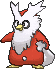

<!-- This file is generated by tools/generate_site.py. Edit the generator, not this file. -->

# #225 Delibird

{ .sprite-lg loading=lazy }

**Delivery Pokémon**

Ice Flying

[:material-arrow-left: #224 Octillery](224.md) · [Pokédex](index.md) · [#226 Mantine :material-arrow-right:](226.md)

!!! info "Changes in Rising Ruby / Sinking Sapphire"

    - **Ability 2:** Hustle → **Aerilate** &#42;&#42;
    - **Hidden Ability:** Insomnia → **Hustle** 
    - **Base stats:** HP 45 → **65**, Atk 55 → **80**, Def 45 → **65**, SpA 65 → **110**, SpD 45 → **65**, Spe 75 → **120** (BST 330 → **505**)

## Location

[Shoal Cave](../wild/shoal_cave_1f.md)

### Wild encounters

| Area | Method | Level | Note |
| --- | --- | --- | --- |
| [Shoal Cave 1F](../wild/shoal_cave_1f.md) | Walking | 40 |  |
| [Shoal Cave B1F, B2F, B3F](../wild/shoal_cave_b1f_b2f_b3f.md) | Walking | 50 |  |
| [Shoal Cave Ice Room](../wild/shoal_cave_ice_room.md) | Walking | 55 |  |

## Type defenses

| Damage taken | Attacking types |
| --- | --- |
| Immune (×0) | Ground |
| Resistant (×½) | Bug Grass |
| Neutral (×1) | Normal Fighting Flying Poison Ghost Water Psychic Ice Dragon Dark Fairy |
| Weak (×2) | Steel Fire Electric |
| Very weak (×4) | Rock |

## Abilities

| Slot | Ability | Effect | Note |
| --- | --- | --- | --- |
| Ability 1 | **Vital Spirit** | Prevents sleep. |  |
| Ability 2 | **Aerilate** | Turns the bearer's Normal moves into Flying moves and strengthens them to 1.3× their power. | changed (was Hustle) &#42;&#42; |
| Hidden | **Hustle** | Strengthens physical moves to inflict 1.5× damage, but decreases their accuracy to 0.8×. | changed (was Insomnia)  |

## Base stats

| Form | HP | Atk | Def | SpA | SpD | Spe | BST |
| --- | --- | --- | --- | --- | --- | --- | --- |
| { .sprite-sm loading=lazy } Normal | 65<small class="was">was 45</small> | 80<small class="was">was 55</small> | 65<small class="was">was 45</small> | 110<small class="was">was 65</small> | 65<small class="was">was 45</small> | 120<small class="was">was 75</small> | 505<small class="was">was 330</small> |

## Training & breeding

| Property | Value |
| --- | --- |
| EV yield | 1 Spe |
| Catch rate | 45 |
| Base friendship | 70 |
| Base experience | 116 |
| Growth rate | fast |
| Egg groups | Water 1, Field |
| Hatch counter | 20 |
| Gender ratio | 50% ♂ / 50% ♀ |
| Height / weight | 0.9 m / 16 kg |

## Evolution

This Pokémon does not evolve.

## Wild held items

None.

## Level-up moves { data-search-exclude }

Moves marked &#42; are not normally learned by level up (they come from egg moves, TMs/HMs or tutors in the official games); moves marked &#42;&#42; cannot normally be learned by this Pokémon at all and are omitted from the legal-moves version of the hack.

| Lv. | Move | Type | Cat. | Power | Acc. | PP | Effect | Note |
| --- | --- | --- | --- | --- | --- | --- | --- | --- |
| 1 | Hurricane | Flying | Special | 110 | 70% | 10 | Has a chance to confuse the target. | &#42;&#42; |
| 1 | Gunk Shot | Poison | Physical | 120 | 80% | 5 | Has a chance to poison the target. | &#42; |
| 1 | Seed Bomb | Grass | Physical | 80 | 100% | 15 | Inflicts regular damage with no additional effect. | &#42; |
| 1 | Sky Attack | Flying | Physical | 140 | 90% | 5 | User charges for one turn before attacking.  Has a chance to make the target flinch. | &#42; |
| 1 | Present | Normal | Physical | — | 90% | 15 | Randomly inflicts damage with power from 40 to 120 or heals the target for 1/4 its max HP. |  |
| 8 | Icy Wind | Ice | Special | 55 | 95% | 15 | Has a chance to lower the target’s Speed by one stage. | &#42; |
| 12 | Aurora Beam | Ice | Special | 65 | 100% | 20 | Has a chance to lower the target’s Attack by one stage. | &#42; |
| 16 | Fake Out | Normal | Physical | 40 | 100% | 10 | Can only be used as the first move after the user enters battle.  Causes the target to flinch. | &#42; |
| 20 | Ice Shard | Ice | Physical | 40 | 100% | 30 | Inflicts regular damage with no additional effect. | &#42; |
| 24 | Quick Attack | Normal | Physical | 40 | 100% | 30 | Inflicts regular damage with no additional effect. | &#42; |
| 28 | Freeze-Dry | Ice | Special | 70 | 100% | 20 | Super-effective against Water. | &#42; |
| 32 | Future Sight | Psychic | Special | 120 | 100% | 10 | Hits the target two turns later. | &#42; |
| 36 | Swift | Normal | Special | 60 | — | 20 | Never misses. | &#42; |
| 40 | Ice Beam | Ice | Special | 90 | 100% | 10 | Has a chance to freeze the target. | &#42; |
| 44 | Rapid Spin | Normal | Physical | 20 | 100% | 40 | Frees the user from binding moves, removes Leech Seed, and blows away Spikes. | &#42; |
| 48 | Destiny Bond | Ghost | Status | — | — | 5 | If the user faints this turn, the target automatically will, too. | &#42; |
| 52 | Spikes | Ground | Status | — | — | 20 | Scatters Spikes, hurting opposing Pokémon that switch in. | &#42; |
| 56 | Hurricane | Flying | Special | 110 | 70% | 10 | Has a chance to confuse the target. | &#42;&#42; |

## TM & HM moves { data-search-exclude }

| Machine | Move | Type | Cat. | Power | Acc. | PP | Effect |
| --- | --- | --- | --- | --- | --- | --- | --- |
| HM02 | [Fly](../changes/moves.md#fly) changed | Flying | Physical | 100 | 100% | 10 | User flies high into the air, dodging all attacks, and hits next turn. |
| TM06 | Toxic | Poison | Status | — | 90% | 10 | Badly poisons the target, inflicting more damage every turn. |
| TM07 | Hail | Ice | Status | — | — | 10 | Changes the weather to a hailstorm for five turns. |
| TM10 | Hidden Power | Normal | Special | 60 | 100% | 15 | Power and type depend upon user’s IVs.  Power can range from 30 to 70. |
| TM100 | Confide | Normal | Status | — | — | 20 | Lowers the target’s Special Attack by one stage. |
| TM13 | Ice Beam | Ice | Special | 90 | 100% | 10 | Has a chance to freeze the target. |
| TM14 | Blizzard | Ice | Special | 110 | 70% | 5 | Has a chance to freeze the target. |
| TM17 | Protect | Normal | Status | — | — | 10 | Prevents any moves from hitting the user this turn. |
| TM18 | Rain Dance | Water | Status | — | — | 5 | Changes the weather to rain for five turns. |
| TM21 | Frustration | Normal | Physical | — | 100% | 20 | Power increases as happiness decreases, up to a maximum of 102. |
| TM27 | Return | Normal | Physical | — | 100% | 20 | Power increases with happiness, up to a maximum of 102. |
| TM31 | Brick Break | Fighting | Physical | 75 | 100% | 15 | Destroys Reflect and Light Screen. |
| TM32 | Double Team | Normal | Status | — | — | 15 | Raises the user’s evasion by one stage. |
| TM40 | Aerial Ace | Flying | Physical | 60 | — | 20 | Never misses. |
| TM42 | Facade | Normal | Physical | 70 | 100% | 20 | Power doubles if user is burned, paralyzed, or poisoned. |
| TM44 | Rest | Psychic | Status | — | — | 5 | User sleeps for two turns, completely healing itself. |
| TM45 | Attract | Normal | Status | — | 100% | 15 | Target falls in love if it has the opposite gender, and has a 50% chance to refuse attacking the user. |
| TM46 | Thief | Dark | Physical | 60 | 100% | 25 | Takes the target’s item. |
| TM48 | Round | Normal | Special | 60 | 100% | 15 | Has double power if it’s used more than once per turn. |
| TM56 | Fling | Dark | Physical | — | 100% | 10 | Throws held item at the target; power depends on the item. |
| TM79 | Frost Breath | Ice | Special | 60 | 90% | 10 | Always scores a critical hit. |
| TM87 | Swagger | Normal | Status | — | 90% | 15 | Raises the target’s Attack by two stages and confuses the target. |
| TM88 | Sleep Talk | Normal | Status | — | — | 10 | Randomly uses one of the user’s other three moves.  Only works if the user is sleeping. |
| TM90 | Substitute | Normal | Status | — | — | 10 | Transfers 1/4 of the user’s max HP into a doll, protecting the user from further damage or status changes until it breaks. |
| TM94 | Secret Power | Normal | Physical | 70 | 100% | 20 | Has a chance to inflict a status effect which depends upon the terrain. |
| TM98 | Power-Up Punch | Fighting | Physical | 40 | 100% | 20 | Raises the user’s Attack by one stage after inflicting damage. |

## Move tutor moves { data-search-exclude }

| Move | Type | Cat. | Power | Acc. | PP | Effect |
| --- | --- | --- | --- | --- | --- | --- |
| Bounce | Flying | Physical | 85 | 85% | 5 | User bounces high into the air, dodging all attacks, and hits next turn. |
| Focus Punch | Fighting | Physical | 150 | 100% | 20 | If the user takes damage before attacking, the attack is canceled. |
| Gunk Shot | Poison | Physical | 120 | 80% | 5 | Has a chance to poison the target. |
| Ice Punch | Ice | Physical | 75 | 100% | 15 | Has a chance to freeze the target. |
| Icy Wind | Ice | Special | 55 | 95% | 15 | Has a chance to lower the target’s Speed by one stage. |
| Recycle | Normal | Status | — | — | 10 | User recovers the item it last used up. |
| Seed Bomb | Grass | Physical | 80 | 100% | 15 | Inflicts regular damage with no additional effect. |
| Signal Beam | Bug | Special | 75 | 100% | 15 | Has a chance to confuse the target. |
| Sky Attack | Flying | Physical | 140 | 90% | 5 | User charges for one turn before attacking.  Has a chance to make the target flinch. |
| Snore | Normal | Special | 50 | 100% | 15 | Has a chance to make the target flinch.  Only works if the user is sleeping. |
| Water Pulse | Water | Special | 60 | 100% | 20 | Has a chance to confuse the target. |

## Egg moves { data-search-exclude }

| Move | Type | Cat. | Power | Acc. | PP | Effect |
| --- | --- | --- | --- | --- | --- | --- |
| Aurora Beam | Ice | Special | 65 | 100% | 20 | Has a chance to lower the target’s Attack by one stage. |
| Bestow | Normal | Status | — | — | 15 | Gives the user’s held item to the target. |
| Destiny Bond | Ghost | Status | — | — | 5 | If the user faints this turn, the target automatically will, too. |
| Fake Out | Normal | Physical | 40 | 100% | 10 | Can only be used as the first move after the user enters battle.  Causes the target to flinch. |
| Freeze-Dry | Ice | Special | 70 | 100% | 20 | Super-effective against Water. |
| Future Sight | Psychic | Special | 120 | 100% | 10 | Hits the target two turns later. |
| Ice Ball | Ice | Physical | 30 | 90% | 20 | Power doubles every turn this move is used in succession after the first, resetting after five turns. |
| Ice Punch | Ice | Physical | 75 | 100% | 15 | Has a chance to freeze the target. |
| Ice Shard | Ice | Physical | 40 | 100% | 30 | Inflicts regular damage with no additional effect. |
| Icy Wind | Ice | Special | 55 | 95% | 15 | Has a chance to lower the target’s Speed by one stage. |
| Quick Attack | Normal | Physical | 40 | 100% | 30 | Inflicts regular damage with no additional effect. |
| Rapid Spin | Normal | Physical | 20 | 100% | 40 | Frees the user from binding moves, removes Leech Seed, and blows away Spikes. |
| Spikes | Ground | Status | — | — | 20 | Scatters Spikes, hurting opposing Pokémon that switch in. |
| Splash | Normal | Status | — | — | 40 | Does nothing. |

??? note "Trainers using Delibird (1)"

    | Area | Trainer | Level |
    | --- | --- | --- |
    | [Fortree Gym](../trainers/fortree_gym.md#trainers) | Bird Keeper Will | Lv. 45 |

---

[:material-arrow-left: #224 Octillery](224.md) · [#226 Mantine :material-arrow-right:](226.md)
