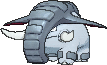

<!-- This file is generated by tools/generate_site.py. Edit the generator, not this file. -->

# #232 Donphan

{ .sprite-lg loading=lazy }

**Armor Pokémon**

Ground

[:material-arrow-left: #231 Phanpy](231.md) · [Pokédex](index.md) · [#233 Porygon2 :material-arrow-right:](233.md)

!!! info "Changes in Rising Ruby / Sinking Sapphire"

    - **Ability 2:** **Sand Veil** 

## Location

[Victory Road](../wild/victory_road_1f.md)

### Wild encounters

| Area | Method | Level | Note |
| --- | --- | --- | --- |
| [Victory Road 1F](../wild/victory_road_1f.md) | Walking | 59 |  |

## Type defenses

| Damage taken | Attacking types |
| --- | --- |
| Immune (×0) | Electric |
| Resistant (×½) | Poison Rock |
| Neutral (×1) | Normal Fighting Flying Ground Bug Ghost Steel Fire Psychic Dragon Dark Fairy |
| Weak (×2) | Water Grass Ice |

## Abilities

| Slot | Ability | Effect | Note |
| --- | --- | --- | --- |
| Ability 1 | **Sturdy** | Prevents being KOed from full HP, leaving 1 HP instead.  Protects against the one-hit KO moves regardless of HP. |  |
| Ability 2 | **Sand Veil** | Increases evasion to 1.25× during a sandstorm.  Protects against sandstorm damage. | changed  |
| Hidden | **Sand Veil** | Increases evasion to 1.25× during a sandstorm.  Protects against sandstorm damage. |  |

## Base stats

| Form | HP | Atk | Def | SpA | SpD | Spe | BST |
| --- | --- | --- | --- | --- | --- | --- | --- |
| { .sprite-sm loading=lazy } Normal | 90 | 120 | 120 | 60 | 60 | 50 | **500** |

## Training & breeding

| Property | Value |
| --- | --- |
| EV yield | 1 Atk, 1 Def |
| Catch rate | 60 |
| Base friendship | 70 |
| Base experience | 175 |
| Growth rate | medium |
| Egg groups | Field |
| Hatch counter | 20 |
| Gender ratio | 50% ♂ / 50% ♀ |
| Height / weight | 1.1 m / 120 kg |

## Evolution

- { .icon loading=lazy } [Phanpy](../pokemon/231.md) → { .icon loading=lazy } **[Donphan](../pokemon/232.md)**: Lv. 25

## Wild held items

None.

## Level-up moves { data-search-exclude }

Moves marked &#42; are not normally learned by level up (they come from egg moves, TMs/HMs or tutors in the official games); moves marked &#42;&#42; cannot normally be learned by this Pokémon at all and are omitted from the legal-moves version of the hack.

| Lv. | Move | Type | Cat. | Power | Acc. | PP | Effect | Note |
| --- | --- | --- | --- | --- | --- | --- | --- | --- |
| 1 | Fire Fang | Fire | Physical | 65 | 95% | 15 | Has a chance to burn the target and a chance to make the target flinch. |  |
| 1 | Thunder Fang | Electric | Physical | 65 | 95% | 15 | Has a chance to paralyze the target and a chance to make the target flinch. |  |
| 1 | Horn Attack | Normal | Physical | 65 | 100% | 25 | Inflicts regular damage with no additional effect. |  |
| 1 | Bulldoze | Ground | Physical | 60 | 100% | 20 | Has a chance to lower the target’s Speed by one stage. |  |
| 1 | Growl | Normal | Status | — | 100% | 40 | Lowers the target’s Attack by one stage. |  |
| 1 | Defense Curl | Normal | Status | — | — | 40 | Raises user’s Defense by one stage. |  |
| 6 | Rapid Spin | Normal | Physical | 20 | 100% | 40 | Frees the user from binding moves, removes Leech Seed, and blows away Spikes. |  |
| 9 | Rollout | Rock | Physical | 30 | 90% | 20 | Power doubles every turn this move is used in succession after the first, resetting after five turns. |  |
| 12 | Assurance | Dark | Physical | 60 | 100% | 10 | Power is doubled if the target has already received damage this turn. |  |
| 15 | Knock Off | Dark | Physical | 65 | 100% | 20 | Target drops its held item. |  |
| 18 | Body Slam | Normal | Physical | 85 | 100% | 15 | Has a chance to paralyze the target. | &#42; |
| 21 | Ice Shard | Ice | Physical | 40 | 100% | 30 | Inflicts regular damage with no additional effect. | &#42; |
| 24 | Slam | Normal | Physical | 80 | 75% | 20 | Inflicts regular damage with no additional effect. |  |
| 25 | Fury Attack | Normal | Physical | 15 | 85% | 20 | Hits 2-5 times in one turn. |  |
| 28 | Magnitude | Ground | Physical | — | 100% | 30 | Power varies randomly from 10 to 150. |  |
| 32 | Play Rough | Fairy | Physical | 90 | 90% | 10 | Has a chance to lower the target’s Attack by one stage. | &#42; |
| 36 | Scary Face | Normal | Status | — | 100% | 10 | Lowers the target’s Speed by two stages. |  |
| 40 | Earthquake | Ground | Physical | 100 | 100% | 10 | Inflicts regular damage and can hit Dig users. |  |
| 44 | Head Smash | Rock | Physical | 150 | 80% | 5 | User receives 1/2 the damage inflicted in recoil. | &#42; |
| 48 | Giga Impact | Normal | Physical | 150 | 90% | 5 | User foregoes its next turn to recharge. |  |

## TM & HM moves { data-search-exclude }

| Machine | Move | Type | Cat. | Power | Acc. | PP | Effect |
| --- | --- | --- | --- | --- | --- | --- | --- |
| HM04 | [Strength](../changes/moves.md#strength) changed | Normal | Physical | 100 | 100% | 10 | Inflicts regular damage with no additional effect. |
| HM06 | [Rock Smash](../changes/moves.md#rock-smash) changed | Fighting | Physical | 65 | 100% | 15 | Has a chance to lower the target’s Defense by one stage. |
| TM05 | Roar | Normal | Status | — | — | 20 | Immediately ends wild battles.  Forces trainers to switch Pokémon. |
| TM06 | Toxic | Poison | Status | — | 90% | 10 | Badly poisons the target, inflicting more damage every turn. |
| TM10 | Hidden Power | Normal | Special | 60 | 100% | 15 | Power and type depend upon user’s IVs.  Power can range from 30 to 70. |
| TM100 | Confide | Normal | Status | — | — | 20 | Lowers the target’s Special Attack by one stage. |
| TM11 | Sunny Day | Fire | Status | — | — | 5 | Changes the weather to sunny for five turns. |
| TM15 | Hyper Beam | Normal | Special | 150 | 90% | 5 | User foregoes its next turn to recharge. |
| TM17 | Protect | Normal | Status | — | — | 10 | Prevents any moves from hitting the user this turn. |
| TM21 | Frustration | Normal | Physical | — | 100% | 20 | Power increases as happiness decreases, up to a maximum of 102. |
| TM26 | Earthquake | Ground | Physical | 100 | 100% | 10 | Inflicts regular damage and can hit Dig users. |
| TM27 | Return | Normal | Physical | — | 100% | 20 | Power increases with happiness, up to a maximum of 102. |
| TM32 | Double Team | Normal | Status | — | — | 15 | Raises the user’s evasion by one stage. |
| TM37 | Sandstorm | Rock | Status | — | — | 10 | Changes the weather to a sandstorm for five turns. |
| TM39 | Rock Tomb | Rock | Physical | 60 | 95% | 15 | Has a chance to lower the target’s Speed by one stage. |
| TM42 | Facade | Normal | Physical | 70 | 100% | 20 | Power doubles if user is burned, paralyzed, or poisoned. |
| TM44 | Rest | Psychic | Status | — | — | 5 | User sleeps for two turns, completely healing itself. |
| TM45 | Attract | Normal | Status | — | 100% | 15 | Target falls in love if it has the opposite gender, and has a 50% chance to refuse attacking the user. |
| TM48 | Round | Normal | Special | 60 | 100% | 15 | Has double power if it’s used more than once per turn. |
| TM49 | Echoed Voice | Normal | Special | 40 | 100% | 15 | Power increases by 100% for each consecutive use by any friendly Pokémon, to a maximum of 200. |
| TM68 | Giga Impact | Normal | Physical | 150 | 90% | 5 | User foregoes its next turn to recharge. |
| TM69 | Rock Polish | Rock | Status | — | — | 20 | Raises the user’s Speed by two stages. |
| TM71 | Stone Edge | Rock | Physical | 100 | 80% | 5 | Has an increased chance for a critical hit. |
| TM74 | Gyro Ball | Steel | Physical | — | 100% | 5 | Power raises when the user has lower Speed, up to a maximum of 150. |
| TM78 | Bulldoze | Ground | Physical | 60 | 100% | 20 | Has a chance to lower the target’s Speed by one stage. |
| TM80 | Rock Slide | Rock | Physical | 75 | 90% | 10 | Has a chance to make the target flinch. |
| TM84 | Poison Jab | Poison | Physical | 80 | 100% | 20 | Has a chance to poison the target. |
| TM87 | Swagger | Normal | Status | — | 90% | 15 | Raises the target’s Attack by two stages and confuses the target. |
| TM88 | Sleep Talk | Normal | Status | — | — | 10 | Randomly uses one of the user’s other three moves.  Only works if the user is sleeping. |
| TM90 | Substitute | Normal | Status | — | — | 10 | Transfers 1/4 of the user’s max HP into a doll, protecting the user from further damage or status changes until it breaks. |
| TM94 | Secret Power | Normal | Physical | 70 | 100% | 20 | Has a chance to inflict a status effect which depends upon the terrain. |

## Move tutor moves { data-search-exclude }

| Move | Type | Cat. | Power | Acc. | PP | Effect |
| --- | --- | --- | --- | --- | --- | --- |
| Block | Normal | Status | — | — | 5 | Prevents the target from leaving battle. |
| Bounce | Flying | Physical | 85 | 85% | 5 | User bounces high into the air, dodging all attacks, and hits next turn. |
| Earth Power | Ground | Special | 90 | 100% | 10 | Has a chance to lower the target’s Special Defense by one stage. |
| Endeavor | Normal | Physical | — | 100% | 5 | Lowers the target’s HP to equal the user’s. |
| Gunk Shot | Poison | Physical | 120 | 80% | 5 | Has a chance to poison the target. |
| Hyper Voice | Normal | Special | 90 | 100% | 10 | Inflicts regular damage with no additional effect. |
| Iron Defense | Steel | Status | — | — | 15 | Raises the user’s Defense by two stages. |
| Iron Tail | Steel | Physical | 100 | 75% | 15 | Has a chance to lower the target’s Defense by one stage. |
| Knock Off | Dark | Physical | 65 | 100% | 20 | Target drops its held item. |
| Last Resort | Normal | Physical | 140 | 100% | 5 | Can only be used after all of the user’s other moves have been used. |
| Seed Bomb | Grass | Physical | 80 | 100% | 15 | Inflicts regular damage with no additional effect. |
| Snore | Normal | Special | 50 | 100% | 15 | Has a chance to make the target flinch.  Only works if the user is sleeping. |
| Stealth Rock | Rock | Status | — | — | 20 | Causes damage when opposing Pokémon switch in. |
| Superpower | Fighting | Physical | 120 | 100% | 5 | Lowers the user’s Attack and Defense by one stage after inflicting damage. |

## Egg moves { data-search-exclude }

No egg moves.

??? note "Trainers using Donphan (2)"

    | Area | Trainer | Level |
    | --- | --- | --- |
    | [Mt. Pyre 1F / 2F](../trainers/mt_pyre_1f_2f.md#trainers) | Poké Maniac Mark | Lv. 49 |
    | [Magma Hideout (Post Game)](../trainers/magma_hideout_post_game.md#trainers) | Team Magma Grunt | Lv. 75 |

---

[:material-arrow-left: #231 Phanpy](231.md) · [#233 Porygon2 :material-arrow-right:](233.md)
