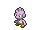
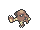
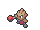
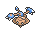

<!-- This file is generated by tools/generate_site.py. Edit the generator, not this file. -->

# #236 Tyrogue

{ .sprite-lg loading=lazy }

**Scuffle Pokémon**

Fighting

[:material-arrow-left: #235 Smeargle](235.md) · [Pokédex](index.md) · [#237 Hitmontop :material-arrow-right:](237.md)

!!! note "No documented changes"

    Drayano's documentation lists no stat, type, ability, evolution or held item changes for this Pokémon. Its level-up moves are listed below as they appear in the hack.

## Location

[Fiery Path](../wild/fiery_path.md)

### Wild encounters

| Area | Method | Level | Note |
| --- | --- | --- | --- |
| [Route 112 North](../wild/route_112_north.md) | Horde | 15 |  |

## Type defenses

| Damage taken | Attacking types |
| --- | --- |
| Resistant (×½) | Rock Bug Dark |
| Neutral (×1) | Normal Fighting Poison Ground Ghost Steel Fire Water Grass Electric Ice Dragon |
| Weak (×2) | Flying Psychic Fairy |

## Abilities

| Slot | Ability | Effect | Note |
| --- | --- | --- | --- |
| Ability 1 | **Guts** | Increases Attack to 1.5× with a major status ailment. |  |
| Ability 2 | **Steadfast** | Raises Speed one stage upon flinching. |  |
| Hidden | **Vital Spirit** | Prevents sleep. |  |

## Base stats

| Form | HP | Atk | Def | SpA | SpD | Spe | BST |
| --- | --- | --- | --- | --- | --- | --- | --- |
| { .sprite-sm loading=lazy } Normal | 35 | 35 | 35 | 35 | 35 | 35 | **210** |

## Training & breeding

| Property | Value |
| --- | --- |
| EV yield | 1 Atk |
| Catch rate | 75 |
| Base friendship | 70 |
| Base experience | 42 |
| Growth rate | medium |
| Egg groups | Undiscovered |
| Hatch counter | 25 |
| Gender ratio | 100% ♂ / 0% ♀ |
| Height / weight | 0.7 m / 21 kg |

## Evolution

- { .icon loading=lazy } **[Tyrogue](../pokemon/236.md)** → { .icon loading=lazy } [Hitmonlee](../pokemon/106.md): Lv. 20, Atk > Def
- { .icon loading=lazy } **[Tyrogue](../pokemon/236.md)** → { .icon loading=lazy } [Hitmonchan](../pokemon/107.md): Lv. 20, Def > Atk
- { .icon loading=lazy } **[Tyrogue](../pokemon/236.md)** → { .icon loading=lazy } [Hitmontop](../pokemon/237.md): Lv. 20, Atk = Def

## Wild held items

None.

## Level-up moves { data-search-exclude }

Moves marked &#42; are not normally learned by level up (they come from egg moves, TMs/HMs or tutors in the official games); moves marked &#42;&#42; cannot normally be learned by this Pokémon at all and are omitted from the legal-moves version of the hack.

| Lv. | Move | Type | Cat. | Power | Acc. | PP | Effect | Note |
| --- | --- | --- | --- | --- | --- | --- | --- | --- |
| 1 | Tackle | Normal | Physical | 50 | 100% | 35 | Inflicts regular damage with no additional effect. |  |
| 1 | Helping Hand | Normal | Status | — | — | 20 | Ally’s next move inflicts half more damage. |  |
| 1 | Fake Out | Normal | Physical | 40 | 100% | 10 | Can only be used as the first move after the user enters battle.  Causes the target to flinch. |  |
| 1 | Foresight | Normal | Status | — | — | 40 | Forces the target to have no Evade, and allows it to be hit by Normal and Fighting moves even if it’s a Ghost. |  |
| 5 | Mach Punch | Fighting | Physical | 40 | 100% | 30 | Inflicts regular damage with no additional effect. | &#42; |
| 15 | Pursuit | Dark | Physical | 40 | 100% | 20 | Has double power against, and can hit, Pokémon attempting to switch out. | &#42; |
| 25 | High Jump Kick | Fighting | Physical | 130 | 90% | 10 | If the user misses, it takes half the damage it would have inflicted in recoil. | &#42; |

## TM & HM moves { data-search-exclude }

| Machine | Move | Type | Cat. | Power | Acc. | PP | Effect |
| --- | --- | --- | --- | --- | --- | --- | --- |
| HM04 | [Strength](../changes/moves.md#strength) changed | Normal | Physical | 100 | 100% | 10 | Inflicts regular damage with no additional effect. |
| HM06 | [Rock Smash](../changes/moves.md#rock-smash) changed | Fighting | Physical | 65 | 100% | 15 | Has a chance to lower the target’s Defense by one stage. |
| TM06 | Toxic | Poison | Status | — | 90% | 10 | Badly poisons the target, inflicting more damage every turn. |
| TM08 | Bulk Up | Fighting | Status | — | — | 20 | Raises the user’s Attack and Defense by one stage. |
| TM10 | Hidden Power | Normal | Special | 60 | 100% | 15 | Power and type depend upon user’s IVs.  Power can range from 30 to 70. |
| TM100 | Confide | Normal | Status | — | — | 20 | Lowers the target’s Special Attack by one stage. |
| TM11 | Sunny Day | Fire | Status | — | — | 5 | Changes the weather to sunny for five turns. |
| TM17 | Protect | Normal | Status | — | — | 10 | Prevents any moves from hitting the user this turn. |
| TM18 | Rain Dance | Water | Status | — | — | 5 | Changes the weather to rain for five turns. |
| TM21 | Frustration | Normal | Physical | — | 100% | 20 | Power increases as happiness decreases, up to a maximum of 102. |
| TM26 | Earthquake | Ground | Physical | 100 | 100% | 10 | Inflicts regular damage and can hit Dig users. |
| TM27 | Return | Normal | Physical | — | 100% | 20 | Power increases with happiness, up to a maximum of 102. |
| TM31 | Brick Break | Fighting | Physical | 75 | 100% | 15 | Destroys Reflect and Light Screen. |
| TM32 | Double Team | Normal | Status | — | — | 15 | Raises the user’s evasion by one stage. |
| TM42 | Facade | Normal | Physical | 70 | 100% | 20 | Power doubles if user is burned, paralyzed, or poisoned. |
| TM44 | Rest | Psychic | Status | — | — | 5 | User sleeps for two turns, completely healing itself. |
| TM45 | Attract | Normal | Status | — | 100% | 15 | Target falls in love if it has the opposite gender, and has a 50% chance to refuse attacking the user. |
| TM46 | Thief | Dark | Physical | 60 | 100% | 25 | Takes the target’s item. |
| TM47 | Low Sweep | Fighting | Physical | 65 | 100% | 20 | Lowers the target’s Speed by one stage. |
| TM48 | Round | Normal | Special | 60 | 100% | 15 | Has double power if it’s used more than once per turn. |
| TM67 | Retaliate | Normal | Physical | 70 | 100% | 5 | Has double power if a friendly Pokémon fainted last turn. |
| TM78 | Bulldoze | Ground | Physical | 60 | 100% | 20 | Has a chance to lower the target’s Speed by one stage. |
| TM80 | Rock Slide | Rock | Physical | 75 | 90% | 10 | Has a chance to make the target flinch. |
| TM87 | Swagger | Normal | Status | — | 90% | 15 | Raises the target’s Attack by two stages and confuses the target. |
| TM88 | Sleep Talk | Normal | Status | — | — | 10 | Randomly uses one of the user’s other three moves.  Only works if the user is sleeping. |
| TM90 | Substitute | Normal | Status | — | — | 10 | Transfers 1/4 of the user’s max HP into a doll, protecting the user from further damage or status changes until it breaks. |
| TM94 | Secret Power | Normal | Physical | 70 | 100% | 20 | Has a chance to inflict a status effect which depends upon the terrain. |

## Move tutor moves { data-search-exclude }

| Move | Type | Cat. | Power | Acc. | PP | Effect |
| --- | --- | --- | --- | --- | --- | --- |
| Covet | Normal | Physical | 60 | 100% | 25 | Takes the target’s item. |
| Helping Hand | Normal | Status | — | — | 20 | Ally’s next move inflicts half more damage. |
| Low Kick | Fighting | Physical | — | 100% | 20 | Inflicts more damage to heavier targets, with a maximum of 120 power. |
| Role Play | Psychic | Status | — | — | 10 | Copies the target’s ability. |
| Snore | Normal | Special | 50 | 100% | 15 | Has a chance to make the target flinch.  Only works if the user is sleeping. |
| Uproar | Normal | Special | 90 | 100% | 10 | Forced to use this move for several turns.  Pokémon cannot fall asleep in that time. |

## Egg moves { data-search-exclude }

| Move | Type | Cat. | Power | Acc. | PP | Effect |
| --- | --- | --- | --- | --- | --- | --- |
| Bullet Punch | Steel | Physical | 40 | 100% | 30 | Inflicts regular damage with no additional effect. |
| Counter | Fighting | Physical | — | 100% | 20 | Inflicts twice the damage the user received from the last physical hit it took. |
| Endure | Normal | Status | — | — | 10 | Prevents the user’s HP from lowering below 1 this turn. |
| Feint | Normal | Physical | 30 | 100% | 10 | Hits through Protect and Detect. |
| Helping Hand | Normal | Status | — | — | 20 | Ally’s next move inflicts half more damage. |
| High Jump Kick | Fighting | Physical | 130 | 90% | 10 | If the user misses, it takes half the damage it would have inflicted in recoil. |
| Mach Punch | Fighting | Physical | 40 | 100% | 30 | Inflicts regular damage with no additional effect. |
| Mind Reader | Normal | Status | — | — | 5 | Ensures that the user’s next move will hit the target. |
| Pursuit | Dark | Physical | 40 | 100% | 20 | Has double power against, and can hit, Pokémon attempting to switch out. |
| Rapid Spin | Normal | Physical | 20 | 100% | 40 | Frees the user from binding moves, removes Leech Seed, and blows away Spikes. |
| Vacuum Wave | Fighting | Special | 40 | 100% | 30 | Inflicts regular damage with no additional effect. |

??? note "Trainers using Tyrogue (1)"

    | Area | Trainer | Level |
    | --- | --- | --- |
    | [Dewford Gym](../trainers/dewford_gym.md#trainers) | Black Belt Hideki | Lv. 17 |

---

[:material-arrow-left: #235 Smeargle](235.md) · [#237 Hitmontop :material-arrow-right:](237.md)
