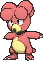
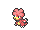
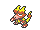
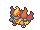

<!-- This file is generated by tools/generate_site.py. Edit the generator, not this file. -->

# #240 Magby

{ .sprite-lg loading=lazy }

**Live Coal Pokémon**

Fire

[:material-arrow-left: #239 Elekid](239.md) · [Pokédex](index.md) · [#241 Miltank :material-arrow-right:](241.md)

!!! info "Changes in Rising Ruby / Sinking Sapphire"

    - **Ability 2:** **Vital Spirit** 

## Location

[Route 112 North](../wild/route_112_north.md)

### Wild encounters

| Area | Method | Level | Note |
| --- | --- | --- | --- |
| [Route 112 North](../wild/route_112_north.md) | Grass | 24 |  |

## Type defenses

| Damage taken | Attacking types |
| --- | --- |
| Resistant (×½) | Bug Steel Fire Grass Ice Fairy |
| Neutral (×1) | Normal Fighting Flying Poison Ghost Electric Psychic Dragon Dark |
| Weak (×2) | Ground Rock Water |

## Abilities

| Slot | Ability | Effect | Note |
| --- | --- | --- | --- |
| Ability 1 | **Flame Body** | Has a 30% chance of burning attacking Pokémon on contact. |  |
| Ability 2 | **Vital Spirit** | Prevents sleep. | changed  |
| Hidden | **Vital Spirit** | Prevents sleep. |  |

## Base stats

| Form | HP | Atk | Def | SpA | SpD | Spe | BST |
| --- | --- | --- | --- | --- | --- | --- | --- |
| { .sprite-sm loading=lazy } Normal | 45 | 75 | 37 | 70 | 55 | 83 | **365** |

## Training & breeding

| Property | Value |
| --- | --- |
| EV yield | 1 Spe |
| Catch rate | 45 |
| Base friendship | 70 |
| Base experience | 73 |
| Growth rate | medium |
| Egg groups | Undiscovered |
| Hatch counter | 25 |
| Gender ratio | 75% ♂ / 25% ♀ |
| Height / weight | 0.7 m / 21.4 kg |

## Evolution

- { .icon loading=lazy } **[Magby](../pokemon/240.md)** → { .icon loading=lazy } [Magmar](../pokemon/126.md): Lv. 30
- { .icon loading=lazy } [Magmar](../pokemon/126.md) → { .icon loading=lazy } [Magmortar](../pokemon/467.md): Magmarizer changed <small>(vanilla: Trade holding Magmarizer)</small>

## Wild held items

| Item | Chance | Note |
| --- | --- | --- |
| { .item loading=lazy } Magmarizer | 5% |  |

## Level-up moves { data-search-exclude }

Moves marked &#42; are not normally learned by level up (they come from egg moves, TMs/HMs or tutors in the official games); moves marked &#42;&#42; cannot normally be learned by this Pokémon at all and are omitted from the legal-moves version of the hack.

| Lv. | Move | Type | Cat. | Power | Acc. | PP | Effect | Note |
| --- | --- | --- | --- | --- | --- | --- | --- | --- |
| 1 | Smog | Poison | Special | 30 | 70% | 20 | Has a chance to poison the target. |  |
| 1 | Leer | Normal | Status | — | 100% | 30 | Lowers the target’s Defense by one stage. |  |
| 5 | Ember | Fire | Special | 40 | 100% | 25 | Has a chance to burn the target. |  |
| 8 | Smokescreen | Normal | Status | — | 100% | 20 | Lowers the target’s accuracy by one stage. |  |
| 11 | Feint Attack | Dark | Physical | 60 | — | 20 | Never misses. |  |
| 14 | Fire Spin | Fire | Special | 35 | 85% | 15 | Prevents the target from fleeing and inflicts damage for 2-5 turns. |  |
| 17 | Clear Smog | Poison | Special | 50 | — | 15 | Removes all of the target’s stat modifiers. |  |
| 20 | Flame Burst | Fire | Special | 70 | 100% | 15 | Deals splash damage to Pokémon next to the target. |  |
| 23 | Confuse Ray | Ghost | Status | — | 100% | 10 | Confuses the target. |  |
| 26 | Brick Break | Fighting | Physical | 75 | 100% | 15 | Destroys Reflect and Light Screen. | &#42; |
| 29 | Fire Punch | Fire | Physical | 75 | 100% | 15 | Has a chance to burn the target. |  |
| 32 | Lava Plume | Fire | Special | 80 | 100% | 15 | Has a chance to burn the target. |  |
| 35 | Sunny Day | Fire | Status | — | — | 5 | Changes the weather to sunny for five turns. |  |
| 38 | Flamethrower | Fire | Special | 90 | 100% | 15 | Has a chance to burn the target. |  |
| 41 | Cross Chop | Fighting | Physical | 100 | 80% | 5 | Has an increased chance for a critical hit. | &#42; |
| 44 | Flare Blitz | Fire | Physical | 120 | 100% | 15 | User takes 1/3 the damage inflicted in recoil.  Has a chance to burn the target. | &#42; |
| 47 | Fire Blast | Fire | Special | 110 | 85% | 5 | Has a chance to burn the target. |  |

## TM & HM moves { data-search-exclude }

| Machine | Move | Type | Cat. | Power | Acc. | PP | Effect |
| --- | --- | --- | --- | --- | --- | --- | --- |
| HM06 | [Rock Smash](../changes/moves.md#rock-smash) changed | Fighting | Physical | 65 | 100% | 15 | Has a chance to lower the target’s Defense by one stage. |
| TM06 | Toxic | Poison | Status | — | 90% | 10 | Badly poisons the target, inflicting more damage every turn. |
| TM10 | Hidden Power | Normal | Special | 60 | 100% | 15 | Power and type depend upon user’s IVs.  Power can range from 30 to 70. |
| TM100 | Confide | Normal | Status | — | — | 20 | Lowers the target’s Special Attack by one stage. |
| TM11 | Sunny Day | Fire | Status | — | — | 5 | Changes the weather to sunny for five turns. |
| TM17 | Protect | Normal | Status | — | — | 10 | Prevents any moves from hitting the user this turn. |
| TM21 | Frustration | Normal | Physical | — | 100% | 20 | Power increases as happiness decreases, up to a maximum of 102. |
| TM27 | Return | Normal | Physical | — | 100% | 20 | Power increases with happiness, up to a maximum of 102. |
| TM29 | Psychic | Psychic | Special | 90 | 100% | 10 | Has a chance to lower the target’s Special Defense by one stage. |
| TM31 | Brick Break | Fighting | Physical | 75 | 100% | 15 | Destroys Reflect and Light Screen. |
| TM32 | Double Team | Normal | Status | — | — | 15 | Raises the user’s evasion by one stage. |
| TM35 | Flamethrower | Fire | Special | 90 | 100% | 15 | Has a chance to burn the target. |
| TM38 | Fire Blast | Fire | Special | 110 | 85% | 5 | Has a chance to burn the target. |
| TM42 | Facade | Normal | Physical | 70 | 100% | 20 | Power doubles if user is burned, paralyzed, or poisoned. |
| TM43 | Flame Charge | Fire | Physical | 50 | 100% | 20 | Inflicts regular damage.  Raises the user’s Speed by one stage. |
| TM44 | Rest | Psychic | Status | — | — | 5 | User sleeps for two turns, completely healing itself. |
| TM45 | Attract | Normal | Status | — | 100% | 15 | Target falls in love if it has the opposite gender, and has a 50% chance to refuse attacking the user. |
| TM46 | Thief | Dark | Physical | 60 | 100% | 25 | Takes the target’s item. |
| TM48 | Round | Normal | Special | 60 | 100% | 15 | Has double power if it’s used more than once per turn. |
| TM50 | Overheat | Fire | Special | 130 | 90% | 5 | Lowers the user’s Special Attack by two stages after inflicting damage. |
| TM56 | Fling | Dark | Physical | — | 100% | 10 | Throws held item at the target; power depends on the item. |
| TM59 | Incinerate | Fire | Special | 60 | 100% | 15 | Destroys the target’s held berry. |
| TM61 | Will-O-Wisp | Fire | Status | — | 85% | 15 | Burns the target. |
| TM87 | Swagger | Normal | Status | — | 90% | 15 | Raises the target’s Attack by two stages and confuses the target. |
| TM88 | Sleep Talk | Normal | Status | — | — | 10 | Randomly uses one of the user’s other three moves.  Only works if the user is sleeping. |
| TM90 | Substitute | Normal | Status | — | — | 10 | Transfers 1/4 of the user’s max HP into a doll, protecting the user from further damage or status changes until it breaks. |
| TM94 | Secret Power | Normal | Physical | 70 | 100% | 20 | Has a chance to inflict a status effect which depends upon the terrain. |
| TM98 | Power-Up Punch | Fighting | Physical | 40 | 100% | 20 | Raises the user’s Attack by one stage after inflicting damage. |

## Move tutor moves { data-search-exclude }

| Move | Type | Cat. | Power | Acc. | PP | Effect |
| --- | --- | --- | --- | --- | --- | --- |
| Covet | Normal | Physical | 60 | 100% | 25 | Takes the target’s item. |
| Dual Chop | Dragon | Physical | 40 | 90% | 15 | Hits twice in one turn. |
| Fire Punch | Fire | Physical | 75 | 100% | 15 | Has a chance to burn the target. |
| Focus Punch | Fighting | Physical | 150 | 100% | 20 | If the user takes damage before attacking, the attack is canceled. |
| Heat Wave | Fire | Special | 95 | 90% | 10 | Has a chance to burn the target. |
| Helping Hand | Normal | Status | — | — | 20 | Ally’s next move inflicts half more damage. |
| Iron Tail | Steel | Physical | 100 | 75% | 15 | Has a chance to lower the target’s Defense by one stage. |
| Snore | Normal | Special | 50 | 100% | 15 | Has a chance to make the target flinch.  Only works if the user is sleeping. |
| Thunder Punch | Electric | Physical | 75 | 100% | 15 | Has a chance to paralyze the target. |
| Uproar | Normal | Special | 90 | 100% | 10 | Forced to use this move for several turns.  Pokémon cannot fall asleep in that time. |

## Egg moves { data-search-exclude }

| Move | Type | Cat. | Power | Acc. | PP | Effect |
| --- | --- | --- | --- | --- | --- | --- |
| Barrier | Psychic | Status | — | — | 20 | Raises the user’s Defense by two stages. |
| Belch | Poison | Special | 120 | 90% | 10 | Can only be used after the user has eaten a berry. |
| Belly Drum | Normal | Status | — | — | 10 | User pays half its max HP to max out its Attack. |
| Cross Chop | Fighting | Physical | 100 | 80% | 5 | Has an increased chance for a critical hit. |
| Dynamic Punch | Fighting | Physical | 100 | 50% | 5 | Has a chance to confuse the target. |
| Flare Blitz | Fire | Physical | 120 | 100% | 15 | User takes 1/3 the damage inflicted in recoil.  Has a chance to burn the target. |
| Focus Energy | Normal | Status | — | — | 30 | Increases the user’s chance to score a critical hit. |
| Iron Tail | Steel | Physical | 100 | 75% | 15 | Has a chance to lower the target’s Defense by one stage. |
| Karate Chop | Fighting | Physical | 50 | 100% | 25 | Has an increased chance for a critical hit. |
| Mach Punch | Fighting | Physical | 40 | 100% | 30 | Inflicts regular damage with no additional effect. |
| Mega Punch | Normal | Physical | 80 | 85% | 20 | Inflicts regular damage with no additional effect. |
| Power Swap | Psychic | Status | — | — | 10 | User swaps Attack and Special Attack changes with the target. |
| Screech | Normal | Status | — | 85% | 40 | Lowers the target’s Defense by two stages. |
| Thunder Punch | Electric | Physical | 75 | 100% | 15 | Has a chance to paralyze the target. |

??? note "Trainers using Magby (1)"

    | Area | Trainer | Level |
    | --- | --- | --- |
    | [Route 117](../trainers/route_117.md#trainers) | PKMN Breeder Isaac | Lv. 19 |

---

[:material-arrow-left: #239 Elekid](239.md) · [#241 Miltank :material-arrow-right:](241.md)
