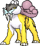

<!-- This file is generated by tools/generate_site.py. Edit the generator, not this file. -->

# #243 Raikou

{ .sprite-lg loading=lazy }

**Thunder Pokémon**

Electric

[:material-arrow-left: #242 Blissey](242.md) · [Pokédex](index.md) · [#244 Entei :material-arrow-right:](244.md)

!!! info "Changes in Rising Ruby / Sinking Sapphire"

    - **Ability 2:** **Volt Absorb** 

## Location

[Trackless Forest](../changes/gifts_and_statics.md), [Mirage Forest](../wild/mirage_forest_any.md)

### Wild encounters

| Area | Method | Level | Note |
| --- | --- | --- | --- |
| [Mirage Forest (Any)](../wild/mirage_forest_any.md) | Grass | 65 - 70 |  |

### Gift & static encounters

| Category | Encounter | Changes |
| --- | --- | --- |
| Static Encounter Changes | Trackless Forest, Raikou | Level increased to 65 |

See [Gifts & Static Encounters](../changes/gifts_and_statics.md) for the full list.

## Type defenses

| Damage taken | Attacking types |
| --- | --- |
| Resistant (×½) | Flying Steel Electric |
| Neutral (×1) | Normal Fighting Poison Rock Bug Ghost Fire Water Grass Psychic Ice Dragon Dark Fairy |
| Weak (×2) | Ground |

## Abilities

| Slot | Ability | Effect | Note |
| --- | --- | --- | --- |
| Ability 1 | **Pressure** | Increases the PP cost of moves targetting the Pokémon by one. |  |
| Ability 2 | **Volt Absorb** | Absorbs Electric moves, healing for 1/4 max HP. | changed  |
| Hidden | **Volt Absorb** | Absorbs Electric moves, healing for 1/4 max HP. |  |

## Base stats

| Form | HP | Atk | Def | SpA | SpD | Spe | BST |
| --- | --- | --- | --- | --- | --- | --- | --- |
| { .sprite-sm loading=lazy } Normal | 90 | 85 | 75 | 115 | 100 | 115 | **580** |

## Training & breeding

| Property | Value |
| --- | --- |
| EV yield | 1 SpA, 2 Spe |
| Catch rate | 3 |
| Base friendship | 35 |
| Base experience | 261 |
| Growth rate | slow |
| Egg groups | Undiscovered |
| Hatch counter | 80 |
| Gender ratio | Genderless |
| Height / weight | 1.9 m / 178 kg |

## Evolution

This Pokémon does not evolve.

## Wild held items

None.

## Level-up moves { data-search-exclude }

Moves marked &#42; are not normally learned by level up (they come from egg moves, TMs/HMs or tutors in the official games); moves marked &#42;&#42; cannot normally be learned by this Pokémon at all and are omitted from the legal-moves version of the hack.

| Lv. | Move | Type | Cat. | Power | Acc. | PP | Effect | Note |
| --- | --- | --- | --- | --- | --- | --- | --- | --- |
| 1 | Bite | Dark | Physical | 60 | 100% | 25 | Has a chance to make the target flinch. |  |
| 1 | Leer | Normal | Status | — | 100% | 30 | Lowers the target’s Defense by one stage. |  |
| 5 | Thunder Shock | Electric | Special | 40 | 100% | 30 | Has a chance to paralyze the target. |  |
| 10 | Roar | Normal | Status | — | — | 20 | Immediately ends wild battles.  Forces trainers to switch Pokémon. |  |
| 15 | Quick Attack | Normal | Physical | 40 | 100% | 30 | Inflicts regular damage with no additional effect. |  |
| 20 | Spark | Electric | Physical | 65 | 100% | 20 | Has a chance to paralyze the target. |  |
| 25 | Reflect | Psychic | Status | — | — | 20 | Reduces damage from physical attacks by half. |  |
| 30 | Crunch | Dark | Physical | 80 | 100% | 15 | Has a chance to lower the target’s Defense by one stage. |  |
| 35 | Thunder Fang | Electric | Physical | 65 | 95% | 15 | Has a chance to paralyze the target and a chance to make the target flinch. |  |
| 40 | Discharge | Electric | Special | 80 | 100% | 15 | Has a chance to paralyze the target. |  |
| 45 | Extrasensory | Psychic | Special | 80 | 100% | 20 | Has a chance to make the target flinch. |  |
| 50 | Rain Dance | Water | Status | — | — | 5 | Changes the weather to rain for five turns. |  |
| 55 | Aura Sphere | Fighting | Special | 80 | — | 20 | Never misses. | &#42; |
| 60 | Calm Mind | Psychic | Status | — | — | 20 | Raises the user’s Special Attack and Special Defense by one stage. |  |
| 65 | Thunder | Electric | Special | 110 | 70% | 10 | Has a chance to paralyze the target. |  |

## TM & HM moves { data-search-exclude }

| Machine | Move | Type | Cat. | Power | Acc. | PP | Effect |
| --- | --- | --- | --- | --- | --- | --- | --- |
| HM01 | [Cut](../changes/moves.md#cut) changed | Grass | Physical | 70 | 100% | 15 | High Critical Rate. High Critical Rate |
| HM04 | [Strength](../changes/moves.md#strength) changed | Normal | Physical | 100 | 100% | 10 | Inflicts regular damage with no additional effect. |
| HM06 | [Rock Smash](../changes/moves.md#rock-smash) changed | Fighting | Physical | 65 | 100% | 15 | Has a chance to lower the target’s Defense by one stage. |
| TM04 | Calm Mind | Psychic | Status | — | — | 20 | Raises the user’s Special Attack and Special Defense by one stage. |
| TM05 | Roar | Normal | Status | — | — | 20 | Immediately ends wild battles.  Forces trainers to switch Pokémon. |
| TM06 | Toxic | Poison | Status | — | 90% | 10 | Badly poisons the target, inflicting more damage every turn. |
| TM10 | Hidden Power | Normal | Special | 60 | 100% | 15 | Power and type depend upon user’s IVs.  Power can range from 30 to 70. |
| TM100 | Confide | Normal | Status | — | — | 20 | Lowers the target’s Special Attack by one stage. |
| TM11 | Sunny Day | Fire | Status | — | — | 5 | Changes the weather to sunny for five turns. |
| TM15 | Hyper Beam | Normal | Special | 150 | 90% | 5 | User foregoes its next turn to recharge. |
| TM16 | Light Screen | Psychic | Status | — | — | 30 | Reduces damage from special attacks by 50% for five turns. |
| TM17 | Protect | Normal | Status | — | — | 10 | Prevents any moves from hitting the user this turn. |
| TM18 | Rain Dance | Water | Status | — | — | 5 | Changes the weather to rain for five turns. |
| TM21 | Frustration | Normal | Physical | — | 100% | 20 | Power increases as happiness decreases, up to a maximum of 102. |
| TM24 | Thunderbolt | Electric | Special | 90 | 100% | 15 | Has a chance to paralyze the target. |
| TM25 | Thunder | Electric | Special | 110 | 70% | 10 | Has a chance to paralyze the target. |
| TM27 | Return | Normal | Physical | — | 100% | 20 | Power increases with happiness, up to a maximum of 102. |
| TM28 | Dig | Ground | Physical | 80 | 100% | 10 | User digs underground, dodging all attacks, and hits next turn. |
| TM30 | Shadow Ball | Ghost | Special | 80 | 100% | 15 | Has a chance to lower the target’s Special Defense by one stage. |
| TM32 | Double Team | Normal | Status | — | — | 15 | Raises the user’s evasion by one stage. |
| TM33 | Reflect | Psychic | Status | — | — | 20 | Reduces damage from physical attacks by half. |
| TM37 | Sandstorm | Rock | Status | — | — | 10 | Changes the weather to a sandstorm for five turns. |
| TM42 | Facade | Normal | Physical | 70 | 100% | 20 | Power doubles if user is burned, paralyzed, or poisoned. |
| TM44 | Rest | Psychic | Status | — | — | 5 | User sleeps for two turns, completely healing itself. |
| TM48 | Round | Normal | Special | 60 | 100% | 15 | Has double power if it’s used more than once per turn. |
| TM57 | Charge Beam | Electric | Special | 50 | 90% | 10 | Has a chance to raise the user’s Special Attack by one stage. |
| TM60 | Quash | Dark | Status | — | 100% | 15 | Makes the target act last this turn. |
| TM68 | Giga Impact | Normal | Physical | 150 | 90% | 5 | User foregoes its next turn to recharge. |
| TM70 | Flash | Normal | Status | — | 100% | 20 | Lowers the target’s accuracy by one stage. |
| TM72 | Volt Switch | Electric | Special | 70 | 100% | 20 | User must switch out after attacking. |
| TM73 | Thunder Wave | Electric | Status | — | 100% | 20 | Paralyzes the target. |
| TM77 | Psych Up | Normal | Status | — | — | 10 | Discards the user’s stat changes and copies the target’s. |
| TM78 | Bulldoze | Ground | Physical | 60 | 100% | 20 | Has a chance to lower the target’s Speed by one stage. |
| TM87 | Swagger | Normal | Status | — | 90% | 15 | Raises the target’s Attack by two stages and confuses the target. |
| TM88 | Sleep Talk | Normal | Status | — | — | 10 | Randomly uses one of the user’s other three moves.  Only works if the user is sleeping. |
| TM90 | Substitute | Normal | Status | — | — | 10 | Transfers 1/4 of the user’s max HP into a doll, protecting the user from further damage or status changes until it breaks. |
| TM93 | Wild Charge | Electric | Physical | 90 | 100% | 15 | User receives 1/4 the damage it inflicts in recoil. |
| TM94 | Secret Power | Normal | Physical | 70 | 100% | 20 | Has a chance to inflict a status effect which depends upon the terrain. |
| TM95 | Snarl | Dark | Special | 55 | 95% | 15 | Has a chance to lower the target’s Special Attack by one stage. |

## Move tutor moves { data-search-exclude }

| Move | Type | Cat. | Power | Acc. | PP | Effect |
| --- | --- | --- | --- | --- | --- | --- |
| Iron Head | Steel | Physical | 80 | 100% | 15 | Has a chance to make the target flinch. |
| Iron Tail | Steel | Physical | 100 | 75% | 15 | Has a chance to lower the target’s Defense by one stage. |
| Magnet Rise | Electric | Status | — | — | 10 | User is immune to Ground moves and effects for five turns. |
| Shock Wave | Electric | Special | 60 | — | 20 | Never misses. |
| Signal Beam | Bug | Special | 75 | 100% | 15 | Has a chance to confuse the target. |
| Snore | Normal | Special | 50 | 100% | 15 | Has a chance to make the target flinch.  Only works if the user is sleeping. |

## Egg moves { data-search-exclude }

No egg moves.

---

[:material-arrow-left: #242 Blissey](242.md) · [#244 Entei :material-arrow-right:](244.md)
