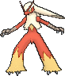
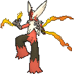

<!-- This file is generated by tools/generate_site.py. Edit the generator, not this file. -->

# #257 Blaziken

{ .sprite-lg loading=lazy }

**Blaze Pokémon**

Fire Fighting

[:material-arrow-left: #256 Combusken](256.md) · [Pokédex](index.md) · [#258 Mudkip :material-arrow-right:](258.md)

!!! info "Changes in Rising Ruby / Sinking Sapphire"

    - **Ability 2:** **Speed Boost** 

## Location

Evolve { .icon loading=lazy } [Combusken](../pokemon/256.md) (Lv. 36)

## Type defenses

| Damage taken | Attacking types |
| --- | --- |
| Very resistant (×¼) | Bug |
| Resistant (×½) | Steel Fire Grass Ice Dark |
| Neutral (×1) | Normal Fighting Poison Rock Ghost Electric Dragon Fairy |
| Weak (×2) | Flying Ground Water Psychic |

## Abilities

| Slot | Ability | Effect | Note |
| --- | --- | --- | --- |
| Ability 1 | **Blaze** | Strengthens Fire moves to inflict 1.5× damage at 1/3 max HP or less. |  |
| Ability 2 | **Speed Boost** | Raises Speed one stage after each turn. | changed  |
| Hidden | **Speed Boost** | Raises Speed one stage after each turn. |  |

## Base stats

| Form | HP | Atk | Def | SpA | SpD | Spe | BST |
| --- | --- | --- | --- | --- | --- | --- | --- |
| { .sprite-sm loading=lazy } Normal | 80 | 120 | 70 | 110 | 70 | 80 | **530** |
| { .sprite-sm loading=lazy } Mega Blaziken | 80 | 160 | 80 | 130 | 80 | 100 | **630** |

## Training & breeding

| Property | Value |
| --- | --- |
| EV yield | 3 Atk |
| Catch rate | 45 |
| Base friendship | 70 |
| Base experience | 239 |
| Growth rate | medium slow |
| Egg groups | Field |
| Hatch counter | 20 |
| Gender ratio | 87.5% ♂ / 12.5% ♀ |
| Height / weight | 1.9 m / 52 kg |

## Evolution

- { .icon loading=lazy } [Torchic](../pokemon/255.md) → { .icon loading=lazy } [Combusken](../pokemon/256.md): Lv. 16
- { .icon loading=lazy } [Combusken](../pokemon/256.md) → { .icon loading=lazy } **[Blaziken](../pokemon/257.md)**: Lv. 36
- { .sprite-sm loading=lazy } **Mega Blaziken**: Mega Evolves by holding the { .item loading=lazy } Blazikenite

## Wild held items

None.

## Level-up moves { data-search-exclude }

Moves marked &#42; are not normally learned by level up (they come from egg moves, TMs/HMs or tutors in the official games); moves marked &#42;&#42; cannot normally be learned by this Pokémon at all and are omitted from the legal-moves version of the hack.

| Lv. | Move | Type | Cat. | Power | Acc. | PP | Effect | Note |
| --- | --- | --- | --- | --- | --- | --- | --- | --- |
| 1 | Flare Blitz | Fire | Physical | 120 | 100% | 15 | User takes 1/3 the damage inflicted in recoil.  Has a chance to burn the target. |  |
| 1 | Fire Punch | Fire | Physical | 75 | 100% | 15 | Has a chance to burn the target. |  |
| 1 | Thunder Punch | Electric | Physical | 75 | 100% | 15 | Has a chance to paralyze the target. |  |
| 1 | High Jump Kick | Fighting | Physical | 130 | 90% | 10 | If the user misses, it takes half the damage it would have inflicted in recoil. |  |
| 3 | Growl | Normal | Status | — | 100% | 40 | Lowers the target’s Attack by one stage. |  |
| 5 | Ember | Fire | Special | 40 | 100% | 25 | Has a chance to burn the target. |  |
| 7 | Sand Attack | Ground | Status | — | 100% | 15 | Lowers the target’s accuracy by one stage. |  |
| 9 | Peck | Flying | Physical | 35 | 100% | 35 | Inflicts regular damage with no additional effect. |  |
| 11 | Fire Spin | Fire | Special | 35 | 85% | 15 | Prevents the target from fleeing and inflicts damage for 2-5 turns. |  |
| 13 | Feather Dance | Flying | Status | — | 100% | 15 | Lowers the target’s Attack by two stages. | &#42; |
| 15 | Flame Charge | Fire | Physical | 50 | 100% | 20 | Inflicts regular damage.  Raises the user’s Speed by one stage. |  |
| 16 | Double Kick | Fighting | Physical | 30 | 100% | 30 | Hits twice in one turn. |  |
| 18 | Night Slash | Dark | Physical | 70 | 100% | 15 | Has an increased chance for a critical hit. | &#42; |
| 21 | Quick Attack | Normal | Physical | 40 | 100% | 30 | Inflicts regular damage with no additional effect. |  |
| 24 | Flame Burst | Fire | Special | 70 | 100% | 15 | Deals splash damage to Pokémon next to the target. | &#42; |
| 27 | Low Kick | Fighting | Physical | — | 100% | 20 | Inflicts more damage to heavier targets, with a maximum of 120 power. | &#42; |
| 30 | Bulk Up | Fighting | Status | — | — | 20 | Raises the user’s Attack and Defense by one stage. |  |
| 33 | Focus Energy | Normal | Status | — | — | 30 | Increases the user’s chance to score a critical hit. |  |
| 36 | Blaze Kick | Fire | Physical | 85 | 90% | 10 | Has an increased chance for a critical hit and a chance to burn the target. |  |
| 37 | Slash | Normal | Physical | 70 | 100% | 20 | Has an increased chance for a critical hit. |  |
| 41 | Bounce | Flying | Physical | 85 | 85% | 5 | User bounces high into the air, dodging all attacks, and hits next turn. | &#42; |
| 45 | Flamethrower | Fire | Special | 90 | 100% | 15 | Has a chance to burn the target. | &#42; |
| 49 | Brave Bird | Flying | Physical | 120 | 100% | 15 | User receives 1/3 the damage inflicted in recoil. |  |
| 53 | Sky Uppercut | Fighting | Physical | 85 | 90% | 15 | Inflicts regular damage and can hit Bounce and Fly users. |  |
| 57 | Flare Blitz | Fire | Physical | 120 | 100% | 15 | User takes 1/3 the damage inflicted in recoil.  Has a chance to burn the target. |  |

## TM & HM moves { data-search-exclude }

| Machine | Move | Type | Cat. | Power | Acc. | PP | Effect |
| --- | --- | --- | --- | --- | --- | --- | --- |
| HM01 | [Cut](../changes/moves.md#cut) changed | Grass | Physical | 70 | 100% | 15 | High Critical Rate. High Critical Rate |
| HM04 | [Strength](../changes/moves.md#strength) changed | Normal | Physical | 100 | 100% | 10 | Inflicts regular damage with no additional effect. |
| HM06 | [Rock Smash](../changes/moves.md#rock-smash) changed | Fighting | Physical | 65 | 100% | 15 | Has a chance to lower the target’s Defense by one stage. |
| TM01 | Hone Claws | Dark | Status | — | — | 15 | Raises the user’s Attack and accuracy by one stage. |
| TM05 | Roar | Normal | Status | — | — | 20 | Immediately ends wild battles.  Forces trainers to switch Pokémon. |
| TM06 | Toxic | Poison | Status | — | 90% | 10 | Badly poisons the target, inflicting more damage every turn. |
| TM08 | Bulk Up | Fighting | Status | — | — | 20 | Raises the user’s Attack and Defense by one stage. |
| TM10 | Hidden Power | Normal | Special | 60 | 100% | 15 | Power and type depend upon user’s IVs.  Power can range from 30 to 70. |
| TM100 | Confide | Normal | Status | — | — | 20 | Lowers the target’s Special Attack by one stage. |
| TM11 | Sunny Day | Fire | Status | — | — | 5 | Changes the weather to sunny for five turns. |
| TM15 | Hyper Beam | Normal | Special | 150 | 90% | 5 | User foregoes its next turn to recharge. |
| TM17 | Protect | Normal | Status | — | — | 10 | Prevents any moves from hitting the user this turn. |
| TM21 | Frustration | Normal | Physical | — | 100% | 20 | Power increases as happiness decreases, up to a maximum of 102. |
| TM22 | Solar Beam | Grass | Special | 120 | 100% | 10 | Requires a turn to charge before attacking. |
| TM26 | Earthquake | Ground | Physical | 100 | 100% | 10 | Inflicts regular damage and can hit Dig users. |
| TM27 | Return | Normal | Physical | — | 100% | 20 | Power increases with happiness, up to a maximum of 102. |
| TM28 | Dig | Ground | Physical | 80 | 100% | 10 | User digs underground, dodging all attacks, and hits next turn. |
| TM31 | Brick Break | Fighting | Physical | 75 | 100% | 15 | Destroys Reflect and Light Screen. |
| TM32 | Double Team | Normal | Status | — | — | 15 | Raises the user’s evasion by one stage. |
| TM35 | Flamethrower | Fire | Special | 90 | 100% | 15 | Has a chance to burn the target. |
| TM38 | Fire Blast | Fire | Special | 110 | 85% | 5 | Has a chance to burn the target. |
| TM39 | Rock Tomb | Rock | Physical | 60 | 95% | 15 | Has a chance to lower the target’s Speed by one stage. |
| TM40 | Aerial Ace | Flying | Physical | 60 | — | 20 | Never misses. |
| TM42 | Facade | Normal | Physical | 70 | 100% | 20 | Power doubles if user is burned, paralyzed, or poisoned. |
| TM43 | Flame Charge | Fire | Physical | 50 | 100% | 20 | Inflicts regular damage.  Raises the user’s Speed by one stage. |
| TM44 | Rest | Psychic | Status | — | — | 5 | User sleeps for two turns, completely healing itself. |
| TM45 | Attract | Normal | Status | — | 100% | 15 | Target falls in love if it has the opposite gender, and has a 50% chance to refuse attacking the user. |
| TM47 | Low Sweep | Fighting | Physical | 65 | 100% | 20 | Lowers the target’s Speed by one stage. |
| TM48 | Round | Normal | Special | 60 | 100% | 15 | Has double power if it’s used more than once per turn. |
| TM49 | Echoed Voice | Normal | Special | 40 | 100% | 15 | Power increases by 100% for each consecutive use by any friendly Pokémon, to a maximum of 200. |
| TM50 | Overheat | Fire | Special | 130 | 90% | 5 | Lowers the user’s Special Attack by two stages after inflicting damage. |
| TM52 | Focus Blast | Fighting | Special | 120 | 70% | 5 | Has a chance to lower the target’s Special Defense by one stage. |
| TM56 | Fling | Dark | Physical | — | 100% | 10 | Throws held item at the target; power depends on the item. |
| TM59 | Incinerate | Fire | Special | 60 | 100% | 15 | Destroys the target’s held berry. |
| TM61 | Will-O-Wisp | Fire | Status | — | 85% | 15 | Burns the target. |
| TM62 | Acrobatics | Flying | Physical | 55 | 100% | 15 | Has double power if the user has no held item. |
| TM65 | Shadow Claw | Ghost | Physical | 70 | 100% | 15 | Has an increased chance for a critical hit. |
| TM68 | Giga Impact | Normal | Physical | 150 | 90% | 5 | User foregoes its next turn to recharge. |
| TM71 | Stone Edge | Rock | Physical | 100 | 80% | 5 | Has an increased chance for a critical hit. |
| TM75 | Swords Dance | Normal | Status | — | — | 20 | Raises the user’s Attack by two stages. |
| TM78 | Bulldoze | Ground | Physical | 60 | 100% | 20 | Has a chance to lower the target’s Speed by one stage. |
| TM80 | Rock Slide | Rock | Physical | 75 | 90% | 10 | Has a chance to make the target flinch. |
| TM84 | Poison Jab | Poison | Physical | 80 | 100% | 20 | Has a chance to poison the target. |
| TM87 | Swagger | Normal | Status | — | 90% | 15 | Raises the target’s Attack by two stages and confuses the target. |
| TM88 | Sleep Talk | Normal | Status | — | — | 10 | Randomly uses one of the user’s other three moves.  Only works if the user is sleeping. |
| TM90 | Substitute | Normal | Status | — | — | 10 | Transfers 1/4 of the user’s max HP into a doll, protecting the user from further damage or status changes until it breaks. |
| TM94 | Secret Power | Normal | Physical | 70 | 100% | 20 | Has a chance to inflict a status effect which depends upon the terrain. |
| TM98 | Power-Up Punch | Fighting | Physical | 40 | 100% | 20 | Raises the user’s Attack by one stage after inflicting damage. |

## Move tutor moves { data-search-exclude }

| Move | Type | Cat. | Power | Acc. | PP | Effect |
| --- | --- | --- | --- | --- | --- | --- |
| Blast Burn | Fire | Special | 150 | 90% | 5 | User foregoes its next turn to recharge. |
| Bounce | Flying | Physical | 85 | 85% | 5 | User bounces high into the air, dodging all attacks, and hits next turn. |
| Dual Chop | Dragon | Physical | 40 | 90% | 15 | Hits twice in one turn. |
| [Fire Pledge](../changes/moves.md#fire-pledge) changed | Fire | Special | 85 | 100% | 10 | With Water Pledge, doubles the effect chance of friendly Pokémon’s moves for four turns. |
| Fire Punch | Fire | Physical | 75 | 100% | 15 | Has a chance to burn the target. |
| Focus Punch | Fighting | Physical | 150 | 100% | 20 | If the user takes damage before attacking, the attack is canceled. |
| Heat Wave | Fire | Special | 95 | 90% | 10 | Has a chance to burn the target. |
| Helping Hand | Normal | Status | — | — | 20 | Ally’s next move inflicts half more damage. |
| Knock Off | Dark | Physical | 65 | 100% | 20 | Target drops its held item. |
| Last Resort | Normal | Physical | 140 | 100% | 5 | Can only be used after all of the user’s other moves have been used. |
| Low Kick | Fighting | Physical | — | 100% | 20 | Inflicts more damage to heavier targets, with a maximum of 120 power. |
| Role Play | Psychic | Status | — | — | 10 | Copies the target’s ability. |
| Snore | Normal | Special | 50 | 100% | 15 | Has a chance to make the target flinch.  Only works if the user is sleeping. |
| Superpower | Fighting | Physical | 120 | 100% | 5 | Lowers the user’s Attack and Defense by one stage after inflicting damage. |
| Thunder Punch | Electric | Physical | 75 | 100% | 15 | Has a chance to paralyze the target. |

## Egg moves { data-search-exclude }

No egg moves.

??? note "Trainers using Blaziken (8)"

    | Area | Trainer | Level |
    | --- | --- | --- |
    | [Route 119 (Fortree)](../trainers/route_119_fortree.md#trainers) | PKMN Trainer Brendan | Lv. 49 |
    | [Route 119 (Fortree)](../trainers/route_119_fortree.md#trainers) | PKMN Trainer May | Lv. 49 |
    | [Route 123](../trainers/route_123.md#trainers) | Ace Trainer Clyde | Lv. 50 |
    | [Lilycove City](../trainers/lilycove_city.md#trainers) | PKMN Trainer Brendan | Lv. 55 |
    | [Lilycove City](../trainers/lilycove_city.md#trainers) | PKMN Trainer May | Lv. 55 |
    | [Victory Road B1F](../trainers/victory_road_b1f.md#trainers) | Expert Theodore | Lv. 65 |
    | [Credits](../trainers/credits.md#trainers) | PKMN Trainer Brendan | Lv. 77 |
    | [Credits](../trainers/credits.md#trainers) | PKMN Trainer May | Lv. 77 |

---

[:material-arrow-left: #256 Combusken](256.md) · [#258 Mudkip :material-arrow-right:](258.md)
