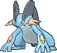
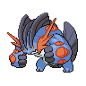

<!-- This file is generated by tools/generate_site.py. Edit the generator, not this file. -->

# #260 Swampert

{ .sprite-lg loading=lazy }

**Mud Fish Pokémon**

Water Ground

[:material-arrow-left: #259 Marshtomp](259.md) · [Pokédex](index.md) · [#261 Poochyena :material-arrow-right:](261.md)

!!! info "Changes in Rising Ruby / Sinking Sapphire"

    - **Ability 2:** **Damp** 

## Location

Evolve { .icon loading=lazy } [Marshtomp](../pokemon/259.md) (Lv. 36)

## Type defenses

| Damage taken | Attacking types |
| --- | --- |
| Immune (×0) | Electric |
| Resistant (×½) | Poison Rock Steel Fire |
| Neutral (×1) | Normal Fighting Flying Ground Bug Ghost Water Psychic Ice Dragon Dark Fairy |
| Very weak (×4) | Grass |

## Abilities

| Slot | Ability | Effect | Note |
| --- | --- | --- | --- |
| Ability 1 | **Torrent** | Strengthens Water moves to inflict 1.5× damage at 1/3 max HP or less. |  |
| Ability 2 | **Damp** | Prevents Self-Destruct, Explosion, and Aftermath from working while the Pokémon is in battle. | changed  |
| Hidden | **Damp** | Prevents Self-Destruct, Explosion, and Aftermath from working while the Pokémon is in battle. |  |

## Base stats

| Form | HP | Atk | Def | SpA | SpD | Spe | BST |
| --- | --- | --- | --- | --- | --- | --- | --- |
| { .sprite-sm loading=lazy } Normal | 100 | 110 | 90 | 85 | 90 | 60 | **535** |
| { .sprite-sm loading=lazy } Mega Swampert | 100 | 150 | 110 | 95 | 110 | 70 | **635** |

## Training & breeding

| Property | Value |
| --- | --- |
| EV yield | 3 Atk |
| Catch rate | 45 |
| Base friendship | 70 |
| Base experience | 241 |
| Growth rate | medium slow |
| Egg groups | Monster, Water 1 |
| Hatch counter | 20 |
| Gender ratio | 87.5% ♂ / 12.5% ♀ |
| Height / weight | 1.5 m / 81.9 kg |

## Evolution

- { .icon loading=lazy } [Mudkip](../pokemon/258.md) → { .icon loading=lazy } [Marshtomp](../pokemon/259.md): Lv. 16
- { .icon loading=lazy } [Marshtomp](../pokemon/259.md) → { .icon loading=lazy } **[Swampert](../pokemon/260.md)**: Lv. 36
- { .sprite-sm loading=lazy } **Mega Swampert**: Mega Evolves by holding the { .item loading=lazy } Swampertite

## Wild held items

None.

## Level-up moves { data-search-exclude }

Moves marked &#42; are not normally learned by level up (they come from egg moves, TMs/HMs or tutors in the official games); moves marked &#42;&#42; cannot normally be learned by this Pokémon at all and are omitted from the legal-moves version of the hack.

| Lv. | Move | Type | Cat. | Power | Acc. | PP | Effect | Note |
| --- | --- | --- | --- | --- | --- | --- | --- | --- |
| 1 | Hydro Pump | Water | Special | 110 | 80% | 5 | Inflicts regular damage with no additional effect. |  |
| 1 | Ice Punch | Ice | Physical | 75 | 100% | 15 | Has a chance to freeze the target. |  |
| 1 | Stone Edge | Rock | Physical | 100 | 80% | 5 | Has an increased chance for a critical hit. |  |
| 1 | Tackle | Normal | Physical | 50 | 100% | 35 | Inflicts regular damage with no additional effect. |  |
| 3 | Growl | Normal | Status | — | 100% | 40 | Lowers the target’s Attack by one stage. |  |
| 5 | Water Gun | Water | Special | 40 | 100% | 25 | Inflicts regular damage with no additional effect. |  |
| 7 | Mud-Slap | Ground | Special | 20 | 100% | 10 | Has a chance to lower the target’s accuracy by one stage. |  |
| 9 | Foresight | Normal | Status | — | — | 40 | Forces the target to have no Evade, and allows it to be hit by Normal and Fighting moves even if it’s a Ghost. |  |
| 11 | Bide | Normal | Physical | — | — | 10 | User waits for two turns, then hits back for twice the damage it took. |  |
| 13 | Rock Throw | Rock | Physical | 50 | 90% | 15 | Inflicts regular damage with no additional effect. | &#42; |
| 15 | Water Pulse | Water | Special | 60 | 100% | 20 | Has a chance to confuse the target. | &#42; |
| 16 | Mud Shot | Ground | Special | 55 | 95% | 15 | Has a chance to lower the target’s Speed by one stage. |  |
| 18 | Yawn | Normal | Status | — | — | 10 | Target sleeps at the end of the next turn. | &#42; |
| 21 | Mud Bomb | Ground | Special | 65 | 85% | 10 | Has a chance to lower the target’s accuracy by one stage. |  |
| 24 | Aqua Tail | Water | Physical | 90 | 90% | 10 | Inflicts regular damage with no additional effect. | &#42; |
| 27 | Rock Slide | Rock | Physical | 75 | 90% | 10 | Has a chance to make the target flinch. |  |
| 30 | Muddy Water | Water | Special | 90 | 85% | 10 | Has a chance to lower the target’s accuracy by one stage. |  |
| 33 | Sludge Wave | Poison | Special | 95 | 100% | 10 | Has a chance to poison the target. | &#42; |
| 36 | Hammer Arm | Fighting | Physical | 100 | 90% | 10 | Lowers user’s Speed by one stage. |  |
| 37 | Take Down | Normal | Physical | 90 | 85% | 20 | User receives 1/4 the damage it inflicts in recoil. |  |
| 41 | Earthquake | Ground | Physical | 100 | 100% | 10 | Inflicts regular damage and can hit Dig users. |  |
| 45 | Avalanche | Ice | Physical | 60 | 100% | 10 | Inflicts double damage if the user takes damage before attacking this turn. | &#42; |
| 49 | Endeavor | Normal | Physical | — | 100% | 5 | Lowers the target’s HP to equal the user’s. |  |
| 53 | Mirror Coat | Psychic | Special | — | 100% | 20 | Inflicts twice the damage the user received from the last special hit it took. | &#42; |
| 57 | Hydro Pump | Water | Special | 110 | 80% | 5 | Inflicts regular damage with no additional effect. | &#42; |

## TM & HM moves { data-search-exclude }

| Machine | Move | Type | Cat. | Power | Acc. | PP | Effect |
| --- | --- | --- | --- | --- | --- | --- | --- |
| HM03 | Surf | Water | Special | 90 | 100% | 15 | Inflicts regular damage and can hit Dive users. |
| HM04 | [Strength](../changes/moves.md#strength) changed | Normal | Physical | 100 | 100% | 10 | Inflicts regular damage with no additional effect. |
| HM05 | Waterfall | Water | Physical | 80 | 100% | 15 | Has a chance to make the target flinch. |
| HM06 | [Rock Smash](../changes/moves.md#rock-smash) changed | Fighting | Physical | 65 | 100% | 15 | Has a chance to lower the target’s Defense by one stage. |
| HM07 | Dive | Water | Physical | 80 | 100% | 10 | User dives underwater, dodging all attacks, and hits next turn. |
| TM05 | Roar | Normal | Status | — | — | 20 | Immediately ends wild battles.  Forces trainers to switch Pokémon. |
| TM06 | Toxic | Poison | Status | — | 90% | 10 | Badly poisons the target, inflicting more damage every turn. |
| TM07 | Hail | Ice | Status | — | — | 10 | Changes the weather to a hailstorm for five turns. |
| TM10 | Hidden Power | Normal | Special | 60 | 100% | 15 | Power and type depend upon user’s IVs.  Power can range from 30 to 70. |
| TM100 | Confide | Normal | Status | — | — | 20 | Lowers the target’s Special Attack by one stage. |
| TM13 | Ice Beam | Ice | Special | 90 | 100% | 10 | Has a chance to freeze the target. |
| TM14 | Blizzard | Ice | Special | 110 | 70% | 5 | Has a chance to freeze the target. |
| TM15 | Hyper Beam | Normal | Special | 150 | 90% | 5 | User foregoes its next turn to recharge. |
| TM17 | Protect | Normal | Status | — | — | 10 | Prevents any moves from hitting the user this turn. |
| TM18 | Rain Dance | Water | Status | — | — | 5 | Changes the weather to rain for five turns. |
| TM21 | Frustration | Normal | Physical | — | 100% | 20 | Power increases as happiness decreases, up to a maximum of 102. |
| TM26 | Earthquake | Ground | Physical | 100 | 100% | 10 | Inflicts regular damage and can hit Dig users. |
| TM27 | Return | Normal | Physical | — | 100% | 20 | Power increases with happiness, up to a maximum of 102. |
| TM28 | Dig | Ground | Physical | 80 | 100% | 10 | User digs underground, dodging all attacks, and hits next turn. |
| TM31 | Brick Break | Fighting | Physical | 75 | 100% | 15 | Destroys Reflect and Light Screen. |
| TM32 | Double Team | Normal | Status | — | — | 15 | Raises the user’s evasion by one stage. |
| TM34 | Sludge Wave | Poison | Special | 95 | 100% | 10 | Has a chance to poison the target. |
| TM39 | Rock Tomb | Rock | Physical | 60 | 95% | 15 | Has a chance to lower the target’s Speed by one stage. |
| TM42 | Facade | Normal | Physical | 70 | 100% | 20 | Power doubles if user is burned, paralyzed, or poisoned. |
| TM44 | Rest | Psychic | Status | — | — | 5 | User sleeps for two turns, completely healing itself. |
| TM45 | Attract | Normal | Status | — | 100% | 15 | Target falls in love if it has the opposite gender, and has a 50% chance to refuse attacking the user. |
| TM48 | Round | Normal | Special | 60 | 100% | 15 | Has double power if it’s used more than once per turn. |
| TM49 | Echoed Voice | Normal | Special | 40 | 100% | 15 | Power increases by 100% for each consecutive use by any friendly Pokémon, to a maximum of 200. |
| TM52 | Focus Blast | Fighting | Special | 120 | 70% | 5 | Has a chance to lower the target’s Special Defense by one stage. |
| TM55 | Scald | Water | Special | 80 | 100% | 15 | Has a chance to burn the target. |
| TM56 | Fling | Dark | Physical | — | 100% | 10 | Throws held item at the target; power depends on the item. |
| TM68 | Giga Impact | Normal | Physical | 150 | 90% | 5 | User foregoes its next turn to recharge. |
| TM71 | Stone Edge | Rock | Physical | 100 | 80% | 5 | Has an increased chance for a critical hit. |
| TM78 | Bulldoze | Ground | Physical | 60 | 100% | 20 | Has a chance to lower the target’s Speed by one stage. |
| TM80 | Rock Slide | Rock | Physical | 75 | 90% | 10 | Has a chance to make the target flinch. |
| TM87 | Swagger | Normal | Status | — | 90% | 15 | Raises the target’s Attack by two stages and confuses the target. |
| TM88 | Sleep Talk | Normal | Status | — | — | 10 | Randomly uses one of the user’s other three moves.  Only works if the user is sleeping. |
| TM90 | Substitute | Normal | Status | — | — | 10 | Transfers 1/4 of the user’s max HP into a doll, protecting the user from further damage or status changes until it breaks. |
| TM94 | Secret Power | Normal | Physical | 70 | 100% | 20 | Has a chance to inflict a status effect which depends upon the terrain. |
| TM98 | Power-Up Punch | Fighting | Physical | 40 | 100% | 20 | Raises the user’s Attack by one stage after inflicting damage. |

## Move tutor moves { data-search-exclude }

| Move | Type | Cat. | Power | Acc. | PP | Effect |
| --- | --- | --- | --- | --- | --- | --- |
| Aqua Tail | Water | Physical | 90 | 90% | 10 | Inflicts regular damage with no additional effect. |
| Earth Power | Ground | Special | 90 | 100% | 10 | Has a chance to lower the target’s Special Defense by one stage. |
| Endeavor | Normal | Physical | — | 100% | 5 | Lowers the target’s HP to equal the user’s. |
| Focus Punch | Fighting | Physical | 150 | 100% | 20 | If the user takes damage before attacking, the attack is canceled. |
| Hydro Cannon | Water | Special | 150 | 90% | 5 | User foregoes its next turn to recharge. |
| Ice Punch | Ice | Physical | 75 | 100% | 15 | Has a chance to freeze the target. |
| Icy Wind | Ice | Special | 55 | 95% | 15 | Has a chance to lower the target’s Speed by one stage. |
| Iron Tail | Steel | Physical | 100 | 75% | 15 | Has a chance to lower the target’s Defense by one stage. |
| Low Kick | Fighting | Physical | — | 100% | 20 | Inflicts more damage to heavier targets, with a maximum of 120 power. |
| Outrage | Dragon | Physical | 120 | 100% | 10 | Hits every turn for 2-3 turns, then confuses the user. |
| Snore | Normal | Special | 50 | 100% | 15 | Has a chance to make the target flinch.  Only works if the user is sleeping. |
| Stealth Rock | Rock | Status | — | — | 20 | Causes damage when opposing Pokémon switch in. |
| Superpower | Fighting | Physical | 120 | 100% | 5 | Lowers the user’s Attack and Defense by one stage after inflicting damage. |
| Uproar | Normal | Special | 90 | 100% | 10 | Forced to use this move for several turns.  Pokémon cannot fall asleep in that time. |
| [Water Pledge](../changes/moves.md#water-pledge) changed | Water | Special | 85 | 100% | 10 | With Grass Pledge, halves opposing Pokémon’s Speed for four turns. |
| Water Pulse | Water | Special | 60 | 100% | 20 | Has a chance to confuse the target. |

## Egg moves { data-search-exclude }

No egg moves.

??? note "Trainers using Swampert (11)"

    | Area | Trainer | Level |
    | --- | --- | --- |
    | [Route 119 (Fortree)](../trainers/route_119_fortree.md#trainers) | PKMN Trainer Brendan | Lv. 49 |
    | [Route 119 (Fortree)](../trainers/route_119_fortree.md#trainers) | PKMN Trainer May | Lv. 49 |
    | [Lilycove City](../trainers/lilycove_city.md#trainers) | PKMN Trainer Brendan | Lv. 55 |
    | [Lilycove City](../trainers/lilycove_city.md#trainers) | PKMN Trainer May | Lv. 55 |
    | [Route 127](../trainers/route_127.md#trainers) | Ace Trainer Claudia | Lv. 55 |
    | [Sootopolis Gym](../trainers/sootopolis_gym.md#trainers) | Leader Wallace | Lv. 67 |
    | [Credits](../trainers/credits.md#trainers) | PKMN Trainer Brendan | Lv. 77 |
    | [Credits](../trainers/credits.md#trainers) | PKMN Trainer May | Lv. 77 |
    | [Route 131 (Post Game)](../trainers/route_131_post_game.md#trainers) | Sootopolitan Wallace | Lv. 79 |
    | [Battle Resort](../trainers/battle_resort.md#trainers) | Leader Josephine [Wallace] | Lv. 79 |
    | [Battle Resort](../trainers/battle_resort.md#trainers) | Leader Josephine [Wallace] | Lv. 79 |

---

[:material-arrow-left: #259 Marshtomp](259.md) · [#261 Poochyena :material-arrow-right:](261.md)
