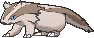
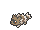
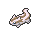

<!-- This file is generated by tools/generate_site.py. Edit the generator, not this file. -->

# #264 Linoone

{ .sprite-lg loading=lazy }

**Rushing Pokémon**

Normal

[:material-arrow-left: #263 Zigzagoon](263.md) · [Pokédex](index.md) · [#265 Wurmple :material-arrow-right:](265.md)

!!! info "Changes in Rising Ruby / Sinking Sapphire"

    - **Base stats:** HP 78 → **80**, Atk 70 → **90**, Def 61 → **60**, SpA 50 → **40**, SpD 61 → **60**, Spe 100 → **110** (BST 420 → **440**)

## Location

[Route 101](../wild/route_101.md), [Route 118](../wild/route_118.md)

### Wild encounters

| Area | Method | Level | Note |
| --- | --- | --- | --- |
| [Route 101](../wild/route_101.md) | DexNav | 50 |  |
| [Route 118](../wild/route_118.md) | Grass | 33 |  |
| [Route 118](../wild/route_118.md) | Tall Grass | 36 |  |

## Type defenses

| Damage taken | Attacking types |
| --- | --- |
| Immune (×0) | Ghost |
| Neutral (×1) | Normal Flying Poison Ground Rock Bug Steel Fire Water Grass Electric Psychic Ice Dragon Dark Fairy |
| Weak (×2) | Fighting |

## Abilities

| Slot | Ability | Effect | Note |
| --- | --- | --- | --- |
| Ability 1 | **Pickup** | Picks up other Pokémon's used and Flung held items.  May also pick up an item after battle. |  |
| Ability 2 | **Gluttony** | Makes the Pokémon eat any held Berry triggered by low HP below 1/2 its max HP. |  |
| Hidden | **Quick Feet** | Increases Speed to 1.5× with a major status ailment. |  |

## Base stats

| Form | HP | Atk | Def | SpA | SpD | Spe | BST |
| --- | --- | --- | --- | --- | --- | --- | --- |
| { .sprite-sm loading=lazy } Normal | 80<small class="was">was 78</small> | 90<small class="was">was 70</small> | 60<small class="was">was 61</small> | 40<small class="was">was 50</small> | 60<small class="was">was 61</small> | 110<small class="was">was 100</small> | 440<small class="was">was 420</small> |

## Training & breeding

| Property | Value |
| --- | --- |
| EV yield | 2 Spe |
| Catch rate | 90 |
| Base friendship | 70 |
| Base experience | 147 |
| Growth rate | medium |
| Egg groups | Field |
| Hatch counter | 15 |
| Gender ratio | 50% ♂ / 50% ♀ |
| Height / weight | 0.5 m / 32.5 kg |

## Evolution

- { .icon loading=lazy } [Zigzagoon](../pokemon/263.md) → { .icon loading=lazy } **[Linoone](../pokemon/264.md)**: Lv. 20

## Wild held items

| Item | Chance | Note |
| --- | --- | --- |
| { .item loading=lazy } Potion | 50% |  |
| { .item loading=lazy } Max Revive | 5% |  |

## Level-up moves { data-search-exclude }

Moves marked &#42; are not normally learned by level up (they come from egg moves, TMs/HMs or tutors in the official games); moves marked &#42;&#42; cannot normally be learned by this Pokémon at all and are omitted from the legal-moves version of the hack.

| Lv. | Move | Type | Cat. | Power | Acc. | PP | Effect | Note |
| --- | --- | --- | --- | --- | --- | --- | --- | --- |
| 1 | Extreme Speed | Normal | Physical | 80 | 100% | 5 | Inflicts regular damage with no additional effect. | &#42; |
| 1 | Switcheroo | Dark | Status | — | 100% | 10 | User and target swap items. |  |
| 1 | Tackle | Normal | Physical | 50 | 100% | 35 | Inflicts regular damage with no additional effect. |  |
| 1 | Growl | Normal | Status | — | 100% | 40 | Lowers the target’s Attack by one stage. |  |
| 5 | Tail Whip | Normal | Status | — | 100% | 30 | Lowers the target’s Defense by one stage. |  |
| 7 | Sand Attack | Ground | Status | — | 100% | 15 | Lowers the target’s accuracy by one stage. |  |
| 9 | Headbutt | Normal | Physical | 70 | 100% | 15 | Has a chance to make the target flinch. |  |
| 11 | Rototiller | Ground | Status | — | — | 10 | Raises the Attack and Special Attack of all Grass Pokémon in battle. |  |
| 13 | Odor Sleuth | Normal | Status | — | — | 40 | Forces the target to have no Evade, and allows it to be hit by Normal and Fighting moves even if it’s a Ghost. |  |
| 15 | Covet | Normal | Physical | 60 | 100% | 25 | Takes the target’s item. |  |
| 17 | Fury Swipes | Normal | Physical | 18 | 80% | 15 | Hits 2-5 times in one turn. |  |
| 19 | Mud Sport | Ground | Status | — | — | 15 | Halves all Electric-type damage. |  |
| 20 | Play Rough | Fairy | Physical | 90 | 90% | 10 | Has a chance to lower the target’s Attack by one stage. |  |
| 22 | Slash | Normal | Physical | 70 | 100% | 20 | Has an increased chance for a critical hit. |  |
| 26 | Seed Bomb | Grass | Physical | 80 | 100% | 15 | Inflicts regular damage with no additional effect. | &#42; |
| 30 | Bestow | Normal | Status | — | — | 15 | Gives the user’s held item to the target. |  |
| 34 | Double-Edge | Normal | Physical | 120 | 100% | 15 | User receives 1/3 the damage inflicted in recoil. |  |
| 38 | Belly Drum | Normal | Status | — | — | 10 | User pays half its max HP to max out its Attack. |  |
| 42 | Rest | Psychic | Status | — | — | 5 | User sleeps for two turns, completely healing itself. |  |
| 46 | Gunk Shot | Poison | Physical | 120 | 80% | 5 | Has a chance to poison the target. | &#42; |
| 50 | Fling | Dark | Physical | — | 100% | 10 | Throws held item at the target; power depends on the item. |  |
| 54 | Extreme Speed | Normal | Physical | 80 | 100% | 5 | Inflicts regular damage with no additional effect. | &#42; |

## TM & HM moves { data-search-exclude }

| Machine | Move | Type | Cat. | Power | Acc. | PP | Effect |
| --- | --- | --- | --- | --- | --- | --- | --- |
| HM01 | [Cut](../changes/moves.md#cut) changed | Grass | Physical | 70 | 100% | 15 | High Critical Rate. High Critical Rate |
| HM03 | Surf | Water | Special | 90 | 100% | 15 | Inflicts regular damage and can hit Dive users. |
| HM04 | [Strength](../changes/moves.md#strength) changed | Normal | Physical | 100 | 100% | 10 | Inflicts regular damage with no additional effect. |
| HM06 | [Rock Smash](../changes/moves.md#rock-smash) changed | Fighting | Physical | 65 | 100% | 15 | Has a chance to lower the target’s Defense by one stage. |
| TM01 | Hone Claws | Dark | Status | — | — | 15 | Raises the user’s Attack and accuracy by one stage. |
| TM05 | Roar | Normal | Status | — | — | 20 | Immediately ends wild battles.  Forces trainers to switch Pokémon. |
| TM06 | Toxic | Poison | Status | — | 90% | 10 | Badly poisons the target, inflicting more damage every turn. |
| TM10 | Hidden Power | Normal | Special | 60 | 100% | 15 | Power and type depend upon user’s IVs.  Power can range from 30 to 70. |
| TM100 | Confide | Normal | Status | — | — | 20 | Lowers the target’s Special Attack by one stage. |
| TM11 | Sunny Day | Fire | Status | — | — | 5 | Changes the weather to sunny for five turns. |
| TM13 | Ice Beam | Ice | Special | 90 | 100% | 10 | Has a chance to freeze the target. |
| TM14 | Blizzard | Ice | Special | 110 | 70% | 5 | Has a chance to freeze the target. |
| TM15 | Hyper Beam | Normal | Special | 150 | 90% | 5 | User foregoes its next turn to recharge. |
| TM17 | Protect | Normal | Status | — | — | 10 | Prevents any moves from hitting the user this turn. |
| TM18 | Rain Dance | Water | Status | — | — | 5 | Changes the weather to rain for five turns. |
| TM21 | Frustration | Normal | Physical | — | 100% | 20 | Power increases as happiness decreases, up to a maximum of 102. |
| TM24 | Thunderbolt | Electric | Special | 90 | 100% | 15 | Has a chance to paralyze the target. |
| TM25 | Thunder | Electric | Special | 110 | 70% | 10 | Has a chance to paralyze the target. |
| TM27 | Return | Normal | Physical | — | 100% | 20 | Power increases with happiness, up to a maximum of 102. |
| TM28 | Dig | Ground | Physical | 80 | 100% | 10 | User digs underground, dodging all attacks, and hits next turn. |
| TM30 | Shadow Ball | Ghost | Special | 80 | 100% | 15 | Has a chance to lower the target’s Special Defense by one stage. |
| TM32 | Double Team | Normal | Status | — | — | 15 | Raises the user’s evasion by one stage. |
| TM42 | Facade | Normal | Physical | 70 | 100% | 20 | Power doubles if user is burned, paralyzed, or poisoned. |
| TM44 | Rest | Psychic | Status | — | — | 5 | User sleeps for two turns, completely healing itself. |
| TM45 | Attract | Normal | Status | — | 100% | 15 | Target falls in love if it has the opposite gender, and has a 50% chance to refuse attacking the user. |
| TM46 | Thief | Dark | Physical | 60 | 100% | 25 | Takes the target’s item. |
| TM48 | Round | Normal | Special | 60 | 100% | 15 | Has double power if it’s used more than once per turn. |
| TM49 | Echoed Voice | Normal | Special | 40 | 100% | 15 | Power increases by 100% for each consecutive use by any friendly Pokémon, to a maximum of 200. |
| TM56 | Fling | Dark | Physical | — | 100% | 10 | Throws held item at the target; power depends on the item. |
| TM57 | Charge Beam | Electric | Special | 50 | 90% | 10 | Has a chance to raise the user’s Special Attack by one stage. |
| TM65 | Shadow Claw | Ghost | Physical | 70 | 100% | 15 | Has an increased chance for a critical hit. |
| TM67 | Retaliate | Normal | Physical | 70 | 100% | 5 | Has double power if a friendly Pokémon fainted last turn. |
| TM68 | Giga Impact | Normal | Physical | 150 | 90% | 5 | User foregoes its next turn to recharge. |
| TM73 | Thunder Wave | Electric | Status | — | 100% | 20 | Paralyzes the target. |
| TM86 | Grass Knot | Grass | Special | — | 100% | 20 | Inflicts more damage to heavier targets, with a maximum of 120 power. |
| TM87 | Swagger | Normal | Status | — | 90% | 15 | Raises the target’s Attack by two stages and confuses the target. |
| TM88 | Sleep Talk | Normal | Status | — | — | 10 | Randomly uses one of the user’s other three moves.  Only works if the user is sleeping. |
| TM90 | Substitute | Normal | Status | — | — | 10 | Transfers 1/4 of the user’s max HP into a doll, protecting the user from further damage or status changes until it breaks. |
| TM94 | Secret Power | Normal | Physical | 70 | 100% | 20 | Has a chance to inflict a status effect which depends upon the terrain. |

## Move tutor moves { data-search-exclude }

| Move | Type | Cat. | Power | Acc. | PP | Effect |
| --- | --- | --- | --- | --- | --- | --- |
| Covet | Normal | Physical | 60 | 100% | 25 | Takes the target’s item. |
| Gunk Shot | Poison | Physical | 120 | 80% | 5 | Has a chance to poison the target. |
| Helping Hand | Normal | Status | — | — | 20 | Ally’s next move inflicts half more damage. |
| Hyper Voice | Normal | Special | 90 | 100% | 10 | Inflicts regular damage with no additional effect. |
| Icy Wind | Ice | Special | 55 | 95% | 15 | Has a chance to lower the target’s Speed by one stage. |
| Iron Tail | Steel | Physical | 100 | 75% | 15 | Has a chance to lower the target’s Defense by one stage. |
| Last Resort | Normal | Physical | 140 | 100% | 5 | Can only be used after all of the user’s other moves have been used. |
| Seed Bomb | Grass | Physical | 80 | 100% | 15 | Inflicts regular damage with no additional effect. |
| Shock Wave | Electric | Special | 60 | — | 20 | Never misses. |
| Snore | Normal | Special | 50 | 100% | 15 | Has a chance to make the target flinch.  Only works if the user is sleeping. |
| Super Fang | Normal | Physical | — | 90% | 10 | Inflicts damage equal to half the target’s HP. |
| Trick | Psychic | Status | — | 100% | 10 | User and target swap items. |
| Water Pulse | Water | Special | 60 | 100% | 20 | Has a chance to confuse the target. |

## Egg moves { data-search-exclude }

No egg moves.

??? note "Trainers using Linoone (8)"

    | Area | Trainer | Level |
    | --- | --- | --- |
    | [Route 102](../trainers/route_102.md#rematches) | Youngster Calvin (3) | Lv. 25 |
    | [Route 102](../trainers/route_102.md#rematches) | Youngster Calvin (5) | Lv. 39 |
    | [Route 102](../trainers/route_102.md#rematches) | Youngster Calvin (C) | Lv. 75 |
    | [Route 109](../trainers/route_109.md#rematches) | Tuber Ricky (4) | Lv. 35 |
    | [Route 109](../trainers/route_109.md#rematches) | Tuber Ricky (6) | Lv. 47 |
    | [Route 109](../trainers/route_109.md#rematches) | Tuber Ricky (7) | Lv. 59 |
    | [Route 109](../trainers/route_109.md#rematches) | Tuber Ricky (C) | Lv. 75 |
    | [Route 111](../trainers/route_111.md#trainers) | Backpacker Deon | Lv. 27 |

---

[:material-arrow-left: #263 Zigzagoon](263.md) · [#265 Wurmple :material-arrow-right:](265.md)
