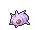
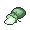

<!-- This file is generated by tools/generate_site.py. Edit the generator, not this file. -->

# #265 Wurmple

{ .sprite-lg loading=lazy }

**Worm Pokémon**

Bug

[:material-arrow-left: #264 Linoone](264.md) · [Pokédex](index.md) · [#266 Silcoon :material-arrow-right:](266.md)

!!! info "Changes in Rising Ruby / Sinking Sapphire"

    - **Ability 2:** **Run Away** 

## Location

[Route 102](../wild/route_102.md)

### Wild encounters

| Area | Method | Level | Note |
| --- | --- | --- | --- |
| [Route 102](../wild/route_102.md) | Grass | 6 |  |

## Type defenses

| Damage taken | Attacking types |
| --- | --- |
| Resistant (×½) | Fighting Ground Grass |
| Neutral (×1) | Normal Poison Bug Ghost Steel Water Electric Psychic Ice Dragon Dark Fairy |
| Weak (×2) | Flying Rock Fire |

## Abilities

| Slot | Ability | Effect | Note |
| --- | --- | --- | --- |
| Ability 1 | **Shield Dust** | Protects against incoming moves' extra effects. |  |
| Ability 2 | **Run Away** | Ensures success fleeing from wild battles. | changed  |
| Hidden | **Run Away** | Ensures success fleeing from wild battles. |  |

## Base stats

| Form | HP | Atk | Def | SpA | SpD | Spe | BST |
| --- | --- | --- | --- | --- | --- | --- | --- |
| { .sprite-sm loading=lazy } Normal | 45 | 45 | 35 | 20 | 30 | 20 | **195** |

## Training & breeding

| Property | Value |
| --- | --- |
| EV yield | 1 HP |
| Catch rate | 255 |
| Base friendship | 70 |
| Base experience | 56 |
| Growth rate | medium |
| Egg groups | Bug |
| Hatch counter | 15 |
| Gender ratio | 50% ♂ / 50% ♀ |
| Height / weight | 0.3 m / 3.6 kg |

## Evolution

- { .icon loading=lazy } **[Wurmple](../pokemon/265.md)** → { .icon loading=lazy } [Silcoon](../pokemon/266.md): Lv. 7
- { .icon loading=lazy } **[Wurmple](../pokemon/265.md)** → { .icon loading=lazy } [Cascoon](../pokemon/268.md): Lv. 7
- { .icon loading=lazy } [Silcoon](../pokemon/266.md) → { .icon loading=lazy } [Beautifly](../pokemon/267.md): Lv. 10
- { .icon loading=lazy } [Cascoon](../pokemon/268.md) → { .icon loading=lazy } [Dustox](../pokemon/269.md): Lv. 10

## Wild held items

| Item | Chance | Note |
| --- | --- | --- |
| { .item loading=lazy } Pecha Berry | 50% |  |
| { .item loading=lazy } Bright Powder | 5% |  |

## Level-up moves { data-search-exclude }

Moves marked &#42; are not normally learned by level up (they come from egg moves, TMs/HMs or tutors in the official games); moves marked &#42;&#42; cannot normally be learned by this Pokémon at all and are omitted from the legal-moves version of the hack.

| Lv. | Move | Type | Cat. | Power | Acc. | PP | Effect | Note |
| --- | --- | --- | --- | --- | --- | --- | --- | --- |
| 1 | Tackle | Normal | Physical | 50 | 100% | 35 | Inflicts regular damage with no additional effect. |  |
| 1 | String Shot | Bug | Status | — | 95% | 40 | Lowers the target’s Speed by one stage. |  |
| 1 | Poison Sting | Poison | Physical | 15 | 100% | 35 | Has a chance to poison the target. |  |
| 3 | Bug Bite | Bug | Physical | 60 | 100% | 20 | If target has a berry, inflicts double damage and uses the berry. |  |
| 5 | Electroweb | Electric | Special | 55 | 95% | 15 | Lowers the target’s Speed by one stage. | &#42; |

## TM & HM moves { data-search-exclude }

This Pokémon cannot learn any TM or HM moves.

## Move tutor moves { data-search-exclude }

| Move | Type | Cat. | Power | Acc. | PP | Effect |
| --- | --- | --- | --- | --- | --- | --- |
| Bug Bite | Bug | Physical | 60 | 100% | 20 | If target has a berry, inflicts double damage and uses the berry. |
| Electroweb | Electric | Special | 55 | 95% | 15 | Lowers the target’s Speed by one stage. |
| Snore | Normal | Special | 50 | 100% | 15 | Has a chance to make the target flinch.  Only works if the user is sleeping. |

## Egg moves { data-search-exclude }

No egg moves.

??? note "Trainers using Wurmple (1)"

    | Area | Trainer | Level |
    | --- | --- | --- |
    | [Route 102](../trainers/route_102.md#trainers) | Bug Catcher Rick | Lv. 7 |

---

[:material-arrow-left: #264 Linoone](264.md) · [#266 Silcoon :material-arrow-right:](266.md)
