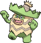

<!-- This file is generated by tools/generate_site.py. Edit the generator, not this file. -->

# #272 Ludicolo

{ .sprite-lg loading=lazy }

**Carefree Pokémon**

Water Grass

[:material-arrow-left: #271 Lombre](271.md) · [Pokédex](index.md) · [#273 Seedot :material-arrow-right:](273.md)

!!! note "No documented changes"

    Drayano's documentation lists no stat, type, ability, evolution or held item changes for this Pokémon. Its level-up moves are listed below as they appear in the hack.

## Location

Evolve { .icon loading=lazy } [Lombre](../pokemon/271.md) (Water Stone)

## Type defenses

| Damage taken | Attacking types |
| --- | --- |
| Very resistant (×¼) | Water |
| Resistant (×½) | Ground Steel |
| Neutral (×1) | Normal Fighting Rock Ghost Fire Grass Electric Psychic Ice Dragon Dark Fairy |
| Weak (×2) | Flying Poison Bug |

## Abilities

| Slot | Ability | Effect | Note |
| --- | --- | --- | --- |
| Ability 1 | **Swift Swim** | Doubles Speed during rain. |  |
| Ability 2 | **Rain Dish** | Heals for 1/16 max HP after each turn during rain. |  |
| Hidden | **Own Tempo** | Prevents confusion. |  |

## Base stats

| Form | HP | Atk | Def | SpA | SpD | Spe | BST |
| --- | --- | --- | --- | --- | --- | --- | --- |
| { .sprite-sm loading=lazy } Normal | 80 | 70 | 70 | 90 | 100 | 70 | **480** |

## Training & breeding

| Property | Value |
| --- | --- |
| EV yield | 3 SpD |
| Catch rate | 45 |
| Base friendship | 70 |
| Base experience | 216 |
| Growth rate | medium slow |
| Egg groups | Water 1, Grass |
| Hatch counter | 15 |
| Gender ratio | 50% ♂ / 50% ♀ |
| Height / weight | 1.5 m / 55 kg |

## Evolution

- { .icon loading=lazy } [Lotad](../pokemon/270.md) → { .icon loading=lazy } [Lombre](../pokemon/271.md): Lv. 14
- { .icon loading=lazy } [Lombre](../pokemon/271.md) → { .icon loading=lazy } **[Ludicolo](../pokemon/272.md)**: Water Stone

## Wild held items

| Item | Chance | Note |
| --- | --- | --- |
| { .item loading=lazy } Mental Herb | 5% |  |

## Level-up moves { data-search-exclude }

Moves marked &#42; are not normally learned by level up (they come from egg moves, TMs/HMs or tutors in the official games); moves marked &#42;&#42; cannot normally be learned by this Pokémon at all and are omitted from the legal-moves version of the hack.

| Lv. | Move | Type | Cat. | Power | Acc. | PP | Effect | Note |
| --- | --- | --- | --- | --- | --- | --- | --- | --- |
| 1 | Ice Punch | Ice | Physical | 75 | 100% | 15 | Has a chance to freeze the target. | &#42; |
| 1 | Fire Punch | Fire | Physical | 75 | 100% | 15 | Has a chance to burn the target. | &#42; |
| 1 | Thunder Punch | Electric | Physical | 75 | 100% | 15 | Has a chance to paralyze the target. | &#42; |
| 1 | Drain Punch | Fighting | Physical | 75 | 100% | 10 | Drains half the damage inflicted to heal the user. | &#42; |
| 1 | Astonish | Ghost | Physical | 30 | 100% | 15 | Has a chance to make the target flinch. |  |
| 1 | Growl | Normal | Status | — | 100% | 40 | Lowers the target’s Attack by one stage. |  |
| 1 | Mega Drain | Grass | Special | 40 | 100% | 15 | Drains half the damage inflicted to heal the user. |  |
| 1 | Nature Power | Normal | Status | — | — | 20 | Uses a move which depends upon the terrain. |  |
| 23 | Teeter Dance | Normal | Status | — | 100% | 20 | Confuses the target. | &#42; |
| 38 | Rain Dance | Water | Status | — | — | 5 | Changes the weather to rain for five turns. | &#42; |
| 53 | Hydro Pump | Water | Special | 110 | 80% | 5 | Inflicts regular damage with no additional effect. | &#42; |

## TM & HM moves { data-search-exclude }

| Machine | Move | Type | Cat. | Power | Acc. | PP | Effect |
| --- | --- | --- | --- | --- | --- | --- | --- |
| HM03 | Surf | Water | Special | 90 | 100% | 15 | Inflicts regular damage and can hit Dive users. |
| HM04 | [Strength](../changes/moves.md#strength) changed | Normal | Physical | 100 | 100% | 10 | Inflicts regular damage with no additional effect. |
| HM05 | Waterfall | Water | Physical | 80 | 100% | 15 | Has a chance to make the target flinch. |
| HM06 | [Rock Smash](../changes/moves.md#rock-smash) changed | Fighting | Physical | 65 | 100% | 15 | Has a chance to lower the target’s Defense by one stage. |
| HM07 | Dive | Water | Physical | 80 | 100% | 10 | User dives underwater, dodging all attacks, and hits next turn. |
| TM01 | Hone Claws | Dark | Status | — | — | 15 | Raises the user’s Attack and accuracy by one stage. |
| TM06 | Toxic | Poison | Status | — | 90% | 10 | Badly poisons the target, inflicting more damage every turn. |
| TM07 | Hail | Ice | Status | — | — | 10 | Changes the weather to a hailstorm for five turns. |
| TM10 | Hidden Power | Normal | Special | 60 | 100% | 15 | Power and type depend upon user’s IVs.  Power can range from 30 to 70. |
| TM100 | Confide | Normal | Status | — | — | 20 | Lowers the target’s Special Attack by one stage. |
| TM11 | Sunny Day | Fire | Status | — | — | 5 | Changes the weather to sunny for five turns. |
| TM13 | Ice Beam | Ice | Special | 90 | 100% | 10 | Has a chance to freeze the target. |
| TM14 | Blizzard | Ice | Special | 110 | 70% | 5 | Has a chance to freeze the target. |
| TM15 | Hyper Beam | Normal | Special | 150 | 90% | 5 | User foregoes its next turn to recharge. |
| TM17 | Protect | Normal | Status | — | — | 10 | Prevents any moves from hitting the user this turn. |
| TM18 | Rain Dance | Water | Status | — | — | 5 | Changes the weather to rain for five turns. |
| TM21 | Frustration | Normal | Physical | — | 100% | 20 | Power increases as happiness decreases, up to a maximum of 102. |
| TM22 | Solar Beam | Grass | Special | 120 | 100% | 10 | Requires a turn to charge before attacking. |
| TM27 | Return | Normal | Physical | — | 100% | 20 | Power increases with happiness, up to a maximum of 102. |
| TM31 | Brick Break | Fighting | Physical | 75 | 100% | 15 | Destroys Reflect and Light Screen. |
| TM32 | Double Team | Normal | Status | — | — | 15 | Raises the user’s evasion by one stage. |
| TM42 | Facade | Normal | Physical | 70 | 100% | 20 | Power doubles if user is burned, paralyzed, or poisoned. |
| TM44 | Rest | Psychic | Status | — | — | 5 | User sleeps for two turns, completely healing itself. |
| TM45 | Attract | Normal | Status | — | 100% | 15 | Target falls in love if it has the opposite gender, and has a 50% chance to refuse attacking the user. |
| TM46 | Thief | Dark | Physical | 60 | 100% | 25 | Takes the target’s item. |
| TM48 | Round | Normal | Special | 60 | 100% | 15 | Has double power if it’s used more than once per turn. |
| TM49 | Echoed Voice | Normal | Special | 40 | 100% | 15 | Power increases by 100% for each consecutive use by any friendly Pokémon, to a maximum of 200. |
| TM52 | Focus Blast | Fighting | Special | 120 | 70% | 5 | Has a chance to lower the target’s Special Defense by one stage. |
| TM53 | Energy Ball | Grass | Special | 90 | 100% | 10 | Has a chance to lower the target’s Special Defense by one stage. |
| TM55 | Scald | Water | Special | 80 | 100% | 15 | Has a chance to burn the target. |
| TM56 | Fling | Dark | Physical | — | 100% | 10 | Throws held item at the target; power depends on the item. |
| TM68 | Giga Impact | Normal | Physical | 150 | 90% | 5 | User foregoes its next turn to recharge. |
| TM70 | Flash | Normal | Status | — | 100% | 20 | Lowers the target’s accuracy by one stage. |
| TM75 | Swords Dance | Normal | Status | — | — | 20 | Raises the user’s Attack by two stages. |
| TM86 | Grass Knot | Grass | Special | — | 100% | 20 | Inflicts more damage to heavier targets, with a maximum of 120 power. |
| TM87 | Swagger | Normal | Status | — | 90% | 15 | Raises the target’s Attack by two stages and confuses the target. |
| TM88 | Sleep Talk | Normal | Status | — | — | 10 | Randomly uses one of the user’s other three moves.  Only works if the user is sleeping. |
| TM90 | Substitute | Normal | Status | — | — | 10 | Transfers 1/4 of the user’s max HP into a doll, protecting the user from further damage or status changes until it breaks. |
| TM94 | Secret Power | Normal | Physical | 70 | 100% | 20 | Has a chance to inflict a status effect which depends upon the terrain. |
| TM96 | Nature Power | Normal | Status | — | — | 20 | Uses a move which depends upon the terrain. |
| TM98 | Power-Up Punch | Fighting | Physical | 40 | 100% | 20 | Raises the user’s Attack by one stage after inflicting damage. |

## Move tutor moves { data-search-exclude }

| Move | Type | Cat. | Power | Acc. | PP | Effect |
| --- | --- | --- | --- | --- | --- | --- |
| Drain Punch | Fighting | Physical | 75 | 100% | 10 | Drains half the damage inflicted to heal the user. |
| Fire Punch | Fire | Physical | 75 | 100% | 15 | Has a chance to burn the target. |
| Focus Punch | Fighting | Physical | 150 | 100% | 20 | If the user takes damage before attacking, the attack is canceled. |
| Giga Drain | Grass | Special | 75 | 100% | 10 | Drains half the damage inflicted to heal the user. |
| Hyper Voice | Normal | Special | 90 | 100% | 10 | Inflicts regular damage with no additional effect. |
| Ice Punch | Ice | Physical | 75 | 100% | 15 | Has a chance to freeze the target. |
| Icy Wind | Ice | Special | 55 | 95% | 15 | Has a chance to lower the target’s Speed by one stage. |
| Knock Off | Dark | Physical | 65 | 100% | 20 | Target drops its held item. |
| Seed Bomb | Grass | Physical | 80 | 100% | 15 | Inflicts regular damage with no additional effect. |
| Snore | Normal | Special | 50 | 100% | 15 | Has a chance to make the target flinch.  Only works if the user is sleeping. |
| Synthesis | Grass | Status | — | — | 5 | Heals the user by half its max HP.  Affected by weather. |
| Thunder Punch | Electric | Physical | 75 | 100% | 15 | Has a chance to paralyze the target. |
| Uproar | Normal | Special | 90 | 100% | 10 | Forced to use this move for several turns.  Pokémon cannot fall asleep in that time. |
| Water Pulse | Water | Special | 60 | 100% | 20 | Has a chance to confuse the target. |
| Zen Headbutt | Psychic | Physical | 80 | 90% | 15 | Has a chance to make the target flinch. |

## Egg moves { data-search-exclude }

No egg moves.

??? note "Trainers using Ludicolo (8)"

    | Area | Trainer | Level |
    | --- | --- | --- |
    | [Route 110](../trainers/route_110.md#rematches) | Collector Edwin (7) | Lv. 59 |
    | [Route 110](../trainers/route_110.md#rematches) | Collector Edwin (8) | Lv. 64 |
    | [Route 110](../trainers/route_110.md#rematches) | Collector Edwin (C) | Lv. 75 |
    | [Route 125](../trainers/route_125.md#trainers) | Swimmer Cody | Lv. 55 |
    | [Sootopolis Gym](../trainers/sootopolis_gym.md#trainers) | Leader Wallace | Lv. 65 |
    | [Route 131 (Post Game)](../trainers/route_131_post_game.md#trainers) | Sootopolitan Wallace | Lv. 77 |
    | [Battle Resort](../trainers/battle_resort.md#trainers) | Leader Josephine [Wallace] | Lv. 77 |
    | [Battle Resort](../trainers/battle_resort.md#trainers) | Leader Josephine [Wallace] | Lv. 77 |

---

[:material-arrow-left: #271 Lombre](271.md) · [#273 Seedot :material-arrow-right:](273.md)
