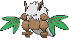

<!-- This file is generated by tools/generate_site.py. Edit the generator, not this file. -->

# #275 Shiftry

{ .sprite-lg loading=lazy }

**Wicked Pokémon**

Grass Dark

[:material-arrow-left: #274 Nuzleaf](274.md) · [Pokédex](index.md) · [#276 Taillow :material-arrow-right:](276.md)

!!! note "No documented changes"

    Drayano's documentation lists no stat, type, ability, evolution or held item changes for this Pokémon. Its level-up moves are listed below as they appear in the hack.

## Location

Evolve { .icon loading=lazy } [Nuzleaf](../pokemon/274.md) (Leaf Stone)

### Wild encounters

| Area | Method | Level | Note |
| --- | --- | --- | --- |
| [Safari Zone (4)](../wild/safari_zone_4.md) | DexNav | 50 |  |

## Type defenses

| Damage taken | Attacking types |
| --- | --- |
| Immune (×0) | Psychic |
| Resistant (×½) | Ground Ghost Water Grass Electric Dark |
| Neutral (×1) | Normal Rock Steel Dragon |
| Weak (×2) | Fighting Flying Poison Fire Ice Fairy |
| Very weak (×4) | Bug |

## Abilities

| Slot | Ability | Effect | Note |
| --- | --- | --- | --- |
| Ability 1 | **Chlorophyll** | Doubles Speed during strong sunlight. |  |
| Ability 2 | **Early Bird** | Makes sleep pass twice as quickly. |  |
| Hidden | **Pickpocket** | Steals attacking Pokémon's held items on contact. |  |

## Base stats

| Form | HP | Atk | Def | SpA | SpD | Spe | BST |
| --- | --- | --- | --- | --- | --- | --- | --- |
| { .sprite-sm loading=lazy } Normal | 90 | 100 | 60 | 90 | 60 | 80 | **480** |

## Training & breeding

| Property | Value |
| --- | --- |
| EV yield | 3 Atk |
| Catch rate | 45 |
| Base friendship | 70 |
| Base experience | 216 |
| Growth rate | medium slow |
| Egg groups | Field, Grass |
| Hatch counter | 15 |
| Gender ratio | 50% ♂ / 50% ♀ |
| Height / weight | 1.3 m / 59.6 kg |

## Evolution

- { .icon loading=lazy } [Seedot](../pokemon/273.md) → { .icon loading=lazy } [Nuzleaf](../pokemon/274.md): Lv. 14
- { .icon loading=lazy } [Nuzleaf](../pokemon/274.md) → { .icon loading=lazy } **[Shiftry](../pokemon/275.md)**: Leaf Stone

## Wild held items

| Item | Chance | Note |
| --- | --- | --- |
| { .item loading=lazy } Power Herb | 5% |  |

## Level-up moves { data-search-exclude }

Moves marked &#42; are not normally learned by level up (they come from egg moves, TMs/HMs or tutors in the official games); moves marked &#42;&#42; cannot normally be learned by this Pokémon at all and are omitted from the legal-moves version of the hack.

| Lv. | Move | Type | Cat. | Power | Acc. | PP | Effect | Note |
| --- | --- | --- | --- | --- | --- | --- | --- | --- |
| 1 | Twister | Dragon | Special | 40 | 100% | 20 | Has a chance to make the target flinch. | &#42; |
| 1 | Ominous Wind | Ghost | Special | 60 | 100% | 5 | Has a chance to raise all of the user’s stats by one stage. | &#42; |
| 1 | Silver Wind | Bug | Special | 60 | 100% | 5 | Has a chance to raise all of the user’s stats by one stage. | &#42; |
| 1 | Razor Leaf | Grass | Physical | 55 | 95% | 25 | Has an increased chance for a critical hit. |  |
| 1 | Feint Attack | Dark | Physical | 60 | — | 20 | Never misses. |  |
| 1 | Whirlwind | Normal | Status | — | — | 20 | Immediately ends wild battles.  Forces trainers to switch Pokémon. |  |
| 1 | Nasty Plot | Dark | Status | — | — | 20 | Raises the user’s Special Attack by two stages. |  |
| 20 | Leaf Tornado | Grass | Special | 65 | 90% | 10 | Has a chance to lower the target’s accuracy by one stage. |  |
| 32 | Hurricane | Flying | Special | 110 | 70% | 10 | Has a chance to confuse the target. |  |
| 44 | Leaf Storm | Grass | Special | 130 | 90% | 5 | Lowers the user’s Special Attack by two stages after inflicting damage. |  |

## TM & HM moves { data-search-exclude }

| Machine | Move | Type | Cat. | Power | Acc. | PP | Effect |
| --- | --- | --- | --- | --- | --- | --- | --- |
| HM01 | [Cut](../changes/moves.md#cut) changed | Grass | Physical | 70 | 100% | 15 | High Critical Rate. High Critical Rate |
| HM04 | [Strength](../changes/moves.md#strength) changed | Normal | Physical | 100 | 100% | 10 | Inflicts regular damage with no additional effect. |
| HM06 | [Rock Smash](../changes/moves.md#rock-smash) changed | Fighting | Physical | 65 | 100% | 15 | Has a chance to lower the target’s Defense by one stage. |
| TM06 | Toxic | Poison | Status | — | 90% | 10 | Badly poisons the target, inflicting more damage every turn. |
| TM10 | Hidden Power | Normal | Special | 60 | 100% | 15 | Power and type depend upon user’s IVs.  Power can range from 30 to 70. |
| TM100 | Confide | Normal | Status | — | — | 20 | Lowers the target’s Special Attack by one stage. |
| TM11 | Sunny Day | Fire | Status | — | — | 5 | Changes the weather to sunny for five turns. |
| TM15 | Hyper Beam | Normal | Special | 150 | 90% | 5 | User foregoes its next turn to recharge. |
| TM17 | Protect | Normal | Status | — | — | 10 | Prevents any moves from hitting the user this turn. |
| TM21 | Frustration | Normal | Physical | — | 100% | 20 | Power increases as happiness decreases, up to a maximum of 102. |
| TM22 | Solar Beam | Grass | Special | 120 | 100% | 10 | Requires a turn to charge before attacking. |
| TM27 | Return | Normal | Physical | — | 100% | 20 | Power increases with happiness, up to a maximum of 102. |
| TM28 | Dig | Ground | Physical | 80 | 100% | 10 | User digs underground, dodging all attacks, and hits next turn. |
| TM30 | Shadow Ball | Ghost | Special | 80 | 100% | 15 | Has a chance to lower the target’s Special Defense by one stage. |
| TM31 | Brick Break | Fighting | Physical | 75 | 100% | 15 | Destroys Reflect and Light Screen. |
| TM32 | Double Team | Normal | Status | — | — | 15 | Raises the user’s evasion by one stage. |
| TM39 | Rock Tomb | Rock | Physical | 60 | 95% | 15 | Has a chance to lower the target’s Speed by one stage. |
| TM40 | Aerial Ace | Flying | Physical | 60 | — | 20 | Never misses. |
| TM41 | Torment | Dark | Status | — | 100% | 15 | Prevents the target from using the same move twice in a row. |
| TM42 | Facade | Normal | Physical | 70 | 100% | 20 | Power doubles if user is burned, paralyzed, or poisoned. |
| TM44 | Rest | Psychic | Status | — | — | 5 | User sleeps for two turns, completely healing itself. |
| TM45 | Attract | Normal | Status | — | 100% | 15 | Target falls in love if it has the opposite gender, and has a 50% chance to refuse attacking the user. |
| TM46 | Thief | Dark | Physical | 60 | 100% | 25 | Takes the target’s item. |
| TM47 | Low Sweep | Fighting | Physical | 65 | 100% | 20 | Lowers the target’s Speed by one stage. |
| TM48 | Round | Normal | Special | 60 | 100% | 15 | Has double power if it’s used more than once per turn. |
| TM52 | Focus Blast | Fighting | Special | 120 | 70% | 5 | Has a chance to lower the target’s Special Defense by one stage. |
| TM53 | Energy Ball | Grass | Special | 90 | 100% | 10 | Has a chance to lower the target’s Special Defense by one stage. |
| TM54 | False Swipe | Normal | Physical | 40 | 100% | 40 | Cannot lower the target’s HP below 1. |
| TM56 | Fling | Dark | Physical | — | 100% | 10 | Throws held item at the target; power depends on the item. |
| TM63 | Embargo | Dark | Status | — | 100% | 15 | Target cannot use held items. |
| TM64 | Explosion | Normal | Physical | 250 | 100% | 5 | User faints. |
| TM66 | Payback | Dark | Physical | 50 | 100% | 10 | Power is doubled if the target has already moved this turn. |
| TM67 | Retaliate | Normal | Physical | 70 | 100% | 5 | Has double power if a friendly Pokémon fainted last turn. |
| TM68 | Giga Impact | Normal | Physical | 150 | 90% | 5 | User foregoes its next turn to recharge. |
| TM70 | Flash | Normal | Status | — | 100% | 20 | Lowers the target’s accuracy by one stage. |
| TM75 | Swords Dance | Normal | Status | — | — | 20 | Raises the user’s Attack by two stages. |
| TM77 | Psych Up | Normal | Status | — | — | 10 | Discards the user’s stat changes and copies the target’s. |
| TM80 | Rock Slide | Rock | Physical | 75 | 90% | 10 | Has a chance to make the target flinch. |
| TM81 | X-Scissor | Bug | Physical | 80 | 100% | 15 | Inflicts regular damage with no additional effect. |
| TM86 | Grass Knot | Grass | Special | — | 100% | 20 | Inflicts more damage to heavier targets, with a maximum of 120 power. |
| TM87 | Swagger | Normal | Status | — | 90% | 15 | Raises the target’s Attack by two stages and confuses the target. |
| TM88 | Sleep Talk | Normal | Status | — | — | 10 | Randomly uses one of the user’s other three moves.  Only works if the user is sleeping. |
| TM90 | Substitute | Normal | Status | — | — | 10 | Transfers 1/4 of the user’s max HP into a doll, protecting the user from further damage or status changes until it breaks. |
| TM94 | Secret Power | Normal | Physical | 70 | 100% | 20 | Has a chance to inflict a status effect which depends upon the terrain. |
| TM95 | Snarl | Dark | Special | 55 | 95% | 15 | Has a chance to lower the target’s Special Attack by one stage. |
| TM96 | Nature Power | Normal | Status | — | — | 20 | Uses a move which depends upon the terrain. |
| TM97 | Dark Pulse | Dark | Special | 80 | 100% | 15 | Has a chance to make the target flinch. |
| TM98 | Power-Up Punch | Fighting | Physical | 40 | 100% | 20 | Raises the user’s Attack by one stage after inflicting damage. |

## Move tutor moves { data-search-exclude }

| Move | Type | Cat. | Power | Acc. | PP | Effect |
| --- | --- | --- | --- | --- | --- | --- |
| Bounce | Flying | Physical | 85 | 85% | 5 | User bounces high into the air, dodging all attacks, and hits next turn. |
| Foul Play | Dark | Physical | 95 | 100% | 15 | Calculates damage with the target’s attacking stat. |
| Giga Drain | Grass | Special | 75 | 100% | 10 | Drains half the damage inflicted to heal the user. |
| Icy Wind | Ice | Special | 55 | 95% | 15 | Has a chance to lower the target’s Speed by one stage. |
| Knock Off | Dark | Physical | 65 | 100% | 20 | Target drops its held item. |
| Low Kick | Fighting | Physical | — | 100% | 20 | Inflicts more damage to heavier targets, with a maximum of 120 power. |
| Seed Bomb | Grass | Physical | 80 | 100% | 15 | Inflicts regular damage with no additional effect. |
| Snore | Normal | Special | 50 | 100% | 15 | Has a chance to make the target flinch.  Only works if the user is sleeping. |
| Spite | Ghost | Status | — | 100% | 10 | Lowers the PP of the target’s last used move by 4. |
| Synthesis | Grass | Status | — | — | 5 | Heals the user by half its max HP.  Affected by weather. |
| Tailwind | Flying | Status | — | — | 15 | For three turns, friendly Pokémon have doubled Speed. |
| Worry Seed | Grass | Status | — | 100% | 10 | Changes the target’s ability to Insomnia. |

## Egg moves { data-search-exclude }

No egg moves.

??? note "Trainers using Shiftry (8)"

    | Area | Trainer | Level |
    | --- | --- | --- |
    | [Route 110](../trainers/route_110.md#rematches) | Collector Edwin (7) | Lv. 59 |
    | [Route 110](../trainers/route_110.md#rematches) | Collector Edwin (8) | Lv. 64 |
    | [Route 110](../trainers/route_110.md#rematches) | Collector Edwin (C) | Lv. 75 |
    | [Route 108](../trainers/route_108.md#rematches) | Ace Trainer Neville (6) | Lv. 47 |
    | [Route 108](../trainers/route_108.md#rematches) | Ace Trainer Neville (7) | Lv. 59 |
    | [Route 108](../trainers/route_108.md#rematches) | Ace Trainer Neville (8) | Lv. 64 |
    | [Route 108](../trainers/route_108.md#rematches) | Ace Trainer Neville (C) | Lv. 75 |
    | [Victory Road B1F](../trainers/victory_road_b1f.md#trainers) | Ace Trainer Vito | Lv. 65 |

---

[:material-arrow-left: #274 Nuzleaf](274.md) · [#276 Taillow :material-arrow-right:](276.md)
