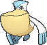

<!-- This file is generated by tools/generate_site.py. Edit the generator, not this file. -->

# #279 Pelipper

{ .sprite-lg loading=lazy }

**Water Bird Pokémon**

Water Flying

[:material-arrow-left: #278 Wingull](278.md) · [Pokédex](index.md) · [#280 Ralts :material-arrow-right:](280.md)

!!! info "Changes in Rising Ruby / Sinking Sapphire"

    - **Ability 2:** **Rain Dish** 
    - **Base stats:** HP 60 → **80** (BST 430 → **450**)
    - **New TM/HM compatibility:** Waterfall, Dive

## Location

[Route 106](../wild/route_106.md), [Dewford Town](../wild/dewford_town.md), [Route 107](../wild/route_107.md), [Route 109](../wild/route_109.md), [Route 105](../wild/route_105.md), [Route 118](../wild/route_118.md), [Route 126](../wild/route_126.md), [Ever Grande City](../wild/ever_grande_city.md), [Route 131](../wild/route_131.md), [Battle Resort](../wild/battle_resort.md)

### Wild encounters

| Area | Method | Level | Note |
| --- | --- | --- | --- |
| [Route 106](../wild/route_106.md) | Surfing | 25 - 35 |  |
| [Dewford Town](../wild/dewford_town.md) | Surfing | 25 - 35 |  |
| [Route 107](../wild/route_107.md) | Surfing | 25 - 35 |  |
| [Route 109](../wild/route_109.md) | Surfing | 25 - 35 |  |
| [Route 105](../wild/route_105.md) | Surfing | 25 - 35 |  |
| [Route 118](../wild/route_118.md) | Surfing | 25 - 35 |  |
| [Route 126](../wild/route_126.md) | Surfing | 40 - 50 |  |
| [Ever Grande City](../wild/ever_grande_city.md) | Surfing | 45 - 55 |  |
| [Route 131](../wild/route_131.md) | Surfing | 40 - 50 |  |
| [Battle Resort](../wild/battle_resort.md) | Surfing | 65 - 75 |  |

## Type defenses

| Damage taken | Attacking types |
| --- | --- |
| Immune (×0) | Ground |
| Resistant (×½) | Fighting Bug Steel Fire Water |
| Neutral (×1) | Normal Flying Poison Ghost Grass Psychic Ice Dragon Dark Fairy |
| Weak (×2) | Rock |
| Very weak (×4) | Electric |

## Abilities

| Slot | Ability | Effect | Note |
| --- | --- | --- | --- |
| Ability 1 | **Keen Eye** | Prevents accuracy from being lowered. |  |
| Ability 2 | **Rain Dish** | Heals for 1/16 max HP after each turn during rain. | changed  |
| Hidden | **Rain Dish** | Heals for 1/16 max HP after each turn during rain. |  |

## Base stats

| Form | HP | Atk | Def | SpA | SpD | Spe | BST |
| --- | --- | --- | --- | --- | --- | --- | --- |
| { .sprite-sm loading=lazy } Normal | 80<small class="was">was 60</small> | 50 | 100 | 85 | 70 | 65 | 450<small class="was">was 430</small> |

## Training & breeding

| Property | Value |
| --- | --- |
| EV yield | 2 Def |
| Catch rate | 45 |
| Base friendship | 70 |
| Base experience | 154 |
| Growth rate | medium |
| Egg groups | Water 1, Flying |
| Hatch counter | 20 |
| Gender ratio | 50% ♂ / 50% ♀ |
| Height / weight | 1.2 m / 28 kg |

## Evolution

- { .icon loading=lazy } [Wingull](../pokemon/278.md) → { .icon loading=lazy } **[Pelipper](../pokemon/279.md)**: Lv. 25

## Wild held items

| Item | Chance | Note |
| --- | --- | --- |
| { .item loading=lazy } Lucky Egg | 5% |  |
| { .item loading=lazy } Pretty Feather | 50% |  |

## Level-up moves { data-search-exclude }

Moves marked &#42; are not normally learned by level up (they come from egg moves, TMs/HMs or tutors in the official games); moves marked &#42;&#42; cannot normally be learned by this Pokémon at all and are omitted from the legal-moves version of the hack.

| Lv. | Move | Type | Cat. | Power | Acc. | PP | Effect | Note |
| --- | --- | --- | --- | --- | --- | --- | --- | --- |
| 1 | Hurricane | Flying | Special | 110 | 70% | 10 | Has a chance to confuse the target. |  |
| 1 | Hydro Pump | Water | Special | 110 | 80% | 5 | Inflicts regular damage with no additional effect. |  |
| 1 | Tailwind | Flying | Status | — | — | 15 | For three turns, friendly Pokémon have doubled Speed. |  |
| 1 | Soak | Water | Status | — | 100% | 20 | Changes the target’s type to Water. |  |
| 1 | Shock Wave | Electric | Special | 60 | — | 20 | Never misses. | &#42; |
| 1 | Growl | Normal | Status | — | 100% | 40 | Lowers the target’s Attack by one stage. |  |
| 1 | Water Gun | Water | Special | 40 | 100% | 25 | Inflicts regular damage with no additional effect. |  |
| 1 | Water Sport | Water | Status | — | — | 15 | Halves all Fire-type damage. |  |
| 5 | Supersonic | Normal | Status | — | 55% | 20 | Confuses the target. |  |
| 8 | Wing Attack | Flying | Physical | 60 | 100% | 35 | Inflicts regular damage with no additional effect. |  |
| 12 | Mist | Ice | Status | — | — | 30 | Protects the user’s stats from being changed by enemy moves. |  |
| 15 | Water Pulse | Water | Special | 60 | 100% | 20 | Has a chance to confuse the target. |  |
| 19 | Payback | Dark | Physical | 50 | 100% | 10 | Power is doubled if the target has already moved this turn. |  |
| 22 | Roost | Flying | Status | — | — | 5 | Heals the user by half its max HP. |  |
| 25 | Protect | Normal | Status | — | — | 10 | Prevents any moves from hitting the user this turn. |  |
| 28 | Brine | Water | Special | 65 | 100% | 10 | Has double power against Pokémon that have less than half their max HP remaining. |  |
| 33 | Stockpile | Normal | Status | — | — | 20 | Stores energy up to three times for use with Spit Up and Swallow. |  |
| 33 | Swallow | Normal | Status | — | — | 10 | Recovers 1/4 HP after one Stockpile, 1/2 HP after two Stockpiles, or full HP after three Stockpiles. |  |
| 33 | Spit Up | Normal | Special | — | 100% | 10 | Power is 100 times the amount of energy Stockpiled. |  |
| 39 | Fling | Dark | Physical | — | 100% | 10 | Throws held item at the target; power depends on the item. |  |
| 44 | Tailwind | Flying | Status | — | — | 15 | For three turns, friendly Pokémon have doubled Speed. |  |
| 50 | Hydro Pump | Water | Special | 110 | 80% | 5 | Inflicts regular damage with no additional effect. |  |
| 55 | Hurricane | Flying | Special | 110 | 70% | 10 | Has a chance to confuse the target. |  |

## TM & HM moves { data-search-exclude }

| Machine | Move | Type | Cat. | Power | Acc. | PP | Effect |
| --- | --- | --- | --- | --- | --- | --- | --- |
| HM02 | [Fly](../changes/moves.md#fly) changed | Flying | Physical | 100 | 100% | 10 | User flies high into the air, dodging all attacks, and hits next turn. |
| HM03 | Surf | Water | Special | 90 | 100% | 15 | Inflicts regular damage and can hit Dive users. |
| HM05 new | Waterfall | Water | Physical | 80 | 100% | 15 | Has a chance to make the target flinch. |
| HM07 new | Dive | Water | Physical | 80 | 100% | 10 | User dives underwater, dodging all attacks, and hits next turn. |
| TM06 | Toxic | Poison | Status | — | 90% | 10 | Badly poisons the target, inflicting more damage every turn. |
| TM07 | Hail | Ice | Status | — | — | 10 | Changes the weather to a hailstorm for five turns. |
| TM10 | Hidden Power | Normal | Special | 60 | 100% | 15 | Power and type depend upon user’s IVs.  Power can range from 30 to 70. |
| TM100 | Confide | Normal | Status | — | — | 20 | Lowers the target’s Special Attack by one stage. |
| TM13 | Ice Beam | Ice | Special | 90 | 100% | 10 | Has a chance to freeze the target. |
| TM14 | Blizzard | Ice | Special | 110 | 70% | 5 | Has a chance to freeze the target. |
| TM15 | Hyper Beam | Normal | Special | 150 | 90% | 5 | User foregoes its next turn to recharge. |
| TM17 | Protect | Normal | Status | — | — | 10 | Prevents any moves from hitting the user this turn. |
| TM18 | Rain Dance | Water | Status | — | — | 5 | Changes the weather to rain for five turns. |
| TM19 | Roost | Flying | Status | — | — | 5 | Heals the user by half its max HP. |
| TM21 | Frustration | Normal | Physical | — | 100% | 20 | Power increases as happiness decreases, up to a maximum of 102. |
| TM27 | Return | Normal | Physical | — | 100% | 20 | Power increases with happiness, up to a maximum of 102. |
| TM32 | Double Team | Normal | Status | — | — | 15 | Raises the user’s evasion by one stage. |
| TM40 | Aerial Ace | Flying | Physical | 60 | — | 20 | Never misses. |
| TM42 | Facade | Normal | Physical | 70 | 100% | 20 | Power doubles if user is burned, paralyzed, or poisoned. |
| TM44 | Rest | Psychic | Status | — | — | 5 | User sleeps for two turns, completely healing itself. |
| TM45 | Attract | Normal | Status | — | 100% | 15 | Target falls in love if it has the opposite gender, and has a 50% chance to refuse attacking the user. |
| TM46 | Thief | Dark | Physical | 60 | 100% | 25 | Takes the target’s item. |
| TM48 | Round | Normal | Special | 60 | 100% | 15 | Has double power if it’s used more than once per turn. |
| TM49 | Echoed Voice | Normal | Special | 40 | 100% | 15 | Power increases by 100% for each consecutive use by any friendly Pokémon, to a maximum of 200. |
| TM51 | Steel Wing | Steel | Physical | 70 | 90% | 25 | Has a chance to raise the user’s Defense by one stage. |
| TM55 | Scald | Water | Special | 80 | 100% | 15 | Has a chance to burn the target. |
| TM56 | Fling | Dark | Physical | — | 100% | 10 | Throws held item at the target; power depends on the item. |
| TM58 | Sky Drop | Flying | Physical | 60 | 100% | 10 | Carries the target high into the air, dodging all attacks against either, and drops it next turn. |
| TM66 | Payback | Dark | Physical | 50 | 100% | 10 | Power is doubled if the target has already moved this turn. |
| TM68 | Giga Impact | Normal | Physical | 150 | 90% | 5 | User foregoes its next turn to recharge. |
| TM87 | Swagger | Normal | Status | — | 90% | 15 | Raises the target’s Attack by two stages and confuses the target. |
| TM88 | Sleep Talk | Normal | Status | — | — | 10 | Randomly uses one of the user’s other three moves.  Only works if the user is sleeping. |
| TM89 | U-turn | Bug | Physical | 70 | 100% | 20 | User must switch out after attacking. |
| TM90 | Substitute | Normal | Status | — | — | 10 | Transfers 1/4 of the user’s max HP into a doll, protecting the user from further damage or status changes until it breaks. |
| TM94 | Secret Power | Normal | Physical | 70 | 100% | 20 | Has a chance to inflict a status effect which depends upon the terrain. |

## Move tutor moves { data-search-exclude }

| Move | Type | Cat. | Power | Acc. | PP | Effect |
| --- | --- | --- | --- | --- | --- | --- |
| Gunk Shot | Poison | Physical | 120 | 80% | 5 | Has a chance to poison the target. |
| Icy Wind | Ice | Special | 55 | 95% | 15 | Has a chance to lower the target’s Speed by one stage. |
| Knock Off | Dark | Physical | 65 | 100% | 20 | Target drops its held item. |
| Seed Bomb | Grass | Physical | 80 | 100% | 15 | Inflicts regular damage with no additional effect. |
| Shock Wave | Electric | Special | 60 | — | 20 | Never misses. |
| Sky Attack | Flying | Physical | 140 | 90% | 5 | User charges for one turn before attacking.  Has a chance to make the target flinch. |
| Snore | Normal | Special | 50 | 100% | 15 | Has a chance to make the target flinch.  Only works if the user is sleeping. |
| Tailwind | Flying | Status | — | — | 15 | For three turns, friendly Pokémon have doubled Speed. |
| Uproar | Normal | Special | 90 | 100% | 10 | Forced to use this move for several turns.  Pokémon cannot fall asleep in that time. |
| Water Pulse | Water | Special | 60 | 100% | 20 | Has a chance to confuse the target. |

## Egg moves { data-search-exclude }

No egg moves.

??? note "Trainers using Pelipper (11)"

    | Area | Trainer | Level |
    | --- | --- | --- |
    | [Route 114](../trainers/route_114.md#trainers) | Kindler Bernie | Lv. 30 |
    | [Route 114](../trainers/route_114.md#rematches) | Kindler Bernie (4) | Lv. 35 |
    | [Route 114](../trainers/route_114.md#rematches) | Kindler Bernie (6) | Lv. 47 |
    | [Route 114](../trainers/route_114.md#rematches) | Kindler Bernie (7) | Lv. 59 |
    | [Route 114](../trainers/route_114.md#rematches) | Kindler Bernie (C) | Lv. 75 |
    | [Route 105](../trainers/route_105.md#trainers) | Swimmer Austin | Lv. 36 |
    | [Route 124](../trainers/route_124.md#trainers) | Swimmer Spencer | Lv. 53 |
    | [Route 130](../trainers/route_130.md#trainers) | Swimmer Katie | Lv. 54 |
    | [Underwater 126](../trainers/underwater_126.md#trainers) | Scuba Diver Yukata | Lv. 60 |
    | [Sootopolis Gym](../trainers/sootopolis_gym.md#trainers) | Lady Brianna | Lv. 62 |
    | [S.S Tidal](../trainers/s_s_tidal.md#trainers) | Sailor Leonard | Lv. 75 |

---

[:material-arrow-left: #278 Wingull](278.md) · [#280 Ralts :material-arrow-right:](280.md)
