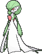
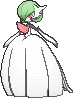

<!-- This file is generated by tools/generate_site.py. Edit the generator, not this file. -->

# #282 Gardevoir

{ .sprite-lg loading=lazy }

**Embrace Pokémon**

Psychic Fairy

[:material-arrow-left: #281 Kirlia](281.md) · [Pokédex](index.md) · [#283 Surskit :material-arrow-right:](283.md)

!!! note "No documented changes"

    Drayano's documentation lists no stat, type, ability, evolution or held item changes for this Pokémon. Its level-up moves are listed below as they appear in the hack.

## Location

Evolve { .icon loading=lazy } [Kirlia](../pokemon/281.md) (Lv. 30)

## Type defenses

| Damage taken | Attacking types |
| --- | --- |
| Immune (×0) | Dragon |
| Very resistant (×¼) | Fighting |
| Resistant (×½) | Psychic |
| Neutral (×1) | Normal Flying Ground Rock Bug Fire Water Grass Electric Ice Dark Fairy |
| Weak (×2) | Poison Ghost Steel |

## Abilities

| Slot | Ability | Effect | Note |
| --- | --- | --- | --- |
| Ability 1 | **Synchronize** | Copies burns, paralysis, and poison received onto the Pokémon that inflicted them. |  |
| Ability 2 | **Trace** | Copies an opponent's ability upon entering battle. |  |
| Hidden | **Telepathy** | Protects against friendly Pokémon's damaging moves. |  |

## Base stats

| Form | HP | Atk | Def | SpA | SpD | Spe | BST |
| --- | --- | --- | --- | --- | --- | --- | --- |
| { .sprite-sm loading=lazy } Normal | 68 | 65 | 65 | 125 | 115 | 80 | **518** |
| { .sprite-sm loading=lazy } Mega Gardevoir | 68 | 85 | 65 | 165 | 135 | 100 | **618** |

## Training & breeding

| Property | Value |
| --- | --- |
| EV yield | 3 SpA |
| Catch rate | 45 |
| Base friendship | 35 |
| Base experience | 233 |
| Growth rate | slow |
| Egg groups | Human-Like, Amorphous |
| Hatch counter | 20 |
| Gender ratio | 50% ♂ / 50% ♀ |
| Height / weight | 1.6 m / 48.4 kg |

## Evolution

- { .icon loading=lazy } [Ralts](../pokemon/280.md) → { .icon loading=lazy } [Kirlia](../pokemon/281.md): Lv. 20
- { .icon loading=lazy } [Kirlia](../pokemon/281.md) → { .icon loading=lazy } **[Gardevoir](../pokemon/282.md)**: Lv. 30
- { .icon loading=lazy } [Kirlia](../pokemon/281.md) → { .icon loading=lazy } [Gallade](../pokemon/475.md): Dawn Stone ♂
- { .sprite-sm loading=lazy } **Mega Gardevoir**: Mega Evolves by holding the { .item loading=lazy } Gardevoirite

## Wild held items

None.

## Level-up moves { data-search-exclude }

Moves marked &#42; are not normally learned by level up (they come from egg moves, TMs/HMs or tutors in the official games); moves marked &#42;&#42; cannot normally be learned by this Pokémon at all and are omitted from the legal-moves version of the hack.

| Lv. | Move | Type | Cat. | Power | Acc. | PP | Effect | Note |
| --- | --- | --- | --- | --- | --- | --- | --- | --- |
| 1 | Moonblast | Fairy | Special | 95 | 100% | 15 | Has a chance to lower the target’s Special Attack by one stage. |  |
| 1 | Stored Power | Psychic | Special | 20 | 100% | 10 | Power is higher the more the user’s stats have been raised, to a maximum of 31×. |  |
| 1 | Misty Terrain | Fairy | Status | — | — | 10 | For five turns, protects all Pokémon on the ground from major status ailments and confusion, and halves the power of incoming Dragon moves. |  |
| 1 | Healing Wish | Psychic | Status | — | — | 10 | User faints.  Its replacement has its HP fully restored and any major status effect removed. |  |
| 1 | Growl | Normal | Status | — | 100% | 40 | Lowers the target’s Attack by one stage. |  |
| 4 | Confusion | Psychic | Special | 50 | 100% | 25 | Has a chance to confuse the target. |  |
| 6 | Double Team | Normal | Status | — | — | 15 | Raises the user’s evasion by one stage. |  |
| 9 | Teleport | Psychic | Status | — | — | 20 | Immediately ends wild battles.  No effect otherwise. |  |
| 11 | [Disarming Voice](../changes/moves.md#disarming-voice) changed | Fairy | Special | 60 | — | 20 | Never misses. |  |
| 14 | Magical Leaf | Grass | Special | 60 | — | 20 | Never misses. |  |
| 17 | [Draining Kiss](../changes/moves.md#draining-kiss) changed | Fairy | Special | 75 | 100% | 10 | Drains 75% of the damage inflicted to heal the user. (Absorb %: 75 → 50) |  |
| 19 | Wish | Normal | Status | — | — | 10 | User will recover half its max HP at the end of the next turn. |  |
| 23 | Heal Pulse | Psychic | Status | — | — | 10 | Heals the target for half its max HP. |  |
| 26 | Psychic | Psychic | Special | 90 | 100% | 10 | Has a chance to lower the target’s Special Defense by one stage. |  |
| 30 | Hyper Voice | Normal | Special | 90 | 100% | 10 | Inflicts regular damage with no additional effect. | &#42; |
| 31 | Calm Mind | Psychic | Status | — | — | 20 | Raises the user’s Special Attack and Special Defense by one stage. |  |
| 35 | Imprison | Psychic | Status | — | — | 10 | Prevents the target from using any moves that the user also knows. |  |
| 40 | Future Sight | Psychic | Special | 120 | 100% | 10 | Hits the target two turns later. |  |
| 44 | Captivate | Normal | Status | — | 100% | 20 | Lowers the target’s Special Attack by two stages if it’s the opposite gender. |  |
| 49 | Hypnosis | Psychic | Status | — | 60% | 20 | Puts the target to sleep. |  |
| 53 | Dream Eater | Psychic | Special | 100 | 100% | 15 | Only works on sleeping Pokémon.  Drains half the damage inflicted to heal the user. |  |
| 58 | Stored Power | Psychic | Special | 20 | 100% | 10 | Power is higher the more the user’s stats have been raised, to a maximum of 31×. |  |
| 62 | Moonblast | Fairy | Special | 95 | 100% | 15 | Has a chance to lower the target’s Special Attack by one stage. |  |

## TM & HM moves { data-search-exclude }

| Machine | Move | Type | Cat. | Power | Acc. | PP | Effect |
| --- | --- | --- | --- | --- | --- | --- | --- |
| TM03 | Psyshock | Psychic | Special | 80 | 100% | 10 | Inflicts damage based on the target’s Defense, not Special Defense. |
| TM04 | Calm Mind | Psychic | Status | — | — | 20 | Raises the user’s Special Attack and Special Defense by one stage. |
| TM06 | Toxic | Poison | Status | — | 90% | 10 | Badly poisons the target, inflicting more damage every turn. |
| TM10 | Hidden Power | Normal | Special | 60 | 100% | 15 | Power and type depend upon user’s IVs.  Power can range from 30 to 70. |
| TM100 | Confide | Normal | Status | — | — | 20 | Lowers the target’s Special Attack by one stage. |
| TM11 | Sunny Day | Fire | Status | — | — | 5 | Changes the weather to sunny for five turns. |
| TM12 | Taunt | Dark | Status | — | 100% | 20 | For the next few turns, the target can only use damaging moves. |
| TM15 | Hyper Beam | Normal | Special | 150 | 90% | 5 | User foregoes its next turn to recharge. |
| TM16 | Light Screen | Psychic | Status | — | — | 30 | Reduces damage from special attacks by 50% for five turns. |
| TM17 | Protect | Normal | Status | — | — | 10 | Prevents any moves from hitting the user this turn. |
| TM18 | Rain Dance | Water | Status | — | — | 5 | Changes the weather to rain for five turns. |
| TM20 | Safeguard | Normal | Status | — | — | 25 | Protects the user’s field from major status ailments and confusion for five turns. |
| TM21 | Frustration | Normal | Physical | — | 100% | 20 | Power increases as happiness decreases, up to a maximum of 102. |
| TM24 | Thunderbolt | Electric | Special | 90 | 100% | 15 | Has a chance to paralyze the target. |
| TM27 | Return | Normal | Physical | — | 100% | 20 | Power increases with happiness, up to a maximum of 102. |
| TM29 | Psychic | Psychic | Special | 90 | 100% | 10 | Has a chance to lower the target’s Special Defense by one stage. |
| TM30 | Shadow Ball | Ghost | Special | 80 | 100% | 15 | Has a chance to lower the target’s Special Defense by one stage. |
| TM32 | Double Team | Normal | Status | — | — | 15 | Raises the user’s evasion by one stage. |
| TM33 | Reflect | Psychic | Status | — | — | 20 | Reduces damage from physical attacks by half. |
| TM41 | Torment | Dark | Status | — | 100% | 15 | Prevents the target from using the same move twice in a row. |
| TM42 | Facade | Normal | Physical | 70 | 100% | 20 | Power doubles if user is burned, paralyzed, or poisoned. |
| TM44 | Rest | Psychic | Status | — | — | 5 | User sleeps for two turns, completely healing itself. |
| TM45 | Attract | Normal | Status | — | 100% | 15 | Target falls in love if it has the opposite gender, and has a 50% chance to refuse attacking the user. |
| TM46 | Thief | Dark | Physical | 60 | 100% | 25 | Takes the target’s item. |
| TM48 | Round | Normal | Special | 60 | 100% | 15 | Has double power if it’s used more than once per turn. |
| TM49 | Echoed Voice | Normal | Special | 40 | 100% | 15 | Power increases by 100% for each consecutive use by any friendly Pokémon, to a maximum of 200. |
| TM52 | Focus Blast | Fighting | Special | 120 | 70% | 5 | Has a chance to lower the target’s Special Defense by one stage. |
| TM53 | Energy Ball | Grass | Special | 90 | 100% | 10 | Has a chance to lower the target’s Special Defense by one stage. |
| TM56 | Fling | Dark | Physical | — | 100% | 10 | Throws held item at the target; power depends on the item. |
| TM57 | Charge Beam | Electric | Special | 50 | 90% | 10 | Has a chance to raise the user’s Special Attack by one stage. |
| TM61 | Will-O-Wisp | Fire | Status | — | 85% | 15 | Burns the target. |
| TM68 | Giga Impact | Normal | Physical | 150 | 90% | 5 | User foregoes its next turn to recharge. |
| TM70 | Flash | Normal | Status | — | 100% | 20 | Lowers the target’s accuracy by one stage. |
| TM73 | Thunder Wave | Electric | Status | — | 100% | 20 | Paralyzes the target. |
| TM77 | Psych Up | Normal | Status | — | — | 10 | Discards the user’s stat changes and copies the target’s. |
| TM85 | Dream Eater | Psychic | Special | 100 | 100% | 15 | Only works on sleeping Pokémon.  Drains half the damage inflicted to heal the user. |
| TM86 | Grass Knot | Grass | Special | — | 100% | 20 | Inflicts more damage to heavier targets, with a maximum of 120 power. |
| TM87 | Swagger | Normal | Status | — | 90% | 15 | Raises the target’s Attack by two stages and confuses the target. |
| TM88 | Sleep Talk | Normal | Status | — | — | 10 | Randomly uses one of the user’s other three moves.  Only works if the user is sleeping. |
| TM90 | Substitute | Normal | Status | — | — | 10 | Transfers 1/4 of the user’s max HP into a doll, protecting the user from further damage or status changes until it breaks. |
| TM92 | Trick Room | Psychic | Status | — | — | 5 | For five turns, slower Pokémon will act before faster Pokémon. |
| TM94 | Secret Power | Normal | Physical | 70 | 100% | 20 | Has a chance to inflict a status effect which depends upon the terrain. |
| TM99 | Dazzling Gleam | Fairy | Special | 80 | 100% | 10 | Inflicts regular damage with no additional effect. |

## Move tutor moves { data-search-exclude }

| Move | Type | Cat. | Power | Acc. | PP | Effect |
| --- | --- | --- | --- | --- | --- | --- |
| Fire Punch | Fire | Physical | 75 | 100% | 15 | Has a chance to burn the target. |
| Heal Bell | Normal | Status | — | — | 5 | Cures the entire party of major status effects. |
| Helping Hand | Normal | Status | — | — | 20 | Ally’s next move inflicts half more damage. |
| Hyper Voice | Normal | Special | 90 | 100% | 10 | Inflicts regular damage with no additional effect. |
| Ice Punch | Ice | Physical | 75 | 100% | 15 | Has a chance to freeze the target. |
| Icy Wind | Ice | Special | 55 | 95% | 15 | Has a chance to lower the target’s Speed by one stage. |
| Magic Coat | Psychic | Status | — | — | 15 | Reflects back the first effect move used on the user this turn. |
| Magic Room | Psychic | Status | — | — | 10 | Negates held items for five turns. |
| Pain Split | Normal | Status | — | — | 20 | Sets the user’s and targets’s HP to the average of their current HP. |
| Recycle | Normal | Status | — | — | 10 | User recovers the item it last used up. |
| Shock Wave | Electric | Special | 60 | — | 20 | Never misses. |
| Signal Beam | Bug | Special | 75 | 100% | 15 | Has a chance to confuse the target. |
| Skill Swap | Psychic | Status | — | — | 10 | User and target swap abilities. |
| Snatch | Dark | Status | — | — | 10 | Steals the target’s move, if it’s self-targeted. |
| Snore | Normal | Special | 50 | 100% | 15 | Has a chance to make the target flinch.  Only works if the user is sleeping. |
| Thunder Punch | Electric | Physical | 75 | 100% | 15 | Has a chance to paralyze the target. |
| Trick | Psychic | Status | — | 100% | 10 | User and target swap items. |
| Wonder Room | Psychic | Status | — | — | 10 | All Pokémon’s Defense and Special Defense are swapped for 5 turns. |
| Zen Headbutt | Psychic | Physical | 80 | 90% | 15 | Has a chance to make the target flinch. |

## Egg moves { data-search-exclude }

No egg moves.

??? note "Trainers using Gardevoir (12)"

    | Area | Trainer | Level |
    | --- | --- | --- |
    | [Route 116](../trainers/route_116.md#rematches) | Schoolkid Jerry (6) | Lv. 47 |
    | [Route 116](../trainers/route_116.md#rematches) | Schoolkid Jerry (C) | Lv. 75 |
    | [Route 109](../trainers/route_109.md#trainers) | Ace Trainer Portia | Lv. 38 |
    | [Route 109](../trainers/route_109.md#rematches) | Ace Trainer Portia (6) | Lv. 47 |
    | [Route 109](../trainers/route_109.md#rematches) | Ace Trainer Portia (7) | Lv. 59 |
    | [Route 109](../trainers/route_109.md#rematches) | Ace Trainer Portia (8) | Lv. 64 |
    | [Route 109](../trainers/route_109.md#rematches) | Ace Trainer Portia (C) | Lv. 75 |
    | [Mossdeep Gym](../trainers/mossdeep_gym.md#trainers) | Leaders Liza & Tate | Lv. 62 |
    | [Victory Road 1F](../trainers/victory_road_1f.md#trainers) | Brains & Brawn Aden & Finn | Lv. 65 |
    | [Battle Resort](../trainers/battle_resort.md#trainers) | Champion Josephine [Diantha] | Lv. 88 |
    | [Battle Resort](../trainers/battle_resort.md#trainers) | Leader Josephine [Liza] | Lv. 79 |
    | [Battle Resort](../trainers/battle_resort.md#trainers) | Leader Josephine [Liza] | Lv. 79 |

---

[:material-arrow-left: #281 Kirlia](281.md) · [#283 Surskit :material-arrow-right:](283.md)
