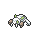

<!-- This file is generated by tools/generate_site.py. Edit the generator, not this file. -->

# #291 Ninjask

{ .sprite-lg loading=lazy }

**Ninja Pokémon**

Bug Flying

[:material-arrow-left: #290 Nincada](290.md) · [Pokédex](index.md) · [#292 Shedinja :material-arrow-right:](292.md)

!!! info "Changes in Rising Ruby / Sinking Sapphire"

    - **Ability 2:** **Infiltrator** 
    - **New TM/HM compatibility:** [Fly](../changes/moves.md#fly) changed

## Location

Evolve { .icon loading=lazy } [Nincada](../pokemon/290.md) (Lv. 20)

## Type defenses

| Damage taken | Attacking types |
| --- | --- |
| Immune (×0) | Ground |
| Very resistant (×¼) | Fighting Grass |
| Resistant (×½) | Bug |
| Neutral (×1) | Normal Poison Ghost Steel Water Psychic Dragon Dark Fairy |
| Weak (×2) | Flying Fire Electric Ice |
| Very weak (×4) | Rock |

## Abilities

| Slot | Ability | Effect | Note |
| --- | --- | --- | --- |
| Ability 1 | **Speed Boost** | Raises Speed one stage after each turn. |  |
| Ability 2 | **Infiltrator** | Bypasses Light Screen, Reflect, and Safeguard. | changed  |
| Hidden | **Infiltrator** | Bypasses Light Screen, Reflect, and Safeguard. |  |

## Base stats

| Form | HP | Atk | Def | SpA | SpD | Spe | BST |
| --- | --- | --- | --- | --- | --- | --- | --- |
| { .sprite-sm loading=lazy } Normal | 61 | 90 | 45 | 50 | 50 | 160 | **456** |

## Training & breeding

| Property | Value |
| --- | --- |
| EV yield | 2 Spe |
| Catch rate | 120 |
| Base friendship | 70 |
| Base experience | 160 |
| Growth rate | erratic |
| Egg groups | Bug |
| Hatch counter | 15 |
| Gender ratio | 50% ♂ / 50% ♀ |
| Height / weight | 0.8 m / 12 kg |

## Evolution

- { .icon loading=lazy } [Nincada](../pokemon/290.md) → { .icon loading=lazy } **[Ninjask](../pokemon/291.md)**: Lv. 20
- { .icon loading=lazy } [Nincada](../pokemon/290.md) → { .icon loading=lazy } [Shedinja](../pokemon/292.md): Lv. 20

## Wild held items

None.

## Level-up moves { data-search-exclude }

Moves marked &#42; are not normally learned by level up (they come from egg moves, TMs/HMs or tutors in the official games); moves marked &#42;&#42; cannot normally be learned by this Pokémon at all and are omitted from the legal-moves version of the hack.

| Lv. | Move | Type | Cat. | Power | Acc. | PP | Effect | Note |
| --- | --- | --- | --- | --- | --- | --- | --- | --- |
| 1 | [Scratch](../changes/moves.md#scratch) changed | Normal | Physical | 50 | 100% | 35 | Inflicts regular damage with no additional effect. |  |
| 1 | Harden | Normal | Status | — | — | 30 | Raises the user’s Defense by one stage. |  |
| 1 | Leech Life | Bug | Physical | 20 | 100% | 15 | Drains half the damage inflicted to heal the user. |  |
| 1 | Agility | Psychic | Status | — | — | 30 | Raises the user’s Speed by two stages. |  |
| 5 | Sand Attack | Ground | Status | — | 100% | 15 | Lowers the target’s accuracy by one stage. |  |
| 9 | Fury Swipes | Normal | Physical | 18 | 80% | 15 | Hits 2-5 times in one turn. |  |
| 13 | Bug Bite | Bug | Physical | 60 | 100% | 20 | If target has a berry, inflicts double damage and uses the berry. |  |
| 17 | Night Slash | Dark | Physical | 70 | 100% | 15 | Has an increased chance for a critical hit. | &#42; |
| 20 | Double Team | Normal | Status | — | — | 15 | Raises the user’s evasion by one stage. |  |
| 20 | Fury Cutter | Bug | Physical | 40 | 95% | 20 | Power doubles every turn this move is used in succession after the first, maxing out after five turns. |  |
| 20 | Screech | Normal | Status | — | 85% | 40 | Lowers the target’s Defense by two stages. |  |
| 23 | Slash | Normal | Physical | 70 | 100% | 20 | Has an increased chance for a critical hit. |  |
| 28 | Mind Reader | Normal | Status | — | — | 5 | Ensures that the user’s next move will hit the target. |  |
| 33 | X-Scissor | Bug | Physical | 80 | 100% | 15 | Inflicts regular damage with no additional effect. |  |
| 38 | Swords Dance | Normal | Status | — | — | 20 | Raises the user’s Attack by two stages. |  |
| 43 | Baton Pass | Normal | Status | — | — | 40 | Allows the trainer to switch out the user and pass effects along to its replacement. |  |
| 48 | Extreme Speed | Normal | Physical | 80 | 100% | 5 | Inflicts regular damage with no additional effect. | &#42;&#42; |

## TM & HM moves { data-search-exclude }

| Machine | Move | Type | Cat. | Power | Acc. | PP | Effect |
| --- | --- | --- | --- | --- | --- | --- | --- |
| HM01 | [Cut](../changes/moves.md#cut) changed | Grass | Physical | 70 | 100% | 15 | High Critical Rate. High Critical Rate |
| HM02 new | [Fly](../changes/moves.md#fly) changed | Flying | Physical | 100 | 100% | 10 | User flies high into the air, dodging all attacks, and hits next turn. |
| TM01 | Hone Claws | Dark | Status | — | — | 15 | Raises the user’s Attack and accuracy by one stage. |
| TM06 | Toxic | Poison | Status | — | 90% | 10 | Badly poisons the target, inflicting more damage every turn. |
| TM10 | Hidden Power | Normal | Special | 60 | 100% | 15 | Power and type depend upon user’s IVs.  Power can range from 30 to 70. |
| TM100 | Confide | Normal | Status | — | — | 20 | Lowers the target’s Special Attack by one stage. |
| TM11 | Sunny Day | Fire | Status | — | — | 5 | Changes the weather to sunny for five turns. |
| TM15 | Hyper Beam | Normal | Special | 150 | 90% | 5 | User foregoes its next turn to recharge. |
| TM17 | Protect | Normal | Status | — | — | 10 | Prevents any moves from hitting the user this turn. |
| TM19 | Roost | Flying | Status | — | — | 5 | Heals the user by half its max HP. |
| TM21 | Frustration | Normal | Physical | — | 100% | 20 | Power increases as happiness decreases, up to a maximum of 102. |
| TM22 | Solar Beam | Grass | Special | 120 | 100% | 10 | Requires a turn to charge before attacking. |
| TM27 | Return | Normal | Physical | — | 100% | 20 | Power increases with happiness, up to a maximum of 102. |
| TM28 | Dig | Ground | Physical | 80 | 100% | 10 | User digs underground, dodging all attacks, and hits next turn. |
| TM30 | Shadow Ball | Ghost | Special | 80 | 100% | 15 | Has a chance to lower the target’s Special Defense by one stage. |
| TM32 | Double Team | Normal | Status | — | — | 15 | Raises the user’s evasion by one stage. |
| TM37 | Sandstorm | Rock | Status | — | — | 10 | Changes the weather to a sandstorm for five turns. |
| TM40 | Aerial Ace | Flying | Physical | 60 | — | 20 | Never misses. |
| TM42 | Facade | Normal | Physical | 70 | 100% | 20 | Power doubles if user is burned, paralyzed, or poisoned. |
| TM44 | Rest | Psychic | Status | — | — | 5 | User sleeps for two turns, completely healing itself. |
| TM45 | Attract | Normal | Status | — | 100% | 15 | Target falls in love if it has the opposite gender, and has a 50% chance to refuse attacking the user. |
| TM46 | Thief | Dark | Physical | 60 | 100% | 25 | Takes the target’s item. |
| TM48 | Round | Normal | Special | 60 | 100% | 15 | Has double power if it’s used more than once per turn. |
| TM54 | False Swipe | Normal | Physical | 40 | 100% | 40 | Cannot lower the target’s HP below 1. |
| TM68 | Giga Impact | Normal | Physical | 150 | 90% | 5 | User foregoes its next turn to recharge. |
| TM70 | Flash | Normal | Status | — | 100% | 20 | Lowers the target’s accuracy by one stage. |
| TM75 | Swords Dance | Normal | Status | — | — | 20 | Raises the user’s Attack by two stages. |
| TM76 | Struggle Bug | Bug | Special | 50 | 100% | 20 | Has a chance to lower the target’s Special Attack by one stage. |
| TM81 | X-Scissor | Bug | Physical | 80 | 100% | 15 | Inflicts regular damage with no additional effect. |
| TM87 | Swagger | Normal | Status | — | 90% | 15 | Raises the target’s Attack by two stages and confuses the target. |
| TM88 | Sleep Talk | Normal | Status | — | — | 10 | Randomly uses one of the user’s other three moves.  Only works if the user is sleeping. |
| TM89 | U-turn | Bug | Physical | 70 | 100% | 20 | User must switch out after attacking. |
| TM90 | Substitute | Normal | Status | — | — | 10 | Transfers 1/4 of the user’s max HP into a doll, protecting the user from further damage or status changes until it breaks. |
| TM94 | Secret Power | Normal | Physical | 70 | 100% | 20 | Has a chance to inflict a status effect which depends upon the terrain. |

## Move tutor moves { data-search-exclude }

| Move | Type | Cat. | Power | Acc. | PP | Effect |
| --- | --- | --- | --- | --- | --- | --- |
| Bug Bite | Bug | Physical | 60 | 100% | 20 | If target has a berry, inflicts double damage and uses the berry. |
| Giga Drain | Grass | Special | 75 | 100% | 10 | Drains half the damage inflicted to heal the user. |
| Snore | Normal | Special | 50 | 100% | 15 | Has a chance to make the target flinch.  Only works if the user is sleeping. |
| Spite | Ghost | Status | — | 100% | 10 | Lowers the PP of the target’s last used move by 4. |
| Uproar | Normal | Special | 90 | 100% | 10 | Forced to use this move for several turns.  Pokémon cannot fall asleep in that time. |

## Egg moves { data-search-exclude }

No egg moves.

??? note "Trainers using Ninjask (5)"

    | Area | Trainer | Level |
    | --- | --- | --- |
    | [Petalburg Woods](../trainers/petalburg_woods.md#rematches) | Bug Catcher James (4) | Lv. 35 |
    | [Petalburg Woods](../trainers/petalburg_woods.md#rematches) | Bug Catcher James (C) | Lv. 75 |
    | [Route 113](../trainers/route_113.md#trainers) | Ninja Boy Lung | Lv. 28 |
    | [Route 119 (Mauville)](../trainers/route_119_mauville.md#trainers) | Bug Catcher Doug | Lv. 39 |
    | [Route 120 South-West](../trainers/route_120_south_west.md#trainers) | Ninja Boy Keigo | Lv. 47 |

---

[:material-arrow-left: #290 Nincada](290.md) · [#292 Shedinja :material-arrow-right:](292.md)
