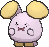

<!-- This file is generated by tools/generate_site.py. Edit the generator, not this file. -->

# #293 Whismur

{ .sprite-lg loading=lazy }

**Whisper Pokémon**

Normal

[:material-arrow-left: #292 Shedinja](292.md) · [Pokédex](index.md) · [#294 Loudred :material-arrow-right:](294.md)

!!! info "Changes in Rising Ruby / Sinking Sapphire"

    - **Ability 2:** **Rattled** 

## Location

[Rusturf Tunnel](../wild/rusturf_tunnel.md)

### Wild encounters

| Area | Method | Level | Note |
| --- | --- | --- | --- |
| [Rusturf Tunnel](../wild/rusturf_tunnel.md) | Walking | 10 |  |

## Type defenses

| Damage taken | Attacking types |
| --- | --- |
| Immune (×0) | Ghost |
| Neutral (×1) | Normal Flying Poison Ground Rock Bug Steel Fire Water Grass Electric Psychic Ice Dragon Dark Fairy |
| Weak (×2) | Fighting |

## Abilities

| Slot | Ability | Effect | Note |
| --- | --- | --- | --- |
| Ability 1 | **Soundproof** | Protects against sound-based moves. |  |
| Ability 2 | **Rattled** | Raises Speed one stage upon being hit by a Dark, Ghost, or Bug move. | changed  |
| Hidden | **Rattled** | Raises Speed one stage upon being hit by a Dark, Ghost, or Bug move. |  |

## Base stats

| Form | HP | Atk | Def | SpA | SpD | Spe | BST |
| --- | --- | --- | --- | --- | --- | --- | --- |
| { .sprite-sm loading=lazy } Normal | 64 | 51 | 23 | 51 | 23 | 28 | **240** |

## Training & breeding

| Property | Value |
| --- | --- |
| EV yield | 1 HP |
| Catch rate | 190 |
| Base friendship | 70 |
| Base experience | 48 |
| Growth rate | medium slow |
| Egg groups | Monster, Field |
| Hatch counter | 20 |
| Gender ratio | 50% ♂ / 50% ♀ |
| Height / weight | 0.6 m / 16.3 kg |

## Evolution

- { .icon loading=lazy } **[Whismur](../pokemon/293.md)** → { .icon loading=lazy } [Loudred](../pokemon/294.md): Lv. 20
- { .icon loading=lazy } [Loudred](../pokemon/294.md) → { .icon loading=lazy } [Exploud](../pokemon/295.md): Lv. 40

## Wild held items

None.

## Level-up moves { data-search-exclude }

Moves marked &#42; are not normally learned by level up (they come from egg moves, TMs/HMs or tutors in the official games); moves marked &#42;&#42; cannot normally be learned by this Pokémon at all and are omitted from the legal-moves version of the hack.

| Lv. | Move | Type | Cat. | Power | Acc. | PP | Effect | Note |
| --- | --- | --- | --- | --- | --- | --- | --- | --- |
| 1 | [Pound](../changes/moves.md#pound) changed | Normal | Physical | 50 | 100% | 35 | Inflicts regular damage with no additional effect. |  |
| 4 | Echoed Voice | Normal | Special | 40 | 100% | 15 | Power increases by 100% for each consecutive use by any friendly Pokémon, to a maximum of 200. |  |
| 7 | Astonish | Ghost | Physical | 30 | 100% | 15 | Has a chance to make the target flinch. |  |
| 10 | Howl | Normal | Status | — | — | 40 | Raises the user’s Attack by one stage. |  |
| 13 | Screech | Normal | Status | — | 85% | 40 | Lowers the target’s Defense by two stages. |  |
| 16 | Stomp | Normal | Physical | 65 | 100% | 20 | Has a chance to make the target flinch. |  |
| 19 | Supersonic | Normal | Status | — | 55% | 20 | Confuses the target. |  |
| 22 | Uproar | Normal | Special | 90 | 100% | 10 | Forced to use this move for several turns.  Pokémon cannot fall asleep in that time. |  |
| 25 | Extrasensory | Psychic | Special | 80 | 100% | 20 | Has a chance to make the target flinch. | &#42; |
| 28 | Roar | Normal | Status | — | — | 20 | Immediately ends wild battles.  Forces trainers to switch Pokémon. |  |
| 31 | Rest | Psychic | Status | — | — | 5 | User sleeps for two turns, completely healing itself. |  |
| 34 | Sleep Talk | Normal | Status | — | — | 10 | Randomly uses one of the user’s other three moves.  Only works if the user is sleeping. |  |
| 37 | Hyper Voice | Normal | Special | 90 | 100% | 10 | Inflicts regular damage with no additional effect. |  |
| 40 | Synchronoise | Psychic | Special | 120 | 100% | 10 | Hits any Pokémon that shares a type with the user. |  |

## TM & HM moves { data-search-exclude }

| Machine | Move | Type | Cat. | Power | Acc. | PP | Effect |
| --- | --- | --- | --- | --- | --- | --- | --- |
| TM05 | Roar | Normal | Status | — | — | 20 | Immediately ends wild battles.  Forces trainers to switch Pokémon. |
| TM06 | Toxic | Poison | Status | — | 90% | 10 | Badly poisons the target, inflicting more damage every turn. |
| TM10 | Hidden Power | Normal | Special | 60 | 100% | 15 | Power and type depend upon user’s IVs.  Power can range from 30 to 70. |
| TM100 | Confide | Normal | Status | — | — | 20 | Lowers the target’s Special Attack by one stage. |
| TM11 | Sunny Day | Fire | Status | — | — | 5 | Changes the weather to sunny for five turns. |
| TM13 | Ice Beam | Ice | Special | 90 | 100% | 10 | Has a chance to freeze the target. |
| TM14 | Blizzard | Ice | Special | 110 | 70% | 5 | Has a chance to freeze the target. |
| TM17 | Protect | Normal | Status | — | — | 10 | Prevents any moves from hitting the user this turn. |
| TM18 | Rain Dance | Water | Status | — | — | 5 | Changes the weather to rain for five turns. |
| TM21 | Frustration | Normal | Physical | — | 100% | 20 | Power increases as happiness decreases, up to a maximum of 102. |
| TM22 | Solar Beam | Grass | Special | 120 | 100% | 10 | Requires a turn to charge before attacking. |
| TM27 | Return | Normal | Physical | — | 100% | 20 | Power increases with happiness, up to a maximum of 102. |
| TM30 | Shadow Ball | Ghost | Special | 80 | 100% | 15 | Has a chance to lower the target’s Special Defense by one stage. |
| TM32 | Double Team | Normal | Status | — | — | 15 | Raises the user’s evasion by one stage. |
| TM35 | Flamethrower | Fire | Special | 90 | 100% | 15 | Has a chance to burn the target. |
| TM38 | Fire Blast | Fire | Special | 110 | 85% | 5 | Has a chance to burn the target. |
| TM42 | Facade | Normal | Physical | 70 | 100% | 20 | Power doubles if user is burned, paralyzed, or poisoned. |
| TM44 | Rest | Psychic | Status | — | — | 5 | User sleeps for two turns, completely healing itself. |
| TM45 | Attract | Normal | Status | — | 100% | 15 | Target falls in love if it has the opposite gender, and has a 50% chance to refuse attacking the user. |
| TM48 | Round | Normal | Special | 60 | 100% | 15 | Has double power if it’s used more than once per turn. |
| TM49 | Echoed Voice | Normal | Special | 40 | 100% | 15 | Power increases by 100% for each consecutive use by any friendly Pokémon, to a maximum of 200. |
| TM56 | Fling | Dark | Physical | — | 100% | 10 | Throws held item at the target; power depends on the item. |
| TM59 | Incinerate | Fire | Special | 60 | 100% | 15 | Destroys the target’s held berry. |
| TM67 | Retaliate | Normal | Physical | 70 | 100% | 5 | Has double power if a friendly Pokémon fainted last turn. |
| TM87 | Swagger | Normal | Status | — | 90% | 15 | Raises the target’s Attack by two stages and confuses the target. |
| TM88 | Sleep Talk | Normal | Status | — | — | 10 | Randomly uses one of the user’s other three moves.  Only works if the user is sleeping. |
| TM90 | Substitute | Normal | Status | — | — | 10 | Transfers 1/4 of the user’s max HP into a doll, protecting the user from further damage or status changes until it breaks. |
| TM94 | Secret Power | Normal | Physical | 70 | 100% | 20 | Has a chance to inflict a status effect which depends upon the terrain. |

## Move tutor moves { data-search-exclude }

| Move | Type | Cat. | Power | Acc. | PP | Effect |
| --- | --- | --- | --- | --- | --- | --- |
| Endeavor | Normal | Physical | — | 100% | 5 | Lowers the target’s HP to equal the user’s. |
| Fire Punch | Fire | Physical | 75 | 100% | 15 | Has a chance to burn the target. |
| Hyper Voice | Normal | Special | 90 | 100% | 10 | Inflicts regular damage with no additional effect. |
| Ice Punch | Ice | Physical | 75 | 100% | 15 | Has a chance to freeze the target. |
| Icy Wind | Ice | Special | 55 | 95% | 15 | Has a chance to lower the target’s Speed by one stage. |
| Shock Wave | Electric | Special | 60 | — | 20 | Never misses. |
| Snore | Normal | Special | 50 | 100% | 15 | Has a chance to make the target flinch.  Only works if the user is sleeping. |
| Thunder Punch | Electric | Physical | 75 | 100% | 15 | Has a chance to paralyze the target. |
| Uproar | Normal | Special | 90 | 100% | 10 | Forced to use this move for several turns.  Pokémon cannot fall asleep in that time. |
| Water Pulse | Water | Special | 60 | 100% | 20 | Has a chance to confuse the target. |
| Zen Headbutt | Psychic | Physical | 80 | 90% | 15 | Has a chance to make the target flinch. |

## Egg moves { data-search-exclude }

| Move | Type | Cat. | Power | Acc. | PP | Effect |
| --- | --- | --- | --- | --- | --- | --- |
| Circle Throw | Fighting | Physical | 60 | 90% | 10 | Ends wild battles.  Forces trainers to switch Pokémon. |
| [Disarming Voice](../changes/moves.md#disarming-voice) changed | Fairy | Special | 60 | — | 20 | Never misses. |
| Endeavor | Normal | Physical | — | 100% | 5 | Lowers the target’s HP to equal the user’s. |
| Extrasensory | Psychic | Special | 80 | 100% | 20 | Has a chance to make the target flinch. |
| Fake Tears | Dark | Status | — | 100% | 20 | Lowers the target’s Special Defense by two stages. |
| Hammer Arm | Fighting | Physical | 100 | 90% | 10 | Lowers user’s Speed by one stage. |
| Smelling Salts | Normal | Physical | 70 | 100% | 10 | If the target is paralyzed, inflicts double damage and cures the paralysis. |
| Smokescreen | Normal | Status | — | 100% | 20 | Lowers the target’s accuracy by one stage. |
| Snore | Normal | Special | 50 | 100% | 15 | Has a chance to make the target flinch.  Only works if the user is sleeping. |
| Take Down | Normal | Physical | 90 | 85% | 20 | User receives 1/4 the damage it inflicts in recoil. |

??? note "Trainers using Whismur (2)"

    | Area | Trainer | Level |
    | --- | --- | --- |
    | [Route 111](../trainers/route_111.md#trainers) | Interviewers Gabby & Ty | Lv. 25 |
    | [Route 118](../trainers/route_118.md#trainers-west-of-inlet) | Guitarist Dalton | Lv. 22 |

---

[:material-arrow-left: #292 Shedinja](292.md) · [#294 Loudred :material-arrow-right:](294.md)
