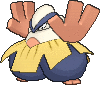
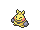
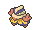
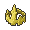

<!-- This file is generated by tools/generate_site.py. Edit the generator, not this file. -->

# #297 Hariyama

{ .sprite-lg loading=lazy }

**Arm Thrust Pokémon**

Fighting

[:material-arrow-left: #296 Makuhita](296.md) · [Pokédex](index.md) · [#298 Azurill :material-arrow-right:](298.md)

!!! note "No documented changes"

    Drayano's documentation lists no stat, type, ability, evolution or held item changes for this Pokémon. Its level-up moves are listed below as they appear in the hack.

## Location

[Granite Cave](../wild/granite_cave_1f.md), [Victory Road](../wild/victory_road_1f.md)

### Wild encounters

| Area | Method | Level | Note |
| --- | --- | --- | --- |
| [Granite Cave B2F](../wild/granite_cave_b2f.md) | Walking | 20 |  |
| [Victory Road B1F](../wild/victory_road_b1f.md) | Walking | 59 |  |

## Type defenses

| Damage taken | Attacking types |
| --- | --- |
| Resistant (×½) | Rock Bug Dark |
| Neutral (×1) | Normal Fighting Poison Ground Ghost Steel Fire Water Grass Electric Ice Dragon |
| Weak (×2) | Flying Psychic Fairy |

## Abilities

| Slot | Ability | Effect | Note |
| --- | --- | --- | --- |
| Ability 1 | **Thick Fat** | Halves damage from Fire and Ice moves. |  |
| Ability 2 | **Guts** | Increases Attack to 1.5× with a major status ailment. |  |
| Hidden | **Sheer Force** | Strengthens moves with extra effects to 1.3× their power, but prevents their extra effects. |  |

## Base stats

| Form | HP | Atk | Def | SpA | SpD | Spe | BST |
| --- | --- | --- | --- | --- | --- | --- | --- |
| { .sprite-sm loading=lazy } Normal | 144 | 120 | 60 | 40 | 60 | 50 | **474** |

## Training & breeding

| Property | Value |
| --- | --- |
| EV yield | 2 HP |
| Catch rate | 200 |
| Base friendship | 70 |
| Base experience | 166 |
| Growth rate | fluctuating |
| Egg groups | Human-Like |
| Hatch counter | 20 |
| Gender ratio | 75% ♂ / 25% ♀ |
| Height / weight | 2.3 m / 253.8 kg |

## Evolution

- { .icon loading=lazy } [Makuhita](../pokemon/296.md) → { .icon loading=lazy } **[Hariyama](../pokemon/297.md)**: Lv. 24

## Wild held items

| Item | Chance | Note |
| --- | --- | --- |
| { .item loading=lazy } King’s Rock | 5% |  |

## Level-up moves { data-search-exclude }

Moves marked &#42; are not normally learned by level up (they come from egg moves, TMs/HMs or tutors in the official games); moves marked &#42;&#42; cannot normally be learned by this Pokémon at all and are omitted from the legal-moves version of the hack.

| Lv. | Move | Type | Cat. | Power | Acc. | PP | Effect | Note |
| --- | --- | --- | --- | --- | --- | --- | --- | --- |
| 1 | Brine | Water | Special | 65 | 100% | 10 | Has double power against Pokémon that have less than half their max HP remaining. |  |
| 1 | Ice Punch | Ice | Physical | 75 | 100% | 15 | Has a chance to freeze the target. | &#42; |
| 1 | Fire Punch | Fire | Physical | 75 | 100% | 15 | Has a chance to burn the target. | &#42; |
| 1 | Thunder Punch | Electric | Physical | 75 | 100% | 15 | Has a chance to paralyze the target. | &#42; |
| 1 | Tackle | Normal | Physical | 50 | 100% | 35 | Inflicts regular damage with no additional effect. |  |
| 1 | Focus Energy | Normal | Status | — | — | 30 | Increases the user’s chance to score a critical hit. |  |
| 4 | Sand Attack | Ground | Status | — | 100% | 15 | Lowers the target’s accuracy by one stage. |  |
| 7 | Arm Thrust | Fighting | Physical | 15 | 100% | 20 | Hits 2-5 times in one turn. |  |
| 10 | Fake Out | Normal | Physical | 40 | 100% | 10 | Can only be used as the first move after the user enters battle.  Causes the target to flinch. |  |
| 13 | Force Palm | Fighting | Physical | 60 | 100% | 10 | Has a chance to paralyze the target. |  |
| 16 | Whirlwind | Normal | Status | — | — | 20 | Immediately ends wild battles.  Forces trainers to switch Pokémon. |  |
| 19 | Knock Off | Dark | Physical | 65 | 100% | 20 | Target drops its held item. |  |
| 22 | Vital Throw | Fighting | Physical | 70 | — | 10 | Never misses. |  |
| 26 | Belly Drum | Normal | Status | — | — | 10 | User pays half its max HP to max out its Attack. |  |
| 30 | Smelling Salts | Normal | Physical | 70 | 100% | 10 | If the target is paralyzed, inflicts double damage and cures the paralysis. |  |
| 34 | Seismic Toss | Fighting | Physical | — | 100% | 20 | Inflicts damage equal to the user’s level. |  |
| 38 | Wake-Up Slap | Fighting | Physical | 70 | 100% | 10 | If the target is asleep, has double power and wakes it up. |  |
| 42 | Endure | Normal | Status | — | — | 10 | Prevents the user’s HP from lowering below 1 this turn. |  |
| 46 | Close Combat | Fighting | Physical | 120 | 100% | 5 | Lowers the user’s Defense and Special Defense by one stage after inflicting damage. |  |
| 50 | Reversal | Fighting | Physical | — | 100% | 15 | Inflicts more damage when the user has less HP remaining, with a maximum of 200 power. |  |
| 54 | Heavy Slam | Steel | Physical | — | 100% | 10 | Power is higher when the user weighs more than the target, up to a maximum of 120. |  |
| 58 | Cross Chop | Fighting | Physical | 100 | 80% | 5 | Has an increased chance for a critical hit. | &#42; |

## TM & HM moves { data-search-exclude }

| Machine | Move | Type | Cat. | Power | Acc. | PP | Effect |
| --- | --- | --- | --- | --- | --- | --- | --- |
| HM03 | Surf | Water | Special | 90 | 100% | 15 | Inflicts regular damage and can hit Dive users. |
| HM04 | [Strength](../changes/moves.md#strength) changed | Normal | Physical | 100 | 100% | 10 | Inflicts regular damage with no additional effect. |
| HM06 | [Rock Smash](../changes/moves.md#rock-smash) changed | Fighting | Physical | 65 | 100% | 15 | Has a chance to lower the target’s Defense by one stage. |
| TM06 | Toxic | Poison | Status | — | 90% | 10 | Badly poisons the target, inflicting more damage every turn. |
| TM08 | Bulk Up | Fighting | Status | — | — | 20 | Raises the user’s Attack and Defense by one stage. |
| TM10 | Hidden Power | Normal | Special | 60 | 100% | 15 | Power and type depend upon user’s IVs.  Power can range from 30 to 70. |
| TM100 | Confide | Normal | Status | — | — | 20 | Lowers the target’s Special Attack by one stage. |
| TM11 | Sunny Day | Fire | Status | — | — | 5 | Changes the weather to sunny for five turns. |
| TM15 | Hyper Beam | Normal | Special | 150 | 90% | 5 | User foregoes its next turn to recharge. |
| TM17 | Protect | Normal | Status | — | — | 10 | Prevents any moves from hitting the user this turn. |
| TM18 | Rain Dance | Water | Status | — | — | 5 | Changes the weather to rain for five turns. |
| TM21 | Frustration | Normal | Physical | — | 100% | 20 | Power increases as happiness decreases, up to a maximum of 102. |
| TM23 | Smack Down | Rock | Physical | 50 | 100% | 15 | Removes any immunity to Ground damage. |
| TM26 | Earthquake | Ground | Physical | 100 | 100% | 10 | Inflicts regular damage and can hit Dig users. |
| TM27 | Return | Normal | Physical | — | 100% | 20 | Power increases with happiness, up to a maximum of 102. |
| TM28 | Dig | Ground | Physical | 80 | 100% | 10 | User digs underground, dodging all attacks, and hits next turn. |
| TM31 | Brick Break | Fighting | Physical | 75 | 100% | 15 | Destroys Reflect and Light Screen. |
| TM32 | Double Team | Normal | Status | — | — | 15 | Raises the user’s evasion by one stage. |
| TM39 | Rock Tomb | Rock | Physical | 60 | 95% | 15 | Has a chance to lower the target’s Speed by one stage. |
| TM42 | Facade | Normal | Physical | 70 | 100% | 20 | Power doubles if user is burned, paralyzed, or poisoned. |
| TM44 | Rest | Psychic | Status | — | — | 5 | User sleeps for two turns, completely healing itself. |
| TM45 | Attract | Normal | Status | — | 100% | 15 | Target falls in love if it has the opposite gender, and has a 50% chance to refuse attacking the user. |
| TM47 | Low Sweep | Fighting | Physical | 65 | 100% | 20 | Lowers the target’s Speed by one stage. |
| TM48 | Round | Normal | Special | 60 | 100% | 15 | Has double power if it’s used more than once per turn. |
| TM52 | Focus Blast | Fighting | Special | 120 | 70% | 5 | Has a chance to lower the target’s Special Defense by one stage. |
| TM56 | Fling | Dark | Physical | — | 100% | 10 | Throws held item at the target; power depends on the item. |
| TM66 | Payback | Dark | Physical | 50 | 100% | 10 | Power is doubled if the target has already moved this turn. |
| TM67 | Retaliate | Normal | Physical | 70 | 100% | 5 | Has double power if a friendly Pokémon fainted last turn. |
| TM68 | Giga Impact | Normal | Physical | 150 | 90% | 5 | User foregoes its next turn to recharge. |
| TM71 | Stone Edge | Rock | Physical | 100 | 80% | 5 | Has an increased chance for a critical hit. |
| TM78 | Bulldoze | Ground | Physical | 60 | 100% | 20 | Has a chance to lower the target’s Speed by one stage. |
| TM80 | Rock Slide | Rock | Physical | 75 | 90% | 10 | Has a chance to make the target flinch. |
| TM84 | Poison Jab | Poison | Physical | 80 | 100% | 20 | Has a chance to poison the target. |
| TM87 | Swagger | Normal | Status | — | 90% | 15 | Raises the target’s Attack by two stages and confuses the target. |
| TM88 | Sleep Talk | Normal | Status | — | — | 10 | Randomly uses one of the user’s other three moves.  Only works if the user is sleeping. |
| TM90 | Substitute | Normal | Status | — | — | 10 | Transfers 1/4 of the user’s max HP into a doll, protecting the user from further damage or status changes until it breaks. |
| TM94 | Secret Power | Normal | Physical | 70 | 100% | 20 | Has a chance to inflict a status effect which depends upon the terrain. |
| TM98 | Power-Up Punch | Fighting | Physical | 40 | 100% | 20 | Raises the user’s Attack by one stage after inflicting damage. |

## Move tutor moves { data-search-exclude }

| Move | Type | Cat. | Power | Acc. | PP | Effect |
| --- | --- | --- | --- | --- | --- | --- |
| Fire Punch | Fire | Physical | 75 | 100% | 15 | Has a chance to burn the target. |
| Focus Punch | Fighting | Physical | 150 | 100% | 20 | If the user takes damage before attacking, the attack is canceled. |
| Helping Hand | Normal | Status | — | — | 20 | Ally’s next move inflicts half more damage. |
| Ice Punch | Ice | Physical | 75 | 100% | 15 | Has a chance to freeze the target. |
| Iron Head | Steel | Physical | 80 | 100% | 15 | Has a chance to make the target flinch. |
| Knock Off | Dark | Physical | 65 | 100% | 20 | Target drops its held item. |
| Low Kick | Fighting | Physical | — | 100% | 20 | Inflicts more damage to heavier targets, with a maximum of 120 power. |
| Role Play | Psychic | Status | — | — | 10 | Copies the target’s ability. |
| Snore | Normal | Special | 50 | 100% | 15 | Has a chance to make the target flinch.  Only works if the user is sleeping. |
| Superpower | Fighting | Physical | 120 | 100% | 5 | Lowers the user’s Attack and Defense by one stage after inflicting damage. |
| Thunder Punch | Electric | Physical | 75 | 100% | 15 | Has a chance to paralyze the target. |

## Egg moves { data-search-exclude }

No egg moves.

??? note "Trainers using Hariyama (9)"

    | Area | Trainer | Level |
    | --- | --- | --- |
    | [Dewford Gym](../trainers/dewford_gym.md#trainers) | Leader Brawly | Lv. 19 |
    | [Route 115](../trainers/route_115.md#rematches) | Expert Timothy (7) | Lv. 59 |
    | [Route 115](../trainers/route_115.md#rematches) | Expert Timothy (8) | Lv. 64 |
    | [Route 115](../trainers/route_115.md#rematches) | Expert Timothy (C) | Lv. 75 |
    | [Route 132](../trainers/route_132.md#trainers) | Black Belt Kiyo | Lv. 58 |
    | [Meteor Falls 1F-2](../trainers/meteor_falls_1f_2.md#trainers) | Old Couple John & Jay | Lv. 65 |
    | [Meteor Falls 1F-2](../trainers/meteor_falls_1f_2.md#rematches) | Old Couple John & Jay (C) | Lv. 75 |
    | [Battle Resort](../trainers/battle_resort.md#trainers) | Leader Antonin [Brawly] | Lv. 79 |
    | [Battle Resort](../trainers/battle_resort.md#trainers) | Leader Antonin [Brawly] | Lv. 79 |

---

[:material-arrow-left: #296 Makuhita](296.md) · [#298 Azurill :material-arrow-right:](298.md)
