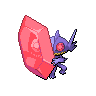

<!-- This file is generated by tools/generate_site.py. Edit the generator, not this file. -->

# #302 Sableye

{ .sprite-lg loading=lazy }

**Darkness Pokémon**

Dark Ghost

[:material-arrow-left: #301 Delcatty](301.md) · [Pokédex](index.md) · [#303 Mawile :material-arrow-right:](303.md)

!!! info "Changes in Rising Ruby / Sinking Sapphire"

    - **Base stats:** HP 50 → **55**, Atk 75 → **80**, Def 75 → **80**, SpA 65 → **70**, SpD 65 → **70**, Spe 50 → **55** (BST 380 → **410**)
    - **Base stats (Mega Sableye):** HP 50 → **55**, Atk 85 → **90**, Def 125 → **130**, SpA 85 → **90**, SpD 115 → **120**, Spe 20 → **25** (BST 480 → **510**)

## Location

[Granite Cave](../wild/granite_cave_1f.md), [Cave of Origin](../wild/cave_of_origin_1f.md)

### Wild encounters

| Area | Method | Level | Note |
| --- | --- | --- | --- |
| [Granite Cave B1F](../wild/granite_cave_b1f.md) | Walking | 18 |  |
| [Granite Cave B2F](../wild/granite_cave_b2f.md) | Walking | 20 |  |
| [Cave of Origin 1F](../wild/cave_of_origin_1f.md) | Walking | 57 |  |
| [Victory Road B1F](../wild/victory_road_b1f.md) | Walking | 59 | 5% (rare) |

## Type defenses

| Damage taken | Attacking types |
| --- | --- |
| Immune (×0) | Normal Fighting Psychic |
| Resistant (×½) | Poison |
| Neutral (×1) | Flying Ground Rock Bug Ghost Steel Fire Water Grass Electric Ice Dragon Dark |
| Weak (×2) | Fairy |

## Abilities

| Slot | Ability | Effect | Note |
| --- | --- | --- | --- |
| Ability 1 | **Keen Eye** | Prevents accuracy from being lowered. |  |
| Ability 2 | **Stall** | Makes the Pokémon move last within its move's priority bracket. |  |
| Hidden | **Prankster** | Raises non-damaging moves' priority by one stage. |  |

## Base stats

| Form | HP | Atk | Def | SpA | SpD | Spe | BST |
| --- | --- | --- | --- | --- | --- | --- | --- |
| { .sprite-sm loading=lazy } Normal | 55<small class="was">was 50</small> | 80<small class="was">was 75</small> | 80<small class="was">was 75</small> | 70<small class="was">was 65</small> | 70<small class="was">was 65</small> | 55<small class="was">was 50</small> | 410<small class="was">was 380</small> |
| { .sprite-sm loading=lazy } Mega Sableye | 55<small class="was">was 50</small> | 90<small class="was">was 85</small> | 130<small class="was">was 125</small> | 90<small class="was">was 85</small> | 120<small class="was">was 115</small> | 25<small class="was">was 20</small> | 510<small class="was">was 480</small> |

## Training & breeding

| Property | Value |
| --- | --- |
| EV yield | 1 Atk, 1 Def |
| Catch rate | 45 |
| Base friendship | 35 |
| Base experience | 133 |
| Growth rate | medium slow |
| Egg groups | Human-Like |
| Hatch counter | 25 |
| Gender ratio | 50% ♂ / 50% ♀ |
| Height / weight | 0.5 m / 11 kg |

## Evolution

This Pokémon does not evolve.
- { .sprite-sm loading=lazy } **Mega Sableye**: Mega Evolves by holding the Sableyeite

## Wild held items

| Item | Chance | Note |
| --- | --- | --- |
| { .item loading=lazy } Wide Lens | 5% |  |

## Level-up moves { data-search-exclude }

Moves marked &#42; are not normally learned by level up (they come from egg moves, TMs/HMs or tutors in the official games); moves marked &#42;&#42; cannot normally be learned by this Pokémon at all and are omitted from the legal-moves version of the hack.

| Lv. | Move | Type | Cat. | Power | Acc. | PP | Effect | Note |
| --- | --- | --- | --- | --- | --- | --- | --- | --- |
| 1 | Leer | Normal | Status | — | 100% | 30 | Lowers the target’s Defense by one stage. |  |
| 1 | [Scratch](../changes/moves.md#scratch) changed | Normal | Physical | 50 | 100% | 35 | Inflicts regular damage with no additional effect. |  |
| 4 | Foresight | Normal | Status | — | — | 40 | Forces the target to have no Evade, and allows it to be hit by Normal and Fighting moves even if it’s a Ghost. |  |
| 6 | Night Shade | Ghost | Special | — | 100% | 15 | Inflicts damage equal to the user’s level. |  |
| 8 | Astonish | Ghost | Physical | 30 | 100% | 15 | Has a chance to make the target flinch. |  |
| 11 | Fury Swipes | Normal | Physical | 18 | 80% | 15 | Hits 2-5 times in one turn. |  |
| 13 | Detect | Fighting | Status | — | — | 5 | Prevents any moves from hitting the user this turn. |  |
| 14 | Shadow Sneak | Ghost | Physical | 40 | 100% | 30 | Inflicts regular damage with no additional effect. |  |
| 16 | Feint Attack | Dark | Physical | 60 | — | 20 | Never misses. |  |
| 19 | Fake Out | Normal | Physical | 40 | 100% | 10 | Can only be used as the first move after the user enters battle.  Causes the target to flinch. |  |
| 21 | Punishment | Dark | Physical | — | 100% | 5 | Power increases against targets with more raised stats, up to a maximum of 200. |  |
| 24 | Knock Off | Dark | Physical | 65 | 100% | 20 | Target drops its held item. |  |
| 26 | Recover | Normal | Status | — | — | 5 | Heals the user by half its max HP. | &#42; |
| 28 | Shadow Claw | Ghost | Physical | 70 | 100% | 15 | Has an increased chance for a critical hit. |  |
| 29 | Confuse Ray | Ghost | Status | — | 100% | 10 | Confuses the target. |  |
| 32 | Zen Headbutt | Psychic | Physical | 80 | 90% | 15 | Has a chance to make the target flinch. |  |
| 35 | Sucker Punch | Dark | Physical | 80 | 100% | 5 | Only works if the target is about to use a damaging move. | &#42; |
| 36 | [Power Gem](../changes/moves.md#power-gem) changed | Rock | Special | 90 | 100% | 10 | Inflicts regular damage with no additional effect. |  |
| 39 | Shadow Ball | Ghost | Special | 80 | 100% | 15 | Has a chance to lower the target’s Special Defense by one stage. |  |
| 41 | Foul Play | Dark | Physical | 95 | 100% | 15 | Calculates damage with the target’s attacking stat. |  |
| 44 | Quash | Dark | Status | — | 100% | 15 | Makes the target act last this turn. |  |
| 46 | Mean Look | Normal | Status | — | — | 5 | Prevents the target from leaving battle. |  |
| 49 | Metal Burst | Steel | Physical | — | 100% | 10 | Strikes back at the last Pokémon to hit the user this turn with 1.5× the damage. | &#42; |

## TM & HM moves { data-search-exclude }

| Machine | Move | Type | Cat. | Power | Acc. | PP | Effect |
| --- | --- | --- | --- | --- | --- | --- | --- |
| HM01 | [Cut](../changes/moves.md#cut) changed | Grass | Physical | 70 | 100% | 15 | High Critical Rate. High Critical Rate |
| HM06 | [Rock Smash](../changes/moves.md#rock-smash) changed | Fighting | Physical | 65 | 100% | 15 | Has a chance to lower the target’s Defense by one stage. |
| TM01 | Hone Claws | Dark | Status | — | — | 15 | Raises the user’s Attack and accuracy by one stage. |
| TM04 | Calm Mind | Psychic | Status | — | — | 20 | Raises the user’s Special Attack and Special Defense by one stage. |
| TM06 | Toxic | Poison | Status | — | 90% | 10 | Badly poisons the target, inflicting more damage every turn. |
| TM10 | Hidden Power | Normal | Special | 60 | 100% | 15 | Power and type depend upon user’s IVs.  Power can range from 30 to 70. |
| TM100 | Confide | Normal | Status | — | — | 20 | Lowers the target’s Special Attack by one stage. |
| TM11 | Sunny Day | Fire | Status | — | — | 5 | Changes the weather to sunny for five turns. |
| TM12 | Taunt | Dark | Status | — | 100% | 20 | For the next few turns, the target can only use damaging moves. |
| TM17 | Protect | Normal | Status | — | — | 10 | Prevents any moves from hitting the user this turn. |
| TM18 | Rain Dance | Water | Status | — | — | 5 | Changes the weather to rain for five turns. |
| TM21 | Frustration | Normal | Physical | — | 100% | 20 | Power increases as happiness decreases, up to a maximum of 102. |
| TM27 | Return | Normal | Physical | — | 100% | 20 | Power increases with happiness, up to a maximum of 102. |
| TM28 | Dig | Ground | Physical | 80 | 100% | 10 | User digs underground, dodging all attacks, and hits next turn. |
| TM29 | Psychic | Psychic | Special | 90 | 100% | 10 | Has a chance to lower the target’s Special Defense by one stage. |
| TM30 | Shadow Ball | Ghost | Special | 80 | 100% | 15 | Has a chance to lower the target’s Special Defense by one stage. |
| TM31 | Brick Break | Fighting | Physical | 75 | 100% | 15 | Destroys Reflect and Light Screen. |
| TM32 | Double Team | Normal | Status | — | — | 15 | Raises the user’s evasion by one stage. |
| TM39 | Rock Tomb | Rock | Physical | 60 | 95% | 15 | Has a chance to lower the target’s Speed by one stage. |
| TM40 | Aerial Ace | Flying | Physical | 60 | — | 20 | Never misses. |
| TM41 | Torment | Dark | Status | — | 100% | 15 | Prevents the target from using the same move twice in a row. |
| TM42 | Facade | Normal | Physical | 70 | 100% | 20 | Power doubles if user is burned, paralyzed, or poisoned. |
| TM44 | Rest | Psychic | Status | — | — | 5 | User sleeps for two turns, completely healing itself. |
| TM45 | Attract | Normal | Status | — | 100% | 15 | Target falls in love if it has the opposite gender, and has a 50% chance to refuse attacking the user. |
| TM46 | Thief | Dark | Physical | 60 | 100% | 25 | Takes the target’s item. |
| TM47 | Low Sweep | Fighting | Physical | 65 | 100% | 20 | Lowers the target’s Speed by one stage. |
| TM48 | Round | Normal | Special | 60 | 100% | 15 | Has double power if it’s used more than once per turn. |
| TM56 | Fling | Dark | Physical | — | 100% | 10 | Throws held item at the target; power depends on the item. |
| TM59 | Incinerate | Fire | Special | 60 | 100% | 15 | Destroys the target’s held berry. |
| TM60 | Quash | Dark | Status | — | 100% | 15 | Makes the target act last this turn. |
| TM61 | Will-O-Wisp | Fire | Status | — | 85% | 15 | Burns the target. |
| TM63 | Embargo | Dark | Status | — | 100% | 15 | Target cannot use held items. |
| TM65 | Shadow Claw | Ghost | Physical | 70 | 100% | 15 | Has an increased chance for a critical hit. |
| TM66 | Payback | Dark | Physical | 50 | 100% | 10 | Power is doubled if the target has already moved this turn. |
| TM67 | Retaliate | Normal | Physical | 70 | 100% | 5 | Has double power if a friendly Pokémon fainted last turn. |
| TM70 | Flash | Normal | Status | — | 100% | 20 | Lowers the target’s accuracy by one stage. |
| TM77 | Psych Up | Normal | Status | — | — | 10 | Discards the user’s stat changes and copies the target’s. |
| TM84 | Poison Jab | Poison | Physical | 80 | 100% | 20 | Has a chance to poison the target. |
| TM85 | Dream Eater | Psychic | Special | 100 | 100% | 15 | Only works on sleeping Pokémon.  Drains half the damage inflicted to heal the user. |
| TM87 | Swagger | Normal | Status | — | 90% | 15 | Raises the target’s Attack by two stages and confuses the target. |
| TM88 | Sleep Talk | Normal | Status | — | — | 10 | Randomly uses one of the user’s other three moves.  Only works if the user is sleeping. |
| TM90 | Substitute | Normal | Status | — | — | 10 | Transfers 1/4 of the user’s max HP into a doll, protecting the user from further damage or status changes until it breaks. |
| TM94 | Secret Power | Normal | Physical | 70 | 100% | 20 | Has a chance to inflict a status effect which depends upon the terrain. |
| TM95 | Snarl | Dark | Special | 55 | 95% | 15 | Has a chance to lower the target’s Special Attack by one stage. |
| TM97 | Dark Pulse | Dark | Special | 80 | 100% | 15 | Has a chance to make the target flinch. |
| TM98 | Power-Up Punch | Fighting | Physical | 40 | 100% | 20 | Raises the user’s Attack by one stage after inflicting damage. |
| TM99 | Dazzling Gleam | Fairy | Special | 80 | 100% | 10 | Inflicts regular damage with no additional effect. |

## Move tutor moves { data-search-exclude }

| Move | Type | Cat. | Power | Acc. | PP | Effect |
| --- | --- | --- | --- | --- | --- | --- |
| Fire Punch | Fire | Physical | 75 | 100% | 15 | Has a chance to burn the target. |
| Focus Punch | Fighting | Physical | 150 | 100% | 20 | If the user takes damage before attacking, the attack is canceled. |
| Foul Play | Dark | Physical | 95 | 100% | 15 | Calculates damage with the target’s attacking stat. |
| Gravity | Psychic | Status | — | — | 5 | Disables moves and immunities that involve flying or levitating for five turns. |
| Ice Punch | Ice | Physical | 75 | 100% | 15 | Has a chance to freeze the target. |
| Icy Wind | Ice | Special | 55 | 95% | 15 | Has a chance to lower the target’s Speed by one stage. |
| Knock Off | Dark | Physical | 65 | 100% | 20 | Target drops its held item. |
| Low Kick | Fighting | Physical | — | 100% | 20 | Inflicts more damage to heavier targets, with a maximum of 120 power. |
| Magic Coat | Psychic | Status | — | — | 15 | Reflects back the first effect move used on the user this turn. |
| Pain Split | Normal | Status | — | — | 20 | Sets the user’s and targets’s HP to the average of their current HP. |
| Role Play | Psychic | Status | — | — | 10 | Copies the target’s ability. |
| Shock Wave | Electric | Special | 60 | — | 20 | Never misses. |
| Signal Beam | Bug | Special | 75 | 100% | 15 | Has a chance to confuse the target. |
| Snatch | Dark | Status | — | — | 10 | Steals the target’s move, if it’s self-targeted. |
| Snore | Normal | Special | 50 | 100% | 15 | Has a chance to make the target flinch.  Only works if the user is sleeping. |
| Spite | Ghost | Status | — | 100% | 10 | Lowers the PP of the target’s last used move by 4. |
| Thunder Punch | Electric | Physical | 75 | 100% | 15 | Has a chance to paralyze the target. |
| Trick | Psychic | Status | — | 100% | 10 | User and target swap items. |
| Water Pulse | Water | Special | 60 | 100% | 20 | Has a chance to confuse the target. |
| Wonder Room | Psychic | Status | — | — | 10 | All Pokémon’s Defense and Special Defense are swapped for 5 turns. |
| Zen Headbutt | Psychic | Physical | 80 | 90% | 15 | Has a chance to make the target flinch. |

## Egg moves { data-search-exclude }

| Move | Type | Cat. | Power | Acc. | PP | Effect |
| --- | --- | --- | --- | --- | --- | --- |
| Captivate | Normal | Status | — | 100% | 20 | Lowers the target’s Special Attack by two stages if it’s the opposite gender. |
| Feint | Normal | Physical | 30 | 100% | 10 | Hits through Protect and Detect. |
| Flatter | Dark | Status | — | 100% | 15 | Raises the target’s Special Attack by one stage and confuses the target. |
| Imprison | Psychic | Status | — | — | 10 | Prevents the target from using any moves that the user also knows. |
| Mean Look | Normal | Status | — | — | 5 | Prevents the target from leaving battle. |
| Metal Burst | Steel | Physical | — | 100% | 10 | Strikes back at the last Pokémon to hit the user this turn with 1.5× the damage. |
| Moonlight | Fairy | Status | — | — | 5 | Heals the user by half its max HP.  Affected by weather. |
| Nasty Plot | Dark | Status | — | — | 20 | Raises the user’s Special Attack by two stages. |
| Recover | Normal | Status | — | — | 5 | Heals the user by half its max HP. |
| Sucker Punch | Dark | Physical | 80 | 100% | 5 | Only works if the target is about to use a damaging move. |
| Trick | Psychic | Status | — | 100% | 10 | User and target swap items. |

??? note "Trainers using Sableye (3)"

    | Area | Trainer | Level |
    | --- | --- | --- |
    | [Route 109](../trainers/route_109.md#trainers) | Delinquent Destinee | Lv. 19 |
    | [Pokémon League](../trainers/pokemon_league.md#trainers) | Elite Four Phoebe | Lv. 73 |
    | [Pokémon League (Post Game)](../trainers/pokemon_league_post_game.md#trainers) | Elite Four Phoebe | Lv. 83 |

---

[:material-arrow-left: #301 Delcatty](301.md) · [#303 Mawile :material-arrow-right:](303.md)
