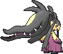

<!-- This file is generated by tools/generate_site.py. Edit the generator, not this file. -->

# #303 Mawile

{ .sprite-lg loading=lazy }

**Deceiver Pokémon**

Steel Fairy

[:material-arrow-left: #302 Sableye](302.md) · [Pokédex](index.md) · [#304 Aron :material-arrow-right:](304.md)

!!! info "Changes in Rising Ruby / Sinking Sapphire"

    - **Base stats:** HP 50 → **55**, Atk 85 → **90**, Def 85 → **90**, SpA 55 → **60**, SpD 55 → **60**, Spe 50 → **55** (BST 380 → **410**)
    - **Base stats (Mega Mawile):** HP 50 → **55**, Atk 105 → **110**, Def 125 → **130**, SpA 55 → **60**, SpD 95 → **100**, Spe 50 → **55** (BST 480 → **510**)

## Location

[Granite Cave](../wild/granite_cave_1f.md), [Cave of Origin](../wild/cave_of_origin_1f.md)

### Wild encounters

| Area | Method | Level | Note |
| --- | --- | --- | --- |
| [Granite Cave B1F](../wild/granite_cave_b1f.md) | Walking | 18 |  |
| [Granite Cave B2F](../wild/granite_cave_b2f.md) | Walking | 20 |  |
| [Cave of Origin 1F](../wild/cave_of_origin_1f.md) | Walking | 57 |  |
| [Victory Road B1F](../wild/victory_road_b1f.md) | Walking | 59 | 5% (rare) |

## Type defenses

| Damage taken | Attacking types |
| --- | --- |
| Immune (×0) | Poison Dragon |
| Very resistant (×¼) | Bug |
| Resistant (×½) | Normal Flying Rock Grass Psychic Ice Dark Fairy |
| Neutral (×1) | Fighting Ghost Steel Water Electric |
| Weak (×2) | Ground Fire |

## Abilities

| Slot | Ability | Effect | Note |
| --- | --- | --- | --- |
| Ability 1 | **Hyper Cutter** | Prevents Attack from being lowered by other Pokémon. |  |
| Ability 2 | **Intimidate** | Lowers opponents' Attack one stage upon entering battle. |  |
| Hidden | **Sheer Force** | Strengthens moves with extra effects to 1.3× their power, but prevents their extra effects. |  |

## Base stats

| Form | HP | Atk | Def | SpA | SpD | Spe | BST |
| --- | --- | --- | --- | --- | --- | --- | --- |
| { .sprite-sm loading=lazy } Normal | 55<small class="was">was 50</small> | 90<small class="was">was 85</small> | 90<small class="was">was 85</small> | 60<small class="was">was 55</small> | 60<small class="was">was 55</small> | 55<small class="was">was 50</small> | 410<small class="was">was 380</small> |
| { .sprite-sm loading=lazy } Mega Mawile | 55<small class="was">was 50</small> | 110<small class="was">was 105</small> | 130<small class="was">was 125</small> | 60<small class="was">was 55</small> | 100<small class="was">was 95</small> | 55<small class="was">was 50</small> | 510<small class="was">was 480</small> |

## Training & breeding

| Property | Value |
| --- | --- |
| EV yield | 1 Atk, 1 Def |
| Catch rate | 45 |
| Base friendship | 70 |
| Base experience | 133 |
| Growth rate | fast |
| Egg groups | Field, Fairy |
| Hatch counter | 20 |
| Gender ratio | 50% ♂ / 50% ♀ |
| Height / weight | 0.6 m / 11.5 kg |

## Evolution

This Pokémon does not evolve.
- { .sprite-sm loading=lazy } **Mega Mawile**: Mega Evolves by holding the Mawileite

## Wild held items

| Item | Chance | Note |
| --- | --- | --- |
| { .item loading=lazy } Iron Ball | 5% |  |

## Level-up moves { data-search-exclude }

Moves marked &#42; are not normally learned by level up (they come from egg moves, TMs/HMs or tutors in the official games); moves marked &#42;&#42; cannot normally be learned by this Pokémon at all and are omitted from the legal-moves version of the hack.

| Lv. | Move | Type | Cat. | Power | Acc. | PP | Effect | Note |
| --- | --- | --- | --- | --- | --- | --- | --- | --- |
| 1 | Taunt | Dark | Status | — | 100% | 20 | For the next few turns, the target can only use damaging moves. |  |
| 1 | Growl | Normal | Status | — | 100% | 40 | Lowers the target’s Attack by one stage. |  |
| 1 | [Fairy Wind](../changes/moves.md#fairy-wind) changed | Fairy | Special | 50 | 100% | 25 | Inflicts regular damage with no additional effect. |  |
| 1 | Astonish | Ghost | Physical | 30 | 100% | 15 | Has a chance to make the target flinch. |  |
| 6 | Fake Tears | Dark | Status | — | 100% | 20 | Lowers the target’s Special Defense by two stages. |  |
| 9 | Sweet Scent | Normal | Status | — | 100% | 20 | Lowers the target’s evasion by one stage. |  |
| 12 | Bite | Dark | Physical | 60 | 100% | 25 | Has a chance to make the target flinch. |  |
| 15 | Fire Fang | Fire | Physical | 65 | 95% | 15 | Has a chance to burn the target and a chance to make the target flinch. | &#42; |
| 15 | Thunder Fang | Electric | Physical | 65 | 95% | 15 | Has a chance to paralyze the target and a chance to make the target flinch. | &#42; |
| 15 | Ice Fang | Ice | Physical | 65 | 95% | 15 | Has a chance to freeze the target and a chance to make the target flinch. | &#42; |
| 15 | Poison Fang | Poison | Physical | 50 | 100% | 15 | Has a chance to badly poison the target. | &#42; |
| 18 | Vise Grip | Normal | Physical | 55 | 100% | 30 | Inflicts regular damage with no additional effect. |  |
| 21 | Crunch | Dark | Physical | 80 | 100% | 15 | Has a chance to lower the target’s Defense by one stage. |  |
| 24 | Play Rough | Fairy | Physical | 90 | 90% | 10 | Has a chance to lower the target’s Attack by one stage. |  |
| 27 | Baton Pass | Normal | Status | — | — | 40 | Allows the trainer to switch out the user and pass effects along to its replacement. |  |
| 30 | Iron Defense | Steel | Status | — | — | 15 | Raises the user’s Defense by two stages. |  |
| 33 | Iron Head | Steel | Physical | 80 | 100% | 15 | Has a chance to make the target flinch. |  |
| 37 | Sucker Punch | Dark | Physical | 80 | 100% | 5 | Only works if the target is about to use a damaging move. |  |
| 41 | Stockpile | Normal | Status | — | — | 20 | Stores energy up to three times for use with Spit Up and Swallow. |  |
| 41 | Swallow | Normal | Status | — | — | 10 | Recovers 1/4 HP after one Stockpile, 1/2 HP after two Stockpiles, or full HP after three Stockpiles. |  |
| 41 | Spit Up | Normal | Special | — | 100% | 10 | Power is 100 times the amount of energy Stockpiled. |  |
| 45 | Super Fang | Normal | Physical | — | 90% | 10 | Inflicts damage equal to half the target’s HP. | &#42; |
| 49 | Metal Burst | Steel | Physical | — | 100% | 10 | Strikes back at the last Pokémon to hit the user this turn with 1.5× the damage. | &#42; |

## TM & HM moves { data-search-exclude }

| Machine | Move | Type | Cat. | Power | Acc. | PP | Effect |
| --- | --- | --- | --- | --- | --- | --- | --- |
| HM04 | [Strength](../changes/moves.md#strength) changed | Normal | Physical | 100 | 100% | 10 | Inflicts regular damage with no additional effect. |
| HM06 | [Rock Smash](../changes/moves.md#rock-smash) changed | Fighting | Physical | 65 | 100% | 15 | Has a chance to lower the target’s Defense by one stage. |
| TM06 | Toxic | Poison | Status | — | 90% | 10 | Badly poisons the target, inflicting more damage every turn. |
| TM10 | Hidden Power | Normal | Special | 60 | 100% | 15 | Power and type depend upon user’s IVs.  Power can range from 30 to 70. |
| TM100 | Confide | Normal | Status | — | — | 20 | Lowers the target’s Special Attack by one stage. |
| TM11 | Sunny Day | Fire | Status | — | — | 5 | Changes the weather to sunny for five turns. |
| TM12 | Taunt | Dark | Status | — | 100% | 20 | For the next few turns, the target can only use damaging moves. |
| TM13 | Ice Beam | Ice | Special | 90 | 100% | 10 | Has a chance to freeze the target. |
| TM15 | Hyper Beam | Normal | Special | 150 | 90% | 5 | User foregoes its next turn to recharge. |
| TM17 | Protect | Normal | Status | — | — | 10 | Prevents any moves from hitting the user this turn. |
| TM18 | Rain Dance | Water | Status | — | — | 5 | Changes the weather to rain for five turns. |
| TM21 | Frustration | Normal | Physical | — | 100% | 20 | Power increases as happiness decreases, up to a maximum of 102. |
| TM22 | Solar Beam | Grass | Special | 120 | 100% | 10 | Requires a turn to charge before attacking. |
| TM27 | Return | Normal | Physical | — | 100% | 20 | Power increases with happiness, up to a maximum of 102. |
| TM30 | Shadow Ball | Ghost | Special | 80 | 100% | 15 | Has a chance to lower the target’s Special Defense by one stage. |
| TM31 | Brick Break | Fighting | Physical | 75 | 100% | 15 | Destroys Reflect and Light Screen. |
| TM32 | Double Team | Normal | Status | — | — | 15 | Raises the user’s evasion by one stage. |
| TM35 | Flamethrower | Fire | Special | 90 | 100% | 15 | Has a chance to burn the target. |
| TM36 | Sludge Bomb | Poison | Special | 90 | 100% | 10 | Has a chance to poison the target. |
| TM37 | Sandstorm | Rock | Status | — | — | 10 | Changes the weather to a sandstorm for five turns. |
| TM38 | Fire Blast | Fire | Special | 110 | 85% | 5 | Has a chance to burn the target. |
| TM39 | Rock Tomb | Rock | Physical | 60 | 95% | 15 | Has a chance to lower the target’s Speed by one stage. |
| TM41 | Torment | Dark | Status | — | 100% | 15 | Prevents the target from using the same move twice in a row. |
| TM42 | Facade | Normal | Physical | 70 | 100% | 20 | Power doubles if user is burned, paralyzed, or poisoned. |
| TM44 | Rest | Psychic | Status | — | — | 5 | User sleeps for two turns, completely healing itself. |
| TM45 | Attract | Normal | Status | — | 100% | 15 | Target falls in love if it has the opposite gender, and has a 50% chance to refuse attacking the user. |
| TM48 | Round | Normal | Special | 60 | 100% | 15 | Has double power if it’s used more than once per turn. |
| TM52 | Focus Blast | Fighting | Special | 120 | 70% | 5 | Has a chance to lower the target’s Special Defense by one stage. |
| TM54 | False Swipe | Normal | Physical | 40 | 100% | 40 | Cannot lower the target’s HP below 1. |
| TM56 | Fling | Dark | Physical | — | 100% | 10 | Throws held item at the target; power depends on the item. |
| TM57 | Charge Beam | Electric | Special | 50 | 90% | 10 | Has a chance to raise the user’s Special Attack by one stage. |
| TM59 | Incinerate | Fire | Special | 60 | 100% | 15 | Destroys the target’s held berry. |
| TM63 | Embargo | Dark | Status | — | 100% | 15 | Target cannot use held items. |
| TM66 | Payback | Dark | Physical | 50 | 100% | 10 | Power is doubled if the target has already moved this turn. |
| TM68 | Giga Impact | Normal | Physical | 150 | 90% | 5 | User foregoes its next turn to recharge. |
| TM71 | Stone Edge | Rock | Physical | 100 | 80% | 5 | Has an increased chance for a critical hit. |
| TM75 | Swords Dance | Normal | Status | — | — | 20 | Raises the user’s Attack by two stages. |
| TM77 | Psych Up | Normal | Status | — | — | 10 | Discards the user’s stat changes and copies the target’s. |
| TM80 | Rock Slide | Rock | Physical | 75 | 90% | 10 | Has a chance to make the target flinch. |
| TM86 | Grass Knot | Grass | Special | — | 100% | 20 | Inflicts more damage to heavier targets, with a maximum of 120 power. |
| TM87 | Swagger | Normal | Status | — | 90% | 15 | Raises the target’s Attack by two stages and confuses the target. |
| TM88 | Sleep Talk | Normal | Status | — | — | 10 | Randomly uses one of the user’s other three moves.  Only works if the user is sleeping. |
| TM90 | Substitute | Normal | Status | — | — | 10 | Transfers 1/4 of the user’s max HP into a doll, protecting the user from further damage or status changes until it breaks. |
| TM91 | Flash Cannon | Steel | Special | 80 | 100% | 10 | Has a chance to lower the target’s Special Defense by one stage. |
| TM94 | Secret Power | Normal | Physical | 70 | 100% | 20 | Has a chance to inflict a status effect which depends upon the terrain. |
| TM97 | Dark Pulse | Dark | Special | 80 | 100% | 15 | Has a chance to make the target flinch. |
| TM98 | Power-Up Punch | Fighting | Physical | 40 | 100% | 20 | Raises the user’s Attack by one stage after inflicting damage. |

## Move tutor moves { data-search-exclude }

| Move | Type | Cat. | Power | Acc. | PP | Effect |
| --- | --- | --- | --- | --- | --- | --- |
| Focus Punch | Fighting | Physical | 150 | 100% | 20 | If the user takes damage before attacking, the attack is canceled. |
| Foul Play | Dark | Physical | 95 | 100% | 15 | Calculates damage with the target’s attacking stat. |
| Ice Punch | Ice | Physical | 75 | 100% | 15 | Has a chance to freeze the target. |
| Icy Wind | Ice | Special | 55 | 95% | 15 | Has a chance to lower the target’s Speed by one stage. |
| Iron Defense | Steel | Status | — | — | 15 | Raises the user’s Defense by two stages. |
| Iron Head | Steel | Physical | 80 | 100% | 15 | Has a chance to make the target flinch. |
| Knock Off | Dark | Physical | 65 | 100% | 20 | Target drops its held item. |
| Last Resort | Normal | Physical | 140 | 100% | 5 | Can only be used after all of the user’s other moves have been used. |
| Magnet Rise | Electric | Status | — | — | 10 | User is immune to Ground moves and effects for five turns. |
| Pain Split | Normal | Status | — | — | 20 | Sets the user’s and targets’s HP to the average of their current HP. |
| Snatch | Dark | Status | — | — | 10 | Steals the target’s move, if it’s self-targeted. |
| Snore | Normal | Special | 50 | 100% | 15 | Has a chance to make the target flinch.  Only works if the user is sleeping. |
| Stealth Rock | Rock | Status | — | — | 20 | Causes damage when opposing Pokémon switch in. |
| Super Fang | Normal | Physical | — | 90% | 10 | Inflicts damage equal to half the target’s HP. |
| Thunder Punch | Electric | Physical | 75 | 100% | 15 | Has a chance to paralyze the target. |

## Egg moves { data-search-exclude }

| Move | Type | Cat. | Power | Acc. | PP | Effect |
| --- | --- | --- | --- | --- | --- | --- |
| [Ancient Power](../changes/moves.md#ancient-power) changed | Rock | Special | 80 | 100% | 10 | Has a chance to raise all of the user’s stats by one stage. |
| Captivate | Normal | Status | — | 100% | 20 | Lowers the target’s Special Attack by two stages if it’s the opposite gender. |
| Fire Fang | Fire | Physical | 65 | 95% | 15 | Has a chance to burn the target and a chance to make the target flinch. |
| Guard Swap | Psychic | Status | — | — | 10 | User swaps Defense and Special Defense changes with the target. |
| Ice Fang | Ice | Physical | 65 | 95% | 15 | Has a chance to freeze the target and a chance to make the target flinch. |
| Metal Burst | Steel | Physical | — | 100% | 10 | Strikes back at the last Pokémon to hit the user this turn with 1.5× the damage. |
| Misty Terrain | Fairy | Status | — | — | 10 | For five turns, protects all Pokémon on the ground from major status ailments and confusion, and halves the power of incoming Dragon moves. |
| Poison Fang | Poison | Physical | 50 | 100% | 15 | Has a chance to badly poison the target. |
| Punishment | Dark | Physical | — | 100% | 5 | Power increases against targets with more raised stats, up to a maximum of 200. |
| Seismic Toss | Fighting | Physical | — | 100% | 20 | Inflicts damage equal to the user’s level. |
| Slam | Normal | Physical | 80 | 75% | 20 | Inflicts regular damage with no additional effect. |
| Sucker Punch | Dark | Physical | 80 | 100% | 5 | Only works if the target is about to use a damaging move. |
| Thunder Fang | Electric | Physical | 65 | 95% | 15 | Has a chance to paralyze the target and a chance to make the target flinch. |
| Tickle | Normal | Status | — | 100% | 20 | Lowers the target’s Attack and Defense by one stage. |

??? note "Trainers using Mawile (5)"

    | Area | Trainer | Level |
    | --- | --- | --- |
    | [Route 109](../trainers/route_109.md#trainers) | Beauty Johanna | Lv. 19 |
    | [Sea Mauville Inside](../trainers/sea_mauville_inside.md#rematches) | Mysterious Sisters Scall & Ion (8) | Lv. 65 |
    | [Sea Mauville Inside](../trainers/sea_mauville_inside.md#rematches) | Mysterious Sisters Scall & Ion (C) | Lv. 75 |
    | [Victory Road 1F](../trainers/victory_road_1f.md#trainers) | Ace Trainer Edgar | Lv. 65 |
    | [Battle Resort](../trainers/battle_resort.md#trainers) | Leader Felix [Valerie] | Lv. 79 |

---

[:material-arrow-left: #302 Sableye](302.md) · [#304 Aron :material-arrow-right:](304.md)
