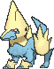
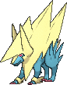

<!-- This file is generated by tools/generate_site.py. Edit the generator, not this file. -->

# #310 Manectric

{ .sprite-lg loading=lazy }

**Discharge Pokémon**

Electric

[:material-arrow-left: #309 Electrike](309.md) · [Pokédex](index.md) · [#311 Plusle :material-arrow-right:](311.md)

!!! note "No documented changes"

    Drayano's documentation lists no stat, type, ability, evolution or held item changes for this Pokémon. Its level-up moves are listed below as they appear in the hack.

## Location

[Route 118](../wild/route_118.md)

### Wild encounters

| Area | Method | Level | Note |
| --- | --- | --- | --- |
| [Route 118](../wild/route_118.md) | Grass | 33 |  |
| [Route 118](../wild/route_118.md) | Tall Grass | 36 |  |

## Type defenses

| Damage taken | Attacking types |
| --- | --- |
| Resistant (×½) | Flying Steel Electric |
| Neutral (×1) | Normal Fighting Poison Rock Bug Ghost Fire Water Grass Psychic Ice Dragon Dark Fairy |
| Weak (×2) | Ground |

## Abilities

| Slot | Ability | Effect | Note |
| --- | --- | --- | --- |
| Ability 1 | **Static** | Has a 30% chance of paralyzing attacking Pokémon on contact. |  |
| Ability 2 | **Lightning Rod** | Redirects single-target Electric moves to this Pokémon where possible.  Absorbs Electric moves, raising Special Attack one stage. |  |
| Hidden | **Minus** | Increases Special Attack to 1.5× when a friendly Pokémon has Plus or Minus. |  |

## Base stats

| Form | HP | Atk | Def | SpA | SpD | Spe | BST |
| --- | --- | --- | --- | --- | --- | --- | --- |
| { .sprite-sm loading=lazy } Normal | 70 | 75 | 60 | 105 | 60 | 105 | **475** |
| { .sprite-sm loading=lazy } Mega Manectric | 70 | 75 | 80 | 135 | 80 | 135 | **575** |

## Training & breeding

| Property | Value |
| --- | --- |
| EV yield | 2 Spe |
| Catch rate | 45 |
| Base friendship | 70 |
| Base experience | 166 |
| Growth rate | slow |
| Egg groups | Field |
| Hatch counter | 20 |
| Gender ratio | 50% ♂ / 50% ♀ |
| Height / weight | 1.5 m / 40.2 kg |

## Evolution

- { .icon loading=lazy } [Electrike](../pokemon/309.md) → { .icon loading=lazy } **[Manectric](../pokemon/310.md)**: Lv. 26
- { .sprite-sm loading=lazy } **Mega Manectric**: Mega Evolves by holding the Manectricite

## Wild held items

None.

## Level-up moves { data-search-exclude }

Moves marked &#42; are not normally learned by level up (they come from egg moves, TMs/HMs or tutors in the official games); moves marked &#42;&#42; cannot normally be learned by this Pokémon at all and are omitted from the legal-moves version of the hack.

| Lv. | Move | Type | Cat. | Power | Acc. | PP | Effect | Note |
| --- | --- | --- | --- | --- | --- | --- | --- | --- |
| 1 | Electric Terrain | Electric | Status | — | — | 10 | For five turns, prevents all Pokémon on the ground from sleeping and strengthens their Electric moves to 1.5× their power. |  |
| 1 | Fire Fang | Fire | Physical | 65 | 95% | 15 | Has a chance to burn the target and a chance to make the target flinch. |  |
| 1 | Tackle | Normal | Physical | 50 | 100% | 35 | Inflicts regular damage with no additional effect. |  |
| 1 | Thunder Wave | Electric | Status | — | 100% | 20 | Paralyzes the target. |  |
| 1 | Leer | Normal | Status | — | 100% | 30 | Lowers the target’s Defense by one stage. |  |
| 1 | Howl | Normal | Status | — | — | 40 | Raises the user’s Attack by one stage. |  |
| 4 | Leer | Normal | Status | — | 100% | 30 | Lowers the target’s Defense by one stage. |  |
| 7 | Howl | Normal | Status | — | — | 40 | Raises the user’s Attack by one stage. |  |
| 10 | Quick Attack | Normal | Physical | 40 | 100% | 30 | Inflicts regular damage with no additional effect. |  |
| 13 | Spark | Electric | Physical | 65 | 100% | 20 | Has a chance to paralyze the target. |  |
| 15 | Odor Sleuth | Normal | Status | — | — | 40 | Forces the target to have no Evade, and allows it to be hit by Normal and Fighting moves even if it’s a Ghost. |  |
| 18 | Electro Ball | Electric | Special | — | 100% | 10 | Power is higher when the user has greater Speed than the target, up to a maximum of 150. | &#42; |
| 21 | Thunder Fang | Electric | Physical | 65 | 95% | 15 | Has a chance to paralyze the target and a chance to make the target flinch. |  |
| 24 | Bite | Dark | Physical | 60 | 100% | 25 | Has a chance to make the target flinch. |  |
| 26 | Flame Burst | Fire | Special | 70 | 100% | 15 | Deals splash damage to Pokémon next to the target. | &#42; |
| 29 | Discharge | Electric | Special | 80 | 100% | 15 | Has a chance to paralyze the target. |  |
| 34 | Roar | Normal | Status | — | — | 20 | Immediately ends wild battles.  Forces trainers to switch Pokémon. |  |
| 39 | Thunderbolt | Electric | Special | 90 | 100% | 15 | Has a chance to paralyze the target. | &#42; |
| 43 | Wild Charge | Electric | Physical | 90 | 100% | 15 | User receives 1/4 the damage it inflicts in recoil. |  |
| 48 | Charge | Electric | Status | — | — | 20 | Raises the user’s Special Defense by one stage.  User’s Electric moves have doubled power next turn. |  |
| 54 | Thunder | Electric | Special | 110 | 70% | 10 | Has a chance to paralyze the target. |  |
| 60 | Electric Terrain | Electric | Status | — | — | 10 | For five turns, prevents all Pokémon on the ground from sleeping and strengthens their Electric moves to 1.5× their power. |  |

## TM & HM moves { data-search-exclude }

| Machine | Move | Type | Cat. | Power | Acc. | PP | Effect |
| --- | --- | --- | --- | --- | --- | --- | --- |
| HM04 | [Strength](../changes/moves.md#strength) changed | Normal | Physical | 100 | 100% | 10 | Inflicts regular damage with no additional effect. |
| TM05 | Roar | Normal | Status | — | — | 20 | Immediately ends wild battles.  Forces trainers to switch Pokémon. |
| TM06 | Toxic | Poison | Status | — | 90% | 10 | Badly poisons the target, inflicting more damage every turn. |
| TM10 | Hidden Power | Normal | Special | 60 | 100% | 15 | Power and type depend upon user’s IVs.  Power can range from 30 to 70. |
| TM100 | Confide | Normal | Status | — | — | 20 | Lowers the target’s Special Attack by one stage. |
| TM15 | Hyper Beam | Normal | Special | 150 | 90% | 5 | User foregoes its next turn to recharge. |
| TM16 | Light Screen | Psychic | Status | — | — | 30 | Reduces damage from special attacks by 50% for five turns. |
| TM17 | Protect | Normal | Status | — | — | 10 | Prevents any moves from hitting the user this turn. |
| TM18 | Rain Dance | Water | Status | — | — | 5 | Changes the weather to rain for five turns. |
| TM21 | Frustration | Normal | Physical | — | 100% | 20 | Power increases as happiness decreases, up to a maximum of 102. |
| TM24 | Thunderbolt | Electric | Special | 90 | 100% | 15 | Has a chance to paralyze the target. |
| TM25 | Thunder | Electric | Special | 110 | 70% | 10 | Has a chance to paralyze the target. |
| TM27 | Return | Normal | Physical | — | 100% | 20 | Power increases with happiness, up to a maximum of 102. |
| TM32 | Double Team | Normal | Status | — | — | 15 | Raises the user’s evasion by one stage. |
| TM35 | Flamethrower | Fire | Special | 90 | 100% | 15 | Has a chance to burn the target. |
| TM42 | Facade | Normal | Physical | 70 | 100% | 20 | Power doubles if user is burned, paralyzed, or poisoned. |
| TM44 | Rest | Psychic | Status | — | — | 5 | User sleeps for two turns, completely healing itself. |
| TM45 | Attract | Normal | Status | — | 100% | 15 | Target falls in love if it has the opposite gender, and has a 50% chance to refuse attacking the user. |
| TM46 | Thief | Dark | Physical | 60 | 100% | 25 | Takes the target’s item. |
| TM48 | Round | Normal | Special | 60 | 100% | 15 | Has double power if it’s used more than once per turn. |
| TM50 | Overheat | Fire | Special | 130 | 90% | 5 | Lowers the user’s Special Attack by two stages after inflicting damage. |
| TM57 | Charge Beam | Electric | Special | 50 | 90% | 10 | Has a chance to raise the user’s Special Attack by one stage. |
| TM68 | Giga Impact | Normal | Physical | 150 | 90% | 5 | User foregoes its next turn to recharge. |
| TM70 | Flash | Normal | Status | — | 100% | 20 | Lowers the target’s accuracy by one stage. |
| TM72 | Volt Switch | Electric | Special | 70 | 100% | 20 | User must switch out after attacking. |
| TM73 | Thunder Wave | Electric | Status | — | 100% | 20 | Paralyzes the target. |
| TM87 | Swagger | Normal | Status | — | 90% | 15 | Raises the target’s Attack by two stages and confuses the target. |
| TM88 | Sleep Talk | Normal | Status | — | — | 10 | Randomly uses one of the user’s other three moves.  Only works if the user is sleeping. |
| TM90 | Substitute | Normal | Status | — | — | 10 | Transfers 1/4 of the user’s max HP into a doll, protecting the user from further damage or status changes until it breaks. |
| TM93 | Wild Charge | Electric | Physical | 90 | 100% | 15 | User receives 1/4 the damage it inflicts in recoil. |
| TM94 | Secret Power | Normal | Physical | 70 | 100% | 20 | Has a chance to inflict a status effect which depends upon the terrain. |
| TM95 | Snarl | Dark | Special | 55 | 95% | 15 | Has a chance to lower the target’s Special Attack by one stage. |

## Move tutor moves { data-search-exclude }

| Move | Type | Cat. | Power | Acc. | PP | Effect |
| --- | --- | --- | --- | --- | --- | --- |
| Iron Tail | Steel | Physical | 100 | 75% | 15 | Has a chance to lower the target’s Defense by one stage. |
| Magnet Rise | Electric | Status | — | — | 10 | User is immune to Ground moves and effects for five turns. |
| Shock Wave | Electric | Special | 60 | — | 20 | Never misses. |
| Signal Beam | Bug | Special | 75 | 100% | 15 | Has a chance to confuse the target. |
| Snore | Normal | Special | 50 | 100% | 15 | Has a chance to make the target flinch.  Only works if the user is sleeping. |
| Uproar | Normal | Special | 90 | 100% | 10 | Forced to use this move for several turns.  Pokémon cannot fall asleep in that time. |

## Egg moves { data-search-exclude }

No egg moves.

??? note "Trainers using Manectric (7)"

    | Area | Trainer | Level |
    | --- | --- | --- |
    | [Mauville Gym](../trainers/mauville_gym.md#trainers) | Leader Wattson | Lv. 28 |
    | [Route 121](../trainers/route_121.md#trainers) | Gentleman Walter | Lv. 47 |
    | [Route 121](../trainers/route_121.md#rematches) | Gentleman Walter (7) | Lv. 59 |
    | [Route 121](../trainers/route_121.md#rematches) | Gentleman Walter (8) | Lv. 64 |
    | [Route 121](../trainers/route_121.md#rematches) | Gentleman Walter (C) | Lv. 75 |
    | [Battle Resort](../trainers/battle_resort.md#trainers) | Leader Antonin [Wattson] | Lv. 79 |
    | [Battle Resort](../trainers/battle_resort.md#trainers) | Leader Antonin [Wattson] | Lv. 79 |

---

[:material-arrow-left: #309 Electrike](309.md) · [#311 Plusle :material-arrow-right:](311.md)
