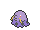
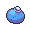
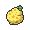

<!-- This file is generated by tools/generate_site.py. Edit the generator, not this file. -->

# #316 Gulpin

{ .sprite-lg loading=lazy }

**Stomach Pokémon**

Poison

[:material-arrow-left: #315 Roselia](315.md) · [Pokédex](index.md) · [#317 Swalot :material-arrow-right:](317.md)

!!! note "No documented changes"

    Drayano's documentation lists no stat, type, ability, evolution or held item changes for this Pokémon. Its level-up moves are listed below as they appear in the hack.

## Location

[Route 110](../wild/route_110.md)

### Wild encounters

| Area | Method | Level | Note |
| --- | --- | --- | --- |
| [Route 110](../wild/route_110.md) | Grass | 17 |  |

## Type defenses

| Damage taken | Attacking types |
| --- | --- |
| Resistant (×½) | Fighting Poison Bug Grass Fairy |
| Neutral (×1) | Normal Flying Rock Ghost Steel Fire Water Electric Ice Dragon Dark |
| Weak (×2) | Ground Psychic |

## Abilities

| Slot | Ability | Effect | Note |
| --- | --- | --- | --- |
| Ability 1 | **Liquid Ooze** | Damages opponents using leeching moves for as much as they would heal. |  |
| Ability 2 | **Sticky Hold** | Prevents a held item from being removed by other Pokémon. |  |
| Hidden | **Gluttony** | Makes the Pokémon eat any held Berry triggered by low HP below 1/2 its max HP. |  |

## Base stats

| Form | HP | Atk | Def | SpA | SpD | Spe | BST |
| --- | --- | --- | --- | --- | --- | --- | --- |
| { .sprite-sm loading=lazy } Normal | 70 | 43 | 53 | 43 | 53 | 40 | **302** |

## Training & breeding

| Property | Value |
| --- | --- |
| EV yield | 1 HP |
| Catch rate | 225 |
| Base friendship | 70 |
| Base experience | 60 |
| Growth rate | fluctuating |
| Egg groups | Amorphous |
| Hatch counter | 20 |
| Gender ratio | 50% ♂ / 50% ♀ |
| Height / weight | 0.4 m / 10.3 kg |

## Evolution

- { .icon loading=lazy } **[Gulpin](../pokemon/316.md)** → { .icon loading=lazy } [Swalot](../pokemon/317.md): Lv. 26

## Wild held items

| Item | Chance | Note |
| --- | --- | --- |
| { .item loading=lazy } Oran Berry | 50% |  |
| { .item loading=lazy } Sitrus Berry | 5% |  |

## Level-up moves { data-search-exclude }

Moves marked &#42; are not normally learned by level up (they come from egg moves, TMs/HMs or tutors in the official games); moves marked &#42;&#42; cannot normally be learned by this Pokémon at all and are omitted from the legal-moves version of the hack.

| Lv. | Move | Type | Cat. | Power | Acc. | PP | Effect | Note |
| --- | --- | --- | --- | --- | --- | --- | --- | --- |
| 1 | [Pound](../changes/moves.md#pound) changed | Normal | Physical | 50 | 100% | 35 | Inflicts regular damage with no additional effect. |  |
| 1 | Yawn | Normal | Status | — | — | 10 | Target sleeps at the end of the next turn. |  |
| 6 | Poison Gas | Poison | Status | — | 90% | 40 | Poisons the target. |  |
| 9 | Sludge | Poison | Special | 65 | 100% | 20 | Has a chance to poison the target. |  |
| 12 | Amnesia | Psychic | Status | — | — | 20 | Raises the user’s Special Defense by two stages. |  |
| 14 | Acid Spray | Poison | Special | 40 | 100% | 20 | Lowers the target’s Special Defense by two stages. |  |
| 16 | Encore | Normal | Status | — | 100% | 5 | Forces the target to repeat its last used move every turn for 2 to 6 turns. |  |
| 18 | Venoshock | Poison | Special | 65 | 100% | 10 | Inflicts double damage if the target is Poisoned. | &#42; |
| 21 | Toxic | Poison | Status | — | 90% | 10 | Badly poisons the target, inflicting more damage every turn. |  |
| 24 | Stockpile | Normal | Status | — | — | 20 | Stores energy up to three times for use with Spit Up and Swallow. |  |
| 24 | Spit Up | Normal | Special | — | 100% | 10 | Power is 100 times the amount of energy Stockpiled. |  |
| 24 | Swallow | Normal | Status | — | — | 10 | Recovers 1/4 HP after one Stockpile, 1/2 HP after two Stockpiles, or full HP after three Stockpiles. |  |
| 27 | Sludge Bomb | Poison | Special | 90 | 100% | 10 | Has a chance to poison the target. |  |
| 30 | Gastro Acid | Poison | Status | — | 100% | 10 | Nullifies target’s ability until it leaves battle. |  |
| 34 | Sludge Wave | Poison | Special | 95 | 100% | 10 | Has a chance to poison the target. | &#42; |
| 38 | Belch | Poison | Special | 120 | 90% | 10 | Can only be used after the user has eaten a berry. |  |
| 41 | Wring Out | Normal | Special | — | 100% | 5 | Power increases against targets with more HP remaining, up to a maximum of 121 power. |  |
| 44 | Seed Bomb | Grass | Physical | 80 | 100% | 15 | Inflicts regular damage with no additional effect. | &#42; |
| 48 | Gunk Shot | Poison | Physical | 120 | 80% | 5 | Has a chance to poison the target. |  |

## TM & HM moves { data-search-exclude }

| Machine | Move | Type | Cat. | Power | Acc. | PP | Effect |
| --- | --- | --- | --- | --- | --- | --- | --- |
| HM04 | [Strength](../changes/moves.md#strength) changed | Normal | Physical | 100 | 100% | 10 | Inflicts regular damage with no additional effect. |
| HM06 | [Rock Smash](../changes/moves.md#rock-smash) changed | Fighting | Physical | 65 | 100% | 15 | Has a chance to lower the target’s Defense by one stage. |
| TM06 | Toxic | Poison | Status | — | 90% | 10 | Badly poisons the target, inflicting more damage every turn. |
| TM09 | Venoshock | Poison | Special | 65 | 100% | 10 | Inflicts double damage if the target is Poisoned. |
| TM10 | Hidden Power | Normal | Special | 60 | 100% | 15 | Power and type depend upon user’s IVs.  Power can range from 30 to 70. |
| TM100 | Confide | Normal | Status | — | — | 20 | Lowers the target’s Special Attack by one stage. |
| TM11 | Sunny Day | Fire | Status | — | — | 5 | Changes the weather to sunny for five turns. |
| TM13 | Ice Beam | Ice | Special | 90 | 100% | 10 | Has a chance to freeze the target. |
| TM17 | Protect | Normal | Status | — | — | 10 | Prevents any moves from hitting the user this turn. |
| TM18 | Rain Dance | Water | Status | — | — | 5 | Changes the weather to rain for five turns. |
| TM21 | Frustration | Normal | Physical | — | 100% | 20 | Power increases as happiness decreases, up to a maximum of 102. |
| TM22 | Solar Beam | Grass | Special | 120 | 100% | 10 | Requires a turn to charge before attacking. |
| TM27 | Return | Normal | Physical | — | 100% | 20 | Power increases with happiness, up to a maximum of 102. |
| TM30 | Shadow Ball | Ghost | Special | 80 | 100% | 15 | Has a chance to lower the target’s Special Defense by one stage. |
| TM32 | Double Team | Normal | Status | — | — | 15 | Raises the user’s evasion by one stage. |
| TM34 | Sludge Wave | Poison | Special | 95 | 100% | 10 | Has a chance to poison the target. |
| TM36 | Sludge Bomb | Poison | Special | 90 | 100% | 10 | Has a chance to poison the target. |
| TM42 | Facade | Normal | Physical | 70 | 100% | 20 | Power doubles if user is burned, paralyzed, or poisoned. |
| TM44 | Rest | Psychic | Status | — | — | 5 | User sleeps for two turns, completely healing itself. |
| TM45 | Attract | Normal | Status | — | 100% | 15 | Target falls in love if it has the opposite gender, and has a 50% chance to refuse attacking the user. |
| TM48 | Round | Normal | Special | 60 | 100% | 15 | Has double power if it’s used more than once per turn. |
| TM64 | Explosion | Normal | Physical | 250 | 100% | 5 | User faints. |
| TM83 | Infestation | Bug | Special | 20 | 100% | 20 | Prevents the target from fleeing and inflicts damage for 2-5 turns. |
| TM85 | Dream Eater | Psychic | Special | 100 | 100% | 15 | Only works on sleeping Pokémon.  Drains half the damage inflicted to heal the user. |
| TM87 | Swagger | Normal | Status | — | 90% | 15 | Raises the target’s Attack by two stages and confuses the target. |
| TM88 | Sleep Talk | Normal | Status | — | — | 10 | Randomly uses one of the user’s other three moves.  Only works if the user is sleeping. |
| TM90 | Substitute | Normal | Status | — | — | 10 | Transfers 1/4 of the user’s max HP into a doll, protecting the user from further damage or status changes until it breaks. |
| TM94 | Secret Power | Normal | Physical | 70 | 100% | 20 | Has a chance to inflict a status effect which depends upon the terrain. |
| TM98 | Power-Up Punch | Fighting | Physical | 40 | 100% | 20 | Raises the user’s Attack by one stage after inflicting damage. |

## Move tutor moves { data-search-exclude }

| Move | Type | Cat. | Power | Acc. | PP | Effect |
| --- | --- | --- | --- | --- | --- | --- |
| Fire Punch | Fire | Physical | 75 | 100% | 15 | Has a chance to burn the target. |
| Gastro Acid | Poison | Status | — | 100% | 10 | Nullifies target’s ability until it leaves battle. |
| Giga Drain | Grass | Special | 75 | 100% | 10 | Drains half the damage inflicted to heal the user. |
| Gunk Shot | Poison | Physical | 120 | 80% | 5 | Has a chance to poison the target. |
| Ice Punch | Ice | Physical | 75 | 100% | 15 | Has a chance to freeze the target. |
| Pain Split | Normal | Status | — | — | 20 | Sets the user’s and targets’s HP to the average of their current HP. |
| Seed Bomb | Grass | Physical | 80 | 100% | 15 | Inflicts regular damage with no additional effect. |
| Shock Wave | Electric | Special | 60 | — | 20 | Never misses. |
| Snatch | Dark | Status | — | — | 10 | Steals the target’s move, if it’s self-targeted. |
| Snore | Normal | Special | 50 | 100% | 15 | Has a chance to make the target flinch.  Only works if the user is sleeping. |
| Thunder Punch | Electric | Physical | 75 | 100% | 15 | Has a chance to paralyze the target. |
| Water Pulse | Water | Special | 60 | 100% | 20 | Has a chance to confuse the target. |

## Egg moves { data-search-exclude }

| Move | Type | Cat. | Power | Acc. | PP | Effect |
| --- | --- | --- | --- | --- | --- | --- |
| Acid Armor | Poison | Status | — | — | 20 | Raises the user’s Defense by two stages. |
| Curse | Ghost | Status | — | — | 10 | Ghosts pay half their max HP to hurt the target every turn.  Others decrease Speed but raise Attack and Defense. |
| Destiny Bond | Ghost | Status | — | — | 5 | If the user faints this turn, the target automatically will, too. |
| Gunk Shot | Poison | Physical | 120 | 80% | 5 | Has a chance to poison the target. |
| Mud-Slap | Ground | Special | 20 | 100% | 10 | Has a chance to lower the target’s accuracy by one stage. |
| Pain Split | Normal | Status | — | — | 20 | Sets the user’s and targets’s HP to the average of their current HP. |
| Smog | Poison | Special | 30 | 70% | 20 | Has a chance to poison the target. |
| Venom Drench | Poison | Status | — | 100% | 20 | Lowers the target’s Attack, Special Attack, and Speed by one stage if it is poisoned. |

??? note "Trainers using Gulpin (1)"

    | Area | Trainer | Level |
    | --- | --- | --- |
    | [Route 112 South](../trainers/route_112_south.md#trainers) | Picknicker Carol | Lv. 25 |

---

[:material-arrow-left: #315 Roselia](315.md) · [#317 Swalot :material-arrow-right:](317.md)
