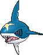
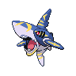

<!-- This file is generated by tools/generate_site.py. Edit the generator, not this file. -->

# #319 Sharpedo

{ .sprite-lg loading=lazy }

**Brutal Pokémon**

Water Dark

[:material-arrow-left: #318 Carvanha](318.md) · [Pokédex](index.md) · [#320 Wailmer :material-arrow-right:](320.md)

!!! info "Changes in Rising Ruby / Sinking Sapphire"

    - **Ability 2:** **Speed Boost** 

## Location

[Route 118](../wild/route_118.md), [Mossdeep City](../wild/mossdeep_city.md)

### Wild encounters

| Area | Method | Level | Note |
| --- | --- | --- | --- |
| [Route 118](../wild/route_118.md) | Super Rod | 55 |  |
| [Mossdeep City](../wild/mossdeep_city.md) | Super Rod | 55 |  |

### Gift & static encounters

| Category | Encounter | Changes |
| --- | --- | --- |
| Gift Pokémon Changes | Battle Resort, Sharpedo | Level increased to 80, always has max IVs |

See [Gifts & Static Encounters](../changes/gifts_and_statics.md) for the full list.

## Type defenses

| Damage taken | Attacking types |
| --- | --- |
| Immune (×0) | Psychic |
| Resistant (×½) | Ghost Steel Fire Water Ice Dark |
| Neutral (×1) | Normal Flying Poison Ground Rock Dragon |
| Weak (×2) | Fighting Bug Grass Electric Fairy |

## Abilities

| Slot | Ability | Effect | Note |
| --- | --- | --- | --- |
| Ability 1 | **Rough Skin** | Damages attacking Pokémon for 1/8 their max HP on contact. |  |
| Ability 2 | **Speed Boost** | Raises Speed one stage after each turn. | changed  |
| Hidden | **Speed Boost** | Raises Speed one stage after each turn. |  |

## Base stats

| Form | HP | Atk | Def | SpA | SpD | Spe | BST |
| --- | --- | --- | --- | --- | --- | --- | --- |
| { .sprite-sm loading=lazy } Normal | 70 | 120 | 40 | 95 | 40 | 95 | **460** |
| { .sprite-sm loading=lazy } Mega Sharpedo | 70 | 140 | 70 | 110 | 65 | 105 | **560** |

## Training & breeding

| Property | Value |
| --- | --- |
| EV yield | 2 Atk |
| Catch rate | 60 |
| Base friendship | 35 |
| Base experience | 161 |
| Growth rate | slow |
| Egg groups | Water 2 |
| Hatch counter | 20 |
| Gender ratio | 50% ♂ / 50% ♀ |
| Height / weight | 1.8 m / 88.8 kg |

## Evolution

- { .icon loading=lazy } [Carvanha](../pokemon/318.md) → { .icon loading=lazy } **[Sharpedo](../pokemon/319.md)**: Lv. 30
- { .sprite-sm loading=lazy } **Mega Sharpedo**: Mega Evolves by holding the Sharpedoite

## Wild held items

| Item | Chance | Note |
| --- | --- | --- |
| { .item loading=lazy } Deep Sea Tooth | 5% |  |

## Level-up moves { data-search-exclude }

Moves marked &#42; are not normally learned by level up (they come from egg moves, TMs/HMs or tutors in the official games); moves marked &#42;&#42; cannot normally be learned by this Pokémon at all and are omitted from the legal-moves version of the hack.

| Lv. | Move | Type | Cat. | Power | Acc. | PP | Effect | Note |
| --- | --- | --- | --- | --- | --- | --- | --- | --- |
| 1 | Night Slash | Dark | Physical | 70 | 100% | 15 | Has an increased chance for a critical hit. |  |
| 1 | Zen Headbutt | Psychic | Physical | 80 | 90% | 15 | Has a chance to make the target flinch. | &#42; |
| 1 | Feint | Normal | Physical | 30 | 100% | 10 | Hits through Protect and Detect. |  |
| 1 | Leer | Normal | Status | — | 100% | 30 | Lowers the target’s Defense by one stage. |  |
| 1 | Bite | Dark | Physical | 60 | 100% | 25 | Has a chance to make the target flinch. |  |
| 4 | Rage | Normal | Physical | 20 | 100% | 20 | If the user is hit after using this move, its Attack rises by one stage. |  |
| 7 | Focus Energy | Normal | Status | — | — | 30 | Increases the user’s chance to score a critical hit. |  |
| 10 | Aqua Jet | Water | Physical | 40 | 100% | 20 | Inflicts regular damage with no additional effect. |  |
| 13 | Assurance | Dark | Physical | 60 | 100% | 10 | Power is doubled if the target has already received damage this turn. |  |
| 16 | Screech | Normal | Status | — | 85% | 40 | Lowers the target’s Defense by two stages. |  |
| 19 | Swagger | Normal | Status | — | 90% | 15 | Raises the target’s Attack by two stages and confuses the target. |  |
| 22 | Ice Fang | Ice | Physical | 65 | 95% | 15 | Has a chance to freeze the target and a chance to make the target flinch. |  |
| 25 | Poison Fang | Poison | Physical | 50 | 100% | 15 | Has a chance to badly poison the target. |  |
| 28 | Waterfall | Water | Physical | 80 | 100% | 15 | Has a chance to make the target flinch. | &#42; |
| 30 | Slash | Normal | Physical | 70 | 100% | 20 | Has an increased chance for a critical hit. |  |
| 32 | Scary Face | Normal | Status | — | 100% | 10 | Lowers the target’s Speed by two stages. |  |
| 36 | Crunch | Dark | Physical | 80 | 100% | 15 | Has a chance to lower the target’s Defense by one stage. |  |
| 40 | Thrash | Normal | Physical | 120 | 100% | 10 | Hits every turn for 2-3 turns, then confuses the user. | &#42; |
| 44 | Agility | Psychic | Status | — | — | 30 | Raises the user’s Speed by two stages. |  |
| 48 | Skull Bash | Normal | Physical | 130 | 100% | 10 | Raises the user’s Defense by one stage.  User charges for one turn before attacking. |  |
| 52 | Hydro Pump | Water | Special | 110 | 80% | 5 | Inflicts regular damage with no additional effect. | &#42; |
| 56 | Taunt | Dark | Status | — | 100% | 20 | For the next few turns, the target can only use damaging moves. |  |
| 60 | Night Slash | Dark | Physical | 70 | 100% | 15 | Has an increased chance for a critical hit. |  |

## TM & HM moves { data-search-exclude }

| Machine | Move | Type | Cat. | Power | Acc. | PP | Effect |
| --- | --- | --- | --- | --- | --- | --- | --- |
| HM03 | Surf | Water | Special | 90 | 100% | 15 | Inflicts regular damage and can hit Dive users. |
| HM04 | [Strength](../changes/moves.md#strength) changed | Normal | Physical | 100 | 100% | 10 | Inflicts regular damage with no additional effect. |
| HM05 | Waterfall | Water | Physical | 80 | 100% | 15 | Has a chance to make the target flinch. |
| HM06 | [Rock Smash](../changes/moves.md#rock-smash) changed | Fighting | Physical | 65 | 100% | 15 | Has a chance to lower the target’s Defense by one stage. |
| HM07 | Dive | Water | Physical | 80 | 100% | 10 | User dives underwater, dodging all attacks, and hits next turn. |
| TM05 | Roar | Normal | Status | — | — | 20 | Immediately ends wild battles.  Forces trainers to switch Pokémon. |
| TM06 | Toxic | Poison | Status | — | 90% | 10 | Badly poisons the target, inflicting more damage every turn. |
| TM07 | Hail | Ice | Status | — | — | 10 | Changes the weather to a hailstorm for five turns. |
| TM10 | Hidden Power | Normal | Special | 60 | 100% | 15 | Power and type depend upon user’s IVs.  Power can range from 30 to 70. |
| TM100 | Confide | Normal | Status | — | — | 20 | Lowers the target’s Special Attack by one stage. |
| TM12 | Taunt | Dark | Status | — | 100% | 20 | For the next few turns, the target can only use damaging moves. |
| TM13 | Ice Beam | Ice | Special | 90 | 100% | 10 | Has a chance to freeze the target. |
| TM14 | Blizzard | Ice | Special | 110 | 70% | 5 | Has a chance to freeze the target. |
| TM15 | Hyper Beam | Normal | Special | 150 | 90% | 5 | User foregoes its next turn to recharge. |
| TM17 | Protect | Normal | Status | — | — | 10 | Prevents any moves from hitting the user this turn. |
| TM18 | Rain Dance | Water | Status | — | — | 5 | Changes the weather to rain for five turns. |
| TM21 | Frustration | Normal | Physical | — | 100% | 20 | Power increases as happiness decreases, up to a maximum of 102. |
| TM26 | Earthquake | Ground | Physical | 100 | 100% | 10 | Inflicts regular damage and can hit Dig users. |
| TM27 | Return | Normal | Physical | — | 100% | 20 | Power increases with happiness, up to a maximum of 102. |
| TM32 | Double Team | Normal | Status | — | — | 15 | Raises the user’s evasion by one stage. |
| TM39 | Rock Tomb | Rock | Physical | 60 | 95% | 15 | Has a chance to lower the target’s Speed by one stage. |
| TM41 | Torment | Dark | Status | — | 100% | 15 | Prevents the target from using the same move twice in a row. |
| TM42 | Facade | Normal | Physical | 70 | 100% | 20 | Power doubles if user is burned, paralyzed, or poisoned. |
| TM44 | Rest | Psychic | Status | — | — | 5 | User sleeps for two turns, completely healing itself. |
| TM45 | Attract | Normal | Status | — | 100% | 15 | Target falls in love if it has the opposite gender, and has a 50% chance to refuse attacking the user. |
| TM46 | Thief | Dark | Physical | 60 | 100% | 25 | Takes the target’s item. |
| TM48 | Round | Normal | Special | 60 | 100% | 15 | Has double power if it’s used more than once per turn. |
| TM55 | Scald | Water | Special | 80 | 100% | 15 | Has a chance to burn the target. |
| TM66 | Payback | Dark | Physical | 50 | 100% | 10 | Power is doubled if the target has already moved this turn. |
| TM67 | Retaliate | Normal | Physical | 70 | 100% | 5 | Has double power if a friendly Pokémon fainted last turn. |
| TM68 | Giga Impact | Normal | Physical | 150 | 90% | 5 | User foregoes its next turn to recharge. |
| TM78 | Bulldoze | Ground | Physical | 60 | 100% | 20 | Has a chance to lower the target’s Speed by one stage. |
| TM84 | Poison Jab | Poison | Physical | 80 | 100% | 20 | Has a chance to poison the target. |
| TM87 | Swagger | Normal | Status | — | 90% | 15 | Raises the target’s Attack by two stages and confuses the target. |
| TM88 | Sleep Talk | Normal | Status | — | — | 10 | Randomly uses one of the user’s other three moves.  Only works if the user is sleeping. |
| TM90 | Substitute | Normal | Status | — | — | 10 | Transfers 1/4 of the user’s max HP into a doll, protecting the user from further damage or status changes until it breaks. |
| TM94 | Secret Power | Normal | Physical | 70 | 100% | 20 | Has a chance to inflict a status effect which depends upon the terrain. |
| TM95 | Snarl | Dark | Special | 55 | 95% | 15 | Has a chance to lower the target’s Special Attack by one stage. |
| TM97 | Dark Pulse | Dark | Special | 80 | 100% | 15 | Has a chance to make the target flinch. |

## Move tutor moves { data-search-exclude }

| Move | Type | Cat. | Power | Acc. | PP | Effect |
| --- | --- | --- | --- | --- | --- | --- |
| Bounce | Flying | Physical | 85 | 85% | 5 | User bounces high into the air, dodging all attacks, and hits next turn. |
| Icy Wind | Ice | Special | 55 | 95% | 15 | Has a chance to lower the target’s Speed by one stage. |
| Snore | Normal | Special | 50 | 100% | 15 | Has a chance to make the target flinch.  Only works if the user is sleeping. |
| Spite | Ghost | Status | — | 100% | 10 | Lowers the PP of the target’s last used move by 4. |
| Super Fang | Normal | Physical | — | 90% | 10 | Inflicts damage equal to half the target’s HP. |
| Uproar | Normal | Special | 90 | 100% | 10 | Forced to use this move for several turns.  Pokémon cannot fall asleep in that time. |
| Water Pulse | Water | Special | 60 | 100% | 20 | Has a chance to confuse the target. |
| Zen Headbutt | Psychic | Physical | 80 | 90% | 15 | Has a chance to make the target flinch. |

## Egg moves { data-search-exclude }

No egg moves.

??? note "Trainers using Sharpedo (13)"

    | Area | Trainer | Level |
    | --- | --- | --- |
    | [Mt. Chimney](../trainers/mt_chimney.md#trainers) | Aqua Leader Archie | Lv. 36 |
    | [Route 108](../trainers/route_108.md#trainers) | Swimmer Jerome | Lv. 36 |
    | [Weather Institute](../trainers/weather_institute.md#trainers) | Team Aqua Grunt | Lv. 43 |
    | [Weather Institute](../trainers/weather_institute.md#trainers) | Aqua Admin Shelly | Lv. 46 |
    | [Mt. Pyre Summit 2](../trainers/mt_pyre_summit_2.md#trainers) | Team Aqua Grunt | Lv. 49 |
    | [Aqua Hideout](../trainers/aqua_hideout.md#trainers) | Team Aqua Grunt | Lv. 52 |
    | [Aqua Hideout](../trainers/aqua_hideout.md#trainers) | Aqua Admin Matt | Lv. 55 |
    | [Route 126](../trainers/route_126.md#trainers) | Triathlete Denzel | Lv. 55 |
    | [Route 134](../trainers/route_134.md#trainers) | Swimmer Jack | Lv. 59 |
    | [Seafloor Cavern Back Rooms](../trainers/seafloor_cavern_back_rooms.md#trainers) | Aqua Leader Archie | Lv. 65 |
    | [Sootopolis Gym](../trainers/sootopolis_gym.md#trainers) | Lass Crissy | Lv. 62 |
    | [Petalburg City (Post Game)](../trainers/petalburg_city_post_game.md#trainers) | Aqua Admin Matt | Lv. 75 |
    | [Aqua Hideout (Post Game)](../trainers/aqua_hideout_post_game.md#trainers) | Team Aqua Grunt | Lv. 75 |

---

[:material-arrow-left: #318 Carvanha](318.md) · [#320 Wailmer :material-arrow-right:](320.md)
