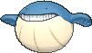

<!-- This file is generated by tools/generate_site.py. Edit the generator, not this file. -->

# #320 Wailmer

{ .sprite-lg loading=lazy }

**Ball Whale Pokémon**

Water

[:material-arrow-left: #319 Sharpedo](319.md) · [Pokédex](index.md) · [#321 Wailord :material-arrow-right:](321.md)

!!! info "Changes in Rising Ruby / Sinking Sapphire"

    - **Evolution level:** 40 → **37**

## Location

[Slateport City](../wild/slateport_city.md), [Sea Mauville](../wild/sea_mauville_outside.md), [Magma Hideout](../wild/magma_hideout.md), [Aqua Hideout](../wild/aqua_hideout.md), [Route 129](../wild/route_129.md)

### Wild encounters

| Area | Method | Level | Note |
| --- | --- | --- | --- |
| [Slateport City](../wild/slateport_city.md) | Old Rod | 15 |  |
| [Slateport City](../wild/slateport_city.md) | Good Rod | 35 |  |
| [Slateport City](../wild/slateport_city.md) | Super Rod | 55 |  |
| [Sea Mauville Outside](../wild/sea_mauville_outside.md) | Old Rod | 15 |  |
| [Sea Mauville Outside](../wild/sea_mauville_outside.md) | Good Rod | 35 |  |
| [Sea Mauville Outside](../wild/sea_mauville_outside.md) | Super Rod | 55 |  |
| [Sea Mauville Inside](../wild/sea_mauville_inside.md) | Old Rod | 15 |  |
| [Sea Mauville Inside](../wild/sea_mauville_inside.md) | Good Rod | 35 |  |
| [Sea Mauville Inside](../wild/sea_mauville_inside.md) | Super Rod | 55 |  |
| [Magma Hideout](../wild/magma_hideout.md) | Old Rod | 15 |  |
| [Magma Hideout](../wild/magma_hideout.md) | Good Rod | 35 |  |
| [Magma Hideout](../wild/magma_hideout.md) | Super Rod | 55 |  |
| [Aqua Hideout](../wild/aqua_hideout.md) | Old Rod | 15 |  |
| [Aqua Hideout](../wild/aqua_hideout.md) | Good Rod | 35 |  |
| [Aqua Hideout](../wild/aqua_hideout.md) | Super Rod | 55 |  |
| [Route 129](../wild/route_129.md) | Surfing | 40 - 50 |  |
| [Route 129](../wild/route_129.md) | Old Rod | 15 |  |
| [Route 129](../wild/route_129.md) | Good Rod | 35 |  |
| [Route 129](../wild/route_129.md) | Super Rod | 55 |  |

## Type defenses

| Damage taken | Attacking types |
| --- | --- |
| Resistant (×½) | Steel Fire Water Ice |
| Neutral (×1) | Normal Fighting Flying Poison Ground Rock Bug Ghost Psychic Dragon Dark Fairy |
| Weak (×2) | Grass Electric |

## Abilities

| Slot | Ability | Effect | Note |
| --- | --- | --- | --- |
| Ability 1 | **Water Veil** | Prevents burns. |  |
| Ability 2 | **Oblivious** | Prevents infatuation and protects against Captivate. |  |
| Hidden | **Pressure** | Increases the PP cost of moves targetting the Pokémon by one. |  |

## Base stats

| Form | HP | Atk | Def | SpA | SpD | Spe | BST |
| --- | --- | --- | --- | --- | --- | --- | --- |
| { .sprite-sm loading=lazy } Normal | 130 | 70 | 35 | 70 | 35 | 60 | **400** |

## Training & breeding

| Property | Value |
| --- | --- |
| EV yield | 1 HP |
| Catch rate | 125 |
| Base friendship | 70 |
| Base experience | 80 |
| Growth rate | fluctuating |
| Egg groups | Field, Water 2 |
| Hatch counter | 40 |
| Gender ratio | 50% ♂ / 50% ♀ |
| Height / weight | 2 m / 130 kg |

## Evolution

- { .icon loading=lazy } **[Wailmer](../pokemon/320.md)** → { .icon loading=lazy } [Wailord](../pokemon/321.md): Lv. 37 changed <small>(vanilla: Lv. 40)</small>

## Wild held items

None.

## Level-up moves { data-search-exclude }

Moves marked &#42; are not normally learned by level up (they come from egg moves, TMs/HMs or tutors in the official games); moves marked &#42;&#42; cannot normally be learned by this Pokémon at all and are omitted from the legal-moves version of the hack.

| Lv. | Move | Type | Cat. | Power | Acc. | PP | Effect | Note |
| --- | --- | --- | --- | --- | --- | --- | --- | --- |
| 1 | Splash | Normal | Status | — | — | 40 | Does nothing. |  |
| 4 | Growl | Normal | Status | — | 100% | 40 | Lowers the target’s Attack by one stage. |  |
| 7 | Water Gun | Water | Special | 40 | 100% | 25 | Inflicts regular damage with no additional effect. |  |
| 10 | Rollout | Rock | Physical | 30 | 90% | 20 | Power doubles every turn this move is used in succession after the first, resetting after five turns. |  |
| 13 | Whirlpool | Water | Special | 35 | 85% | 15 | Prevents the target from leaving battle and inflicts 1/16 its max HP in damage for 2-5 turns. |  |
| 16 | Astonish | Ghost | Physical | 30 | 100% | 15 | Has a chance to make the target flinch. |  |
| 19 | Water Pulse | Water | Special | 60 | 100% | 20 | Has a chance to confuse the target. |  |
| 22 | Mist | Ice | Status | — | — | 30 | Protects the user’s stats from being changed by enemy moves. |  |
| 25 | Brine | Water | Special | 65 | 100% | 10 | Has double power against Pokémon that have less than half their max HP remaining. |  |
| 28 | Rest | Psychic | Status | — | — | 5 | User sleeps for two turns, completely healing itself. |  |
| 31 | Body Slam | Normal | Physical | 85 | 100% | 15 | Has a chance to paralyze the target. | &#42; |
| 34 | Dive | Water | Physical | 80 | 100% | 10 | User dives underwater, dodging all attacks, and hits next turn. |  |
| 37 | Zen Headbutt | Psychic | Physical | 80 | 90% | 15 | Has a chance to make the target flinch. | &#42; |
| 40 | Amnesia | Psychic | Status | — | — | 20 | Raises the user’s Special Defense by two stages. |  |
| 43 | Water Spout | Water | Special | 150 | 100% | 5 | Inflicts more damage when the user has more HP remaining, with a maximum of 150 power. |  |
| 46 | Bounce | Flying | Physical | 85 | 85% | 5 | User bounces high into the air, dodging all attacks, and hits next turn. |  |
| 49 | Hydro Pump | Water | Special | 110 | 80% | 5 | Inflicts regular damage with no additional effect. |  |
| 52 | Double-Edge | Normal | Physical | 120 | 100% | 15 | User receives 1/3 the damage inflicted in recoil. | &#42; |
| 55 | Fissure | Ground | Physical | — | 30% | 5 | Causes a one-hit KO. | &#42; |
| 58 | Heavy Slam | Steel | Physical | — | 100% | 10 | Power is higher when the user weighs more than the target, up to a maximum of 120. |  |

## TM & HM moves { data-search-exclude }

| Machine | Move | Type | Cat. | Power | Acc. | PP | Effect |
| --- | --- | --- | --- | --- | --- | --- | --- |
| HM03 | Surf | Water | Special | 90 | 100% | 15 | Inflicts regular damage and can hit Dive users. |
| HM04 | [Strength](../changes/moves.md#strength) changed | Normal | Physical | 100 | 100% | 10 | Inflicts regular damage with no additional effect. |
| HM05 | Waterfall | Water | Physical | 80 | 100% | 15 | Has a chance to make the target flinch. |
| HM06 | [Rock Smash](../changes/moves.md#rock-smash) changed | Fighting | Physical | 65 | 100% | 15 | Has a chance to lower the target’s Defense by one stage. |
| HM07 | Dive | Water | Physical | 80 | 100% | 10 | User dives underwater, dodging all attacks, and hits next turn. |
| TM05 | Roar | Normal | Status | — | — | 20 | Immediately ends wild battles.  Forces trainers to switch Pokémon. |
| TM06 | Toxic | Poison | Status | — | 90% | 10 | Badly poisons the target, inflicting more damage every turn. |
| TM07 | Hail | Ice | Status | — | — | 10 | Changes the weather to a hailstorm for five turns. |
| TM10 | Hidden Power | Normal | Special | 60 | 100% | 15 | Power and type depend upon user’s IVs.  Power can range from 30 to 70. |
| TM100 | Confide | Normal | Status | — | — | 20 | Lowers the target’s Special Attack by one stage. |
| TM13 | Ice Beam | Ice | Special | 90 | 100% | 10 | Has a chance to freeze the target. |
| TM14 | Blizzard | Ice | Special | 110 | 70% | 5 | Has a chance to freeze the target. |
| TM17 | Protect | Normal | Status | — | — | 10 | Prevents any moves from hitting the user this turn. |
| TM18 | Rain Dance | Water | Status | — | — | 5 | Changes the weather to rain for five turns. |
| TM21 | Frustration | Normal | Physical | — | 100% | 20 | Power increases as happiness decreases, up to a maximum of 102. |
| TM26 | Earthquake | Ground | Physical | 100 | 100% | 10 | Inflicts regular damage and can hit Dig users. |
| TM27 | Return | Normal | Physical | — | 100% | 20 | Power increases with happiness, up to a maximum of 102. |
| TM32 | Double Team | Normal | Status | — | — | 15 | Raises the user’s evasion by one stage. |
| TM39 | Rock Tomb | Rock | Physical | 60 | 95% | 15 | Has a chance to lower the target’s Speed by one stage. |
| TM42 | Facade | Normal | Physical | 70 | 100% | 20 | Power doubles if user is burned, paralyzed, or poisoned. |
| TM44 | Rest | Psychic | Status | — | — | 5 | User sleeps for two turns, completely healing itself. |
| TM45 | Attract | Normal | Status | — | 100% | 15 | Target falls in love if it has the opposite gender, and has a 50% chance to refuse attacking the user. |
| TM48 | Round | Normal | Special | 60 | 100% | 15 | Has double power if it’s used more than once per turn. |
| TM49 | Echoed Voice | Normal | Special | 40 | 100% | 15 | Power increases by 100% for each consecutive use by any friendly Pokémon, to a maximum of 200. |
| TM55 | Scald | Water | Special | 80 | 100% | 15 | Has a chance to burn the target. |
| TM78 | Bulldoze | Ground | Physical | 60 | 100% | 20 | Has a chance to lower the target’s Speed by one stage. |
| TM87 | Swagger | Normal | Status | — | 90% | 15 | Raises the target’s Attack by two stages and confuses the target. |
| TM88 | Sleep Talk | Normal | Status | — | — | 10 | Randomly uses one of the user’s other three moves.  Only works if the user is sleeping. |
| TM90 | Substitute | Normal | Status | — | — | 10 | Transfers 1/4 of the user’s max HP into a doll, protecting the user from further damage or status changes until it breaks. |
| TM94 | Secret Power | Normal | Physical | 70 | 100% | 20 | Has a chance to inflict a status effect which depends upon the terrain. |

## Move tutor moves { data-search-exclude }

| Move | Type | Cat. | Power | Acc. | PP | Effect |
| --- | --- | --- | --- | --- | --- | --- |
| Bounce | Flying | Physical | 85 | 85% | 5 | User bounces high into the air, dodging all attacks, and hits next turn. |
| Hyper Voice | Normal | Special | 90 | 100% | 10 | Inflicts regular damage with no additional effect. |
| Icy Wind | Ice | Special | 55 | 95% | 15 | Has a chance to lower the target’s Speed by one stage. |
| Snore | Normal | Special | 50 | 100% | 15 | Has a chance to make the target flinch.  Only works if the user is sleeping. |
| Water Pulse | Water | Special | 60 | 100% | 20 | Has a chance to confuse the target. |
| Zen Headbutt | Psychic | Physical | 80 | 90% | 15 | Has a chance to make the target flinch. |

## Egg moves { data-search-exclude }

| Move | Type | Cat. | Power | Acc. | PP | Effect |
| --- | --- | --- | --- | --- | --- | --- |
| Aqua Ring | Water | Status | — | — | 20 | Restores 1/16 of the user’s max HP each turn. |
| Body Slam | Normal | Physical | 85 | 100% | 15 | Has a chance to paralyze the target. |
| Clear Smog | Poison | Special | 50 | — | 15 | Removes all of the target’s stat modifiers. |
| Curse | Ghost | Status | — | — | 10 | Ghosts pay half their max HP to hurt the target every turn.  Others decrease Speed but raise Attack and Defense. |
| Defense Curl | Normal | Status | — | — | 40 | Raises user’s Defense by one stage. |
| Double-Edge | Normal | Physical | 120 | 100% | 15 | User receives 1/3 the damage inflicted in recoil. |
| Fissure | Ground | Physical | — | 30% | 5 | Causes a one-hit KO. |
| Sleep Talk | Normal | Status | — | — | 10 | Randomly uses one of the user’s other three moves.  Only works if the user is sleeping. |
| Snore | Normal | Special | 50 | 100% | 15 | Has a chance to make the target flinch.  Only works if the user is sleeping. |
| Soak | Water | Status | — | 100% | 20 | Changes the target’s type to Water. |
| Thrash | Normal | Physical | 120 | 100% | 10 | Hits every turn for 2-3 turns, then confuses the user. |
| Tickle | Normal | Status | — | 100% | 20 | Lowers the target’s Attack and Defense by one stage. |
| Zen Headbutt | Psychic | Physical | 80 | 90% | 15 | Has a chance to make the target flinch. |

??? note "Trainers using Wailmer (6)"

    | Area | Trainer | Level |
    | --- | --- | --- |
    | [Rusturf Tunnel](../trainers/rusturf_tunnel.md#trainers) | Team Aqua Grunt | Lv. 14 |
    | [Route 110](../trainers/route_110.md#trainers-main-area) | PKMN Trainer Brendan | Lv. 22 |
    | [Route 110](../trainers/route_110.md#trainers-main-area) | PKMN Trainer Brendan | Lv. 22 |
    | [Route 110](../trainers/route_110.md#trainers-main-area) | PKMN Trainer May | Lv. 22 |
    | [Route 110](../trainers/route_110.md#trainers-main-area) | PKMN Trainer May | Lv. 22 |
    | [Route 110](../trainers/route_110.md#trainers-main-area) | Fisherman Dale | Lv. 20 |

---

[:material-arrow-left: #319 Sharpedo](319.md) · [#321 Wailord :material-arrow-right:](321.md)
