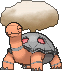

<!-- This file is generated by tools/generate_site.py. Edit the generator, not this file. -->

# #324 Torkoal

{ .sprite-lg loading=lazy }

**Coal Pokémon**

Fire

[:material-arrow-left: #323 Camerupt](323.md) · [Pokédex](index.md) · [#325 Spoink :material-arrow-right:](325.md)

!!! info "Changes in Rising Ruby / Sinking Sapphire"

    - **Ability 2:** **Shell Armor** 

## Location

[Fiery Path](../wild/fiery_path.md)

### Wild encounters

| Area | Method | Level | Note |
| --- | --- | --- | --- |
| [Fiery Path](../wild/fiery_path.md) | Grass | 23 |  |

## Type defenses

| Damage taken | Attacking types |
| --- | --- |
| Resistant (×½) | Bug Steel Fire Grass Ice Fairy |
| Neutral (×1) | Normal Fighting Flying Poison Ghost Electric Psychic Dragon Dark |
| Weak (×2) | Ground Rock Water |

## Abilities

| Slot | Ability | Effect | Note |
| --- | --- | --- | --- |
| Ability 1 | **White Smoke** | Prevents stats from being lowered by other Pokémon. |  |
| Ability 2 | **Shell Armor** | Protects against critical hits. | changed  |
| Hidden | **Shell Armor** | Protects against critical hits. |  |

## Base stats

| Form | HP | Atk | Def | SpA | SpD | Spe | BST |
| --- | --- | --- | --- | --- | --- | --- | --- |
| { .sprite-sm loading=lazy } Normal | 70 | 85 | 140 | 85 | 70 | 20 | **470** |

## Training & breeding

| Property | Value |
| --- | --- |
| EV yield | 2 Def |
| Catch rate | 90 |
| Base friendship | 70 |
| Base experience | 165 |
| Growth rate | medium |
| Egg groups | Field |
| Hatch counter | 20 |
| Gender ratio | 50% ♂ / 50% ♀ |
| Height / weight | 0.5 m / 80.4 kg |

## Evolution

This Pokémon does not evolve.

## Wild held items

| Item | Chance | Note |
| --- | --- | --- |
| { .item loading=lazy } Charcoal | 5% |  |

## Level-up moves { data-search-exclude }

Moves marked &#42; are not normally learned by level up (they come from egg moves, TMs/HMs or tutors in the official games); moves marked &#42;&#42; cannot normally be learned by this Pokémon at all and are omitted from the legal-moves version of the hack.

| Lv. | Move | Type | Cat. | Power | Acc. | PP | Effect | Note |
| --- | --- | --- | --- | --- | --- | --- | --- | --- |
| 1 | Ember | Fire | Special | 40 | 100% | 25 | Has a chance to burn the target. |  |
| 4 | Smog | Poison | Special | 30 | 70% | 20 | Has a chance to poison the target. |  |
| 7 | Withdraw | Water | Status | — | — | 40 | Raises the user’s Defense by one stage. |  |
| 10 | Rapid Spin | Normal | Physical | 20 | 100% | 40 | Frees the user from binding moves, removes Leech Seed, and blows away Spikes. |  |
| 13 | Fire Spin | Fire | Special | 35 | 85% | 15 | Prevents the target from fleeing and inflicts damage for 2-5 turns. |  |
| 15 | Smokescreen | Normal | Status | — | 100% | 20 | Lowers the target’s accuracy by one stage. |  |
| 18 | Flame Wheel | Fire | Physical | 60 | 100% | 25 | Has a chance to burn the target.  Lets frozen Pokémon thaw themselves. |  |
| 22 | Curse | Ghost | Status | — | — | 10 | Ghosts pay half their max HP to hurt the target every turn.  Others decrease Speed but raise Attack and Defense. |  |
| 25 | Lava Plume | Fire | Special | 80 | 100% | 15 | Has a chance to burn the target. |  |
| 27 | Body Slam | Normal | Physical | 85 | 100% | 15 | Has a chance to paralyze the target. |  |
| 30 | Protect | Normal | Status | — | — | 10 | Prevents any moves from hitting the user this turn. |  |
| 34 | Flamethrower | Fire | Special | 90 | 100% | 15 | Has a chance to burn the target. |  |
| 38 | Iron Defense | Steel | Status | — | — | 15 | Raises the user’s Defense by two stages. |  |
| 40 | Earth Power | Ground | Special | 90 | 100% | 10 | Has a chance to lower the target’s Special Defense by one stage. | &#42; |
| 42 | Amnesia | Psychic | Status | — | — | 20 | Raises the user’s Special Defense by two stages. |  |
| 45 | Flail | Normal | Physical | — | 100% | 15 | Inflicts more damage when the user has less HP remaining, with a maximum of 200 power. |  |
| 47 | Heat Wave | Fire | Special | 95 | 90% | 10 | Has a chance to burn the target. |  |
| 50 | Shell Smash | Normal | Status | — | — | 15 | Raises user’s Attack, Special Attack, and Speed by two stages.  Lower user’s Defense and Special Defense by one stage. |  |
| 53 | Inferno | Fire | Special | 100 | 50% | 5 | Has a chance to burn the target. |  |
| 57 | Superpower | Fighting | Physical | 120 | 100% | 5 | Lowers the user’s Attack and Defense by one stage after inflicting damage. | &#42; |
| 60 | Eruption | Fire | Special | 150 | 100% | 5 | Inflicts more damage when the user has more HP remaining, with a maximum of 150 power. | &#42; |

## TM & HM moves { data-search-exclude }

| Machine | Move | Type | Cat. | Power | Acc. | PP | Effect |
| --- | --- | --- | --- | --- | --- | --- | --- |
| HM04 | [Strength](../changes/moves.md#strength) changed | Normal | Physical | 100 | 100% | 10 | Inflicts regular damage with no additional effect. |
| HM06 | [Rock Smash](../changes/moves.md#rock-smash) changed | Fighting | Physical | 65 | 100% | 15 | Has a chance to lower the target’s Defense by one stage. |
| TM06 | Toxic | Poison | Status | — | 90% | 10 | Badly poisons the target, inflicting more damage every turn. |
| TM10 | Hidden Power | Normal | Special | 60 | 100% | 15 | Power and type depend upon user’s IVs.  Power can range from 30 to 70. |
| TM100 | Confide | Normal | Status | — | — | 20 | Lowers the target’s Special Attack by one stage. |
| TM11 | Sunny Day | Fire | Status | — | — | 5 | Changes the weather to sunny for five turns. |
| TM15 | Hyper Beam | Normal | Special | 150 | 90% | 5 | User foregoes its next turn to recharge. |
| TM17 | Protect | Normal | Status | — | — | 10 | Prevents any moves from hitting the user this turn. |
| TM21 | Frustration | Normal | Physical | — | 100% | 20 | Power increases as happiness decreases, up to a maximum of 102. |
| TM22 | Solar Beam | Grass | Special | 120 | 100% | 10 | Requires a turn to charge before attacking. |
| TM26 | Earthquake | Ground | Physical | 100 | 100% | 10 | Inflicts regular damage and can hit Dig users. |
| TM27 | Return | Normal | Physical | — | 100% | 20 | Power increases with happiness, up to a maximum of 102. |
| TM32 | Double Team | Normal | Status | — | — | 15 | Raises the user’s evasion by one stage. |
| TM35 | Flamethrower | Fire | Special | 90 | 100% | 15 | Has a chance to burn the target. |
| TM36 | Sludge Bomb | Poison | Special | 90 | 100% | 10 | Has a chance to poison the target. |
| TM38 | Fire Blast | Fire | Special | 110 | 85% | 5 | Has a chance to burn the target. |
| TM39 | Rock Tomb | Rock | Physical | 60 | 95% | 15 | Has a chance to lower the target’s Speed by one stage. |
| TM42 | Facade | Normal | Physical | 70 | 100% | 20 | Power doubles if user is burned, paralyzed, or poisoned. |
| TM43 | Flame Charge | Fire | Physical | 50 | 100% | 20 | Inflicts regular damage.  Raises the user’s Speed by one stage. |
| TM44 | Rest | Psychic | Status | — | — | 5 | User sleeps for two turns, completely healing itself. |
| TM45 | Attract | Normal | Status | — | 100% | 15 | Target falls in love if it has the opposite gender, and has a 50% chance to refuse attacking the user. |
| TM48 | Round | Normal | Special | 60 | 100% | 15 | Has double power if it’s used more than once per turn. |
| TM50 | Overheat | Fire | Special | 130 | 90% | 5 | Lowers the user’s Special Attack by two stages after inflicting damage. |
| TM59 | Incinerate | Fire | Special | 60 | 100% | 15 | Destroys the target’s held berry. |
| TM61 | Will-O-Wisp | Fire | Status | — | 85% | 15 | Burns the target. |
| TM64 | Explosion | Normal | Physical | 250 | 100% | 5 | User faints. |
| TM68 | Giga Impact | Normal | Physical | 150 | 90% | 5 | User foregoes its next turn to recharge. |
| TM71 | Stone Edge | Rock | Physical | 100 | 80% | 5 | Has an increased chance for a critical hit. |
| TM74 | Gyro Ball | Steel | Physical | — | 100% | 5 | Power raises when the user has lower Speed, up to a maximum of 150. |
| TM78 | Bulldoze | Ground | Physical | 60 | 100% | 20 | Has a chance to lower the target’s Speed by one stage. |
| TM80 | Rock Slide | Rock | Physical | 75 | 90% | 10 | Has a chance to make the target flinch. |
| TM87 | Swagger | Normal | Status | — | 90% | 15 | Raises the target’s Attack by two stages and confuses the target. |
| TM88 | Sleep Talk | Normal | Status | — | — | 10 | Randomly uses one of the user’s other three moves.  Only works if the user is sleeping. |
| TM90 | Substitute | Normal | Status | — | — | 10 | Transfers 1/4 of the user’s max HP into a doll, protecting the user from further damage or status changes until it breaks. |
| TM94 | Secret Power | Normal | Physical | 70 | 100% | 20 | Has a chance to inflict a status effect which depends upon the terrain. |
| TM96 | Nature Power | Normal | Status | — | — | 20 | Uses a move which depends upon the terrain. |

## Move tutor moves { data-search-exclude }

| Move | Type | Cat. | Power | Acc. | PP | Effect |
| --- | --- | --- | --- | --- | --- | --- |
| After You | Normal | Status | — | — | 15 | Makes the target act next this turn. |
| Earth Power | Ground | Special | 90 | 100% | 10 | Has a chance to lower the target’s Special Defense by one stage. |
| Heat Wave | Fire | Special | 95 | 90% | 10 | Has a chance to burn the target. |
| Iron Defense | Steel | Status | — | — | 15 | Raises the user’s Defense by two stages. |
| Iron Tail | Steel | Physical | 100 | 75% | 15 | Has a chance to lower the target’s Defense by one stage. |
| Snore | Normal | Special | 50 | 100% | 15 | Has a chance to make the target flinch.  Only works if the user is sleeping. |
| Stealth Rock | Rock | Status | — | — | 20 | Causes damage when opposing Pokémon switch in. |
| Superpower | Fighting | Physical | 120 | 100% | 5 | Lowers the user’s Attack and Defense by one stage after inflicting damage. |

## Egg moves { data-search-exclude }

| Move | Type | Cat. | Power | Acc. | PP | Effect |
| --- | --- | --- | --- | --- | --- | --- |
| Clear Smog | Poison | Special | 50 | — | 15 | Removes all of the target’s stat modifiers. |
| Endure | Normal | Status | — | — | 10 | Prevents the user’s HP from lowering below 1 this turn. |
| Eruption | Fire | Special | 150 | 100% | 5 | Inflicts more damage when the user has more HP remaining, with a maximum of 150 power. |
| Fissure | Ground | Physical | — | 30% | 5 | Causes a one-hit KO. |
| Flame Burst | Fire | Special | 70 | 100% | 15 | Deals splash damage to Pokémon next to the target. |
| Skull Bash | Normal | Physical | 130 | 100% | 10 | Raises the user’s Defense by one stage.  User charges for one turn before attacking. |
| Sleep Talk | Normal | Status | — | — | 10 | Randomly uses one of the user’s other three moves.  Only works if the user is sleeping. |
| Superpower | Fighting | Physical | 120 | 100% | 5 | Lowers the user’s Attack and Defense by one stage after inflicting damage. |
| Yawn | Normal | Status | — | — | 10 | Target sleeps at the end of the next turn. |

??? note "Trainers using Torkoal (9)"

    | Area | Trainer | Level |
    | --- | --- | --- |
    | [Route 111](../trainers/route_111.md#rematches) | Ace Trainer Wilton (4) | Lv. 35 |
    | [Route 111](../trainers/route_111.md#rematches) | Ace Trainer Wilton (6) | Lv. 47 |
    | [Route 111](../trainers/route_111.md#rematches) | Ace Trainer Wilton (8) | Lv. 64 |
    | [Route 111](../trainers/route_111.md#rematches) | Ace Trainer Wilton (C) | Lv. 75 |
    | [Lavaridge Gym](../trainers/lavaridge_gym.md#trainers) | Leader Flannery | Lv. 38 |
    | [Magma Hideout (Post Game)](../trainers/magma_hideout_post_game.md#trainers) | Team Magma Grunt | Lv. 75 |
    | [Battle Resort](../trainers/battle_resort.md#trainers) | Leader Carnation [Flannery] | Lv. 79 |
    | [Battle Resort](../trainers/battle_resort.md#trainers) | Leader Carnation [Flannery] | Lv. 79 |
    | [Battle Resort](../trainers/battle_resort.md#trainers) | Leader Felix [Malva] | Lv. 82 |

---

[:material-arrow-left: #323 Camerupt](323.md) · [#325 Spoink :material-arrow-right:](325.md)
