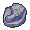

<!-- This file is generated by tools/generate_site.py. Edit the generator, not this file. -->

# #328 Trapinch

{ .sprite-lg loading=lazy }

**Ant Pit Pokémon**

Ground

[:material-arrow-left: #327 Spinda](327.md) · [Pokédex](index.md) · [#329 Vibrava :material-arrow-right:](329.md)

!!! info "Changes in Rising Ruby / Sinking Sapphire"

    - **Wild held items:** { .item loading=lazy } Jaw Fossil (50%), { .item loading=lazy } Soft Sand (5%)

## Location

[Route 111](../wild/route_111.md)

### Wild encounters

| Area | Method | Level | Note |
| --- | --- | --- | --- |
| [Route 111 (Desert)](../wild/route_111_desert.md) | Grass | 31 |  |

## Type defenses

| Damage taken | Attacking types |
| --- | --- |
| Immune (×0) | Electric |
| Resistant (×½) | Poison Rock |
| Neutral (×1) | Normal Fighting Flying Ground Bug Ghost Steel Fire Psychic Dragon Dark Fairy |
| Weak (×2) | Water Grass Ice |

## Abilities

| Slot | Ability | Effect | Note |
| --- | --- | --- | --- |
| Ability 1 | **Hyper Cutter** | Prevents Attack from being lowered by other Pokémon. |  |
| Ability 2 | **Arena Trap** | Prevents opponents from fleeing or switching out.  Eluded by Flying-types and Pokémon in the air. |  |
| Hidden | **Sheer Force** | Strengthens moves with extra effects to 1.3× their power, but prevents their extra effects. |  |

## Base stats

| Form | HP | Atk | Def | SpA | SpD | Spe | BST |
| --- | --- | --- | --- | --- | --- | --- | --- |
| { .sprite-sm loading=lazy } Normal | 45 | 100 | 45 | 45 | 45 | 10 | **290** |

## Training & breeding

| Property | Value |
| --- | --- |
| EV yield | 1 Atk |
| Catch rate | 255 |
| Base friendship | 70 |
| Base experience | 58 |
| Growth rate | medium slow |
| Egg groups | Bug, Dragon |
| Hatch counter | 20 |
| Gender ratio | 50% ♂ / 50% ♀ |
| Height / weight | 0.7 m / 15 kg |

## Evolution

- { .icon loading=lazy } **[Trapinch](../pokemon/328.md)** → { .icon loading=lazy } [Vibrava](../pokemon/329.md): Lv. 35
- { .icon loading=lazy } [Vibrava](../pokemon/329.md) → { .icon loading=lazy } [Flygon](../pokemon/330.md): Lv. 45

## Wild held items

| Item | Chance | Note |
| --- | --- | --- |
| { .item loading=lazy } Jaw Fossil | 50% | changed |
| { .item loading=lazy } Soft Sand | 5% | changed |

## Level-up moves { data-search-exclude }

Moves marked &#42; are not normally learned by level up (they come from egg moves, TMs/HMs or tutors in the official games); moves marked &#42;&#42; cannot normally be learned by this Pokémon at all and are omitted from the legal-moves version of the hack.

| Lv. | Move | Type | Cat. | Power | Acc. | PP | Effect | Note |
| --- | --- | --- | --- | --- | --- | --- | --- | --- |
| 1 | Sand Attack | Ground | Status | — | 100% | 15 | Lowers the target’s accuracy by one stage. |  |
| 1 | Bite | Dark | Physical | 60 | 100% | 25 | Has a chance to make the target flinch. |  |
| 1 | Feint Attack | Dark | Physical | 60 | — | 20 | Never misses. |  |
| 1 | Bide | Normal | Physical | — | — | 10 | User waits for two turns, then hits back for twice the damage it took. |  |
| 5 | Mud-Slap | Ground | Special | 20 | 100% | 10 | Has a chance to lower the target’s accuracy by one stage. |  |
| 8 | Bulldoze | Ground | Physical | 60 | 100% | 20 | Has a chance to lower the target’s Speed by one stage. |  |
| 12 | Sand Tomb | Ground | Physical | 35 | 85% | 15 | Prevents the target from fleeing and inflicts damage for 2-5 turns. |  |
| 15 | Rock Slide | Rock | Physical | 75 | 90% | 10 | Has a chance to make the target flinch. |  |
| 19 | Dig | Ground | Physical | 80 | 100% | 10 | User digs underground, dodging all attacks, and hits next turn. |  |
| 22 | Crunch | Dark | Physical | 80 | 100% | 15 | Has a chance to lower the target’s Defense by one stage. |  |
| 26 | Earth Power | Ground | Special | 90 | 100% | 10 | Has a chance to lower the target’s Special Defense by one stage. |  |
| 29 | Feint | Normal | Physical | 30 | 100% | 10 | Hits through Protect and Detect. |  |
| 33 | Earthquake | Ground | Physical | 100 | 100% | 10 | Inflicts regular damage and can hit Dig users. |  |
| 36 | Sandstorm | Rock | Status | — | — | 10 | Changes the weather to a sandstorm for five turns. |  |
| 40 | Superpower | Fighting | Physical | 120 | 100% | 5 | Lowers the user’s Attack and Defense by one stage after inflicting damage. |  |
| 43 | Hyper Beam | Normal | Special | 150 | 90% | 5 | User foregoes its next turn to recharge. |  |
| 47 | Fissure | Ground | Physical | — | 30% | 5 | Causes a one-hit KO. |  |

## TM & HM moves { data-search-exclude }

| Machine | Move | Type | Cat. | Power | Acc. | PP | Effect |
| --- | --- | --- | --- | --- | --- | --- | --- |
| HM04 | [Strength](../changes/moves.md#strength) changed | Normal | Physical | 100 | 100% | 10 | Inflicts regular damage with no additional effect. |
| HM06 | [Rock Smash](../changes/moves.md#rock-smash) changed | Fighting | Physical | 65 | 100% | 15 | Has a chance to lower the target’s Defense by one stage. |
| TM06 | Toxic | Poison | Status | — | 90% | 10 | Badly poisons the target, inflicting more damage every turn. |
| TM10 | Hidden Power | Normal | Special | 60 | 100% | 15 | Power and type depend upon user’s IVs.  Power can range from 30 to 70. |
| TM100 | Confide | Normal | Status | — | — | 20 | Lowers the target’s Special Attack by one stage. |
| TM11 | Sunny Day | Fire | Status | — | — | 5 | Changes the weather to sunny for five turns. |
| TM15 | Hyper Beam | Normal | Special | 150 | 90% | 5 | User foregoes its next turn to recharge. |
| TM17 | Protect | Normal | Status | — | — | 10 | Prevents any moves from hitting the user this turn. |
| TM21 | Frustration | Normal | Physical | — | 100% | 20 | Power increases as happiness decreases, up to a maximum of 102. |
| TM22 | Solar Beam | Grass | Special | 120 | 100% | 10 | Requires a turn to charge before attacking. |
| TM26 | Earthquake | Ground | Physical | 100 | 100% | 10 | Inflicts regular damage and can hit Dig users. |
| TM27 | Return | Normal | Physical | — | 100% | 20 | Power increases with happiness, up to a maximum of 102. |
| TM28 | Dig | Ground | Physical | 80 | 100% | 10 | User digs underground, dodging all attacks, and hits next turn. |
| TM32 | Double Team | Normal | Status | — | — | 15 | Raises the user’s evasion by one stage. |
| TM37 | Sandstorm | Rock | Status | — | — | 10 | Changes the weather to a sandstorm for five turns. |
| TM39 | Rock Tomb | Rock | Physical | 60 | 95% | 15 | Has a chance to lower the target’s Speed by one stage. |
| TM42 | Facade | Normal | Physical | 70 | 100% | 20 | Power doubles if user is burned, paralyzed, or poisoned. |
| TM44 | Rest | Psychic | Status | — | — | 5 | User sleeps for two turns, completely healing itself. |
| TM45 | Attract | Normal | Status | — | 100% | 15 | Target falls in love if it has the opposite gender, and has a 50% chance to refuse attacking the user. |
| TM48 | Round | Normal | Special | 60 | 100% | 15 | Has double power if it’s used more than once per turn. |
| TM76 | Struggle Bug | Bug | Special | 50 | 100% | 20 | Has a chance to lower the target’s Special Attack by one stage. |
| TM78 | Bulldoze | Ground | Physical | 60 | 100% | 20 | Has a chance to lower the target’s Speed by one stage. |
| TM80 | Rock Slide | Rock | Physical | 75 | 90% | 10 | Has a chance to make the target flinch. |
| TM87 | Swagger | Normal | Status | — | 90% | 15 | Raises the target’s Attack by two stages and confuses the target. |
| TM88 | Sleep Talk | Normal | Status | — | — | 10 | Randomly uses one of the user’s other three moves.  Only works if the user is sleeping. |
| TM90 | Substitute | Normal | Status | — | — | 10 | Transfers 1/4 of the user’s max HP into a doll, protecting the user from further damage or status changes until it breaks. |
| TM94 | Secret Power | Normal | Physical | 70 | 100% | 20 | Has a chance to inflict a status effect which depends upon the terrain. |

## Move tutor moves { data-search-exclude }

| Move | Type | Cat. | Power | Acc. | PP | Effect |
| --- | --- | --- | --- | --- | --- | --- |
| Bug Bite | Bug | Physical | 60 | 100% | 20 | If target has a berry, inflicts double damage and uses the berry. |
| Earth Power | Ground | Special | 90 | 100% | 10 | Has a chance to lower the target’s Special Defense by one stage. |
| Giga Drain | Grass | Special | 75 | 100% | 10 | Drains half the damage inflicted to heal the user. |
| Signal Beam | Bug | Special | 75 | 100% | 15 | Has a chance to confuse the target. |
| Snore | Normal | Special | 50 | 100% | 15 | Has a chance to make the target flinch.  Only works if the user is sleeping. |
| Superpower | Fighting | Physical | 120 | 100% | 5 | Lowers the user’s Attack and Defense by one stage after inflicting damage. |

## Egg moves { data-search-exclude }

| Move | Type | Cat. | Power | Acc. | PP | Effect |
| --- | --- | --- | --- | --- | --- | --- |
| Bug Bite | Bug | Physical | 60 | 100% | 20 | If target has a berry, inflicts double damage and uses the berry. |
| Earth Power | Ground | Special | 90 | 100% | 10 | Has a chance to lower the target’s Special Defense by one stage. |
| Endure | Normal | Status | — | — | 10 | Prevents the user’s HP from lowering below 1 this turn. |
| Flail | Normal | Physical | — | 100% | 15 | Inflicts more damage when the user has less HP remaining, with a maximum of 200 power. |
| Focus Energy | Normal | Status | — | — | 30 | Increases the user’s chance to score a critical hit. |
| Fury Cutter | Bug | Physical | 40 | 95% | 20 | Power doubles every turn this move is used in succession after the first, maxing out after five turns. |
| Gust | Flying | Special | 40 | 100% | 35 | Inflicts regular damage and can hit Pokémon in the air. |
| Mud Shot | Ground | Special | 55 | 95% | 15 | Has a chance to lower the target’s Speed by one stage. |
| Quick Attack | Normal | Physical | 40 | 100% | 30 | Inflicts regular damage with no additional effect. |
| Signal Beam | Bug | Special | 75 | 100% | 15 | Has a chance to confuse the target. |

??? note "Trainers using Trapinch (1)"

    | Area | Trainer | Level |
    | --- | --- | --- |
    | [Route 113](../trainers/route_113.md#trainers) | Youngster Neal | Lv. 28 |

---

[:material-arrow-left: #327 Spinda](327.md) · [#329 Vibrava :material-arrow-right:](329.md)
