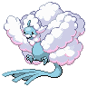

<!-- This file is generated by tools/generate_site.py. Edit the generator, not this file. -->

# #334 Altaria

{ .sprite-lg loading=lazy }

**Humming Pokémon**

Dragon Flying

[:material-arrow-left: #333 Swablu](333.md) · [Pokédex](index.md) · [#335 Zangoose :material-arrow-right:](335.md)

!!! info "Changes in Rising Ruby / Sinking Sapphire"

    - **Ability 2:** **Cloud Nine** 

## Location

[Route 120](../wild/route_120_fortree.md), [Sky Pillar](../wild/sky_pillar.md)

### Wild encounters

| Area | Method | Level | Note |
| --- | --- | --- | --- |
| [Route 120 (Fortree)](../wild/route_120_fortree.md) | Tall Grass | 38 |  |
| [Route 120 South-West](../wild/route_120_south_west.md) | Tall Grass | 44 |  |
| [Sky Pillar](../wild/sky_pillar.md) | Walking | 67 |  |
| [Sky Pillar](../wild/sky_pillar.md) | Horde | 43 |  |

## Type defenses

| Damage taken | Attacking types |
| --- | --- |
| Immune (×0) | Ground |
| Very resistant (×¼) | Grass |
| Resistant (×½) | Fighting Bug Fire Water |
| Neutral (×1) | Normal Flying Poison Ghost Steel Electric Psychic Dark |
| Weak (×2) | Rock Dragon Fairy |
| Very weak (×4) | Ice |

## Abilities

| Slot | Ability | Effect | Note |
| --- | --- | --- | --- |
| Ability 1 | **Natural Cure** | Cures any major status ailment upon switching out. |  |
| Ability 2 | **Cloud Nine** | Negates all effects of weather, but does not prevent the weather itself. | changed  |
| Hidden | **Cloud Nine** | Negates all effects of weather, but does not prevent the weather itself. |  |

## Base stats

| Form | HP | Atk | Def | SpA | SpD | Spe | BST |
| --- | --- | --- | --- | --- | --- | --- | --- |
| { .sprite-sm loading=lazy } Normal | 75 | 70 | 90 | 70 | 105 | 80 | **490** |
| { .sprite-sm loading=lazy } Mega Altaria | 75 | 110 | 110 | 110 | 105 | 80 | **590** |

## Training & breeding

| Property | Value |
| --- | --- |
| EV yield | 2 SpD |
| Catch rate | 45 |
| Base friendship | 70 |
| Base experience | 172 |
| Growth rate | erratic |
| Egg groups | Flying, Dragon |
| Hatch counter | 20 |
| Gender ratio | 50% ♂ / 50% ♀ |
| Height / weight | 1.1 m / 20.6 kg |

## Evolution

- { .icon loading=lazy } [Swablu](../pokemon/333.md) → { .icon loading=lazy } **[Altaria](../pokemon/334.md)**: Lv. 33 changed <small>(vanilla: Lv. 35)</small>
- { .sprite-sm loading=lazy } **Mega Altaria**: Mega Evolves by holding the Altariaite

## Wild held items

None.

## Level-up moves { data-search-exclude }

Moves marked &#42; are not normally learned by level up (they come from egg moves, TMs/HMs or tutors in the official games); moves marked &#42;&#42; cannot normally be learned by this Pokémon at all and are omitted from the legal-moves version of the hack.

| Lv. | Move | Type | Cat. | Power | Acc. | PP | Effect | Note |
| --- | --- | --- | --- | --- | --- | --- | --- | --- |
| 1 | Sky Attack | Flying | Physical | 140 | 90% | 5 | User charges for one turn before attacking.  Has a chance to make the target flinch. |  |
| 1 | Outrage | Dragon | Physical | 120 | 100% | 10 | Hits every turn for 2-3 turns, then confuses the user. | &#42; |
| 1 | Peck | Flying | Physical | 35 | 100% | 35 | Inflicts regular damage with no additional effect. |  |
| 1 | Growl | Normal | Status | — | 100% | 40 | Lowers the target’s Attack by one stage. |  |
| 3 | Astonish | Ghost | Physical | 30 | 100% | 15 | Has a chance to make the target flinch. |  |
| 5 | Sing | Normal | Status | — | 55% | 15 | Puts the target to sleep. |  |
| 7 | Fury Attack | Normal | Physical | 15 | 85% | 20 | Hits 2-5 times in one turn. |  |
| 9 | Safeguard | Normal | Status | — | — | 25 | Protects the user’s field from major status ailments and confusion for five turns. |  |
| 11 | [Disarming Voice](../changes/moves.md#disarming-voice) changed | Fairy | Special | 60 | — | 20 | Never misses. |  |
| 13 | Mist | Ice | Status | — | — | 30 | Protects the user’s stats from being changed by enemy moves. |  |
| 15 | Round | Normal | Special | 60 | 100% | 15 | Has double power if it’s used more than once per turn. |  |
| 18 | Natural Gift | Normal | Physical | — | 100% | 15 | Power and type depend on the held berry. |  |
| 21 | Take Down | Normal | Physical | 90 | 85% | 20 | User receives 1/4 the damage it inflicts in recoil. |  |
| 24 | Pluck | Flying | Physical | 60 | 100% | 20 | If target has a berry, inflicts double damage and uses the berry. | &#42; |
| 27 | Cotton Guard | Grass | Status | — | — | 10 | Raises the user’s Defense by three stages. |  |
| 30 | Dragon Dance | Dragon | Status | — | — | 20 | Raises the user’s Attack and Speed by one stage. |  |
| 33 | Dragon Breath | Dragon | Special | 60 | 100% | 20 | Has a chance to paralyze the target. |  |
| 34 | Refresh | Normal | Status | — | — | 20 | Cleanses the user of a burn, paralysis, or poison. |  |
| 38 | Dragon Pulse | Dragon | Special | 85 | 100% | 10 | Inflicts regular damage with no additional effect. |  |
| 42 | Moonblast | Fairy | Special | 95 | 100% | 15 | Has a chance to lower the target’s Special Attack by one stage. |  |
| 46 | Hyper Voice | Normal | Special | 90 | 100% | 10 | Inflicts regular damage with no additional effect. | &#42; |
| 50 | Perish Song | Normal | Status | — | — | 5 | User and target both faint after three turns. |  |
| 54 | Double-Edge | Normal | Physical | 120 | 100% | 15 | User receives 1/3 the damage inflicted in recoil. | &#42; |
| 58 | Outrage | Dragon | Physical | 120 | 100% | 10 | Hits every turn for 2-3 turns, then confuses the user. | &#42; |
| 62 | Sky Attack | Flying | Physical | 140 | 90% | 5 | User charges for one turn before attacking.  Has a chance to make the target flinch. |  |

## TM & HM moves { data-search-exclude }

| Machine | Move | Type | Cat. | Power | Acc. | PP | Effect |
| --- | --- | --- | --- | --- | --- | --- | --- |
| HM02 | [Fly](../changes/moves.md#fly) changed | Flying | Physical | 100 | 100% | 10 | User flies high into the air, dodging all attacks, and hits next turn. |
| HM06 | [Rock Smash](../changes/moves.md#rock-smash) changed | Fighting | Physical | 65 | 100% | 15 | Has a chance to lower the target’s Defense by one stage. |
| TM01 | Hone Claws | Dark | Status | — | — | 15 | Raises the user’s Attack and accuracy by one stage. |
| TM02 | Dragon Claw | Dragon | Physical | 80 | 100% | 15 | Inflicts regular damage with no additional effect. |
| TM05 | Roar | Normal | Status | — | — | 20 | Immediately ends wild battles.  Forces trainers to switch Pokémon. |
| TM06 | Toxic | Poison | Status | — | 90% | 10 | Badly poisons the target, inflicting more damage every turn. |
| TM10 | Hidden Power | Normal | Special | 60 | 100% | 15 | Power and type depend upon user’s IVs.  Power can range from 30 to 70. |
| TM100 | Confide | Normal | Status | — | — | 20 | Lowers the target’s Special Attack by one stage. |
| TM11 | Sunny Day | Fire | Status | — | — | 5 | Changes the weather to sunny for five turns. |
| TM13 | Ice Beam | Ice | Special | 90 | 100% | 10 | Has a chance to freeze the target. |
| TM15 | Hyper Beam | Normal | Special | 150 | 90% | 5 | User foregoes its next turn to recharge. |
| TM17 | Protect | Normal | Status | — | — | 10 | Prevents any moves from hitting the user this turn. |
| TM18 | Rain Dance | Water | Status | — | — | 5 | Changes the weather to rain for five turns. |
| TM19 | Roost | Flying | Status | — | — | 5 | Heals the user by half its max HP. |
| TM20 | Safeguard | Normal | Status | — | — | 25 | Protects the user’s field from major status ailments and confusion for five turns. |
| TM21 | Frustration | Normal | Physical | — | 100% | 20 | Power increases as happiness decreases, up to a maximum of 102. |
| TM22 | Solar Beam | Grass | Special | 120 | 100% | 10 | Requires a turn to charge before attacking. |
| TM26 | Earthquake | Ground | Physical | 100 | 100% | 10 | Inflicts regular damage and can hit Dig users. |
| TM27 | Return | Normal | Physical | — | 100% | 20 | Power increases with happiness, up to a maximum of 102. |
| TM32 | Double Team | Normal | Status | — | — | 15 | Raises the user’s evasion by one stage. |
| TM35 | Flamethrower | Fire | Special | 90 | 100% | 15 | Has a chance to burn the target. |
| TM38 | Fire Blast | Fire | Special | 110 | 85% | 5 | Has a chance to burn the target. |
| TM40 | Aerial Ace | Flying | Physical | 60 | — | 20 | Never misses. |
| TM42 | Facade | Normal | Physical | 70 | 100% | 20 | Power doubles if user is burned, paralyzed, or poisoned. |
| TM44 | Rest | Psychic | Status | — | — | 5 | User sleeps for two turns, completely healing itself. |
| TM45 | Attract | Normal | Status | — | 100% | 15 | Target falls in love if it has the opposite gender, and has a 50% chance to refuse attacking the user. |
| TM46 | Thief | Dark | Physical | 60 | 100% | 25 | Takes the target’s item. |
| TM48 | Round | Normal | Special | 60 | 100% | 15 | Has double power if it’s used more than once per turn. |
| TM49 | Echoed Voice | Normal | Special | 40 | 100% | 15 | Power increases by 100% for each consecutive use by any friendly Pokémon, to a maximum of 200. |
| TM51 | Steel Wing | Steel | Physical | 70 | 90% | 25 | Has a chance to raise the user’s Defense by one stage. |
| TM59 | Incinerate | Fire | Special | 60 | 100% | 15 | Destroys the target’s held berry. |
| TM68 | Giga Impact | Normal | Physical | 150 | 90% | 5 | User foregoes its next turn to recharge. |
| TM77 | Psych Up | Normal | Status | — | — | 10 | Discards the user’s stat changes and copies the target’s. |
| TM78 | Bulldoze | Ground | Physical | 60 | 100% | 20 | Has a chance to lower the target’s Speed by one stage. |
| TM85 | Dream Eater | Psychic | Special | 100 | 100% | 15 | Only works on sleeping Pokémon.  Drains half the damage inflicted to heal the user. |
| TM87 | Swagger | Normal | Status | — | 90% | 15 | Raises the target’s Attack by two stages and confuses the target. |
| TM88 | Sleep Talk | Normal | Status | — | — | 10 | Randomly uses one of the user’s other three moves.  Only works if the user is sleeping. |
| TM90 | Substitute | Normal | Status | — | — | 10 | Transfers 1/4 of the user’s max HP into a doll, protecting the user from further damage or status changes until it breaks. |
| TM94 | Secret Power | Normal | Physical | 70 | 100% | 20 | Has a chance to inflict a status effect which depends upon the terrain. |
| TM99 | Dazzling Gleam | Fairy | Special | 80 | 100% | 10 | Inflicts regular damage with no additional effect. |

## Move tutor moves { data-search-exclude }

| Move | Type | Cat. | Power | Acc. | PP | Effect |
| --- | --- | --- | --- | --- | --- | --- |
| Draco Meteor | Dragon | Special | 130 | 90% | 5 | Lowers the user’s Special Attack by two stages after inflicting damage. |
| Dragon Pulse | Dragon | Special | 85 | 100% | 10 | Inflicts regular damage with no additional effect. |
| Heal Bell | Normal | Status | — | — | 5 | Cures the entire party of major status effects. |
| Heat Wave | Fire | Special | 95 | 90% | 10 | Has a chance to burn the target. |
| Hyper Voice | Normal | Special | 90 | 100% | 10 | Inflicts regular damage with no additional effect. |
| Iron Tail | Steel | Physical | 100 | 75% | 15 | Has a chance to lower the target’s Defense by one stage. |
| Outrage | Dragon | Physical | 120 | 100% | 10 | Hits every turn for 2-3 turns, then confuses the user. |
| Sky Attack | Flying | Physical | 140 | 90% | 5 | User charges for one turn before attacking.  Has a chance to make the target flinch. |
| Snore | Normal | Special | 50 | 100% | 15 | Has a chance to make the target flinch.  Only works if the user is sleeping. |
| Tailwind | Flying | Status | — | — | 15 | For three turns, friendly Pokémon have doubled Speed. |
| Uproar | Normal | Special | 90 | 100% | 10 | Forced to use this move for several turns.  Pokémon cannot fall asleep in that time. |
| Wonder Room | Psychic | Status | — | — | 10 | All Pokémon’s Defense and Special Defense are swapped for 5 turns. |

## Egg moves { data-search-exclude }

No egg moves.

??? note "Trainers using Altaria (12)"

    | Area | Trainer | Level |
    | --- | --- | --- |
    | [Route 120 (Fortree)](../trainers/route_120_fortree.md#rematches) | Bird Keeper Robert (7) | Lv. 59 |
    | [Route 120 (Fortree)](../trainers/route_120_fortree.md#rematches) | Bird Keeper Robert (8) | Lv. 64 |
    | [Route 120 (Fortree)](../trainers/route_120_fortree.md#rematches) | Bird Keeper Robert (C) | Lv. 75 |
    | [Fortree Gym](../trainers/fortree_gym.md#trainers) | Leader Winona | Lv. 50 |
    | [Route 125](../trainers/route_125.md#trainers) | Teammates Kim & Iris | Lv. 56 |
    | [Route 133](../trainers/route_133.md#trainers) | Bird Keeper Beck | Lv. 57 |
    | [Meteor Falls B1F](../trainers/meteor_falls_b1f.md#trainers) | Dragon Tamer Dray | Lv. 65 |
    | [Granite Cave 1F-2](../trainers/granite_cave_1f_2.md#trainers) | Lorekeeper Zinnia | Lv. 76 |
    | [Battle Resort](../trainers/battle_resort.md#trainers) | Leader Carnation [Winona] | Lv. 79 |
    | [Battle Resort](../trainers/battle_resort.md#trainers) | Leader Carnation [Winona] | Lv. 79 |
    | [Battle Resort](../trainers/battle_resort.md#trainers) | Dragon Tamer Antonin [Lance] | Lv. 86 |
    | [Battle Resort](../trainers/battle_resort.md#trainers) | Leader Felix [Drasna] | Lv. 82 |

---

[:material-arrow-left: #333 Swablu](333.md) · [#335 Zangoose :material-arrow-right:](335.md)
