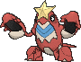

<!-- This file is generated by tools/generate_site.py. Edit the generator, not this file. -->

# #342 Crawdaunt

{ .sprite-lg loading=lazy }

**Rogue Pokémon**

Water Dark

[:material-arrow-left: #341 Corphish](341.md) · [Pokédex](index.md) · [#343 Baltoy :material-arrow-right:](343.md)

!!! note "No documented changes"

    Drayano's documentation lists no stat, type, ability, evolution or held item changes for this Pokémon. Its level-up moves are listed below as they appear in the hack.

## Location

[Route 102](../wild/route_102.md), [Route 123](../wild/route_123.md)

### Wild encounters

| Area | Method | Level | Note |
| --- | --- | --- | --- |
| [Route 102](../wild/route_102.md) | Super Rod | 55 |  |
| [Route 123](../wild/route_123.md) | Super Rod | 55 |  |

## Type defenses

| Damage taken | Attacking types |
| --- | --- |
| Immune (×0) | Psychic |
| Resistant (×½) | Ghost Steel Fire Water Ice Dark |
| Neutral (×1) | Normal Flying Poison Ground Rock Dragon |
| Weak (×2) | Fighting Bug Grass Electric Fairy |

## Abilities

| Slot | Ability | Effect | Note |
| --- | --- | --- | --- |
| Ability 1 | **Hyper Cutter** | Prevents Attack from being lowered by other Pokémon. |  |
| Ability 2 | **Shell Armor** | Protects against critical hits. |  |
| Hidden | **Adaptability** | Increases the same-type attack bonus from 1.5× to 2×. |  |

## Base stats

| Form | HP | Atk | Def | SpA | SpD | Spe | BST |
| --- | --- | --- | --- | --- | --- | --- | --- |
| { .sprite-sm loading=lazy } Normal | 63 | 120 | 85 | 90 | 55 | 55 | **468** |

## Training & breeding

| Property | Value |
| --- | --- |
| EV yield | 2 Atk |
| Catch rate | 155 |
| Base friendship | 70 |
| Base experience | 164 |
| Growth rate | fluctuating |
| Egg groups | Water 1, Water 3 |
| Hatch counter | 15 |
| Gender ratio | 50% ♂ / 50% ♀ |
| Height / weight | 1.1 m / 32.8 kg |

## Evolution

- { .icon loading=lazy } [Corphish](../pokemon/341.md) → { .icon loading=lazy } **[Crawdaunt](../pokemon/342.md)**: Lv. 30

## Wild held items

None.

## Level-up moves { data-search-exclude }

Moves marked &#42; are not normally learned by level up (they come from egg moves, TMs/HMs or tutors in the official games); moves marked &#42;&#42; cannot normally be learned by this Pokémon at all and are omitted from the legal-moves version of the hack.

| Lv. | Move | Type | Cat. | Power | Acc. | PP | Effect | Note |
| --- | --- | --- | --- | --- | --- | --- | --- | --- |
| 1 | Superpower | Fighting | Physical | 120 | 100% | 5 | Lowers the user’s Attack and Defense by one stage after inflicting damage. | &#42; |
| 1 | Avalanche | Ice | Physical | 60 | 100% | 10 | Inflicts double damage if the user takes damage before attacking this turn. | &#42; |
| 1 | Bubble | Water | Special | 40 | 100% | 30 | Has a chance to lower the target’s Speed by one stage. |  |
| 1 | Harden | Normal | Status | — | — | 30 | Raises the user’s Defense by one stage. |  |
| 4 | Vise Grip | Normal | Physical | 55 | 100% | 30 | Inflicts regular damage with no additional effect. |  |
| 7 | Aqua Jet | Water | Physical | 40 | 100% | 20 | Inflicts regular damage with no additional effect. | &#42; |
| 10 | Leer | Normal | Status | — | 100% | 30 | Lowers the target’s Defense by one stage. |  |
| 13 | Bubble Beam | Water | Special | 65 | 100% | 20 | Has a chance to lower the target’s Speed by one stage. |  |
| 16 | Razor Shell | Water | Physical | 75 | 95% | 10 | Has a chance to lower the target’s Defense by one stage. |  |
| 19 | Protect | Normal | Status | — | — | 10 | Prevents any moves from hitting the user this turn. |  |
| 22 | Crabhammer | Water | Physical | 100 | 90% | 10 | Has an increased chance for a critical hit. |  |
| 25 | Knock Off | Dark | Physical | 65 | 100% | 20 | Target drops its held item. |  |
| 28 | Double Hit | Normal | Physical | 35 | 90% | 10 | Hits twice in one turn. |  |
| 30 | Swift | Normal | Special | 60 | — | 20 | Never misses. |  |
| 32 | Night Slash | Dark | Physical | 70 | 100% | 15 | Has an increased chance for a critical hit. |  |
| 36 | Taunt | Dark | Status | — | 100% | 20 | For the next few turns, the target can only use damaging moves. |  |
| 40 | Crunch | Dark | Physical | 80 | 100% | 15 | Has a chance to lower the target’s Defense by one stage. |  |
| 44 | Swords Dance | Normal | Status | — | — | 20 | Raises the user’s Attack by two stages. |  |
| 48 | Superpower | Fighting | Physical | 120 | 100% | 5 | Lowers the user’s Attack and Defense by one stage after inflicting damage. | &#42; |
| 52 | Guillotine | Normal | Physical | — | 30% | 5 | Causes a one-hit KO. |  |
| 56 | Dragon Dance | Dragon | Status | — | — | 20 | Raises the user’s Attack and Speed by one stage. | &#42; |

## TM & HM moves { data-search-exclude }

| Machine | Move | Type | Cat. | Power | Acc. | PP | Effect |
| --- | --- | --- | --- | --- | --- | --- | --- |
| HM01 | [Cut](../changes/moves.md#cut) changed | Grass | Physical | 70 | 100% | 15 | High Critical Rate. High Critical Rate |
| HM03 | Surf | Water | Special | 90 | 100% | 15 | Inflicts regular damage and can hit Dive users. |
| HM04 | [Strength](../changes/moves.md#strength) changed | Normal | Physical | 100 | 100% | 10 | Inflicts regular damage with no additional effect. |
| HM05 | Waterfall | Water | Physical | 80 | 100% | 15 | Has a chance to make the target flinch. |
| HM06 | [Rock Smash](../changes/moves.md#rock-smash) changed | Fighting | Physical | 65 | 100% | 15 | Has a chance to lower the target’s Defense by one stage. |
| HM07 | Dive | Water | Physical | 80 | 100% | 10 | User dives underwater, dodging all attacks, and hits next turn. |
| TM01 | Hone Claws | Dark | Status | — | — | 15 | Raises the user’s Attack and accuracy by one stage. |
| TM06 | Toxic | Poison | Status | — | 90% | 10 | Badly poisons the target, inflicting more damage every turn. |
| TM07 | Hail | Ice | Status | — | — | 10 | Changes the weather to a hailstorm for five turns. |
| TM10 | Hidden Power | Normal | Special | 60 | 100% | 15 | Power and type depend upon user’s IVs.  Power can range from 30 to 70. |
| TM100 | Confide | Normal | Status | — | — | 20 | Lowers the target’s Special Attack by one stage. |
| TM12 | Taunt | Dark | Status | — | 100% | 20 | For the next few turns, the target can only use damaging moves. |
| TM13 | Ice Beam | Ice | Special | 90 | 100% | 10 | Has a chance to freeze the target. |
| TM14 | Blizzard | Ice | Special | 110 | 70% | 5 | Has a chance to freeze the target. |
| TM15 | Hyper Beam | Normal | Special | 150 | 90% | 5 | User foregoes its next turn to recharge. |
| TM17 | Protect | Normal | Status | — | — | 10 | Prevents any moves from hitting the user this turn. |
| TM18 | Rain Dance | Water | Status | — | — | 5 | Changes the weather to rain for five turns. |
| TM21 | Frustration | Normal | Physical | — | 100% | 20 | Power increases as happiness decreases, up to a maximum of 102. |
| TM27 | Return | Normal | Physical | — | 100% | 20 | Power increases with happiness, up to a maximum of 102. |
| TM28 | Dig | Ground | Physical | 80 | 100% | 10 | User digs underground, dodging all attacks, and hits next turn. |
| TM31 | Brick Break | Fighting | Physical | 75 | 100% | 15 | Destroys Reflect and Light Screen. |
| TM32 | Double Team | Normal | Status | — | — | 15 | Raises the user’s evasion by one stage. |
| TM34 | Sludge Wave | Poison | Special | 95 | 100% | 10 | Has a chance to poison the target. |
| TM36 | Sludge Bomb | Poison | Special | 90 | 100% | 10 | Has a chance to poison the target. |
| TM39 | Rock Tomb | Rock | Physical | 60 | 95% | 15 | Has a chance to lower the target’s Speed by one stage. |
| TM40 | Aerial Ace | Flying | Physical | 60 | — | 20 | Never misses. |
| TM42 | Facade | Normal | Physical | 70 | 100% | 20 | Power doubles if user is burned, paralyzed, or poisoned. |
| TM44 | Rest | Psychic | Status | — | — | 5 | User sleeps for two turns, completely healing itself. |
| TM45 | Attract | Normal | Status | — | 100% | 15 | Target falls in love if it has the opposite gender, and has a 50% chance to refuse attacking the user. |
| TM48 | Round | Normal | Special | 60 | 100% | 15 | Has double power if it’s used more than once per turn. |
| TM54 | False Swipe | Normal | Physical | 40 | 100% | 40 | Cannot lower the target’s HP below 1. |
| TM55 | Scald | Water | Special | 80 | 100% | 15 | Has a chance to burn the target. |
| TM56 | Fling | Dark | Physical | — | 100% | 10 | Throws held item at the target; power depends on the item. |
| TM66 | Payback | Dark | Physical | 50 | 100% | 10 | Power is doubled if the target has already moved this turn. |
| TM67 | Retaliate | Normal | Physical | 70 | 100% | 5 | Has double power if a friendly Pokémon fainted last turn. |
| TM68 | Giga Impact | Normal | Physical | 150 | 90% | 5 | User foregoes its next turn to recharge. |
| TM75 | Swords Dance | Normal | Status | — | — | 20 | Raises the user’s Attack by two stages. |
| TM80 | Rock Slide | Rock | Physical | 75 | 90% | 10 | Has a chance to make the target flinch. |
| TM81 | X-Scissor | Bug | Physical | 80 | 100% | 15 | Inflicts regular damage with no additional effect. |
| TM87 | Swagger | Normal | Status | — | 90% | 15 | Raises the target’s Attack by two stages and confuses the target. |
| TM88 | Sleep Talk | Normal | Status | — | — | 10 | Randomly uses one of the user’s other three moves.  Only works if the user is sleeping. |
| TM90 | Substitute | Normal | Status | — | — | 10 | Transfers 1/4 of the user’s max HP into a doll, protecting the user from further damage or status changes until it breaks. |
| TM94 | Secret Power | Normal | Physical | 70 | 100% | 20 | Has a chance to inflict a status effect which depends upon the terrain. |
| TM95 | Snarl | Dark | Special | 55 | 95% | 15 | Has a chance to lower the target’s Special Attack by one stage. |
| TM96 | Nature Power | Normal | Status | — | — | 20 | Uses a move which depends upon the terrain. |
| TM97 | Dark Pulse | Dark | Special | 80 | 100% | 15 | Has a chance to make the target flinch. |

## Move tutor moves { data-search-exclude }

| Move | Type | Cat. | Power | Acc. | PP | Effect |
| --- | --- | --- | --- | --- | --- | --- |
| Endeavor | Normal | Physical | — | 100% | 5 | Lowers the target’s HP to equal the user’s. |
| Icy Wind | Ice | Special | 55 | 95% | 15 | Has a chance to lower the target’s Speed by one stage. |
| Iron Defense | Steel | Status | — | — | 15 | Raises the user’s Defense by two stages. |
| Knock Off | Dark | Physical | 65 | 100% | 20 | Target drops its held item. |
| Snore | Normal | Special | 50 | 100% | 15 | Has a chance to make the target flinch.  Only works if the user is sleeping. |
| Spite | Ghost | Status | — | 100% | 10 | Lowers the PP of the target’s last used move by 4. |
| Superpower | Fighting | Physical | 120 | 100% | 5 | Lowers the user’s Attack and Defense by one stage after inflicting damage. |
| Water Pulse | Water | Special | 60 | 100% | 20 | Has a chance to confuse the target. |

## Egg moves { data-search-exclude }

No egg moves.

??? note "Trainers using Crawdaunt (3)"

    | Area | Trainer | Level |
    | --- | --- | --- |
    | [Route 107](../trainers/route_107.md#trainers) | Sis & Bro Lisa and Ray | Lv. 39 |
    | [Route 123](../trainers/route_123.md#trainers) | Fisherman Finley | Lv. 51 |
    | [Route 130](../trainers/route_130.md#trainers) | Swimmer Rodney | Lv. 54 |

---

[:material-arrow-left: #341 Corphish](341.md) · [#343 Baltoy :material-arrow-right:](343.md)
