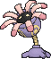

<!-- This file is generated by tools/generate_site.py. Edit the generator, not this file. -->

# #345 Lileep

{ .sprite-lg loading=lazy }

**Sea Lily Pokémon**

Rock Grass

[:material-arrow-left: #344 Claydol](344.md) · [Pokédex](index.md) · [#346 Cradily :material-arrow-right:](346.md)

!!! info "Changes in Rising Ruby / Sinking Sapphire"

    - **Ability 2:** **Storm Drain** 
    - **Evolution level:** 40 → **37**

## Location

[Seafloor Cavern](../wild/seafloor_cavern_out.md), Revive Root Fossil

### Wild encounters

| Area | Method | Level | Note |
| --- | --- | --- | --- |
| [Seafloor Cavern Front Rooms](../wild/seafloor_cavern_front_rooms.md) | Walking | 44 |  |

### Gift & static encounters

| Category | Encounter | Changes |
| --- | --- | --- |
| Gift Pokémon Changes | Fossil Pokémon, Lileep | Level increased to 30, always has max IVs |

See [Gifts & Static Encounters](../changes/gifts_and_statics.md) for the full list.

## Type defenses

| Damage taken | Attacking types |
| --- | --- |
| Resistant (×½) | Normal Electric |
| Neutral (×1) | Flying Poison Ground Rock Ghost Fire Water Grass Psychic Dragon Dark Fairy |
| Weak (×2) | Fighting Bug Steel Ice |

## Abilities

| Slot | Ability | Effect | Note |
| --- | --- | --- | --- |
| Ability 1 | **Suction Cups** | Prevents being forced out of battle by other Pokémon's moves. |  |
| Ability 2 | **Storm Drain** | Redirects single-target Water moves to this Pokémon where possible.  Absorbs Water moves, raising Special Attack one stage. | changed  |
| Hidden | **Storm Drain** | Redirects single-target Water moves to this Pokémon where possible.  Absorbs Water moves, raising Special Attack one stage. |  |

## Base stats

| Form | HP | Atk | Def | SpA | SpD | Spe | BST |
| --- | --- | --- | --- | --- | --- | --- | --- |
| { .sprite-sm loading=lazy } Normal | 66 | 41 | 77 | 61 | 87 | 23 | **355** |

## Training & breeding

| Property | Value |
| --- | --- |
| EV yield | 1 SpD |
| Catch rate | 45 |
| Base friendship | 70 |
| Base experience | 71 |
| Growth rate | erratic |
| Egg groups | Water 3 |
| Hatch counter | 30 |
| Gender ratio | 87.5% ♂ / 12.5% ♀ |
| Height / weight | 1 m / 23.8 kg |

## Evolution

- { .icon loading=lazy } **[Lileep](../pokemon/345.md)** → { .icon loading=lazy } [Cradily](../pokemon/346.md): Lv. 37 changed <small>(vanilla: Lv. 40)</small>

## Wild held items

| Item | Chance | Note |
| --- | --- | --- |
| { .item loading=lazy } Big Root | 5% |  |

## Level-up moves { data-search-exclude }

Moves marked &#42; are not normally learned by level up (they come from egg moves, TMs/HMs or tutors in the official games); moves marked &#42;&#42; cannot normally be learned by this Pokémon at all and are omitted from the legal-moves version of the hack.

| Lv. | Move | Type | Cat. | Power | Acc. | PP | Effect | Note |
| --- | --- | --- | --- | --- | --- | --- | --- | --- |
| 1 | Astonish | Ghost | Physical | 30 | 100% | 15 | Has a chance to make the target flinch. |  |
| 1 | Constrict | Normal | Physical | 10 | 100% | 35 | Has a chance to lower the target’s Speed by one stage. |  |
| 4 | Acid | Poison | Special | 40 | 100% | 30 | Has a chance to lower the target’s Special Defense by one stage. |  |
| 8 | Ingrain | Grass | Status | — | — | 20 | Prevents the user from leaving battle.  User regains 1/16 of its max HP every turn. |  |
| 12 | Confuse Ray | Ghost | Status | — | 100% | 10 | Confuses the target. |  |
| 16 | [Ancient Power](../changes/moves.md#ancient-power) changed | Rock | Special | 80 | 100% | 10 | Has a chance to raise all of the user’s stats by one stage. |  |
| 20 | Brine | Water | Special | 65 | 100% | 10 | Has double power against Pokémon that have less than half their max HP remaining. |  |
| 24 | Giga Drain | Grass | Special | 75 | 100% | 10 | Drains half the damage inflicted to heal the user. |  |
| 28 | Gastro Acid | Poison | Status | — | 100% | 10 | Nullifies target’s ability until it leaves battle. |  |
| 32 | Amnesia | Psychic | Status | — | — | 20 | Raises the user’s Special Defense by two stages. |  |
| 36 | Energy Ball | Grass | Special | 90 | 100% | 10 | Has a chance to lower the target’s Special Defense by one stage. |  |
| 40 | Earth Power | Ground | Special | 90 | 100% | 10 | Has a chance to lower the target’s Special Defense by one stage. | &#42; |
| 44 | Stockpile | Normal | Status | — | — | 20 | Stores energy up to three times for use with Spit Up and Swallow. |  |
| 44 | Spit Up | Normal | Special | — | 100% | 10 | Power is 100 times the amount of energy Stockpiled. |  |
| 44 | Swallow | Normal | Status | — | — | 10 | Recovers 1/4 HP after one Stockpile, 1/2 HP after two Stockpiles, or full HP after three Stockpiles. |  |
| 48 | Recover | Normal | Status | — | — | 5 | Heals the user by half its max HP. | &#42; |
| 52 | Wring Out | Normal | Special | — | 100% | 5 | Power increases against targets with more HP remaining, up to a maximum of 121 power. |  |

## TM & HM moves { data-search-exclude }

| Machine | Move | Type | Cat. | Power | Acc. | PP | Effect |
| --- | --- | --- | --- | --- | --- | --- | --- |
| TM06 | Toxic | Poison | Status | — | 90% | 10 | Badly poisons the target, inflicting more damage every turn. |
| TM10 | Hidden Power | Normal | Special | 60 | 100% | 15 | Power and type depend upon user’s IVs.  Power can range from 30 to 70. |
| TM100 | Confide | Normal | Status | — | — | 20 | Lowers the target’s Special Attack by one stage. |
| TM11 | Sunny Day | Fire | Status | — | — | 5 | Changes the weather to sunny for five turns. |
| TM17 | Protect | Normal | Status | — | — | 10 | Prevents any moves from hitting the user this turn. |
| TM21 | Frustration | Normal | Physical | — | 100% | 20 | Power increases as happiness decreases, up to a maximum of 102. |
| TM22 | Solar Beam | Grass | Special | 120 | 100% | 10 | Requires a turn to charge before attacking. |
| TM23 | Smack Down | Rock | Physical | 50 | 100% | 15 | Removes any immunity to Ground damage. |
| TM27 | Return | Normal | Physical | — | 100% | 20 | Power increases with happiness, up to a maximum of 102. |
| TM32 | Double Team | Normal | Status | — | — | 15 | Raises the user’s evasion by one stage. |
| TM36 | Sludge Bomb | Poison | Special | 90 | 100% | 10 | Has a chance to poison the target. |
| TM37 | Sandstorm | Rock | Status | — | — | 10 | Changes the weather to a sandstorm for five turns. |
| TM39 | Rock Tomb | Rock | Physical | 60 | 95% | 15 | Has a chance to lower the target’s Speed by one stage. |
| TM42 | Facade | Normal | Physical | 70 | 100% | 20 | Power doubles if user is burned, paralyzed, or poisoned. |
| TM44 | Rest | Psychic | Status | — | — | 5 | User sleeps for two turns, completely healing itself. |
| TM45 | Attract | Normal | Status | — | 100% | 15 | Target falls in love if it has the opposite gender, and has a 50% chance to refuse attacking the user. |
| TM48 | Round | Normal | Special | 60 | 100% | 15 | Has double power if it’s used more than once per turn. |
| TM53 | Energy Ball | Grass | Special | 90 | 100% | 10 | Has a chance to lower the target’s Special Defense by one stage. |
| TM69 | Rock Polish | Rock | Status | — | — | 20 | Raises the user’s Speed by two stages. |
| TM70 | Flash | Normal | Status | — | 100% | 20 | Lowers the target’s accuracy by one stage. |
| TM75 | Swords Dance | Normal | Status | — | — | 20 | Raises the user’s Attack by two stages. |
| TM80 | Rock Slide | Rock | Physical | 75 | 90% | 10 | Has a chance to make the target flinch. |
| TM83 | Infestation | Bug | Special | 20 | 100% | 20 | Prevents the target from fleeing and inflicts damage for 2-5 turns. |
| TM86 | Grass Knot | Grass | Special | — | 100% | 20 | Inflicts more damage to heavier targets, with a maximum of 120 power. |
| TM87 | Swagger | Normal | Status | — | 90% | 15 | Raises the target’s Attack by two stages and confuses the target. |
| TM88 | Sleep Talk | Normal | Status | — | — | 10 | Randomly uses one of the user’s other three moves.  Only works if the user is sleeping. |
| TM90 | Substitute | Normal | Status | — | — | 10 | Transfers 1/4 of the user’s max HP into a doll, protecting the user from further damage or status changes until it breaks. |
| TM94 | Secret Power | Normal | Physical | 70 | 100% | 20 | Has a chance to inflict a status effect which depends upon the terrain. |

## Move tutor moves { data-search-exclude }

| Move | Type | Cat. | Power | Acc. | PP | Effect |
| --- | --- | --- | --- | --- | --- | --- |
| Bind | Normal | Physical | 15 | 85% | 20 | Prevents the target from fleeing and inflicts damage for 2-5 turns. |
| Earth Power | Ground | Special | 90 | 100% | 10 | Has a chance to lower the target’s Special Defense by one stage. |
| Gastro Acid | Poison | Status | — | 100% | 10 | Nullifies target’s ability until it leaves battle. |
| Giga Drain | Grass | Special | 75 | 100% | 10 | Drains half the damage inflicted to heal the user. |
| Pain Split | Normal | Status | — | — | 20 | Sets the user’s and targets’s HP to the average of their current HP. |
| Seed Bomb | Grass | Physical | 80 | 100% | 15 | Inflicts regular damage with no additional effect. |
| Snore | Normal | Special | 50 | 100% | 15 | Has a chance to make the target flinch.  Only works if the user is sleeping. |
| Stealth Rock | Rock | Status | — | — | 20 | Causes damage when opposing Pokémon switch in. |
| Synthesis | Grass | Status | — | — | 5 | Heals the user by half its max HP.  Affected by weather. |
| Worry Seed | Grass | Status | — | 100% | 10 | Changes the target’s ability to Insomnia. |

## Egg moves { data-search-exclude }

| Move | Type | Cat. | Power | Acc. | PP | Effect |
| --- | --- | --- | --- | --- | --- | --- |
| Barrier | Psychic | Status | — | — | 20 | Raises the user’s Defense by two stages. |
| Curse | Ghost | Status | — | — | 10 | Ghosts pay half their max HP to hurt the target every turn.  Others decrease Speed but raise Attack and Defense. |
| Endure | Normal | Status | — | — | 10 | Prevents the user’s HP from lowering below 1 this turn. |
| Mega Drain | Grass | Special | 40 | 100% | 15 | Drains half the damage inflicted to heal the user. |
| Mirror Coat | Psychic | Special | — | 100% | 20 | Inflicts twice the damage the user received from the last special hit it took. |
| Recover | Normal | Status | — | — | 5 | Heals the user by half its max HP. |
| Stealth Rock | Rock | Status | — | — | 20 | Causes damage when opposing Pokémon switch in. |
| Tickle | Normal | Status | — | 100% | 20 | Lowers the target’s Attack and Defense by one stage. |
| Wring Out | Normal | Special | — | 100% | 5 | Power increases against targets with more HP remaining, up to a maximum of 121 power. |

??? note "Trainers using Lileep (1)"

    | Area | Trainer | Level |
    | --- | --- | --- |
    | [Rustboro Gym](../trainers/rustboro_gym.md#trainers) | Leader Roxanne | Lv. 14 |

---

[:material-arrow-left: #344 Claydol](344.md) · [#346 Cradily :material-arrow-right:](346.md)
