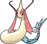

<!-- This file is generated by tools/generate_site.py. Edit the generator, not this file. -->

# #350 Milotic

{ .sprite-lg loading=lazy }

**Tender Pokémon**

Water

[:material-arrow-left: #349 Feebas](349.md) · [Pokédex](index.md) · [#351 Castform :material-arrow-right:](351.md)

!!! note "No documented changes"

    Drayano's documentation lists no stat, type, ability, evolution or held item changes for this Pokémon. Its level-up moves are listed below as they appear in the hack.

## Location

[Route 119](../wild/route_119_mauville.md)

### Wild encounters

| Area | Method | Level | Note |
| --- | --- | --- | --- |
| [Route 119 (Mauville)](../wild/route_119_mauville.md) | Super Rod | 55 | 5% (rare) |
| [Route 119 (Fortree)](../wild/route_119_fortree.md) | Super Rod | 55 | 5% (rare) |

## Type defenses

| Damage taken | Attacking types |
| --- | --- |
| Resistant (×½) | Steel Fire Water Ice |
| Neutral (×1) | Normal Fighting Flying Poison Ground Rock Bug Ghost Psychic Dragon Dark Fairy |
| Weak (×2) | Grass Electric |

## Abilities

| Slot | Ability | Effect | Note |
| --- | --- | --- | --- |
| Ability 1 | **Marvel Scale** | Increases Defense to 1.5× with a major status ailment. |  |
| Ability 2 | **Competitive** | Raises Special Attack by two stages upon having any stat lowered. |  |
| Hidden | **Cute Charm** | Has a 30% chance of infatuating attacking Pokémon on contact. |  |

## Base stats

| Form | HP | Atk | Def | SpA | SpD | Spe | BST |
| --- | --- | --- | --- | --- | --- | --- | --- |
| { .sprite-sm loading=lazy } Normal | 95 | 60 | 79 | 100 | 125 | 81 | **540** |

## Training & breeding

| Property | Value |
| --- | --- |
| EV yield | 2 SpD |
| Catch rate | 60 |
| Base friendship | 70 |
| Base experience | 189 |
| Growth rate | erratic |
| Egg groups | Water 1, Dragon |
| Hatch counter | 20 |
| Gender ratio | 50% ♂ / 50% ♀ |
| Height / weight | 6.2 m / 162 kg |

## Evolution

- { .icon loading=lazy } [Feebas](../pokemon/349.md) → { .icon loading=lazy } **[Milotic](../pokemon/350.md)**: Use a Prism Scale changed <small>(vanilla: Level up with max Beauty / Trade holding Prism Scale)</small>

## Wild held items

None.

## Level-up moves { data-search-exclude }

Moves marked &#42; are not normally learned by level up (they come from egg moves, TMs/HMs or tutors in the official games); moves marked &#42;&#42; cannot normally be learned by this Pokémon at all and are omitted from the legal-moves version of the hack.

| Lv. | Move | Type | Cat. | Power | Acc. | PP | Effect | Note |
| --- | --- | --- | --- | --- | --- | --- | --- | --- |
| 1 | Wrap | Normal | Physical | 15 | 90% | 20 | Prevents the target from fleeing and inflicts damage for 2-5 turns. |  |
| 1 | Water Gun | Water | Special | 40 | 100% | 25 | Inflicts regular damage with no additional effect. |  |
| 1 | Water Sport | Water | Status | — | — | 15 | Halves all Fire-type damage. |  |
| 5 | Refresh | Normal | Status | — | — | 20 | Cleanses the user of a burn, paralysis, or poison. |  |
| 8 | Twister | Dragon | Special | 40 | 100% | 20 | Has a chance to make the target flinch. |  |
| 11 | Captivate | Normal | Status | — | 100% | 20 | Lowers the target’s Special Attack by two stages if it’s the opposite gender. |  |
| 14 | Attract | Normal | Status | — | 100% | 15 | Target falls in love if it has the opposite gender, and has a 50% chance to refuse attacking the user. |  |
| 17 | Water Pulse | Water | Special | 60 | 100% | 20 | Has a chance to confuse the target. |  |
| 20 | [Disarming Voice](../changes/moves.md#disarming-voice) changed | Fairy | Special | 60 | — | 20 | Never misses. |  |
| 23 | Dragon Tail | Dragon | Physical | 60 | 90% | 10 | Ends wild battles.  Forces trainers to switch Pokémon. |  |
| 26 | Mirror Coat | Psychic | Special | — | 100% | 20 | Inflicts twice the damage the user received from the last special hit it took. | &#42; |
| 29 | Recover | Normal | Status | — | — | 5 | Heals the user by half its max HP. |  |
| 32 | Dragon Pulse | Dragon | Special | 85 | 100% | 10 | Inflicts regular damage with no additional effect. | &#42; |
| 35 | Hypnosis | Psychic | Status | — | 60% | 20 | Puts the target to sleep. | &#42; |
| 38 | Aqua Tail | Water | Physical | 90 | 90% | 10 | Inflicts regular damage with no additional effect. |  |
| 41 | Safeguard | Normal | Status | — | — | 25 | Protects the user’s field from major status ailments and confusion for five turns. |  |
| 44 | Coil | Poison | Status | — | — | 20 | Raises the user’s Attack, Defense, and accuracy by one stage each. |  |
| 47 | Rain Dance | Water | Status | — | — | 5 | Changes the weather to rain for five turns. |  |
| 50 | Hydro Pump | Water | Special | 110 | 80% | 5 | Inflicts regular damage with no additional effect. |  |

## TM & HM moves { data-search-exclude }

| Machine | Move | Type | Cat. | Power | Acc. | PP | Effect |
| --- | --- | --- | --- | --- | --- | --- | --- |
| HM03 | Surf | Water | Special | 90 | 100% | 15 | Inflicts regular damage and can hit Dive users. |
| HM05 | Waterfall | Water | Physical | 80 | 100% | 15 | Has a chance to make the target flinch. |
| HM07 | Dive | Water | Physical | 80 | 100% | 10 | User dives underwater, dodging all attacks, and hits next turn. |
| TM06 | Toxic | Poison | Status | — | 90% | 10 | Badly poisons the target, inflicting more damage every turn. |
| TM07 | Hail | Ice | Status | — | — | 10 | Changes the weather to a hailstorm for five turns. |
| TM10 | Hidden Power | Normal | Special | 60 | 100% | 15 | Power and type depend upon user’s IVs.  Power can range from 30 to 70. |
| TM100 | Confide | Normal | Status | — | — | 20 | Lowers the target’s Special Attack by one stage. |
| TM13 | Ice Beam | Ice | Special | 90 | 100% | 10 | Has a chance to freeze the target. |
| TM14 | Blizzard | Ice | Special | 110 | 70% | 5 | Has a chance to freeze the target. |
| TM15 | Hyper Beam | Normal | Special | 150 | 90% | 5 | User foregoes its next turn to recharge. |
| TM16 | Light Screen | Psychic | Status | — | — | 30 | Reduces damage from special attacks by 50% for five turns. |
| TM17 | Protect | Normal | Status | — | — | 10 | Prevents any moves from hitting the user this turn. |
| TM18 | Rain Dance | Water | Status | — | — | 5 | Changes the weather to rain for five turns. |
| TM20 | Safeguard | Normal | Status | — | — | 25 | Protects the user’s field from major status ailments and confusion for five turns. |
| TM21 | Frustration | Normal | Physical | — | 100% | 20 | Power increases as happiness decreases, up to a maximum of 102. |
| TM27 | Return | Normal | Physical | — | 100% | 20 | Power increases with happiness, up to a maximum of 102. |
| TM32 | Double Team | Normal | Status | — | — | 15 | Raises the user’s evasion by one stage. |
| TM42 | Facade | Normal | Physical | 70 | 100% | 20 | Power doubles if user is burned, paralyzed, or poisoned. |
| TM44 | Rest | Psychic | Status | — | — | 5 | User sleeps for two turns, completely healing itself. |
| TM45 | Attract | Normal | Status | — | 100% | 15 | Target falls in love if it has the opposite gender, and has a 50% chance to refuse attacking the user. |
| TM48 | Round | Normal | Special | 60 | 100% | 15 | Has double power if it’s used more than once per turn. |
| TM55 | Scald | Water | Special | 80 | 100% | 15 | Has a chance to burn the target. |
| TM68 | Giga Impact | Normal | Physical | 150 | 90% | 5 | User foregoes its next turn to recharge. |
| TM77 | Psych Up | Normal | Status | — | — | 10 | Discards the user’s stat changes and copies the target’s. |
| TM78 | Bulldoze | Ground | Physical | 60 | 100% | 20 | Has a chance to lower the target’s Speed by one stage. |
| TM82 | Dragon Tail | Dragon | Physical | 60 | 90% | 10 | Ends wild battles.  Forces trainers to switch Pokémon. |
| TM87 | Swagger | Normal | Status | — | 90% | 15 | Raises the target’s Attack by two stages and confuses the target. |
| TM88 | Sleep Talk | Normal | Status | — | — | 10 | Randomly uses one of the user’s other three moves.  Only works if the user is sleeping. |
| TM90 | Substitute | Normal | Status | — | — | 10 | Transfers 1/4 of the user’s max HP into a doll, protecting the user from further damage or status changes until it breaks. |
| TM94 | Secret Power | Normal | Physical | 70 | 100% | 20 | Has a chance to inflict a status effect which depends upon the terrain. |

## Move tutor moves { data-search-exclude }

| Move | Type | Cat. | Power | Acc. | PP | Effect |
| --- | --- | --- | --- | --- | --- | --- |
| Aqua Tail | Water | Physical | 90 | 90% | 10 | Inflicts regular damage with no additional effect. |
| Bind | Normal | Physical | 15 | 85% | 20 | Prevents the target from fleeing and inflicts damage for 2-5 turns. |
| Dragon Pulse | Dragon | Special | 85 | 100% | 10 | Inflicts regular damage with no additional effect. |
| Icy Wind | Ice | Special | 55 | 95% | 15 | Has a chance to lower the target’s Speed by one stage. |
| Iron Head | Steel | Physical | 80 | 100% | 15 | Has a chance to make the target flinch. |
| Iron Tail | Steel | Physical | 100 | 75% | 15 | Has a chance to lower the target’s Defense by one stage. |
| Magic Coat | Psychic | Status | — | — | 15 | Reflects back the first effect move used on the user this turn. |
| Snore | Normal | Special | 50 | 100% | 15 | Has a chance to make the target flinch.  Only works if the user is sleeping. |
| Water Pulse | Water | Special | 60 | 100% | 20 | Has a chance to confuse the target. |

## Egg moves { data-search-exclude }

No egg moves.

??? note "Trainers using Milotic (12)"

    | Area | Trainer | Level |
    | --- | --- | --- |
    | [Route 108](../trainers/route_108.md#trainers) | Swimmer Missy | Lv. 38 |
    | [Route 120 South-West](../trainers/route_120_south_west.md#trainers) | Ace Trainer Jennifer | Lv. 47 |
    | [Route 134](../trainers/route_134.md#trainers) | Ace Trainer Elaine | Lv. 58 |
    | [Underwater 124](../trainers/underwater_124.md#rematches) | Free Diver Arzu (8) | Lv. 64 |
    | [Underwater 124](../trainers/underwater_124.md#rematches) | Free Diver Arzu (C) | Lv. 75 |
    | [Sootopolis Gym](../trainers/sootopolis_gym.md#trainers) | Leader Wallace | Lv. 65 |
    | [Meteor Falls B1F](../trainers/meteor_falls_b1f.md#trainers) | Dragon Tamer Dray | Lv. 65 |
    | [Route 131 (Post Game)](../trainers/route_131_post_game.md#trainers) | Sootopolitan Wallace | Lv. 79 |
    | [Battle Resort](../trainers/battle_resort.md#trainers) | Ace Trainer Carnation [Cynthia] | Lv. 86 |
    | [Battle Resort](../trainers/battle_resort.md#trainers) | Leader Josephine [Wallace] | Lv. 79 |
    | [Battle Resort](../trainers/battle_resort.md#trainers) | Leader Josephine [Wallace] | Lv. 79 |
    | [Battle Resort](../trainers/battle_resort.md#trainers) | Leader Kelvin [Siebold] | Lv. 82 |

---

[:material-arrow-left: #349 Feebas](349.md) · [#351 Castform :material-arrow-right:](351.md)
