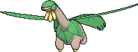

<!-- This file is generated by tools/generate_site.py. Edit the generator, not this file. -->

# #357 Tropius

{ .sprite-lg loading=lazy }

**Fruit Pokémon**

Grass Flying

[:material-arrow-left: #356 Dusclops](356.md) · [Pokédex](index.md) · [#358 Chimecho :material-arrow-right:](358.md)

!!! info "Changes in Rising Ruby / Sinking Sapphire"

    - **Base stats:** HP 99 → **105**, Atk 68 → **75**, Def 83 → **105**, SpA 72 → **85**, SpD 87 → **105**, Spe 51 → **60** (BST 460 → **535**)

## Location

[Route 119](../wild/route_119_mauville.md)

### Wild encounters

| Area | Method | Level | Note |
| --- | --- | --- | --- |
| [Route 119 (Mauville)](../wild/route_119_mauville.md) | Tall Grass | 36 |  |
| [Route 119 (Fortree)](../wild/route_119_fortree.md) | Tall Grass | 38 |  |

## Type defenses

| Damage taken | Attacking types |
| --- | --- |
| Immune (×0) | Ground |
| Very resistant (×¼) | Grass |
| Resistant (×½) | Fighting Water |
| Neutral (×1) | Normal Bug Ghost Steel Electric Psychic Dragon Dark Fairy |
| Weak (×2) | Flying Poison Rock Fire |
| Very weak (×4) | Ice |

## Abilities

| Slot | Ability | Effect | Note |
| --- | --- | --- | --- |
| Ability 1 | **Chlorophyll** | Doubles Speed during strong sunlight. |  |
| Ability 2 | **Solar Power** | Increases Special Attack to 1.5× but costs 1/8 max HP after each turn during strong sunlight. |  |
| Hidden | **Harvest** | Has a 50% chance of restoring a used Berry after each turn if the Pokémon has held no items in the meantime. |  |

## Base stats

| Form | HP | Atk | Def | SpA | SpD | Spe | BST |
| --- | --- | --- | --- | --- | --- | --- | --- |
| { .sprite-sm loading=lazy } Normal | 105<small class="was">was 99</small> | 75<small class="was">was 68</small> | 105<small class="was">was 83</small> | 85<small class="was">was 72</small> | 105<small class="was">was 87</small> | 60<small class="was">was 51</small> | 535<small class="was">was 460</small> |

## Training & breeding

| Property | Value |
| --- | --- |
| EV yield | 2 HP |
| Catch rate | 200 |
| Base friendship | 70 |
| Base experience | 161 |
| Growth rate | slow |
| Egg groups | Monster, Grass |
| Hatch counter | 25 |
| Gender ratio | 50% ♂ / 50% ♀ |
| Height / weight | 2 m / 100 kg |

## Evolution

This Pokémon does not evolve.

## Wild held items

None.

## Level-up moves { data-search-exclude }

Moves marked &#42; are not normally learned by level up (they come from egg moves, TMs/HMs or tutors in the official games); moves marked &#42;&#42; cannot normally be learned by this Pokémon at all and are omitted from the legal-moves version of the hack.

| Lv. | Move | Type | Cat. | Power | Acc. | PP | Effect | Note |
| --- | --- | --- | --- | --- | --- | --- | --- | --- |
| 1 | Hurricane | Flying | Special | 110 | 70% | 10 | Has a chance to confuse the target. | &#42;&#42; |
| 1 | Leaf Storm | Grass | Special | 130 | 90% | 5 | Lowers the user’s Special Attack by two stages after inflicting damage. |  |
| 1 | Leer | Normal | Status | — | 100% | 30 | Lowers the target’s Defense by one stage. |  |
| 1 | Gust | Flying | Special | 40 | 100% | 35 | Inflicts regular damage and can hit Pokémon in the air. |  |
| 1 | Growth | Normal | Status | — | — | 20 | Raises the user’s Attack and Special Attack by one stage. |  |
| 1 | Razor Leaf | Grass | Physical | 55 | 95% | 25 | Has an increased chance for a critical hit. |  |
| 6 | Sweet Scent | Normal | Status | — | 100% | 20 | Lowers the target’s evasion by one stage. |  |
| 10 | Stomp | Normal | Physical | 65 | 100% | 20 | Has a chance to make the target flinch. |  |
| 14 | Magical Leaf | Grass | Special | 60 | — | 20 | Never misses. |  |
| 18 | Whirlwind | Normal | Status | — | — | 20 | Immediately ends wild battles.  Forces trainers to switch Pokémon. |  |
| 22 | Leaf Tornado | Grass | Special | 65 | 90% | 10 | Has a chance to lower the target’s accuracy by one stage. |  |
| 26 | Air Slash | Flying | Special | 75 | 95% | 15 | Has a chance to make the target flinch. |  |
| 30 | Giga Drain | Grass | Special | 75 | 100% | 10 | Drains half the damage inflicted to heal the user. | &#42; |
| 34 | Body Slam | Normal | Physical | 85 | 100% | 15 | Has a chance to paralyze the target. |  |
| 38 | Natural Gift | Normal | Physical | — | 100% | 15 | Power and type depend on the held berry. |  |
| 42 | Dragon Pulse | Dragon | Special | 85 | 100% | 10 | Inflicts regular damage with no additional effect. | &#42; |
| 46 | Bestow | Normal | Status | — | — | 15 | Gives the user’s held item to the target. |  |
| 50 | Synthesis | Grass | Status | — | — | 5 | Heals the user by half its max HP.  Affected by weather. |  |
| 54 | Energy Ball | Grass | Special | 90 | 100% | 10 | Has a chance to lower the target’s Special Defense by one stage. |  |
| 58 | Solar Beam | Grass | Special | 120 | 100% | 10 | Requires a turn to charge before attacking. | &#42; |
| 62 | Leaf Storm | Grass | Special | 130 | 90% | 5 | Lowers the user’s Special Attack by two stages after inflicting damage. |  |
| 66 | Hurricane | Flying | Special | 110 | 70% | 10 | Has a chance to confuse the target. | &#42;&#42; |

## TM & HM moves { data-search-exclude }

| Machine | Move | Type | Cat. | Power | Acc. | PP | Effect |
| --- | --- | --- | --- | --- | --- | --- | --- |
| HM01 | [Cut](../changes/moves.md#cut) changed | Grass | Physical | 70 | 100% | 15 | High Critical Rate. High Critical Rate |
| HM02 | [Fly](../changes/moves.md#fly) changed | Flying | Physical | 100 | 100% | 10 | User flies high into the air, dodging all attacks, and hits next turn. |
| HM04 | [Strength](../changes/moves.md#strength) changed | Normal | Physical | 100 | 100% | 10 | Inflicts regular damage with no additional effect. |
| HM06 | [Rock Smash](../changes/moves.md#rock-smash) changed | Fighting | Physical | 65 | 100% | 15 | Has a chance to lower the target’s Defense by one stage. |
| TM05 | Roar | Normal | Status | — | — | 20 | Immediately ends wild battles.  Forces trainers to switch Pokémon. |
| TM06 | Toxic | Poison | Status | — | 90% | 10 | Badly poisons the target, inflicting more damage every turn. |
| TM10 | Hidden Power | Normal | Special | 60 | 100% | 15 | Power and type depend upon user’s IVs.  Power can range from 30 to 70. |
| TM100 | Confide | Normal | Status | — | — | 20 | Lowers the target’s Special Attack by one stage. |
| TM11 | Sunny Day | Fire | Status | — | — | 5 | Changes the weather to sunny for five turns. |
| TM15 | Hyper Beam | Normal | Special | 150 | 90% | 5 | User foregoes its next turn to recharge. |
| TM17 | Protect | Normal | Status | — | — | 10 | Prevents any moves from hitting the user this turn. |
| TM19 | Roost | Flying | Status | — | — | 5 | Heals the user by half its max HP. |
| TM20 | Safeguard | Normal | Status | — | — | 25 | Protects the user’s field from major status ailments and confusion for five turns. |
| TM21 | Frustration | Normal | Physical | — | 100% | 20 | Power increases as happiness decreases, up to a maximum of 102. |
| TM22 | Solar Beam | Grass | Special | 120 | 100% | 10 | Requires a turn to charge before attacking. |
| TM26 | Earthquake | Ground | Physical | 100 | 100% | 10 | Inflicts regular damage and can hit Dig users. |
| TM27 | Return | Normal | Physical | — | 100% | 20 | Power increases with happiness, up to a maximum of 102. |
| TM32 | Double Team | Normal | Status | — | — | 15 | Raises the user’s evasion by one stage. |
| TM40 | Aerial Ace | Flying | Physical | 60 | — | 20 | Never misses. |
| TM42 | Facade | Normal | Physical | 70 | 100% | 20 | Power doubles if user is burned, paralyzed, or poisoned. |
| TM44 | Rest | Psychic | Status | — | — | 5 | User sleeps for two turns, completely healing itself. |
| TM45 | Attract | Normal | Status | — | 100% | 15 | Target falls in love if it has the opposite gender, and has a 50% chance to refuse attacking the user. |
| TM48 | Round | Normal | Special | 60 | 100% | 15 | Has double power if it’s used more than once per turn. |
| TM51 | Steel Wing | Steel | Physical | 70 | 90% | 25 | Has a chance to raise the user’s Defense by one stage. |
| TM53 | Energy Ball | Grass | Special | 90 | 100% | 10 | Has a chance to lower the target’s Special Defense by one stage. |
| TM68 | Giga Impact | Normal | Physical | 150 | 90% | 5 | User foregoes its next turn to recharge. |
| TM70 | Flash | Normal | Status | — | 100% | 20 | Lowers the target’s accuracy by one stage. |
| TM75 | Swords Dance | Normal | Status | — | — | 20 | Raises the user’s Attack by two stages. |
| TM78 | Bulldoze | Ground | Physical | 60 | 100% | 20 | Has a chance to lower the target’s Speed by one stage. |
| TM86 | Grass Knot | Grass | Special | — | 100% | 20 | Inflicts more damage to heavier targets, with a maximum of 120 power. |
| TM87 | Swagger | Normal | Status | — | 90% | 15 | Raises the target’s Attack by two stages and confuses the target. |
| TM88 | Sleep Talk | Normal | Status | — | — | 10 | Randomly uses one of the user’s other three moves.  Only works if the user is sleeping. |
| TM90 | Substitute | Normal | Status | — | — | 10 | Transfers 1/4 of the user’s max HP into a doll, protecting the user from further damage or status changes until it breaks. |
| TM94 | Secret Power | Normal | Physical | 70 | 100% | 20 | Has a chance to inflict a status effect which depends upon the terrain. |
| TM96 | Nature Power | Normal | Status | — | — | 20 | Uses a move which depends upon the terrain. |

## Move tutor moves { data-search-exclude }

| Move | Type | Cat. | Power | Acc. | PP | Effect |
| --- | --- | --- | --- | --- | --- | --- |
| Dragon Pulse | Dragon | Special | 85 | 100% | 10 | Inflicts regular damage with no additional effect. |
| Giga Drain | Grass | Special | 75 | 100% | 10 | Drains half the damage inflicted to heal the user. |
| Outrage | Dragon | Physical | 120 | 100% | 10 | Hits every turn for 2-3 turns, then confuses the user. |
| Seed Bomb | Grass | Physical | 80 | 100% | 15 | Inflicts regular damage with no additional effect. |
| Snore | Normal | Special | 50 | 100% | 15 | Has a chance to make the target flinch.  Only works if the user is sleeping. |
| Synthesis | Grass | Status | — | — | 5 | Heals the user by half its max HP.  Affected by weather. |
| Tailwind | Flying | Status | — | — | 15 | For three turns, friendly Pokémon have doubled Speed. |
| Worry Seed | Grass | Status | — | 100% | 10 | Changes the target’s ability to Insomnia. |

## Egg moves { data-search-exclude }

| Move | Type | Cat. | Power | Acc. | PP | Effect |
| --- | --- | --- | --- | --- | --- | --- |
| Bullet Seed | Grass | Physical | 25 | 100% | 30 | Hits 2-5 times in one turn. |
| Curse | Ghost | Status | — | — | 10 | Ghosts pay half their max HP to hurt the target every turn.  Others decrease Speed but raise Attack and Defense. |
| Dragon Dance | Dragon | Status | — | — | 20 | Raises the user’s Attack and Speed by one stage. |
| Headbutt | Normal | Physical | 70 | 100% | 15 | Has a chance to make the target flinch. |
| Leaf Blade | Grass | Physical | 90 | 100% | 15 | Has an increased chance for a critical hit. |
| Leaf Storm | Grass | Special | 130 | 90% | 5 | Lowers the user’s Special Attack by two stages after inflicting damage. |
| Leech Seed | Grass | Status | — | 90% | 10 | Seeds the target, stealing HP from it every turn. |
| Natural Gift | Normal | Physical | — | 100% | 15 | Power and type depend on the held berry. |
| Nature Power | Normal | Status | — | — | 20 | Uses a move which depends upon the terrain. |
| Razor Wind | Normal | Special | 80 | 100% | 10 | Requires a turn to charge before attacking. |
| Slam | Normal | Physical | 80 | 75% | 20 | Inflicts regular damage with no additional effect. |
| Synthesis | Grass | Status | — | — | 5 | Heals the user by half its max HP.  Affected by weather. |

??? note "Trainers using Tropius (6)"

    | Area | Trainer | Level |
    | --- | --- | --- |
    | [Route 119 (Mauville)](../trainers/route_119_mauville.md#trainers) | PKMN Ranger Jackson | Lv. 40 |
    | [Route 119 (Mauville)](../trainers/route_119_mauville.md#rematches) | PKMN Ranger Jackson (6) | Lv. 47 |
    | [Route 119 (Mauville)](../trainers/route_119_mauville.md#rematches) | PKMN Ranger Jackson (7) | Lv. 59 |
    | [Route 119 (Mauville)](../trainers/route_119_mauville.md#rematches) | PKMN Ranger Jackson (8) | Lv. 64 |
    | [Route 119 (Mauville)](../trainers/route_119_mauville.md#rematches) | PKMN Ranger Jackson (C) | Lv. 75 |
    | [Fortree Gym](../trainers/fortree_gym.md#trainers) | Camper Terrell | Lv. 45 |

---

[:material-arrow-left: #356 Dusclops](356.md) · [#358 Chimecho :material-arrow-right:](358.md)
