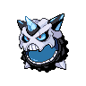

<!-- This file is generated by tools/generate_site.py. Edit the generator, not this file. -->

# #362 Glalie

{ .sprite-lg loading=lazy }

**Face Pokémon**

Ice

[:material-arrow-left: #361 Snorunt](361.md) · [Pokédex](index.md) · [#363 Spheal :material-arrow-right:](363.md)

!!! note "No documented changes"

    Drayano's documentation lists no stat, type, ability, evolution or held item changes for this Pokémon. Its level-up moves are listed below as they appear in the hack.

## Location

[Shoal Cave](../wild/shoal_cave_1f.md)

### Wild encounters

| Area | Method | Level | Note |
| --- | --- | --- | --- |
| [Shoal Cave B1F, B2F, B3F](../wild/shoal_cave_b1f_b2f_b3f.md) | Walking | 50 |  |
| [Shoal Cave Ice Room](../wild/shoal_cave_ice_room.md) | Walking | 55 | 5% (rare) |

## Type defenses

| Damage taken | Attacking types |
| --- | --- |
| Resistant (×½) | Ice |
| Neutral (×1) | Normal Flying Poison Ground Bug Ghost Water Grass Electric Psychic Dragon Dark Fairy |
| Weak (×2) | Fighting Rock Steel Fire |

## Abilities

| Slot | Ability | Effect | Note |
| --- | --- | --- | --- |
| Ability 1 | **Inner Focus** | Prevents flinching. |  |
| Ability 2 | **Ice Body** | Heals for 1/16 max HP after each turn during hail.  Protects against hail damage. |  |
| Hidden | **Moody** | Raises a random stat two stages and lowers another one stage after each turn. |  |

## Base stats

| Form | HP | Atk | Def | SpA | SpD | Spe | BST |
| --- | --- | --- | --- | --- | --- | --- | --- |
| { .sprite-sm loading=lazy } Normal | 80 | 80 | 80 | 80 | 80 | 80 | **480** |
| { .sprite-sm loading=lazy } Mega Glalie | 80 | 120 | 80 | 120 | 80 | 100 | **580** |

## Training & breeding

| Property | Value |
| --- | --- |
| EV yield | 2 HP |
| Catch rate | 75 |
| Base friendship | 70 |
| Base experience | 168 |
| Growth rate | medium |
| Egg groups | Fairy, Mineral |
| Hatch counter | 20 |
| Gender ratio | 50% ♂ / 50% ♀ |
| Height / weight | 1.5 m / 256.5 kg |

## Evolution

- { .icon loading=lazy } [Snorunt](../pokemon/361.md) → { .icon loading=lazy } **[Glalie](../pokemon/362.md)**: Lv. 42
- { .icon loading=lazy } [Snorunt](../pokemon/361.md) → { .icon loading=lazy } [Froslass](../pokemon/478.md): Use Dawn Stone (female only)
- { .sprite-sm loading=lazy } **Mega Glalie**: Mega Evolves by holding the Glalieite

## Wild held items

None.

## Level-up moves { data-search-exclude }

Moves marked &#42; are not normally learned by level up (they come from egg moves, TMs/HMs or tutors in the official games); moves marked &#42;&#42; cannot normally be learned by this Pokémon at all and are omitted from the legal-moves version of the hack.

| Lv. | Move | Type | Cat. | Power | Acc. | PP | Effect | Note |
| --- | --- | --- | --- | --- | --- | --- | --- | --- |
| 1 | Head Smash | Rock | Physical | 150 | 80% | 5 | User receives 1/2 the damage inflicted in recoil. | &#42;&#42; |
| 1 | Double-Edge | Normal | Physical | 120 | 100% | 15 | User receives 1/3 the damage inflicted in recoil. | &#42; |
| 1 | Sheer Cold | Ice | Special | — | 30% | 5 | Causes a one-hit KO. |  |
| 1 | Powder Snow | Ice | Special | 40 | 100% | 25 | Has a chance to freeze the target. |  |
| 1 | Leer | Normal | Status | — | 100% | 30 | Lowers the target’s Defense by one stage. |  |
| 5 | Double Team | Normal | Status | — | — | 15 | Raises the user’s evasion by one stage. |  |
| 10 | Ice Shard | Ice | Physical | 40 | 100% | 30 | Inflicts regular damage with no additional effect. |  |
| 14 | Icy Wind | Ice | Special | 55 | 95% | 15 | Has a chance to lower the target’s Speed by one stage. |  |
| 19 | Bite | Dark | Physical | 60 | 100% | 25 | Has a chance to make the target flinch. |  |
| 23 | Ice Fang | Ice | Physical | 65 | 95% | 15 | Has a chance to freeze the target and a chance to make the target flinch. |  |
| 28 | Headbutt | Normal | Physical | 70 | 100% | 15 | Has a chance to make the target flinch. |  |
| 32 | Protect | Normal | Status | — | — | 10 | Prevents any moves from hitting the user this turn. |  |
| 37 | Freeze-Dry | Ice | Special | 70 | 100% | 20 | Super-effective against Water. |  |
| 38 | Frost Breath | Ice | Special | 60 | 90% | 10 | Always scores a critical hit. |  |
| 44 | Crunch | Dark | Physical | 80 | 100% | 15 | Has a chance to lower the target’s Defense by one stage. |  |
| 50 | Blizzard | Ice | Special | 110 | 70% | 5 | Has a chance to freeze the target. |  |
| 56 | Hail | Ice | Status | — | — | 10 | Changes the weather to a hailstorm for five turns. |  |
| 62 | Sheer Cold | Ice | Special | — | 30% | 5 | Causes a one-hit KO. |  |
| 68 | Double-Edge | Normal | Physical | 120 | 100% | 15 | User receives 1/3 the damage inflicted in recoil. | &#42; |
| 74 | Head Smash | Rock | Physical | 150 | 80% | 5 | User receives 1/2 the damage inflicted in recoil. | &#42;&#42; |

## TM & HM moves { data-search-exclude }

| Machine | Move | Type | Cat. | Power | Acc. | PP | Effect |
| --- | --- | --- | --- | --- | --- | --- | --- |
| TM06 | Toxic | Poison | Status | — | 90% | 10 | Badly poisons the target, inflicting more damage every turn. |
| TM07 | Hail | Ice | Status | — | — | 10 | Changes the weather to a hailstorm for five turns. |
| TM10 | Hidden Power | Normal | Special | 60 | 100% | 15 | Power and type depend upon user’s IVs.  Power can range from 30 to 70. |
| TM100 | Confide | Normal | Status | — | — | 20 | Lowers the target’s Special Attack by one stage. |
| TM12 | Taunt | Dark | Status | — | 100% | 20 | For the next few turns, the target can only use damaging moves. |
| TM13 | Ice Beam | Ice | Special | 90 | 100% | 10 | Has a chance to freeze the target. |
| TM14 | Blizzard | Ice | Special | 110 | 70% | 5 | Has a chance to freeze the target. |
| TM15 | Hyper Beam | Normal | Special | 150 | 90% | 5 | User foregoes its next turn to recharge. |
| TM16 | Light Screen | Psychic | Status | — | — | 30 | Reduces damage from special attacks by 50% for five turns. |
| TM17 | Protect | Normal | Status | — | — | 10 | Prevents any moves from hitting the user this turn. |
| TM18 | Rain Dance | Water | Status | — | — | 5 | Changes the weather to rain for five turns. |
| TM20 | Safeguard | Normal | Status | — | — | 25 | Protects the user’s field from major status ailments and confusion for five turns. |
| TM21 | Frustration | Normal | Physical | — | 100% | 20 | Power increases as happiness decreases, up to a maximum of 102. |
| TM26 | Earthquake | Ground | Physical | 100 | 100% | 10 | Inflicts regular damage and can hit Dig users. |
| TM27 | Return | Normal | Physical | — | 100% | 20 | Power increases with happiness, up to a maximum of 102. |
| TM30 | Shadow Ball | Ghost | Special | 80 | 100% | 15 | Has a chance to lower the target’s Special Defense by one stage. |
| TM32 | Double Team | Normal | Status | — | — | 15 | Raises the user’s evasion by one stage. |
| TM41 | Torment | Dark | Status | — | 100% | 15 | Prevents the target from using the same move twice in a row. |
| TM42 | Facade | Normal | Physical | 70 | 100% | 20 | Power doubles if user is burned, paralyzed, or poisoned. |
| TM44 | Rest | Psychic | Status | — | — | 5 | User sleeps for two turns, completely healing itself. |
| TM45 | Attract | Normal | Status | — | 100% | 15 | Target falls in love if it has the opposite gender, and has a 50% chance to refuse attacking the user. |
| TM48 | Round | Normal | Special | 60 | 100% | 15 | Has double power if it’s used more than once per turn. |
| TM64 | Explosion | Normal | Physical | 250 | 100% | 5 | User faints. |
| TM66 | Payback | Dark | Physical | 50 | 100% | 10 | Power is doubled if the target has already moved this turn. |
| TM68 | Giga Impact | Normal | Physical | 150 | 90% | 5 | User foregoes its next turn to recharge. |
| TM70 | Flash | Normal | Status | — | 100% | 20 | Lowers the target’s accuracy by one stage. |
| TM74 | Gyro Ball | Steel | Physical | — | 100% | 5 | Power raises when the user has lower Speed, up to a maximum of 150. |
| TM78 | Bulldoze | Ground | Physical | 60 | 100% | 20 | Has a chance to lower the target’s Speed by one stage. |
| TM79 | Frost Breath | Ice | Special | 60 | 90% | 10 | Always scores a critical hit. |
| TM87 | Swagger | Normal | Status | — | 90% | 15 | Raises the target’s Attack by two stages and confuses the target. |
| TM88 | Sleep Talk | Normal | Status | — | — | 10 | Randomly uses one of the user’s other three moves.  Only works if the user is sleeping. |
| TM90 | Substitute | Normal | Status | — | — | 10 | Transfers 1/4 of the user’s max HP into a doll, protecting the user from further damage or status changes until it breaks. |
| TM94 | Secret Power | Normal | Physical | 70 | 100% | 20 | Has a chance to inflict a status effect which depends upon the terrain. |
| TM97 | Dark Pulse | Dark | Special | 80 | 100% | 15 | Has a chance to make the target flinch. |

## Move tutor moves { data-search-exclude }

| Move | Type | Cat. | Power | Acc. | PP | Effect |
| --- | --- | --- | --- | --- | --- | --- |
| Block | Normal | Status | — | — | 5 | Prevents the target from leaving battle. |
| Icy Wind | Ice | Special | 55 | 95% | 15 | Has a chance to lower the target’s Speed by one stage. |
| Iron Head | Steel | Physical | 80 | 100% | 15 | Has a chance to make the target flinch. |
| Signal Beam | Bug | Special | 75 | 100% | 15 | Has a chance to confuse the target. |
| Snore | Normal | Special | 50 | 100% | 15 | Has a chance to make the target flinch.  Only works if the user is sleeping. |
| Spite | Ghost | Status | — | 100% | 10 | Lowers the PP of the target’s last used move by 4. |
| Super Fang | Normal | Physical | — | 90% | 10 | Inflicts damage equal to half the target’s HP. |
| Water Pulse | Water | Special | 60 | 100% | 20 | Has a chance to confuse the target. |

## Egg moves { data-search-exclude }

No egg moves.

??? note "Trainers using Glalie (4)"

    | Area | Trainer | Level |
    | --- | --- | --- |
    | [Route 128](../trainers/route_128.md#trainers) | Ace Trainer Cornelius | Lv. 55 |
    | [Pokémon League](../trainers/pokemon_league.md#trainers) | Elite Four Glacia | Lv. 74 |
    | [Battle Resort](../trainers/battle_resort.md#trainers) | Leader Kelvin [Wulfric] | Lv. 77 |
    | [Pokémon League (Post Game)](../trainers/pokemon_league_post_game.md#trainers) | Elite Four Glacia | Lv. 84 |

---

[:material-arrow-left: #361 Snorunt](361.md) · [#363 Spheal :material-arrow-right:](363.md)
