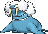

<!-- This file is generated by tools/generate_site.py. Edit the generator, not this file. -->

# #365 Walrein

{ .sprite-lg loading=lazy }

**Ice Break Pokémon**

Ice Water

[:material-arrow-left: #364 Sealeo](364.md) · [Pokédex](index.md) · [#366 Clamperl :material-arrow-right:](366.md)

!!! note "No documented changes"

    Drayano's documentation lists no stat, type, ability, evolution or held item changes for this Pokémon. Its level-up moves are listed below as they appear in the hack.

## Location

Evolve { .icon loading=lazy } [Sealeo](../pokemon/364.md) (Lv. 44)

## Type defenses

| Damage taken | Attacking types |
| --- | --- |
| Very resistant (×¼) | Ice |
| Resistant (×½) | Water |
| Neutral (×1) | Normal Flying Poison Ground Bug Ghost Steel Fire Psychic Dragon Dark Fairy |
| Weak (×2) | Fighting Rock Grass Electric |

## Abilities

| Slot | Ability | Effect | Note |
| --- | --- | --- | --- |
| Ability 1 | **Thick Fat** | Halves damage from Fire and Ice moves. |  |
| Ability 2 | **Ice Body** | Heals for 1/16 max HP after each turn during hail.  Protects against hail damage. |  |
| Hidden | **Oblivious** | Prevents infatuation and protects against Captivate. |  |

## Base stats

| Form | HP | Atk | Def | SpA | SpD | Spe | BST |
| --- | --- | --- | --- | --- | --- | --- | --- |
| { .sprite-sm loading=lazy } Normal | 110 | 80 | 90 | 95 | 90 | 65 | **530** |

## Training & breeding

| Property | Value |
| --- | --- |
| EV yield | 3 HP |
| Catch rate | 45 |
| Base friendship | 70 |
| Base experience | 239 |
| Growth rate | medium slow |
| Egg groups | Water 1, Field |
| Hatch counter | 20 |
| Gender ratio | 50% ♂ / 50% ♀ |
| Height / weight | 1.4 m / 150.6 kg |

## Evolution

- { .icon loading=lazy } [Spheal](../pokemon/363.md) → { .icon loading=lazy } [Sealeo](../pokemon/364.md): Lv. 32
- { .icon loading=lazy } [Sealeo](../pokemon/364.md) → { .icon loading=lazy } **[Walrein](../pokemon/365.md)**: Lv. 44

## Wild held items

None.

## Level-up moves { data-search-exclude }

Moves marked &#42; are not normally learned by level up (they come from egg moves, TMs/HMs or tutors in the official games); moves marked &#42;&#42; cannot normally be learned by this Pokémon at all and are omitted from the legal-moves version of the hack.

| Lv. | Move | Type | Cat. | Power | Acc. | PP | Effect | Note |
| --- | --- | --- | --- | --- | --- | --- | --- | --- |
| 1 | Crunch | Dark | Physical | 80 | 100% | 15 | Has a chance to lower the target’s Defense by one stage. |  |
| 1 | Defense Curl | Normal | Status | — | — | 40 | Raises user’s Defense by one stage. |  |
| 1 | Powder Snow | Ice | Special | 40 | 100% | 25 | Has a chance to freeze the target. |  |
| 1 | Growl | Normal | Status | — | 100% | 40 | Lowers the target’s Attack by one stage. |  |
| 1 | Water Gun | Water | Special | 40 | 100% | 25 | Inflicts regular damage with no additional effect. |  |
| 5 | Rollout | Rock | Physical | 30 | 90% | 20 | Power doubles every turn this move is used in succession after the first, resetting after five turns. |  |
| 9 | Encore | Normal | Status | — | 100% | 5 | Forces the target to repeat its last used move every turn for 2 to 6 turns. |  |
| 13 | Ice Ball | Ice | Physical | 30 | 90% | 20 | Power doubles every turn this move is used in succession after the first, resetting after five turns. |  |
| 17 | Brine | Water | Special | 65 | 100% | 10 | Has double power against Pokémon that have less than half their max HP remaining. |  |
| 21 | Aurora Beam | Ice | Special | 65 | 100% | 20 | Has a chance to lower the target’s Attack by one stage. |  |
| 26 | Body Slam | Normal | Physical | 85 | 100% | 15 | Has a chance to paralyze the target. |  |
| 31 | Rest | Psychic | Status | — | — | 5 | User sleeps for two turns, completely healing itself. |  |
| 31 | Snore | Normal | Special | 50 | 100% | 15 | Has a chance to make the target flinch.  Only works if the user is sleeping. |  |
| 32 | Swagger | Normal | Status | — | 90% | 15 | Raises the target’s Attack by two stages and confuses the target. |  |
| 38 | Hail | Ice | Status | — | — | 10 | Changes the weather to a hailstorm for five turns. |  |
| 44 | Ice Fang | Ice | Physical | 65 | 95% | 15 | Has a chance to freeze the target and a chance to make the target flinch. |  |
| 44 | Super Fang | Normal | Physical | — | 90% | 10 | Inflicts damage equal to half the target’s HP. | &#42; |
| 49 | Blizzard | Ice | Special | 110 | 70% | 5 | Has a chance to freeze the target. |  |
| 60 | Sheer Cold | Ice | Special | — | 30% | 5 | Causes a one-hit KO. |  |

## TM & HM moves { data-search-exclude }

| Machine | Move | Type | Cat. | Power | Acc. | PP | Effect |
| --- | --- | --- | --- | --- | --- | --- | --- |
| HM03 | Surf | Water | Special | 90 | 100% | 15 | Inflicts regular damage and can hit Dive users. |
| HM04 | [Strength](../changes/moves.md#strength) changed | Normal | Physical | 100 | 100% | 10 | Inflicts regular damage with no additional effect. |
| HM05 | Waterfall | Water | Physical | 80 | 100% | 15 | Has a chance to make the target flinch. |
| HM06 | [Rock Smash](../changes/moves.md#rock-smash) changed | Fighting | Physical | 65 | 100% | 15 | Has a chance to lower the target’s Defense by one stage. |
| HM07 | Dive | Water | Physical | 80 | 100% | 10 | User dives underwater, dodging all attacks, and hits next turn. |
| TM05 | Roar | Normal | Status | — | — | 20 | Immediately ends wild battles.  Forces trainers to switch Pokémon. |
| TM06 | Toxic | Poison | Status | — | 90% | 10 | Badly poisons the target, inflicting more damage every turn. |
| TM07 | Hail | Ice | Status | — | — | 10 | Changes the weather to a hailstorm for five turns. |
| TM10 | Hidden Power | Normal | Special | 60 | 100% | 15 | Power and type depend upon user’s IVs.  Power can range from 30 to 70. |
| TM100 | Confide | Normal | Status | — | — | 20 | Lowers the target’s Special Attack by one stage. |
| TM13 | Ice Beam | Ice | Special | 90 | 100% | 10 | Has a chance to freeze the target. |
| TM14 | Blizzard | Ice | Special | 110 | 70% | 5 | Has a chance to freeze the target. |
| TM15 | Hyper Beam | Normal | Special | 150 | 90% | 5 | User foregoes its next turn to recharge. |
| TM17 | Protect | Normal | Status | — | — | 10 | Prevents any moves from hitting the user this turn. |
| TM18 | Rain Dance | Water | Status | — | — | 5 | Changes the weather to rain for five turns. |
| TM21 | Frustration | Normal | Physical | — | 100% | 20 | Power increases as happiness decreases, up to a maximum of 102. |
| TM26 | Earthquake | Ground | Physical | 100 | 100% | 10 | Inflicts regular damage and can hit Dig users. |
| TM27 | Return | Normal | Physical | — | 100% | 20 | Power increases with happiness, up to a maximum of 102. |
| TM32 | Double Team | Normal | Status | — | — | 15 | Raises the user’s evasion by one stage. |
| TM39 | Rock Tomb | Rock | Physical | 60 | 95% | 15 | Has a chance to lower the target’s Speed by one stage. |
| TM42 | Facade | Normal | Physical | 70 | 100% | 20 | Power doubles if user is burned, paralyzed, or poisoned. |
| TM44 | Rest | Psychic | Status | — | — | 5 | User sleeps for two turns, completely healing itself. |
| TM45 | Attract | Normal | Status | — | 100% | 15 | Target falls in love if it has the opposite gender, and has a 50% chance to refuse attacking the user. |
| TM48 | Round | Normal | Special | 60 | 100% | 15 | Has double power if it’s used more than once per turn. |
| TM49 | Echoed Voice | Normal | Special | 40 | 100% | 15 | Power increases by 100% for each consecutive use by any friendly Pokémon, to a maximum of 200. |
| TM68 | Giga Impact | Normal | Physical | 150 | 90% | 5 | User foregoes its next turn to recharge. |
| TM78 | Bulldoze | Ground | Physical | 60 | 100% | 20 | Has a chance to lower the target’s Speed by one stage. |
| TM79 | Frost Breath | Ice | Special | 60 | 90% | 10 | Always scores a critical hit. |
| TM80 | Rock Slide | Rock | Physical | 75 | 90% | 10 | Has a chance to make the target flinch. |
| TM87 | Swagger | Normal | Status | — | 90% | 15 | Raises the target’s Attack by two stages and confuses the target. |
| TM88 | Sleep Talk | Normal | Status | — | — | 10 | Randomly uses one of the user’s other three moves.  Only works if the user is sleeping. |
| TM90 | Substitute | Normal | Status | — | — | 10 | Transfers 1/4 of the user’s max HP into a doll, protecting the user from further damage or status changes until it breaks. |
| TM94 | Secret Power | Normal | Physical | 70 | 100% | 20 | Has a chance to inflict a status effect which depends upon the terrain. |

## Move tutor moves { data-search-exclude }

| Move | Type | Cat. | Power | Acc. | PP | Effect |
| --- | --- | --- | --- | --- | --- | --- |
| Aqua Tail | Water | Physical | 90 | 90% | 10 | Inflicts regular damage with no additional effect. |
| Block | Normal | Status | — | — | 5 | Prevents the target from leaving battle. |
| Icy Wind | Ice | Special | 55 | 95% | 15 | Has a chance to lower the target’s Speed by one stage. |
| Iron Head | Steel | Physical | 80 | 100% | 15 | Has a chance to make the target flinch. |
| Iron Tail | Steel | Physical | 100 | 75% | 15 | Has a chance to lower the target’s Defense by one stage. |
| Signal Beam | Bug | Special | 75 | 100% | 15 | Has a chance to confuse the target. |
| Snore | Normal | Special | 50 | 100% | 15 | Has a chance to make the target flinch.  Only works if the user is sleeping. |
| Super Fang | Normal | Physical | — | 90% | 10 | Inflicts damage equal to half the target’s HP. |
| Water Pulse | Water | Special | 60 | 100% | 20 | Has a chance to confuse the target. |

## Egg moves { data-search-exclude }

No egg moves.

??? note "Trainers using Walrein (4)"

    | Area | Trainer | Level |
    | --- | --- | --- |
    | [Underwater 127](../trainers/underwater_127.md#trainers) | Free Diver Aileen | Lv. 60 |
    | [Seafloor Cavern Back Rooms](../trainers/seafloor_cavern_back_rooms.md#trainers) | Aqua Leader Archie | Lv. 63 |
    | [Pokémon League](../trainers/pokemon_league.md#trainers) | Elite Four Glacia | Lv. 72 |
    | [Pokémon League (Post Game)](../trainers/pokemon_league_post_game.md#trainers) | Elite Four Glacia | Lv. 82 |

---

[:material-arrow-left: #364 Sealeo](364.md) · [#366 Clamperl :material-arrow-right:](366.md)
