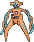
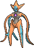
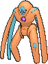
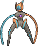

<!-- This file is generated by tools/generate_site.py. Edit the generator, not this file. -->

# #386 Deoxys

{ .sprite-lg loading=lazy }

**DNA Pokémon**

Psychic

[:material-arrow-left: #385 Jirachi](385.md) · [Pokédex](index.md) · [#387 Turtwig :material-arrow-right:](387.md)

!!! note "No documented changes"

    Drayano's documentation lists no stat, type, ability, evolution or held item changes for this Pokémon. Its level-up moves are listed below as they appear in the hack.

## Location

[Sky Pillar](../wild/sky_pillar.md)

## Type defenses

| Damage taken | Attacking types |
| --- | --- |
| Resistant (×½) | Fighting Psychic |
| Neutral (×1) | Normal Flying Poison Ground Rock Steel Fire Water Grass Electric Ice Dragon Fairy |
| Weak (×2) | Bug Ghost Dark |

## Abilities

| Slot | Ability | Effect | Note |
| --- | --- | --- | --- |
| Ability 1 | **Pressure** | Increases the PP cost of moves targetting the Pokémon by one. |  |

## Base stats

| Form | HP | Atk | Def | SpA | SpD | Spe | BST |
| --- | --- | --- | --- | --- | --- | --- | --- |
| { .sprite-sm loading=lazy } Normal | 50 | 150 | 50 | 150 | 50 | 150 | **600** |
| { .sprite-sm loading=lazy } Attack Deoxys | 50 | 180 | 20 | 180 | 20 | 150 | **600** |
| { .sprite-sm loading=lazy } Defense Deoxys | 50 | 70 | 160 | 70 | 160 | 90 | **600** |
| { .sprite-sm loading=lazy } Speed Deoxys | 50 | 95 | 90 | 95 | 90 | 180 | **600** |

## Training & breeding

| Property | Value |
| --- | --- |
| EV yield | 1 Atk, 1 SpA, 1 Spe |
| Catch rate | 3 |
| Base friendship | 0 |
| Base experience | 270 |
| Growth rate | slow |
| Egg groups | Undiscovered |
| Hatch counter | 120 |
| Gender ratio | Genderless |
| Height / weight | 1.7 m / 60.8 kg |

## Evolution

This Pokémon does not evolve.

## Wild held items

None.

## Level-up moves { data-search-exclude }

Moves marked &#42; are not normally learned by level up (they come from egg moves, TMs/HMs or tutors in the official games); moves marked &#42;&#42; cannot normally be learned by this Pokémon at all and are omitted from the legal-moves version of the hack.

=== "Normal Forme"

    | Lv. | Move | Type | Cat. | Power | Acc. | PP | Effect | Note |
    | --- | --- | --- | --- | --- | --- | --- | --- | --- |
    | 1 | Leer | Normal | Status | — | 100% | 30 | Lowers the target’s Defense by one stage. |  |
    | 1 | Wrap | Normal | Physical | 15 | 90% | 20 | Prevents the target from fleeing and inflicts damage for 2-5 turns. |  |
    | 7 | Night Shade | Ghost | Special | — | 100% | 15 | Inflicts damage equal to the user’s level. |  |
    | 13 | Teleport | Psychic | Status | — | — | 20 | Immediately ends wild battles.  No effect otherwise. |  |
    | 19 | Knock Off | Dark | Physical | 65 | 100% | 20 | Target drops its held item. |  |
    | 25 | Pursuit | Dark | Physical | 40 | 100% | 20 | Has double power against, and can hit, Pokémon attempting to switch out. |  |
    | 31 | Psychic | Psychic | Special | 90 | 100% | 10 | Has a chance to lower the target’s Special Defense by one stage. |  |
    | 37 | Snatch | Dark | Status | — | — | 10 | Steals the target’s move, if it’s self-targeted. |  |
    | 43 | Psycho Shift | Psychic | Status | — | 100% | 10 | Transfers the user’s major status effect to the target. |  |
    | 49 | Zen Headbutt | Psychic | Physical | 80 | 90% | 15 | Has a chance to make the target flinch. |  |
    | 55 | Cosmic Power | Psychic | Status | — | — | 20 | Raises the user’s Defense and Special Defense by one stage. |  |
    | 61 | Recover | Normal | Status | — | — | 5 | Heals the user by half its max HP. |  |
    | 67 | Psycho Boost | Psychic | Special | 140 | 90% | 5 | Lowers the user’s Special Attack by two stages after inflicting damage. |  |
    | 73 | Hyper Beam | Normal | Special | 150 | 90% | 5 | User foregoes its next turn to recharge. |  |

=== "Attack Forme"

    | Lv. | Move | Type | Cat. | Power | Acc. | PP | Effect | Note |
    | --- | --- | --- | --- | --- | --- | --- | --- | --- |
    | 1 | Leer | Normal | Status | — | 100% | 30 | Lowers the target’s Defense by one stage. |  |
    | 1 | Wrap | Normal | Physical | 15 | 90% | 20 | Prevents the target from fleeing and inflicts damage for 2-5 turns. |  |
    | 7 | Night Shade | Ghost | Special | — | 100% | 15 | Inflicts damage equal to the user’s level. |  |
    | 13 | Teleport | Psychic | Status | — | — | 20 | Immediately ends wild battles.  No effect otherwise. |  |
    | 19 | Taunt | Dark | Status | — | 100% | 20 | For the next few turns, the target can only use damaging moves. |  |
    | 25 | Pursuit | Dark | Physical | 40 | 100% | 20 | Has double power against, and can hit, Pokémon attempting to switch out. |  |
    | 31 | Psychic | Psychic | Special | 90 | 100% | 10 | Has a chance to lower the target’s Special Defense by one stage. |  |
    | 37 | Superpower | Fighting | Physical | 120 | 100% | 5 | Lowers the user’s Attack and Defense by one stage after inflicting damage. |  |
    | 43 | Psycho Shift | Psychic | Status | — | 100% | 10 | Transfers the user’s major status effect to the target. |  |
    | 49 | Zen Headbutt | Psychic | Physical | 80 | 90% | 15 | Has a chance to make the target flinch. |  |
    | 55 | Cosmic Power | Psychic | Status | — | — | 20 | Raises the user’s Defense and Special Defense by one stage. |  |
    | 61 | Zap Cannon | Electric | Special | 120 | 50% | 5 | Has a chance to paralyze the target. |  |
    | 67 | Psycho Boost | Psychic | Special | 140 | 90% | 5 | Lowers the user’s Special Attack by two stages after inflicting damage. |  |
    | 73 | Hyper Beam | Normal | Special | 150 | 90% | 5 | User foregoes its next turn to recharge. |  |

=== "Defense Forme"

    | Lv. | Move | Type | Cat. | Power | Acc. | PP | Effect | Note |
    | --- | --- | --- | --- | --- | --- | --- | --- | --- |
    | 1 | Leer | Normal | Status | — | 100% | 30 | Lowers the target’s Defense by one stage. |  |
    | 1 | Wrap | Normal | Physical | 15 | 90% | 20 | Prevents the target from fleeing and inflicts damage for 2-5 turns. |  |
    | 7 | Night Shade | Ghost | Special | — | 100% | 15 | Inflicts damage equal to the user’s level. |  |
    | 13 | Teleport | Psychic | Status | — | — | 20 | Immediately ends wild battles.  No effect otherwise. |  |
    | 19 | Knock Off | Dark | Physical | 65 | 100% | 20 | Target drops its held item. |  |
    | 25 | Spikes | Ground | Status | — | — | 20 | Scatters Spikes, hurting opposing Pokémon that switch in. |  |
    | 31 | Psychic | Psychic | Special | 90 | 100% | 10 | Has a chance to lower the target’s Special Defense by one stage. |  |
    | 37 | Snatch | Dark | Status | — | — | 10 | Steals the target’s move, if it’s self-targeted. |  |
    | 43 | Psycho Shift | Psychic | Status | — | 100% | 10 | Transfers the user’s major status effect to the target. |  |
    | 49 | Zen Headbutt | Psychic | Physical | 80 | 90% | 15 | Has a chance to make the target flinch. |  |
    | 55 | Iron Defense | Steel | Status | — | — | 15 | Raises the user’s Defense by two stages. |  |
    | 55 | Amnesia | Psychic | Status | — | — | 20 | Raises the user’s Special Defense by two stages. |  |
    | 61 | Recover | Normal | Status | — | — | 5 | Heals the user by half its max HP. |  |
    | 67 | Psycho Boost | Psychic | Special | 140 | 90% | 5 | Lowers the user’s Special Attack by two stages after inflicting damage. |  |
    | 73 | Counter | Fighting | Physical | — | 100% | 20 | Inflicts twice the damage the user received from the last physical hit it took. |  |
    | 73 | Mirror Coat | Psychic | Special | — | 100% | 20 | Inflicts twice the damage the user received from the last special hit it took. |  |

=== "Speed Forme"

    | Lv. | Move | Type | Cat. | Power | Acc. | PP | Effect | Note |
    | --- | --- | --- | --- | --- | --- | --- | --- | --- |
    | 1 | Leer | Normal | Status | — | 100% | 30 | Lowers the target’s Defense by one stage. |  |
    | 1 | Wrap | Normal | Physical | 15 | 90% | 20 | Prevents the target from fleeing and inflicts damage for 2-5 turns. |  |
    | 7 | Night Shade | Ghost | Special | — | 100% | 15 | Inflicts damage equal to the user’s level. |  |
    | 13 | Double Team | Normal | Status | — | — | 15 | Raises the user’s evasion by one stage. |  |
    | 19 | Knock Off | Dark | Physical | 65 | 100% | 20 | Target drops its held item. |  |
    | 25 | Pursuit | Dark | Physical | 40 | 100% | 20 | Has double power against, and can hit, Pokémon attempting to switch out. |  |
    | 31 | Psychic | Psychic | Special | 90 | 100% | 10 | Has a chance to lower the target’s Special Defense by one stage. |  |
    | 37 | Swift | Normal | Special | 60 | — | 20 | Never misses. |  |
    | 43 | Psycho Shift | Psychic | Status | — | 100% | 10 | Transfers the user’s major status effect to the target. |  |
    | 49 | Zen Headbutt | Psychic | Physical | 80 | 90% | 15 | Has a chance to make the target flinch. |  |
    | 55 | Agility | Psychic | Status | — | — | 30 | Raises the user’s Speed by two stages. |  |
    | 61 | Recover | Normal | Status | — | — | 5 | Heals the user by half its max HP. |  |
    | 67 | Psycho Boost | Psychic | Special | 140 | 90% | 5 | Lowers the user’s Special Attack by two stages after inflicting damage. |  |
    | 73 | Extreme Speed | Normal | Physical | 80 | 100% | 5 | Inflicts regular damage with no additional effect. |  |

## TM & HM moves { data-search-exclude }

| Machine | Move | Type | Cat. | Power | Acc. | PP | Effect |
| --- | --- | --- | --- | --- | --- | --- | --- |
| HM01 | [Cut](../changes/moves.md#cut) changed | Grass | Physical | 70 | 100% | 15 | High Critical Rate. High Critical Rate |
| HM04 | [Strength](../changes/moves.md#strength) changed | Normal | Physical | 100 | 100% | 10 | Inflicts regular damage with no additional effect. |
| HM06 | [Rock Smash](../changes/moves.md#rock-smash) changed | Fighting | Physical | 65 | 100% | 15 | Has a chance to lower the target’s Defense by one stage. |
| TM03 | Psyshock | Psychic | Special | 80 | 100% | 10 | Inflicts damage based on the target’s Defense, not Special Defense. |
| TM04 | Calm Mind | Psychic | Status | — | — | 20 | Raises the user’s Special Attack and Special Defense by one stage. |
| TM06 | Toxic | Poison | Status | — | 90% | 10 | Badly poisons the target, inflicting more damage every turn. |
| TM10 | Hidden Power | Normal | Special | 60 | 100% | 15 | Power and type depend upon user’s IVs.  Power can range from 30 to 70. |
| TM100 | Confide | Normal | Status | — | — | 20 | Lowers the target’s Special Attack by one stage. |
| TM11 | Sunny Day | Fire | Status | — | — | 5 | Changes the weather to sunny for five turns. |
| TM12 | Taunt | Dark | Status | — | 100% | 20 | For the next few turns, the target can only use damaging moves. |
| TM13 | Ice Beam | Ice | Special | 90 | 100% | 10 | Has a chance to freeze the target. |
| TM15 | Hyper Beam | Normal | Special | 150 | 90% | 5 | User foregoes its next turn to recharge. |
| TM16 | Light Screen | Psychic | Status | — | — | 30 | Reduces damage from special attacks by 50% for five turns. |
| TM17 | Protect | Normal | Status | — | — | 10 | Prevents any moves from hitting the user this turn. |
| TM18 | Rain Dance | Water | Status | — | — | 5 | Changes the weather to rain for five turns. |
| TM20 | Safeguard | Normal | Status | — | — | 25 | Protects the user’s field from major status ailments and confusion for five turns. |
| TM21 | Frustration | Normal | Physical | — | 100% | 20 | Power increases as happiness decreases, up to a maximum of 102. |
| TM22 | Solar Beam | Grass | Special | 120 | 100% | 10 | Requires a turn to charge before attacking. |
| TM24 | Thunderbolt | Electric | Special | 90 | 100% | 15 | Has a chance to paralyze the target. |
| TM25 | Thunder | Electric | Special | 110 | 70% | 10 | Has a chance to paralyze the target. |
| TM27 | Return | Normal | Physical | — | 100% | 20 | Power increases with happiness, up to a maximum of 102. |
| TM29 | Psychic | Psychic | Special | 90 | 100% | 10 | Has a chance to lower the target’s Special Defense by one stage. |
| TM30 | Shadow Ball | Ghost | Special | 80 | 100% | 15 | Has a chance to lower the target’s Special Defense by one stage. |
| TM31 | Brick Break | Fighting | Physical | 75 | 100% | 15 | Destroys Reflect and Light Screen. |
| TM32 | Double Team | Normal | Status | — | — | 15 | Raises the user’s evasion by one stage. |
| TM33 | Reflect | Psychic | Status | — | — | 20 | Reduces damage from physical attacks by half. |
| TM39 | Rock Tomb | Rock | Physical | 60 | 95% | 15 | Has a chance to lower the target’s Speed by one stage. |
| TM40 | Aerial Ace | Flying | Physical | 60 | — | 20 | Never misses. |
| TM41 | Torment | Dark | Status | — | 100% | 15 | Prevents the target from using the same move twice in a row. |
| TM42 | Facade | Normal | Physical | 70 | 100% | 20 | Power doubles if user is burned, paralyzed, or poisoned. |
| TM44 | Rest | Psychic | Status | — | — | 5 | User sleeps for two turns, completely healing itself. |
| TM47 | Low Sweep | Fighting | Physical | 65 | 100% | 20 | Lowers the target’s Speed by one stage. |
| TM48 | Round | Normal | Special | 60 | 100% | 15 | Has double power if it’s used more than once per turn. |
| TM52 | Focus Blast | Fighting | Special | 120 | 70% | 5 | Has a chance to lower the target’s Special Defense by one stage. |
| TM53 | Energy Ball | Grass | Special | 90 | 100% | 10 | Has a chance to lower the target’s Special Defense by one stage. |
| TM56 | Fling | Dark | Physical | — | 100% | 10 | Throws held item at the target; power depends on the item. |
| TM57 | Charge Beam | Electric | Special | 50 | 90% | 10 | Has a chance to raise the user’s Special Attack by one stage. |
| TM68 | Giga Impact | Normal | Physical | 150 | 90% | 5 | User foregoes its next turn to recharge. |
| TM70 | Flash | Normal | Status | — | 100% | 20 | Lowers the target’s accuracy by one stage. |
| TM73 | Thunder Wave | Electric | Status | — | 100% | 20 | Paralyzes the target. |
| TM77 | Psych Up | Normal | Status | — | — | 10 | Discards the user’s stat changes and copies the target’s. |
| TM80 | Rock Slide | Rock | Physical | 75 | 90% | 10 | Has a chance to make the target flinch. |
| TM84 | Poison Jab | Poison | Physical | 80 | 100% | 20 | Has a chance to poison the target. |
| TM85 | Dream Eater | Psychic | Special | 100 | 100% | 15 | Only works on sleeping Pokémon.  Drains half the damage inflicted to heal the user. |
| TM86 | Grass Knot | Grass | Special | — | 100% | 20 | Inflicts more damage to heavier targets, with a maximum of 120 power. |
| TM87 | Swagger | Normal | Status | — | 90% | 15 | Raises the target’s Attack by two stages and confuses the target. |
| TM88 | Sleep Talk | Normal | Status | — | — | 10 | Randomly uses one of the user’s other three moves.  Only works if the user is sleeping. |
| TM90 | Substitute | Normal | Status | — | — | 10 | Transfers 1/4 of the user’s max HP into a doll, protecting the user from further damage or status changes until it breaks. |
| TM91 | Flash Cannon | Steel | Special | 80 | 100% | 10 | Has a chance to lower the target’s Special Defense by one stage. |
| TM92 | Trick Room | Psychic | Status | — | — | 5 | For five turns, slower Pokémon will act before faster Pokémon. |
| TM94 | Secret Power | Normal | Physical | 70 | 100% | 20 | Has a chance to inflict a status effect which depends upon the terrain. |
| TM97 | Dark Pulse | Dark | Special | 80 | 100% | 15 | Has a chance to make the target flinch. |
| TM98 | Power-Up Punch | Fighting | Physical | 40 | 100% | 20 | Raises the user’s Attack by one stage after inflicting damage. |

## Move tutor moves { data-search-exclude }

| Move | Type | Cat. | Power | Acc. | PP | Effect |
| --- | --- | --- | --- | --- | --- | --- |
| Bind | Normal | Physical | 15 | 85% | 20 | Prevents the target from fleeing and inflicts damage for 2-5 turns. |
| Drain Punch | Fighting | Physical | 75 | 100% | 10 | Drains half the damage inflicted to heal the user. |
| Fire Punch | Fire | Physical | 75 | 100% | 15 | Has a chance to burn the target. |
| Focus Punch | Fighting | Physical | 150 | 100% | 20 | If the user takes damage before attacking, the attack is canceled. |
| Gravity | Psychic | Status | — | — | 5 | Disables moves and immunities that involve flying or levitating for five turns. |
| Ice Punch | Ice | Physical | 75 | 100% | 15 | Has a chance to freeze the target. |
| Icy Wind | Ice | Special | 55 | 95% | 15 | Has a chance to lower the target’s Speed by one stage. |
| Knock Off | Dark | Physical | 65 | 100% | 20 | Target drops its held item. |
| Low Kick | Fighting | Physical | — | 100% | 20 | Inflicts more damage to heavier targets, with a maximum of 120 power. |
| Magic Coat | Psychic | Status | — | — | 15 | Reflects back the first effect move used on the user this turn. |
| Recycle | Normal | Status | — | — | 10 | User recovers the item it last used up. |
| Role Play | Psychic | Status | — | — | 10 | Copies the target’s ability. |
| Shock Wave | Electric | Special | 60 | — | 20 | Never misses. |
| Signal Beam | Bug | Special | 75 | 100% | 15 | Has a chance to confuse the target. |
| Skill Swap | Psychic | Status | — | — | 10 | User and target swap abilities. |
| Snatch | Dark | Status | — | — | 10 | Steals the target’s move, if it’s self-targeted. |
| Snore | Normal | Special | 50 | 100% | 15 | Has a chance to make the target flinch.  Only works if the user is sleeping. |
| Stealth Rock | Rock | Status | — | — | 20 | Causes damage when opposing Pokémon switch in. |
| Thunder Punch | Electric | Physical | 75 | 100% | 15 | Has a chance to paralyze the target. |
| Trick | Psychic | Status | — | 100% | 10 | User and target swap items. |
| Water Pulse | Water | Special | 60 | 100% | 20 | Has a chance to confuse the target. |
| Wonder Room | Psychic | Status | — | — | 10 | All Pokémon’s Defense and Special Defense are swapped for 5 turns. |
| Zen Headbutt | Psychic | Physical | 80 | 90% | 15 | Has a chance to make the target flinch. |

## Egg moves { data-search-exclude }

No egg moves.

---

[:material-arrow-left: #385 Jirachi](385.md) · [#387 Turtwig :material-arrow-right:](387.md)
