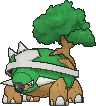

<!-- This file is generated by tools/generate_site.py. Edit the generator, not this file. -->

# #389 Torterra

{ .sprite-lg loading=lazy }

**Continent Pokémon**

Grass Ground

[:material-arrow-left: #388 Grotle](388.md) · [Pokédex](index.md) · [#390 Chimchar :material-arrow-right:](390.md)

!!! info "Changes in Rising Ruby / Sinking Sapphire"

    - **Ability 2:** **Shell Armor** 

## Location

Evolve { .icon loading=lazy } [Grotle](../pokemon/388.md) (Lv. 32)

## Type defenses

| Damage taken | Attacking types |
| --- | --- |
| Immune (×0) | Electric |
| Resistant (×½) | Ground Rock |
| Neutral (×1) | Normal Fighting Poison Ghost Steel Water Grass Psychic Dragon Dark Fairy |
| Weak (×2) | Flying Bug Fire |
| Very weak (×4) | Ice |

## Abilities

| Slot | Ability | Effect | Note |
| --- | --- | --- | --- |
| Ability 1 | **Overgrow** | Strengthens Grass moves to inflict 1.5× damage at 1/3 max HP or less. |  |
| Ability 2 | **Shell Armor** | Protects against critical hits. | changed  |
| Hidden | **Shell Armor** | Protects against critical hits. |  |

## Base stats

| Form | HP | Atk | Def | SpA | SpD | Spe | BST |
| --- | --- | --- | --- | --- | --- | --- | --- |
| { .sprite-sm loading=lazy } Normal | 95 | 109 | 105 | 75 | 85 | 56 | **525** |

## Training & breeding

| Property | Value |
| --- | --- |
| EV yield | 2 Atk, 1 Def |
| Catch rate | 45 |
| Base friendship | 70 |
| Base experience | 236 |
| Growth rate | medium slow |
| Egg groups | Monster, Grass |
| Hatch counter | 20 |
| Gender ratio | 87.5% ♂ / 12.5% ♀ |
| Height / weight | 2.2 m / 310 kg |

## Evolution

- { .icon loading=lazy } [Turtwig](../pokemon/387.md) → { .icon loading=lazy } [Grotle](../pokemon/388.md): Lv. 18
- { .icon loading=lazy } [Grotle](../pokemon/388.md) → { .icon loading=lazy } **[Torterra](../pokemon/389.md)**: Lv. 32

## Wild held items

None.

## Level-up moves { data-search-exclude }

Moves marked &#42; are not normally learned by level up (they come from egg moves, TMs/HMs or tutors in the official games); moves marked &#42;&#42; cannot normally be learned by this Pokémon at all and are omitted from the legal-moves version of the hack.

| Lv. | Move | Type | Cat. | Power | Acc. | PP | Effect | Note |
| --- | --- | --- | --- | --- | --- | --- | --- | --- |
| 1 | Wood Hammer | Grass | Physical | 120 | 100% | 15 | User receives 1/3 the damage inflicted in recoil. |  |
| 1 | Iron Head | Steel | Physical | 80 | 100% | 15 | Has a chance to make the target flinch. | &#42; |
| 1 | Tackle | Normal | Physical | 50 | 100% | 35 | Inflicts regular damage with no additional effect. |  |
| 5 | Withdraw | Water | Status | — | — | 40 | Raises the user’s Defense by one stage. |  |
| 8 | Absorb | Grass | Special | 20 | 100% | 25 | Drains half the damage inflicted to heal the user. |  |
| 11 | Razor Leaf | Grass | Physical | 55 | 95% | 25 | Has an increased chance for a critical hit. |  |
| 14 | Sand Tomb | Ground | Physical | 35 | 85% | 15 | Prevents the target from fleeing and inflicts damage for 2-5 turns. | &#42; |
| 17 | Curse | Ghost | Status | — | — | 10 | Ghosts pay half their max HP to hurt the target every turn.  Others decrease Speed but raise Attack and Defense. |  |
| 21 | Bite | Dark | Physical | 60 | 100% | 25 | Has a chance to make the target flinch. |  |
| 25 | Mega Drain | Grass | Special | 40 | 100% | 15 | Drains half the damage inflicted to heal the user. |  |
| 29 | Leech Seed | Grass | Status | — | 90% | 10 | Seeds the target, stealing HP from it every turn. |  |
| 32 | Earthquake | Ground | Physical | 100 | 100% | 10 | Inflicts regular damage and can hit Dig users. |  |
| 34 | Synthesis | Grass | Status | — | — | 5 | Heals the user by half its max HP.  Affected by weather. |  |
| 39 | Body Slam | Normal | Physical | 85 | 100% | 15 | Has a chance to paralyze the target. | &#42; |
| 44 | Crunch | Dark | Physical | 80 | 100% | 15 | Has a chance to lower the target’s Defense by one stage. |  |
| 49 | Seed Bomb | Grass | Physical | 80 | 100% | 15 | Inflicts regular damage with no additional effect. | &#42; |
| 54 | Giga Drain | Grass | Special | 75 | 100% | 10 | Drains half the damage inflicted to heal the user. |  |
| 59 | Leaf Storm | Grass | Special | 130 | 90% | 5 | Lowers the user’s Special Attack by two stages after inflicting damage. |  |
| 64 | Shell Smash | Normal | Status | — | — | 15 | Raises user’s Attack, Special Attack, and Speed by two stages.  Lower user’s Defense and Special Defense by one stage. | &#42;&#42; |

## TM & HM moves { data-search-exclude }

| Machine | Move | Type | Cat. | Power | Acc. | PP | Effect |
| --- | --- | --- | --- | --- | --- | --- | --- |
| HM01 | [Cut](../changes/moves.md#cut) changed | Grass | Physical | 70 | 100% | 15 | High Critical Rate. High Critical Rate |
| HM04 | [Strength](../changes/moves.md#strength) changed | Normal | Physical | 100 | 100% | 10 | Inflicts regular damage with no additional effect. |
| HM06 | [Rock Smash](../changes/moves.md#rock-smash) changed | Fighting | Physical | 65 | 100% | 15 | Has a chance to lower the target’s Defense by one stage. |
| TM05 | Roar | Normal | Status | — | — | 20 | Immediately ends wild battles.  Forces trainers to switch Pokémon. |
| TM06 | Toxic | Poison | Status | — | 90% | 10 | Badly poisons the target, inflicting more damage every turn. |
| TM10 | Hidden Power | Normal | Special | 60 | 100% | 15 | Power and type depend upon user’s IVs.  Power can range from 30 to 70. |
| TM100 | Confide | Normal | Status | — | — | 20 | Lowers the target’s Special Attack by one stage. |
| TM11 | Sunny Day | Fire | Status | — | — | 5 | Changes the weather to sunny for five turns. |
| TM15 | Hyper Beam | Normal | Special | 150 | 90% | 5 | User foregoes its next turn to recharge. |
| TM16 | Light Screen | Psychic | Status | — | — | 30 | Reduces damage from special attacks by 50% for five turns. |
| TM17 | Protect | Normal | Status | — | — | 10 | Prevents any moves from hitting the user this turn. |
| TM20 | Safeguard | Normal | Status | — | — | 25 | Protects the user’s field from major status ailments and confusion for five turns. |
| TM21 | Frustration | Normal | Physical | — | 100% | 20 | Power increases as happiness decreases, up to a maximum of 102. |
| TM22 | Solar Beam | Grass | Special | 120 | 100% | 10 | Requires a turn to charge before attacking. |
| TM26 | Earthquake | Ground | Physical | 100 | 100% | 10 | Inflicts regular damage and can hit Dig users. |
| TM27 | Return | Normal | Physical | — | 100% | 20 | Power increases with happiness, up to a maximum of 102. |
| TM32 | Double Team | Normal | Status | — | — | 15 | Raises the user’s evasion by one stage. |
| TM33 | Reflect | Psychic | Status | — | — | 20 | Reduces damage from physical attacks by half. |
| TM37 | Sandstorm | Rock | Status | — | — | 10 | Changes the weather to a sandstorm for five turns. |
| TM39 | Rock Tomb | Rock | Physical | 60 | 95% | 15 | Has a chance to lower the target’s Speed by one stage. |
| TM42 | Facade | Normal | Physical | 70 | 100% | 20 | Power doubles if user is burned, paralyzed, or poisoned. |
| TM44 | Rest | Psychic | Status | — | — | 5 | User sleeps for two turns, completely healing itself. |
| TM45 | Attract | Normal | Status | — | 100% | 15 | Target falls in love if it has the opposite gender, and has a 50% chance to refuse attacking the user. |
| TM48 | Round | Normal | Special | 60 | 100% | 15 | Has double power if it’s used more than once per turn. |
| TM53 | Energy Ball | Grass | Special | 90 | 100% | 10 | Has a chance to lower the target’s Special Defense by one stage. |
| TM68 | Giga Impact | Normal | Physical | 150 | 90% | 5 | User foregoes its next turn to recharge. |
| TM69 | Rock Polish | Rock | Status | — | — | 20 | Raises the user’s Speed by two stages. |
| TM70 | Flash | Normal | Status | — | 100% | 20 | Lowers the target’s accuracy by one stage. |
| TM71 | Stone Edge | Rock | Physical | 100 | 80% | 5 | Has an increased chance for a critical hit. |
| TM75 | Swords Dance | Normal | Status | — | — | 20 | Raises the user’s Attack by two stages. |
| TM78 | Bulldoze | Ground | Physical | 60 | 100% | 20 | Has a chance to lower the target’s Speed by one stage. |
| TM80 | Rock Slide | Rock | Physical | 75 | 90% | 10 | Has a chance to make the target flinch. |
| TM86 | Grass Knot | Grass | Special | — | 100% | 20 | Inflicts more damage to heavier targets, with a maximum of 120 power. |
| TM87 | Swagger | Normal | Status | — | 90% | 15 | Raises the target’s Attack by two stages and confuses the target. |
| TM88 | Sleep Talk | Normal | Status | — | — | 10 | Randomly uses one of the user’s other three moves.  Only works if the user is sleeping. |
| TM90 | Substitute | Normal | Status | — | — | 10 | Transfers 1/4 of the user’s max HP into a doll, protecting the user from further damage or status changes until it breaks. |
| TM94 | Secret Power | Normal | Physical | 70 | 100% | 20 | Has a chance to inflict a status effect which depends upon the terrain. |
| TM96 | Nature Power | Normal | Status | — | — | 20 | Uses a move which depends upon the terrain. |

## Move tutor moves { data-search-exclude }

| Move | Type | Cat. | Power | Acc. | PP | Effect |
| --- | --- | --- | --- | --- | --- | --- |
| Block | Normal | Status | — | — | 5 | Prevents the target from leaving battle. |
| Earth Power | Ground | Special | 90 | 100% | 10 | Has a chance to lower the target’s Special Defense by one stage. |
| Frenzy Plant | Grass | Special | 150 | 90% | 5 | User foregoes its next turn to recharge. |
| Giga Drain | Grass | Special | 75 | 100% | 10 | Drains half the damage inflicted to heal the user. |
| [Grass Pledge](../changes/moves.md#grass-pledge) changed | Grass | Special | 85 | 100% | 10 | With Fire Pledge, damages opposing Pokémon for 1/8 their max HP every turn for four turns. |
| Iron Head | Steel | Physical | 80 | 100% | 15 | Has a chance to make the target flinch. |
| Iron Tail | Steel | Physical | 100 | 75% | 15 | Has a chance to lower the target’s Defense by one stage. |
| Outrage | Dragon | Physical | 120 | 100% | 10 | Hits every turn for 2-3 turns, then confuses the user. |
| Seed Bomb | Grass | Physical | 80 | 100% | 15 | Inflicts regular damage with no additional effect. |
| Snore | Normal | Special | 50 | 100% | 15 | Has a chance to make the target flinch.  Only works if the user is sleeping. |
| Stealth Rock | Rock | Status | — | — | 20 | Causes damage when opposing Pokémon switch in. |
| Superpower | Fighting | Physical | 120 | 100% | 5 | Lowers the user’s Attack and Defense by one stage after inflicting damage. |
| Synthesis | Grass | Status | — | — | 5 | Heals the user by half its max HP.  Affected by weather. |
| Worry Seed | Grass | Status | — | 100% | 10 | Changes the target’s ability to Insomnia. |

## Egg moves { data-search-exclude }

No egg moves.

??? note "Trainers using Torterra (5)"

    | Area | Trainer | Level |
    | --- | --- | --- |
    | [Route 119 (Mauville)](../trainers/route_119_mauville.md#trainers) | PKMN Ranger Catherine | Lv. 40 |
    | [Route 119 (Mauville)](../trainers/route_119_mauville.md#rematches) | PKMN Ranger Catherine (6) | Lv. 47 |
    | [Route 119 (Mauville)](../trainers/route_119_mauville.md#rematches) | PKMN Ranger Catherine (7) | Lv. 59 |
    | [Route 119 (Mauville)](../trainers/route_119_mauville.md#rematches) | PKMN Ranger Catherine (8) | Lv. 64 |
    | [Route 119 (Mauville)](../trainers/route_119_mauville.md#rematches) | PKMN Ranger Catherine (C) | Lv. 75 |

---

[:material-arrow-left: #388 Grotle](388.md) · [#390 Chimchar :material-arrow-right:](390.md)
