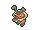
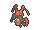

<!-- This file is generated by tools/generate_site.py. Edit the generator, not this file. -->

# #401 Kricketot

{ .sprite-lg loading=lazy }

**Cricket Pokémon**

Bug

[:material-arrow-left: #400 Bibarel](400.md) · [Pokédex](index.md) · [#402 Kricketune :material-arrow-right:](402.md)

!!! info "Changes in Rising Ruby / Sinking Sapphire"

    - **Ability 2:** **Run Away** 

## Location

[Route 104 North](../wild/route_104_north.md)

### Wild encounters

| Area | Method | Level | Note |
| --- | --- | --- | --- |
| [Route 104 North](../wild/route_104_north.md) | Grass | 10 |  |

## Type defenses

| Damage taken | Attacking types |
| --- | --- |
| Resistant (×½) | Fighting Ground Grass |
| Neutral (×1) | Normal Poison Bug Ghost Steel Water Electric Psychic Ice Dragon Dark Fairy |
| Weak (×2) | Flying Rock Fire |

## Abilities

| Slot | Ability | Effect | Note |
| --- | --- | --- | --- |
| Ability 1 | **Shed Skin** | Has a 33% chance of curing any major status ailment after each turn. |  |
| Ability 2 | **Run Away** | Ensures success fleeing from wild battles. | changed  |
| Hidden | **Run Away** | Ensures success fleeing from wild battles. |  |

## Base stats

| Form | HP | Atk | Def | SpA | SpD | Spe | BST |
| --- | --- | --- | --- | --- | --- | --- | --- |
| { .sprite-sm loading=lazy } Normal | 37 | 25 | 41 | 25 | 41 | 25 | **194** |

## Training & breeding

| Property | Value |
| --- | --- |
| EV yield | 1 Def |
| Catch rate | 255 |
| Base friendship | 70 |
| Base experience | 39 |
| Growth rate | medium slow |
| Egg groups | Bug |
| Hatch counter | 15 |
| Gender ratio | 50% ♂ / 50% ♀ |
| Height / weight | 0.3 m / 2.2 kg |

## Evolution

- { .icon loading=lazy } **[Kricketot](../pokemon/401.md)** → { .icon loading=lazy } [Kricketune](../pokemon/402.md): Lv. 10

## Wild held items

| Item | Chance | Note |
| --- | --- | --- |
| { .item loading=lazy } Metronome | 5% |  |

## Level-up moves { data-search-exclude }

Moves marked &#42; are not normally learned by level up (they come from egg moves, TMs/HMs or tutors in the official games); moves marked &#42;&#42; cannot normally be learned by this Pokémon at all and are omitted from the legal-moves version of the hack.

| Lv. | Move | Type | Cat. | Power | Acc. | PP | Effect | Note |
| --- | --- | --- | --- | --- | --- | --- | --- | --- |
| 1 | Growl | Normal | Status | — | 100% | 40 | Lowers the target’s Attack by one stage. |  |
| 1 | Bide | Normal | Physical | — | — | 10 | User waits for two turns, then hits back for twice the damage it took. |  |
| 1 | Struggle Bug | Bug | Special | 50 | 100% | 20 | Has a chance to lower the target’s Special Attack by one stage. |  |
| 5 | Bug Bite | Bug | Physical | 60 | 100% | 20 | If target has a berry, inflicts double damage and uses the berry. |  |
| 10 | Endeavor | Normal | Physical | — | 100% | 5 | Lowers the target’s HP to equal the user’s. |  |

## TM & HM moves { data-search-exclude }

| Machine | Move | Type | Cat. | Power | Acc. | PP | Effect |
| --- | --- | --- | --- | --- | --- | --- | --- |
| TM76 | Struggle Bug | Bug | Special | 50 | 100% | 20 | Has a chance to lower the target’s Special Attack by one stage. |

## Move tutor moves { data-search-exclude }

| Move | Type | Cat. | Power | Acc. | PP | Effect |
| --- | --- | --- | --- | --- | --- | --- |
| Bug Bite | Bug | Physical | 60 | 100% | 20 | If target has a berry, inflicts double damage and uses the berry. |
| Endeavor | Normal | Physical | — | 100% | 5 | Lowers the target’s HP to equal the user’s. |
| Snore | Normal | Special | 50 | 100% | 15 | Has a chance to make the target flinch.  Only works if the user is sleeping. |
| Uproar | Normal | Special | 90 | 100% | 10 | Forced to use this move for several turns.  Pokémon cannot fall asleep in that time. |

## Egg moves { data-search-exclude }

No egg moves.

??? note "Trainers using Kricketot (1)"

    | Area | Trainer | Level |
    | --- | --- | --- |
    | [Petalburg Woods](../trainers/petalburg_woods.md#trainers) | Bug Catcher James | Lv. 10 |

---

[:material-arrow-left: #400 Bibarel](400.md) · [#402 Kricketune :material-arrow-right:](402.md)
