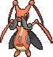

<!-- This file is generated by tools/generate_site.py. Edit the generator, not this file. -->

# #402 Kricketune

{ .sprite-lg loading=lazy }

**Cricket Pokémon**

Bug

[:material-arrow-left: #401 Kricketot](401.md) · [Pokédex](index.md) · [#403 Shinx :material-arrow-right:](403.md)

!!! info "Changes in Rising Ruby / Sinking Sapphire"

    - **Ability 2:** **Technician** 
    - **Base stats:** HP 77 → **80**, Atk 85 → **110**, Def 51 → **65**, SpD 51 → **65** (BST 384 → **440**)

## Location

[Safari Zone](../wild/safari_zone_1.md)

### Wild encounters

| Area | Method | Level | Note |
| --- | --- | --- | --- |
| [Safari Zone (1)](../wild/safari_zone_1.md) | Grass | 45 |  |

## Type defenses

| Damage taken | Attacking types |
| --- | --- |
| Resistant (×½) | Fighting Ground Grass |
| Neutral (×1) | Normal Poison Bug Ghost Steel Water Electric Psychic Ice Dragon Dark Fairy |
| Weak (×2) | Flying Rock Fire |

## Abilities

| Slot | Ability | Effect | Note |
| --- | --- | --- | --- |
| Ability 1 | **Swarm** | Strengthens Bug moves to inflict 1.5× damage at 1/3 max HP or less. |  |
| Ability 2 | **Technician** | Strengthens moves of 60 base power or less to 1.5× their power. | changed  |
| Hidden | **Technician** | Strengthens moves of 60 base power or less to 1.5× their power. |  |

## Base stats

| Form | HP | Atk | Def | SpA | SpD | Spe | BST |
| --- | --- | --- | --- | --- | --- | --- | --- |
| { .sprite-sm loading=lazy } Normal | 80<small class="was">was 77</small> | 110<small class="was">was 85</small> | 65<small class="was">was 51</small> | 55 | 65<small class="was">was 51</small> | 65 | 440<small class="was">was 384</small> |

## Training & breeding

| Property | Value |
| --- | --- |
| EV yield | 2 Atk |
| Catch rate | 45 |
| Base friendship | 70 |
| Base experience | 134 |
| Growth rate | medium slow |
| Egg groups | Bug |
| Hatch counter | 15 |
| Gender ratio | 50% ♂ / 50% ♀ |
| Height / weight | 1 m / 25.5 kg |

## Evolution

- { .icon loading=lazy } [Kricketot](../pokemon/401.md) → { .icon loading=lazy } **[Kricketune](../pokemon/402.md)**: Lv. 10

## Wild held items

| Item | Chance | Note |
| --- | --- | --- |
| { .item loading=lazy } Metronome | 5% |  |

## Level-up moves { data-search-exclude }

Moves marked &#42; are not normally learned by level up (they come from egg moves, TMs/HMs or tutors in the official games); moves marked &#42;&#42; cannot normally be learned by this Pokémon at all and are omitted from the legal-moves version of the hack.

| Lv. | Move | Type | Cat. | Power | Acc. | PP | Effect | Note |
| --- | --- | --- | --- | --- | --- | --- | --- | --- |
| 1 | Growl | Normal | Status | — | 100% | 40 | Lowers the target’s Attack by one stage. |  |
| 1 | Bide | Normal | Physical | — | — | 10 | User waits for two turns, then hits back for twice the damage it took. |  |
| 10 | Fury Cutter | Bug | Physical | 40 | 95% | 20 | Power doubles every turn this move is used in succession after the first, maxing out after five turns. |  |
| 13 | Leech Life | Bug | Physical | 20 | 100% | 15 | Drains half the damage inflicted to heal the user. |  |
| 16 | Sing | Normal | Status | — | 55% | 15 | Puts the target to sleep. |  |
| 19 | Slash | Normal | Physical | 70 | 100% | 20 | Has an increased chance for a critical hit. |  |
| 22 | X-Scissor | Bug | Physical | 80 | 100% | 15 | Inflicts regular damage with no additional effect. |  |
| 25 | Focus Energy | Normal | Status | — | — | 30 | Increases the user’s chance to score a critical hit. |  |
| 28 | Aerial Ace | Flying | Physical | 60 | — | 20 | Never misses. | &#42; |
| 31 | Fell Stinger | Bug | Physical | 30 | 100% | 25 | Raises the user’s Attack by two stages if it KOs the target. |  |
| 34 | Night Slash | Dark | Physical | 70 | 100% | 15 | Has an increased chance for a critical hit. |  |
| 37 | Screech | Normal | Status | — | 85% | 40 | Lowers the target’s Defense by two stages. |  |
| 40 | Taunt | Dark | Status | — | 100% | 20 | For the next few turns, the target can only use damaging moves. |  |
| 43 | Sticky Web | Bug | Status | — | — | 20 | Covers the opposing field, lowering opponents’ Speed by one stage upon switching in. |  |
| 46 | Bug Buzz | Bug | Special | 90 | 100% | 10 | Has a chance to lower the target’s Special Defense by one stage. |  |
| 49 | Perish Song | Normal | Status | — | — | 5 | User and target both faint after three turns. |  |

## TM & HM moves { data-search-exclude }

| Machine | Move | Type | Cat. | Power | Acc. | PP | Effect |
| --- | --- | --- | --- | --- | --- | --- | --- |
| HM01 | [Cut](../changes/moves.md#cut) changed | Grass | Physical | 70 | 100% | 15 | High Critical Rate. High Critical Rate |
| HM04 | [Strength](../changes/moves.md#strength) changed | Normal | Physical | 100 | 100% | 10 | Inflicts regular damage with no additional effect. |
| HM06 | [Rock Smash](../changes/moves.md#rock-smash) changed | Fighting | Physical | 65 | 100% | 15 | Has a chance to lower the target’s Defense by one stage. |
| TM01 | Hone Claws | Dark | Status | — | — | 15 | Raises the user’s Attack and accuracy by one stage. |
| TM06 | Toxic | Poison | Status | — | 90% | 10 | Badly poisons the target, inflicting more damage every turn. |
| TM10 | Hidden Power | Normal | Special | 60 | 100% | 15 | Power and type depend upon user’s IVs.  Power can range from 30 to 70. |
| TM100 | Confide | Normal | Status | — | — | 20 | Lowers the target’s Special Attack by one stage. |
| TM11 | Sunny Day | Fire | Status | — | — | 5 | Changes the weather to sunny for five turns. |
| TM12 | Taunt | Dark | Status | — | 100% | 20 | For the next few turns, the target can only use damaging moves. |
| TM15 | Hyper Beam | Normal | Special | 150 | 90% | 5 | User foregoes its next turn to recharge. |
| TM17 | Protect | Normal | Status | — | — | 10 | Prevents any moves from hitting the user this turn. |
| TM18 | Rain Dance | Water | Status | — | — | 5 | Changes the weather to rain for five turns. |
| TM21 | Frustration | Normal | Physical | — | 100% | 20 | Power increases as happiness decreases, up to a maximum of 102. |
| TM27 | Return | Normal | Physical | — | 100% | 20 | Power increases with happiness, up to a maximum of 102. |
| TM31 | Brick Break | Fighting | Physical | 75 | 100% | 15 | Destroys Reflect and Light Screen. |
| TM32 | Double Team | Normal | Status | — | — | 15 | Raises the user’s evasion by one stage. |
| TM40 | Aerial Ace | Flying | Physical | 60 | — | 20 | Never misses. |
| TM42 | Facade | Normal | Physical | 70 | 100% | 20 | Power doubles if user is burned, paralyzed, or poisoned. |
| TM44 | Rest | Psychic | Status | — | — | 5 | User sleeps for two turns, completely healing itself. |
| TM45 | Attract | Normal | Status | — | 100% | 15 | Target falls in love if it has the opposite gender, and has a 50% chance to refuse attacking the user. |
| TM48 | Round | Normal | Special | 60 | 100% | 15 | Has double power if it’s used more than once per turn. |
| TM49 | Echoed Voice | Normal | Special | 40 | 100% | 15 | Power increases by 100% for each consecutive use by any friendly Pokémon, to a maximum of 200. |
| TM54 | False Swipe | Normal | Physical | 40 | 100% | 40 | Cannot lower the target’s HP below 1. |
| TM68 | Giga Impact | Normal | Physical | 150 | 90% | 5 | User foregoes its next turn to recharge. |
| TM70 | Flash | Normal | Status | — | 100% | 20 | Lowers the target’s accuracy by one stage. |
| TM75 | Swords Dance | Normal | Status | — | — | 20 | Raises the user’s Attack by two stages. |
| TM76 | Struggle Bug | Bug | Special | 50 | 100% | 20 | Has a chance to lower the target’s Special Attack by one stage. |
| TM81 | X-Scissor | Bug | Physical | 80 | 100% | 15 | Inflicts regular damage with no additional effect. |
| TM83 | Infestation | Bug | Special | 20 | 100% | 20 | Prevents the target from fleeing and inflicts damage for 2-5 turns. |
| TM87 | Swagger | Normal | Status | — | 90% | 15 | Raises the target’s Attack by two stages and confuses the target. |
| TM88 | Sleep Talk | Normal | Status | — | — | 10 | Randomly uses one of the user’s other three moves.  Only works if the user is sleeping. |
| TM90 | Substitute | Normal | Status | — | — | 10 | Transfers 1/4 of the user’s max HP into a doll, protecting the user from further damage or status changes until it breaks. |
| TM94 | Secret Power | Normal | Physical | 70 | 100% | 20 | Has a chance to inflict a status effect which depends upon the terrain. |
| TM98 | Power-Up Punch | Fighting | Physical | 40 | 100% | 20 | Raises the user’s Attack by one stage after inflicting damage. |

## Move tutor moves { data-search-exclude }

| Move | Type | Cat. | Power | Acc. | PP | Effect |
| --- | --- | --- | --- | --- | --- | --- |
| Bug Bite | Bug | Physical | 60 | 100% | 20 | If target has a berry, inflicts double damage and uses the berry. |
| Endeavor | Normal | Physical | — | 100% | 5 | Lowers the target’s HP to equal the user’s. |
| Heal Bell | Normal | Status | — | — | 5 | Cures the entire party of major status effects. |
| Hyper Voice | Normal | Special | 90 | 100% | 10 | Inflicts regular damage with no additional effect. |
| Knock Off | Dark | Physical | 65 | 100% | 20 | Target drops its held item. |
| Snore | Normal | Special | 50 | 100% | 15 | Has a chance to make the target flinch.  Only works if the user is sleeping. |
| Uproar | Normal | Special | 90 | 100% | 10 | Forced to use this move for several turns.  Pokémon cannot fall asleep in that time. |

## Egg moves { data-search-exclude }

No egg moves.

??? note "Trainers using Kricketune (8)"

    | Area | Trainer | Level |
    | --- | --- | --- |
    | [Petalburg Woods](../trainers/petalburg_woods.md#rematches) | Bug Catcher James (1) | Lv. 13 |
    | [Petalburg Woods](../trainers/petalburg_woods.md#rematches) | Bug Catcher James (2) | Lv. 16 |
    | [Petalburg Woods](../trainers/petalburg_woods.md#rematches) | Bug Catcher James (4) | Lv. 35 |
    | [Petalburg Woods](../trainers/petalburg_woods.md#rematches) | Bug Catcher James (C) | Lv. 75 |
    | [Route 120 South-West](../trainers/route_120_south_west.md#trainers) | Bug Maniac Brandon | Lv. 47 |
    | [Route 120 South-West](../trainers/route_120_south_west.md#rematches) | Bug Maniac Brandon (7) | Lv. 59 |
    | [Route 120 South-West](../trainers/route_120_south_west.md#rematches) | Bug Maniac Brandon (8) | Lv. 64 |
    | [Route 120 South-West](../trainers/route_120_south_west.md#rematches) | Bug Maniac Brandon (C) | Lv. 75 |

---

[:material-arrow-left: #401 Kricketot](401.md) · [#403 Shinx :material-arrow-right:](403.md)
