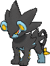

<!-- This file is generated by tools/generate_site.py. Edit the generator, not this file. -->

# #405 Luxray

{ .sprite-lg loading=lazy }

**Gleam Eyes Pokémon**

Electric Dark

Type changed from Electric

[:material-arrow-left: #404 Luxio](404.md) · [Pokédex](index.md) · [#406 Budew :material-arrow-right:](406.md)

!!! info "Changes in Rising Ruby / Sinking Sapphire"

    - **Type:** Electric → Electric Dark
    - **New TM/HM compatibility:** Payback, Dark Pulse

## Location

Evolve { .icon loading=lazy } [Luxio](../pokemon/404.md) (Lv. 30)

## Type defenses

| Damage taken | Attacking types |
| --- | --- |
| Immune (×0) | Psychic |
| Resistant (×½) | Flying Ghost Steel Electric Dark |
| Neutral (×1) | Normal Poison Rock Fire Water Grass Ice Dragon |
| Weak (×2) | Fighting Ground Bug Fairy |

## Abilities

| Slot | Ability | Effect | Note |
| --- | --- | --- | --- |
| Ability 1 | **Rivalry** | Increases damage inflicted to 1.25× against Pokémon of the same gender, but decreases damage to 0.75× against the opposite gender. |  |
| Ability 2 | **Intimidate** | Lowers opponents' Attack one stage upon entering battle. |  |
| Hidden | **Guts** | Increases Attack to 1.5× with a major status ailment. |  |

## Base stats

| Form | HP | Atk | Def | SpA | SpD | Spe | BST |
| --- | --- | --- | --- | --- | --- | --- | --- |
| { .sprite-sm loading=lazy } Normal | 80 | 120 | 79 | 95 | 79 | 70 | **523** |

## Training & breeding

| Property | Value |
| --- | --- |
| EV yield | 3 Atk |
| Catch rate | 45 |
| Base friendship | 70 |
| Base experience | 235 |
| Growth rate | medium slow |
| Egg groups | Field |
| Hatch counter | 20 |
| Gender ratio | 50% ♂ / 50% ♀ |
| Height / weight | 1.4 m / 42 kg |

## Evolution

- { .icon loading=lazy } [Shinx](../pokemon/403.md) → { .icon loading=lazy } [Luxio](../pokemon/404.md): Lv. 15
- { .icon loading=lazy } [Luxio](../pokemon/404.md) → { .icon loading=lazy } **[Luxray](../pokemon/405.md)**: Lv. 30

## Wild held items

None.

## Level-up moves { data-search-exclude }

Moves marked &#42; are not normally learned by level up (they come from egg moves, TMs/HMs or tutors in the official games); moves marked &#42;&#42; cannot normally be learned by this Pokémon at all and are omitted from the legal-moves version of the hack.

| Lv. | Move | Type | Cat. | Power | Acc. | PP | Effect | Note |
| --- | --- | --- | --- | --- | --- | --- | --- | --- |
| 1 | Electric Terrain | Electric | Status | — | — | 10 | For five turns, prevents all Pokémon on the ground from sleeping and strengthens their Electric moves to 1.5× their power. |  |
| 1 | Volt Tackle | Electric | Physical | 120 | 100% | 15 | User takes 1/3 the damage inflicted in recoil.  Has a chance to paralyze the target. | &#42;&#42; |
| 1 | Sucker Punch | Dark | Physical | 80 | 100% | 5 | Only works if the target is about to use a damaging move. | &#42;&#42; |
| 1 | Ice Fang | Ice | Physical | 65 | 95% | 15 | Has a chance to freeze the target and a chance to make the target flinch. | &#42; |
| 1 | Fire Fang | Fire | Physical | 65 | 95% | 15 | Has a chance to burn the target and a chance to make the target flinch. | &#42; |
| 1 | Tackle | Normal | Physical | 50 | 100% | 35 | Inflicts regular damage with no additional effect. |  |
| 1 | Leer | Normal | Status | — | 100% | 30 | Lowers the target’s Defense by one stage. |  |
| 5 | Charge | Electric | Status | — | — | 20 | Raises the user’s Special Defense by one stage.  User’s Electric moves have doubled power next turn. |  |
| 8 | Quick Attack | Normal | Physical | 40 | 100% | 30 | Inflicts regular damage with no additional effect. | &#42; |
| 11 | Spark | Electric | Physical | 65 | 100% | 20 | Has a chance to paralyze the target. |  |
| 14 | Payback | Dark | Physical | 50 | 100% | 10 | Power is doubled if the target has already moved this turn. | &#42;&#42; |
| 18 | Bite | Dark | Physical | 60 | 100% | 25 | Has a chance to make the target flinch. |  |
| 22 | Thunder Fang | Electric | Physical | 65 | 95% | 15 | Has a chance to paralyze the target and a chance to make the target flinch. |  |
| 26 | Roar | Normal | Status | — | — | 20 | Immediately ends wild battles.  Forces trainers to switch Pokémon. |  |
| 30 | Night Slash | Dark | Physical | 70 | 100% | 15 | Has an increased chance for a critical hit. | &#42; |
| 31 | Double Kick | Fighting | Physical | 30 | 100% | 30 | Hits twice in one turn. | &#42; |
| 36 | Wild Charge | Electric | Physical | 90 | 100% | 15 | User receives 1/4 the damage it inflicts in recoil. |  |
| 41 | Crunch | Dark | Physical | 80 | 100% | 15 | Has a chance to lower the target’s Defense by one stage. |  |
| 46 | Swagger | Normal | Status | — | 90% | 15 | Raises the target’s Attack by two stages and confuses the target. |  |
| 51 | Discharge | Electric | Special | 80 | 100% | 15 | Has a chance to paralyze the target. |  |
| 56 | Scary Face | Normal | Status | — | 100% | 10 | Lowers the target’s Speed by two stages. |  |
| 61 | Sucker Punch | Dark | Physical | 80 | 100% | 5 | Only works if the target is about to use a damaging move. | &#42;&#42; |
| 66 | Volt Tackle | Electric | Physical | 120 | 100% | 15 | User takes 1/3 the damage inflicted in recoil.  Has a chance to paralyze the target. | &#42;&#42; |
| 71 | Electric Terrain | Electric | Status | — | — | 10 | For five turns, prevents all Pokémon on the ground from sleeping and strengthens their Electric moves to 1.5× their power. |  |

## TM & HM moves { data-search-exclude }

| Machine | Move | Type | Cat. | Power | Acc. | PP | Effect |
| --- | --- | --- | --- | --- | --- | --- | --- |
| HM04 | [Strength](../changes/moves.md#strength) changed | Normal | Physical | 100 | 100% | 10 | Inflicts regular damage with no additional effect. |
| TM05 | Roar | Normal | Status | — | — | 20 | Immediately ends wild battles.  Forces trainers to switch Pokémon. |
| TM06 | Toxic | Poison | Status | — | 90% | 10 | Badly poisons the target, inflicting more damage every turn. |
| TM10 | Hidden Power | Normal | Special | 60 | 100% | 15 | Power and type depend upon user’s IVs.  Power can range from 30 to 70. |
| TM100 | Confide | Normal | Status | — | — | 20 | Lowers the target’s Special Attack by one stage. |
| TM15 | Hyper Beam | Normal | Special | 150 | 90% | 5 | User foregoes its next turn to recharge. |
| TM16 | Light Screen | Psychic | Status | — | — | 30 | Reduces damage from special attacks by 50% for five turns. |
| TM17 | Protect | Normal | Status | — | — | 10 | Prevents any moves from hitting the user this turn. |
| TM18 | Rain Dance | Water | Status | — | — | 5 | Changes the weather to rain for five turns. |
| TM21 | Frustration | Normal | Physical | — | 100% | 20 | Power increases as happiness decreases, up to a maximum of 102. |
| TM24 | Thunderbolt | Electric | Special | 90 | 100% | 15 | Has a chance to paralyze the target. |
| TM25 | Thunder | Electric | Special | 110 | 70% | 10 | Has a chance to paralyze the target. |
| TM27 | Return | Normal | Physical | — | 100% | 20 | Power increases with happiness, up to a maximum of 102. |
| TM32 | Double Team | Normal | Status | — | — | 15 | Raises the user’s evasion by one stage. |
| TM42 | Facade | Normal | Physical | 70 | 100% | 20 | Power doubles if user is burned, paralyzed, or poisoned. |
| TM44 | Rest | Psychic | Status | — | — | 5 | User sleeps for two turns, completely healing itself. |
| TM45 | Attract | Normal | Status | — | 100% | 15 | Target falls in love if it has the opposite gender, and has a 50% chance to refuse attacking the user. |
| TM46 | Thief | Dark | Physical | 60 | 100% | 25 | Takes the target’s item. |
| TM48 | Round | Normal | Special | 60 | 100% | 15 | Has double power if it’s used more than once per turn. |
| TM57 | Charge Beam | Electric | Special | 50 | 90% | 10 | Has a chance to raise the user’s Special Attack by one stage. |
| TM66 new | Payback | Dark | Physical | 50 | 100% | 10 | Power is doubled if the target has already moved this turn. |
| TM68 | Giga Impact | Normal | Physical | 150 | 90% | 5 | User foregoes its next turn to recharge. |
| TM70 | Flash | Normal | Status | — | 100% | 20 | Lowers the target’s accuracy by one stage. |
| TM72 | Volt Switch | Electric | Special | 70 | 100% | 20 | User must switch out after attacking. |
| TM73 | Thunder Wave | Electric | Status | — | 100% | 20 | Paralyzes the target. |
| TM87 | Swagger | Normal | Status | — | 90% | 15 | Raises the target’s Attack by two stages and confuses the target. |
| TM88 | Sleep Talk | Normal | Status | — | — | 10 | Randomly uses one of the user’s other three moves.  Only works if the user is sleeping. |
| TM90 | Substitute | Normal | Status | — | — | 10 | Transfers 1/4 of the user’s max HP into a doll, protecting the user from further damage or status changes until it breaks. |
| TM93 | Wild Charge | Electric | Physical | 90 | 100% | 15 | User receives 1/4 the damage it inflicts in recoil. |
| TM94 | Secret Power | Normal | Physical | 70 | 100% | 20 | Has a chance to inflict a status effect which depends upon the terrain. |
| TM95 | Snarl | Dark | Special | 55 | 95% | 15 | Has a chance to lower the target’s Special Attack by one stage. |
| TM97 new | Dark Pulse | Dark | Special | 80 | 100% | 15 | Has a chance to make the target flinch. |

## Move tutor moves { data-search-exclude }

| Move | Type | Cat. | Power | Acc. | PP | Effect |
| --- | --- | --- | --- | --- | --- | --- |
| Helping Hand | Normal | Status | — | — | 20 | Ally’s next move inflicts half more damage. |
| Iron Tail | Steel | Physical | 100 | 75% | 15 | Has a chance to lower the target’s Defense by one stage. |
| Magnet Rise | Electric | Status | — | — | 10 | User is immune to Ground moves and effects for five turns. |
| Shock Wave | Electric | Special | 60 | — | 20 | Never misses. |
| Signal Beam | Bug | Special | 75 | 100% | 15 | Has a chance to confuse the target. |
| Snore | Normal | Special | 50 | 100% | 15 | Has a chance to make the target flinch.  Only works if the user is sleeping. |
| Superpower | Fighting | Physical | 120 | 100% | 5 | Lowers the user’s Attack and Defense by one stage after inflicting damage. |

## Egg moves { data-search-exclude }

No egg moves.

??? note "Trainers using Luxray (1)"

    | Area | Trainer | Level |
    | --- | --- | --- |
    | [Route 120 South-West](../trainers/route_120_south_west.md#trainers) | PKMN Ranger Jenna | Lv. 46 |

---

[:material-arrow-left: #404 Luxio](404.md) · [#406 Budew :material-arrow-right:](406.md)
