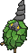

<!-- This file is generated by tools/generate_site.py. Edit the generator, not this file. -->

# #412 Burmy

{ .sprite-lg loading=lazy }

**Bagworm Pokémon**

Bug

[:material-arrow-left: #411 Bastiodon](411.md) · [Pokédex](index.md) · [#413 Wormadam :material-arrow-right:](413.md)

!!! info "Changes in Rising Ruby / Sinking Sapphire"

    - **Ability 2:** **Overcoat** 

## Location

[Route 104 North](../wild/route_104_north.md)

### Wild encounters

| Area | Method | Level | Note |
| --- | --- | --- | --- |
| [Route 104 North](../wild/route_104_north.md) | Grass | 10 |  |

## Type defenses

| Damage taken | Attacking types |
| --- | --- |
| Resistant (×½) | Fighting Ground Grass |
| Neutral (×1) | Normal Poison Bug Ghost Steel Water Electric Psychic Ice Dragon Dark Fairy |
| Weak (×2) | Flying Rock Fire |

## Abilities

| Slot | Ability | Effect | Note |
| --- | --- | --- | --- |
| Ability 1 | **Shed Skin** | Has a 33% chance of curing any major status ailment after each turn. |  |
| Ability 2 | **Overcoat** | Protects against damage from weather. | changed  |
| Hidden | **Overcoat** | Protects against damage from weather. |  |

## Base stats

| Form | HP | Atk | Def | SpA | SpD | Spe | BST |
| --- | --- | --- | --- | --- | --- | --- | --- |
| { .sprite-sm loading=lazy } Normal | 40 | 29 | 45 | 29 | 45 | 36 | **224** |

## Training & breeding

| Property | Value |
| --- | --- |
| EV yield | 1 SpD |
| Catch rate | 120 |
| Base friendship | 70 |
| Base experience | 45 |
| Growth rate | medium |
| Egg groups | Bug |
| Hatch counter | 15 |
| Gender ratio | 50% ♂ / 50% ♀ |
| Height / weight | 0.2 m / 3.4 kg |

## Evolution

- { .icon loading=lazy } **[Burmy](../pokemon/412.md)** → { .icon loading=lazy } [Wormadam](../pokemon/413.md): Lv. 20 (female only)
- { .icon loading=lazy } **[Burmy](../pokemon/412.md)** → { .icon loading=lazy } [Mothim](../pokemon/414.md): Lv. 20 (male only)

## Wild held items

None.

## Level-up moves { data-search-exclude }

Moves marked &#42; are not normally learned by level up (they come from egg moves, TMs/HMs or tutors in the official games); moves marked &#42;&#42; cannot normally be learned by this Pokémon at all and are omitted from the legal-moves version of the hack.

| Lv. | Move | Type | Cat. | Power | Acc. | PP | Effect | Note |
| --- | --- | --- | --- | --- | --- | --- | --- | --- |
| 1 | Protect | Normal | Status | — | — | 10 | Prevents any moves from hitting the user this turn. |  |
| 1 | Tackle | Normal | Physical | 50 | 100% | 35 | Inflicts regular damage with no additional effect. |  |
| 1 | Bug Bite | Bug | Physical | 60 | 100% | 20 | If target has a berry, inflicts double damage and uses the berry. |  |
| 1 | Electroweb | Electric | Special | 55 | 95% | 15 | Lowers the target’s Speed by one stage. | &#42; |
| 15 | Hidden Power | Normal | Special | 60 | 100% | 15 | Power and type depend upon user’s IVs.  Power can range from 30 to 70. |  |

## TM & HM moves { data-search-exclude }

| Machine | Move | Type | Cat. | Power | Acc. | PP | Effect |
| --- | --- | --- | --- | --- | --- | --- | --- |
| TM10 | Hidden Power | Normal | Special | 60 | 100% | 15 | Power and type depend upon user’s IVs.  Power can range from 30 to 70. |
| TM17 | Protect | Normal | Status | — | — | 10 | Prevents any moves from hitting the user this turn. |

## Move tutor moves { data-search-exclude }

| Move | Type | Cat. | Power | Acc. | PP | Effect |
| --- | --- | --- | --- | --- | --- | --- |
| Bug Bite | Bug | Physical | 60 | 100% | 20 | If target has a berry, inflicts double damage and uses the berry. |
| Electroweb | Electric | Special | 55 | 95% | 15 | Lowers the target’s Speed by one stage. |
| Snore | Normal | Special | 50 | 100% | 15 | Has a chance to make the target flinch.  Only works if the user is sleeping. |

## Egg moves { data-search-exclude }

No egg moves.

??? note "Trainers using Burmy (1)"

    | Area | Trainer | Level |
    | --- | --- | --- |
    | [Route 116](../trainers/route_116.md#trainers) | Bug Catcher Jose | Lv. 11 |

---

[:material-arrow-left: #411 Bastiodon](411.md) · [#413 Wormadam :material-arrow-right:](413.md)
