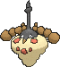
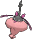

<!-- This file is generated by tools/generate_site.py. Edit the generator, not this file. -->

# #413 Wormadam

{ .sprite-lg loading=lazy }

**Bagworm Pokémon**

Bug Grass

[:material-arrow-left: #412 Burmy](412.md) · [Pokédex](index.md) · [#414 Mothim :material-arrow-right:](414.md)

!!! info "Changes in Rising Ruby / Sinking Sapphire"

    - **Ability 2:** **Overcoat** 
    - **Base stats:** HP 60 → **80**, Atk 59 → **50**, Def 85 → **100**, SpA 79 → **90**, SpD 105 → **110**, Spe 36 → **30** (BST 424 → **460**)
    - **Base stats (Sandy Wormadam):** HP 60 → **80**, Atk 79 → **90**, Def 105 → **110**, SpA 59 → **50**, SpD 85 → **100**, Spe 36 → **30** (BST 424 → **460**)
    - **Base stats (Trash Wormadam):** HP 60 → **80**, Atk 69 → **70**, Def 95 → **105**, SpA 69 → **70**, SpD 95 → **105**, Spe 36 → **30** (BST 424 → **460**)

## Location

[Safari Zone](../wild/safari_zone_1.md)

### Wild encounters

| Area | Method | Level | Note |
| --- | --- | --- | --- |
| [Safari Zone (1)](../wild/safari_zone_1.md) | Grass | 45 |  |

## Type defenses

| Damage taken | Attacking types |
| --- | --- |
| Very resistant (×¼) | Ground Grass |
| Resistant (×½) | Fighting Water Electric |
| Neutral (×1) | Normal Ghost Steel Psychic Dragon Dark Fairy |
| Weak (×2) | Poison Rock Bug Ice |
| Very weak (×4) | Flying Fire |

## Abilities

| Slot | Ability | Effect | Note |
| --- | --- | --- | --- |
| Ability 1 | **Anticipation** | Notifies all trainers upon entering battle if an opponent has a super-effective move, Self-Destruct, Explosion, or a one-hit KO move. |  |
| Ability 2 | **Overcoat** | Protects against damage from weather. | changed  |
| Hidden | **Overcoat** | Protects against damage from weather. |  |

## Base stats

| Form | HP | Atk | Def | SpA | SpD | Spe | BST |
| --- | --- | --- | --- | --- | --- | --- | --- |
| { .sprite-sm loading=lazy } Normal | 80<small class="was">was 60</small> | 50<small class="was">was 59</small> | 100<small class="was">was 85</small> | 90<small class="was">was 79</small> | 110<small class="was">was 105</small> | 30<small class="was">was 36</small> | 460<small class="was">was 424</small> |
| { .sprite-sm loading=lazy } Sandy Wormadam | 80<small class="was">was 60</small> | 90<small class="was">was 79</small> | 110<small class="was">was 105</small> | 50<small class="was">was 59</small> | 100<small class="was">was 85</small> | 30<small class="was">was 36</small> | 460<small class="was">was 424</small> |
| { .sprite-sm loading=lazy } Trash Wormadam | 80<small class="was">was 60</small> | 70<small class="was">was 69</small> | 105<small class="was">was 95</small> | 70<small class="was">was 69</small> | 105<small class="was">was 95</small> | 30<small class="was">was 36</small> | 460<small class="was">was 424</small> |

## Training & breeding

| Property | Value |
| --- | --- |
| EV yield | 2 SpD |
| Catch rate | 45 |
| Base friendship | 70 |
| Base experience | 148 |
| Growth rate | medium |
| Egg groups | Bug |
| Hatch counter | 15 |
| Gender ratio | 0% ♂ / 100% ♀ |
| Height / weight | 0.5 m / 6.5 kg |

## Evolution

- { .icon loading=lazy } [Burmy](../pokemon/412.md) → { .icon loading=lazy } **[Wormadam](../pokemon/413.md)**: Lv. 20 (female only)
- { .icon loading=lazy } [Burmy](../pokemon/412.md) → { .icon loading=lazy } [Mothim](../pokemon/414.md): Lv. 20 (male only)

## Wild held items

| Item | Chance | Note |
| --- | --- | --- |
| { .item loading=lazy } Silver Powder | 5% |  |

## Level-up moves { data-search-exclude }

Moves marked &#42; are not normally learned by level up (they come from egg moves, TMs/HMs or tutors in the official games); moves marked &#42;&#42; cannot normally be learned by this Pokémon at all and are omitted from the legal-moves version of the hack.

=== "Plant Cloak"

    | Lv. | Move | Type | Cat. | Power | Acc. | PP | Effect | Note |
    | --- | --- | --- | --- | --- | --- | --- | --- | --- |
    | 1 | Protect | Normal | Status | — | — | 10 | Prevents any moves from hitting the user this turn. |  |
    | 1 | Tackle | Normal | Physical | 50 | 100% | 35 | Inflicts regular damage with no additional effect. |  |
    | 1 | Bug Bite | Bug | Physical | 60 | 100% | 20 | If target has a berry, inflicts double damage and uses the berry. |  |
    | 1 | Electroweb | Electric | Special | 55 | 95% | 15 | Lowers the target’s Speed by one stage. | &#42; |
    | 15 | Hidden Power | Normal | Special | 60 | 100% | 15 | Power and type depend upon user’s IVs.  Power can range from 30 to 70. |  |
    | 20 | Confusion | Psychic | Special | 50 | 100% | 25 | Has a chance to confuse the target. |  |
    | 20 | Razor Leaf | Grass | Physical | 55 | 95% | 25 | Has an increased chance for a critical hit. |  |
    | 23 | Signal Beam | Bug | Special | 75 | 100% | 15 | Has a chance to confuse the target. | &#42; |
    | 26 | Giga Drain | Grass | Special | 75 | 100% | 10 | Drains half the damage inflicted to heal the user. | &#42; |
    | 29 | Growth | Normal | Status | — | — | 20 | Raises the user’s Attack and Special Attack by one stage. |  |
    | 32 | Psybeam | Psychic | Special | 65 | 100% | 20 | Has a chance to confuse the target. |  |
    | 35 | Energy Ball | Grass | Special | 90 | 100% | 10 | Has a chance to lower the target’s Special Defense by one stage. | &#42; |
    | 38 | Bug Buzz | Bug | Special | 90 | 100% | 10 | Has a chance to lower the target’s Special Defense by one stage. | &#42;&#42; |
    | 41 | Captivate | Normal | Status | — | 100% | 20 | Lowers the target’s Special Attack by two stages if it’s the opposite gender. |  |
    | 44 | Flail | Normal | Physical | — | 100% | 15 | Inflicts more damage when the user has less HP remaining, with a maximum of 200 power. |  |
    | 47 | Attract | Normal | Status | — | 100% | 15 | Target falls in love if it has the opposite gender, and has a 50% chance to refuse attacking the user. |  |
    | 50 | Psychic | Psychic | Special | 90 | 100% | 10 | Has a chance to lower the target’s Special Defense by one stage. |  |
    | 53 | Leaf Storm | Grass | Special | 130 | 90% | 5 | Lowers the user’s Special Attack by two stages after inflicting damage. |  |

=== "Sandy Cloak"

    | Lv. | Move | Type | Cat. | Power | Acc. | PP | Effect | Note |
    | --- | --- | --- | --- | --- | --- | --- | --- | --- |
    | 1 | Protect | Normal | Status | — | — | 10 | Prevents any moves from hitting the user this turn. |  |
    | 1 | Tackle | Normal | Physical | 50 | 100% | 35 | Inflicts regular damage with no additional effect. |  |
    | 1 | Bug Bite | Bug | Physical | 60 | 100% | 20 | If target has a berry, inflicts double damage and uses the berry. |  |
    | 1 | Electroweb | Electric | Special | 55 | 95% | 15 | Lowers the target’s Speed by one stage. | &#42; |
    | 15 | Hidden Power | Normal | Special | 60 | 100% | 15 | Power and type depend upon user’s IVs.  Power can range from 30 to 70. |  |
    | 20 | Confusion | Psychic | Special | 50 | 100% | 25 | Has a chance to confuse the target. |  |
    | 20 | Rock Blast | Rock | Physical | 25 | 90% | 10 | Hits 2-5 times in one turn. |  |
    | 23 | [Steamroller](../changes/moves.md#steamroller) changed | Bug | Physical | 85 | 90% | 10 | Has a chance to make the target flinch. | &#42; |
    | 26 | Bulldoze | Ground | Physical | 60 | 100% | 20 | Has a chance to lower the target’s Speed by one stage. | &#42; |
    | 29 | Harden | Normal | Status | — | — | 30 | Raises the user’s Defense by one stage. |  |
    | 32 | Psybeam | Psychic | Special | 65 | 100% | 20 | Has a chance to confuse the target. |  |
    | 35 | Earthquake | Ground | Physical | 100 | 100% | 10 | Inflicts regular damage and can hit Dig users. | &#42; |
    | 38 | Megahorn | Bug | Physical | 120 | 85% | 10 | Inflicts regular damage with no additional effect. | &#42;&#42; |
    | 41 | Captivate | Normal | Status | — | 100% | 20 | Lowers the target’s Special Attack by two stages if it’s the opposite gender. |  |
    | 44 | Flail | Normal | Physical | — | 100% | 15 | Inflicts more damage when the user has less HP remaining, with a maximum of 200 power. |  |
    | 47 | Attract | Normal | Status | — | 100% | 15 | Target falls in love if it has the opposite gender, and has a 50% chance to refuse attacking the user. |  |
    | 50 | Psychic | Psychic | Special | 90 | 100% | 10 | Has a chance to lower the target’s Special Defense by one stage. |  |
    | 53 | Fissure | Ground | Physical | — | 30% | 5 | Causes a one-hit KO. |  |

=== "Trash Cloak"

    | Lv. | Move | Type | Cat. | Power | Acc. | PP | Effect | Note |
    | --- | --- | --- | --- | --- | --- | --- | --- | --- |
    | 1 | Protect | Normal | Status | — | — | 10 | Prevents any moves from hitting the user this turn. |  |
    | 1 | Tackle | Normal | Physical | 50 | 100% | 35 | Inflicts regular damage with no additional effect. |  |
    | 1 | Bug Bite | Bug | Physical | 60 | 100% | 20 | If target has a berry, inflicts double damage and uses the berry. |  |
    | 1 | Electroweb | Electric | Special | 55 | 95% | 15 | Lowers the target’s Speed by one stage. | &#42; |
    | 15 | Hidden Power | Normal | Special | 60 | 100% | 15 | Power and type depend upon user’s IVs.  Power can range from 30 to 70. |  |
    | 20 | Confusion | Psychic | Special | 50 | 100% | 25 | Has a chance to confuse the target. |  |
    | 20 | Mirror Shot | Steel | Special | 65 | 85% | 10 | Has a chance to lower the target’s accuracy by one stage. |  |
    | 23 | Signal Beam | Bug | Special | 75 | 100% | 15 | Has a chance to confuse the target. | &#42; |
    | 26 | Gyro Ball | Steel | Physical | — | 100% | 5 | Power raises when the user has lower Speed, up to a maximum of 150. | &#42; |
    | 29 | Metal Sound | Steel | Status | — | 85% | 40 | Lowers the target’s Special Defense by two stages. |  |
    | 32 | Psybeam | Psychic | Special | 65 | 100% | 20 | Has a chance to confuse the target. |  |
    | 35 | Flash Cannon | Steel | Special | 80 | 100% | 10 | Has a chance to lower the target’s Special Defense by one stage. | &#42; |
    | 38 | Bug Buzz | Bug | Special | 90 | 100% | 10 | Has a chance to lower the target’s Special Defense by one stage. | &#42;&#42; |
    | 41 | Captivate | Normal | Status | — | 100% | 20 | Lowers the target’s Special Attack by two stages if it’s the opposite gender. |  |
    | 44 | Flail | Normal | Physical | — | 100% | 15 | Inflicts more damage when the user has less HP remaining, with a maximum of 200 power. |  |
    | 47 | Attract | Normal | Status | — | 100% | 15 | Target falls in love if it has the opposite gender, and has a 50% chance to refuse attacking the user. |  |
    | 50 | Psychic | Psychic | Special | 90 | 100% | 10 | Has a chance to lower the target’s Special Defense by one stage. |  |
    | 53 | Iron Head | Steel | Physical | 80 | 100% | 15 | Has a chance to make the target flinch. |  |

## TM & HM moves { data-search-exclude }

| Machine | Move | Type | Cat. | Power | Acc. | PP | Effect |
| --- | --- | --- | --- | --- | --- | --- | --- |
| TM06 | Toxic | Poison | Status | — | 90% | 10 | Badly poisons the target, inflicting more damage every turn. |
| TM09 | Venoshock | Poison | Special | 65 | 100% | 10 | Inflicts double damage if the target is Poisoned. |
| TM10 | Hidden Power | Normal | Special | 60 | 100% | 15 | Power and type depend upon user’s IVs.  Power can range from 30 to 70. |
| TM100 | Confide | Normal | Status | — | — | 20 | Lowers the target’s Special Attack by one stage. |
| TM11 | Sunny Day | Fire | Status | — | — | 5 | Changes the weather to sunny for five turns. |
| TM15 | Hyper Beam | Normal | Special | 150 | 90% | 5 | User foregoes its next turn to recharge. |
| TM17 | Protect | Normal | Status | — | — | 10 | Prevents any moves from hitting the user this turn. |
| TM18 | Rain Dance | Water | Status | — | — | 5 | Changes the weather to rain for five turns. |
| TM20 | Safeguard | Normal | Status | — | — | 25 | Protects the user’s field from major status ailments and confusion for five turns. |
| TM21 | Frustration | Normal | Physical | — | 100% | 20 | Power increases as happiness decreases, up to a maximum of 102. |
| TM22 | Solar Beam | Grass | Special | 120 | 100% | 10 | Requires a turn to charge before attacking. |
| TM27 | Return | Normal | Physical | — | 100% | 20 | Power increases with happiness, up to a maximum of 102. |
| TM29 | Psychic | Psychic | Special | 90 | 100% | 10 | Has a chance to lower the target’s Special Defense by one stage. |
| TM30 | Shadow Ball | Ghost | Special | 80 | 100% | 15 | Has a chance to lower the target’s Special Defense by one stage. |
| TM32 | Double Team | Normal | Status | — | — | 15 | Raises the user’s evasion by one stage. |
| TM42 | Facade | Normal | Physical | 70 | 100% | 20 | Power doubles if user is burned, paralyzed, or poisoned. |
| TM44 | Rest | Psychic | Status | — | — | 5 | User sleeps for two turns, completely healing itself. |
| TM45 | Attract | Normal | Status | — | 100% | 15 | Target falls in love if it has the opposite gender, and has a 50% chance to refuse attacking the user. |
| TM46 | Thief | Dark | Physical | 60 | 100% | 25 | Takes the target’s item. |
| TM48 | Round | Normal | Special | 60 | 100% | 15 | Has double power if it’s used more than once per turn. |
| TM53 | Energy Ball | Grass | Special | 90 | 100% | 10 | Has a chance to lower the target’s Special Defense by one stage. |
| TM68 | Giga Impact | Normal | Physical | 150 | 90% | 5 | User foregoes its next turn to recharge. |
| TM70 | Flash | Normal | Status | — | 100% | 20 | Lowers the target’s accuracy by one stage. |
| TM76 | Struggle Bug | Bug | Special | 50 | 100% | 20 | Has a chance to lower the target’s Special Attack by one stage. |
| TM77 | Psych Up | Normal | Status | — | — | 10 | Discards the user’s stat changes and copies the target’s. |
| TM83 | Infestation | Bug | Special | 20 | 100% | 20 | Prevents the target from fleeing and inflicts damage for 2-5 turns. |
| TM85 | Dream Eater | Psychic | Special | 100 | 100% | 15 | Only works on sleeping Pokémon.  Drains half the damage inflicted to heal the user. |
| TM86 | Grass Knot | Grass | Special | — | 100% | 20 | Inflicts more damage to heavier targets, with a maximum of 120 power. |
| TM87 | Swagger | Normal | Status | — | 90% | 15 | Raises the target’s Attack by two stages and confuses the target. |
| TM88 | Sleep Talk | Normal | Status | — | — | 10 | Randomly uses one of the user’s other three moves.  Only works if the user is sleeping. |
| TM90 | Substitute | Normal | Status | — | — | 10 | Transfers 1/4 of the user’s max HP into a doll, protecting the user from further damage or status changes until it breaks. |
| TM94 | Secret Power | Normal | Physical | 70 | 100% | 20 | Has a chance to inflict a status effect which depends upon the terrain. |

## Move tutor moves { data-search-exclude }

| Move | Type | Cat. | Power | Acc. | PP | Effect |
| --- | --- | --- | --- | --- | --- | --- |
| Bug Bite | Bug | Physical | 60 | 100% | 20 | If target has a berry, inflicts double damage and uses the berry. |
| Electroweb | Electric | Special | 55 | 95% | 15 | Lowers the target’s Speed by one stage. |
| Endeavor | Normal | Physical | — | 100% | 5 | Lowers the target’s HP to equal the user’s. |
| Giga Drain | Grass | Special | 75 | 100% | 10 | Drains half the damage inflicted to heal the user. |
| Seed Bomb | Grass | Physical | 80 | 100% | 15 | Inflicts regular damage with no additional effect. |
| Signal Beam | Bug | Special | 75 | 100% | 15 | Has a chance to confuse the target. |
| Skill Swap | Psychic | Status | — | — | 10 | User and target swap abilities. |
| Snore | Normal | Special | 50 | 100% | 15 | Has a chance to make the target flinch.  Only works if the user is sleeping. |
| Synthesis | Grass | Status | — | — | 5 | Heals the user by half its max HP.  Affected by weather. |
| Uproar | Normal | Special | 90 | 100% | 10 | Forced to use this move for several turns.  Pokémon cannot fall asleep in that time. |
| Worry Seed | Grass | Status | — | 100% | 10 | Changes the target’s ability to Insomnia. |

## Egg moves { data-search-exclude }

No egg moves.

??? note "Trainers using Wormadam (1)"

    | Area | Trainer | Level |
    | --- | --- | --- |
    | [Route 119 (Mauville)](../trainers/route_119_mauville.md#trainers) | Bug Catcher Kent | Lv. 39 |

---

[:material-arrow-left: #412 Burmy](412.md) · [#414 Mothim :material-arrow-right:](414.md)
