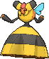

<!-- This file is generated by tools/generate_site.py. Edit the generator, not this file. -->

# #416 Vespiquen

{ .sprite-lg loading=lazy }

**Beehive Pokémon**

Bug Flying

[:material-arrow-left: #415 Combee](415.md) · [Pokédex](index.md) · [#417 Pachirisu :material-arrow-right:](417.md)

!!! info "Changes in Rising Ruby / Sinking Sapphire"

    - **Ability 2:** **Unnerve** 
    - **New TM/HM compatibility:** [Fly](../changes/moves.md#fly) changed

## Location

[Route 104 North](../wild/route_104_north.md)

### Wild encounters

| Area | Method | Level | Note |
| --- | --- | --- | --- |
| [Route 104 North](../wild/route_104_north.md) | DexNav | 50 |  |

## Type defenses

| Damage taken | Attacking types |
| --- | --- |
| Immune (×0) | Ground |
| Very resistant (×¼) | Fighting Grass |
| Resistant (×½) | Bug |
| Neutral (×1) | Normal Poison Ghost Steel Water Psychic Dragon Dark Fairy |
| Weak (×2) | Flying Fire Electric Ice |
| Very weak (×4) | Rock |

## Abilities

| Slot | Ability | Effect | Note |
| --- | --- | --- | --- |
| Ability 1 | **Pressure** | Increases the PP cost of moves targetting the Pokémon by one. |  |
| Ability 2 | **Unnerve** | Prevents opposing Pokémon from eating held Berries. | changed  |
| Hidden | **Unnerve** | Prevents opposing Pokémon from eating held Berries. |  |

## Base stats

| Form | HP | Atk | Def | SpA | SpD | Spe | BST |
| --- | --- | --- | --- | --- | --- | --- | --- |
| { .sprite-sm loading=lazy } Normal | 70 | 80 | 102 | 80 | 102 | 40 | **474** |

## Training & breeding

| Property | Value |
| --- | --- |
| EV yield | 1 Def, 1 SpD |
| Catch rate | 45 |
| Base friendship | 70 |
| Base experience | 166 |
| Growth rate | medium slow |
| Egg groups | Bug |
| Hatch counter | 15 |
| Gender ratio | 0% ♂ / 100% ♀ |
| Height / weight | 1.2 m / 38.5 kg |

## Evolution

- { .icon loading=lazy } [Combee](../pokemon/415.md) → { .icon loading=lazy } **[Vespiquen](../pokemon/416.md)**: Lv. 21 (female only)

## Wild held items

| Item | Chance | Note |
| --- | --- | --- |
| { .item loading=lazy } Poison Barb | 5% |  |

## Level-up moves { data-search-exclude }

Moves marked &#42; are not normally learned by level up (they come from egg moves, TMs/HMs or tutors in the official games); moves marked &#42;&#42; cannot normally be learned by this Pokémon at all and are omitted from the legal-moves version of the hack.

| Lv. | Move | Type | Cat. | Power | Acc. | PP | Effect | Note |
| --- | --- | --- | --- | --- | --- | --- | --- | --- |
| 1 | Fell Stinger | Bug | Physical | 30 | 100% | 25 | Raises the user’s Attack by two stages if it KOs the target. |  |
| 1 | Destiny Bond | Ghost | Status | — | — | 5 | If the user faints this turn, the target automatically will, too. |  |
| 1 | Sweet Scent | Normal | Status | — | 100% | 20 | Lowers the target’s evasion by one stage. |  |
| 1 | Gust | Flying | Special | 40 | 100% | 35 | Inflicts regular damage and can hit Pokémon in the air. |  |
| 1 | Poison Sting | Poison | Physical | 15 | 100% | 35 | Has a chance to poison the target. |  |
| 1 | Confuse Ray | Ghost | Status | — | 100% | 10 | Confuses the target. |  |
| 5 | Fury Cutter | Bug | Physical | 40 | 95% | 20 | Power doubles every turn this move is used in succession after the first, maxing out after five turns. |  |
| 9 | Pursuit | Dark | Physical | 40 | 100% | 20 | Has double power against, and can hit, Pokémon attempting to switch out. |  |
| 13 | Fury Swipes | Normal | Physical | 18 | 80% | 15 | Hits 2-5 times in one turn. |  |
| 17 | Air Cutter | Flying | Special | 60 | 95% | 25 | Has an increased chance for a critical hit. | &#42; |
| 21 | Attack Order | Bug | Physical | 90 | 100% | 15 | Has an increased chance for a critical hit. |  |
| 21 | Defend Order | Bug | Status | — | — | 10 | Raises the user’s Defense and Special Defense by one stage. |  |
| 21 | Heal Order | Bug | Status | — | — | 10 | Heals the user by half its max HP. |  |
| 25 | [Power Gem](../changes/moves.md#power-gem) changed | Rock | Special | 90 | 100% | 10 | Inflicts regular damage with no additional effect. |  |
| 29 | Slash | Normal | Physical | 70 | 100% | 20 | Has an increased chance for a critical hit. |  |
| 33 | Air Slash | Flying | Special | 75 | 95% | 15 | Has a chance to make the target flinch. |  |
| 37 | Toxic | Poison | Status | — | 90% | 10 | Badly poisons the target, inflicting more damage every turn. |  |
| 41 | Captivate | Normal | Status | — | 100% | 20 | Lowers the target’s Special Attack by two stages if it’s the opposite gender. |  |
| 45 | Swagger | Normal | Status | — | 90% | 15 | Raises the target’s Attack by two stages and confuses the target. |  |
| 49 | Destiny Bond | Ghost | Status | — | — | 5 | If the user faints this turn, the target automatically will, too. |  |
| 53 | Fell Stinger | Bug | Physical | 30 | 100% | 25 | Raises the user’s Attack by two stages if it KOs the target. |  |

## TM & HM moves { data-search-exclude }

| Machine | Move | Type | Cat. | Power | Acc. | PP | Effect |
| --- | --- | --- | --- | --- | --- | --- | --- |
| HM01 | [Cut](../changes/moves.md#cut) changed | Grass | Physical | 70 | 100% | 15 | High Critical Rate. High Critical Rate |
| HM02 new | [Fly](../changes/moves.md#fly) changed | Flying | Physical | 100 | 100% | 10 | User flies high into the air, dodging all attacks, and hits next turn. |
| TM01 | Hone Claws | Dark | Status | — | — | 15 | Raises the user’s Attack and accuracy by one stage. |
| TM06 | Toxic | Poison | Status | — | 90% | 10 | Badly poisons the target, inflicting more damage every turn. |
| TM09 | Venoshock | Poison | Special | 65 | 100% | 10 | Inflicts double damage if the target is Poisoned. |
| TM10 | Hidden Power | Normal | Special | 60 | 100% | 15 | Power and type depend upon user’s IVs.  Power can range from 30 to 70. |
| TM100 | Confide | Normal | Status | — | — | 20 | Lowers the target’s Special Attack by one stage. |
| TM11 | Sunny Day | Fire | Status | — | — | 5 | Changes the weather to sunny for five turns. |
| TM15 | Hyper Beam | Normal | Special | 150 | 90% | 5 | User foregoes its next turn to recharge. |
| TM17 | Protect | Normal | Status | — | — | 10 | Prevents any moves from hitting the user this turn. |
| TM18 | Rain Dance | Water | Status | — | — | 5 | Changes the weather to rain for five turns. |
| TM19 | Roost | Flying | Status | — | — | 5 | Heals the user by half its max HP. |
| TM21 | Frustration | Normal | Physical | — | 100% | 20 | Power increases as happiness decreases, up to a maximum of 102. |
| TM27 | Return | Normal | Physical | — | 100% | 20 | Power increases with happiness, up to a maximum of 102. |
| TM32 | Double Team | Normal | Status | — | — | 15 | Raises the user’s evasion by one stage. |
| TM36 | Sludge Bomb | Poison | Special | 90 | 100% | 10 | Has a chance to poison the target. |
| TM40 | Aerial Ace | Flying | Physical | 60 | — | 20 | Never misses. |
| TM42 | Facade | Normal | Physical | 70 | 100% | 20 | Power doubles if user is burned, paralyzed, or poisoned. |
| TM44 | Rest | Psychic | Status | — | — | 5 | User sleeps for two turns, completely healing itself. |
| TM45 | Attract | Normal | Status | — | 100% | 15 | Target falls in love if it has the opposite gender, and has a 50% chance to refuse attacking the user. |
| TM46 | Thief | Dark | Physical | 60 | 100% | 25 | Takes the target’s item. |
| TM48 | Round | Normal | Special | 60 | 100% | 15 | Has double power if it’s used more than once per turn. |
| TM56 | Fling | Dark | Physical | — | 100% | 10 | Throws held item at the target; power depends on the item. |
| TM60 | Quash | Dark | Status | — | 100% | 15 | Makes the target act last this turn. |
| TM62 | Acrobatics | Flying | Physical | 55 | 100% | 15 | Has double power if the user has no held item. |
| TM68 | Giga Impact | Normal | Physical | 150 | 90% | 5 | User foregoes its next turn to recharge. |
| TM70 | Flash | Normal | Status | — | 100% | 20 | Lowers the target’s accuracy by one stage. |
| TM76 | Struggle Bug | Bug | Special | 50 | 100% | 20 | Has a chance to lower the target’s Special Attack by one stage. |
| TM81 | X-Scissor | Bug | Physical | 80 | 100% | 15 | Inflicts regular damage with no additional effect. |
| TM83 | Infestation | Bug | Special | 20 | 100% | 20 | Prevents the target from fleeing and inflicts damage for 2-5 turns. |
| TM87 | Swagger | Normal | Status | — | 90% | 15 | Raises the target’s Attack by two stages and confuses the target. |
| TM88 | Sleep Talk | Normal | Status | — | — | 10 | Randomly uses one of the user’s other three moves.  Only works if the user is sleeping. |
| TM89 | U-turn | Bug | Physical | 70 | 100% | 20 | User must switch out after attacking. |
| TM90 | Substitute | Normal | Status | — | — | 10 | Transfers 1/4 of the user’s max HP into a doll, protecting the user from further damage or status changes until it breaks. |
| TM94 | Secret Power | Normal | Physical | 70 | 100% | 20 | Has a chance to inflict a status effect which depends upon the terrain. |

## Move tutor moves { data-search-exclude }

| Move | Type | Cat. | Power | Acc. | PP | Effect |
| --- | --- | --- | --- | --- | --- | --- |
| Bug Bite | Bug | Physical | 60 | 100% | 20 | If target has a berry, inflicts double damage and uses the berry. |
| Endeavor | Normal | Physical | — | 100% | 5 | Lowers the target’s HP to equal the user’s. |
| Signal Beam | Bug | Special | 75 | 100% | 15 | Has a chance to confuse the target. |
| Snore | Normal | Special | 50 | 100% | 15 | Has a chance to make the target flinch.  Only works if the user is sleeping. |
| Tailwind | Flying | Status | — | — | 15 | For three turns, friendly Pokémon have doubled Speed. |

## Egg moves { data-search-exclude }

No egg moves.

??? note "Trainers using Vespiquen (2)"

    | Area | Trainer | Level |
    | --- | --- | --- |
    | [Route 119 (Mauville)](../trainers/route_119_mauville.md#trainers) | Bug Maniac Taylor | Lv. 40 |
    | [Battle Resort](../trainers/battle_resort.md#trainers) | Leader Felix [Viola] | Lv. 77 |

---

[:material-arrow-left: #415 Combee](415.md) · [#417 Pachirisu :material-arrow-right:](417.md)
