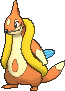

<!-- This file is generated by tools/generate_site.py. Edit the generator, not this file. -->

# #419 Floatzel

{ .sprite-lg loading=lazy }

**Sea Weasel Pokémon**

Water

[:material-arrow-left: #418 Buizel](418.md) · [Pokédex](index.md) · [#420 Cherubi :material-arrow-right:](420.md)

!!! info "Changes in Rising Ruby / Sinking Sapphire"

    - **Ability 2:** **Water Veil** 

## Location

[Route 103](../wild/route_103.md), [Route 120](../wild/route_120_fortree.md), [Scorched Slab](../wild/scorched_slab.md), [Victory Road](../wild/victory_road_1f.md)

### Wild encounters

| Area | Method | Level | Note |
| --- | --- | --- | --- |
| [Route 103](../wild/route_103.md) | Surfing | 25 - 35 |  |
| [Route 120 (Fortree)](../wild/route_120_fortree.md) | Surfing | 30 - 40 |  |
| [Scorched Slab Basement](../wild/scorched_slab_basement.md) | Surfing | 35 - 45 |  |
| [Route 120 South-West](../wild/route_120_south_west.md) | Surfing | 35 - 45 |  |
| [Victory Road 1F](../wild/victory_road_1f.md) | Surfing | 55 - 65 |  |
| [Victory Road B1F](../wild/victory_road_b1f.md) | Surfing | 55 - 65 |  |
| [Victory Road 2F](../wild/victory_road_2f.md) | Surfing | 55 - 65 |  |

## Type defenses

| Damage taken | Attacking types |
| --- | --- |
| Resistant (×½) | Steel Fire Water Ice |
| Neutral (×1) | Normal Fighting Flying Poison Ground Rock Bug Ghost Psychic Dragon Dark Fairy |
| Weak (×2) | Grass Electric |

## Abilities

| Slot | Ability | Effect | Note |
| --- | --- | --- | --- |
| Ability 1 | **Swift Swim** | Doubles Speed during rain. |  |
| Ability 2 | **Water Veil** | Prevents burns. | changed  |
| Hidden | **Water Veil** | Prevents burns. |  |

## Base stats

| Form | HP | Atk | Def | SpA | SpD | Spe | BST |
| --- | --- | --- | --- | --- | --- | --- | --- |
| { .sprite-sm loading=lazy } Normal | 85 | 105 | 55 | 85 | 50 | 115 | **495** |

## Training & breeding

| Property | Value |
| --- | --- |
| EV yield | 2 Spe |
| Catch rate | 75 |
| Base friendship | 70 |
| Base experience | 173 |
| Growth rate | medium |
| Egg groups | Water 1, Field |
| Hatch counter | 20 |
| Gender ratio | 50% ♂ / 50% ♀ |
| Height / weight | 1.1 m / 33.5 kg |

## Evolution

- { .icon loading=lazy } [Buizel](../pokemon/418.md) → { .icon loading=lazy } **[Floatzel](../pokemon/419.md)**: Lv. 26

## Wild held items

None.

## Level-up moves { data-search-exclude }

Moves marked &#42; are not normally learned by level up (they come from egg moves, TMs/HMs or tutors in the official games); moves marked &#42;&#42; cannot normally be learned by this Pokémon at all and are omitted from the legal-moves version of the hack.

| Lv. | Move | Type | Cat. | Power | Acc. | PP | Effect | Note |
| --- | --- | --- | --- | --- | --- | --- | --- | --- |
| 1 | Tail Slap | Normal | Physical | 25 | 85% | 10 | Hits 2-5 times in one turn. | &#42; |
| 1 | Ice Fang | Ice | Physical | 65 | 95% | 15 | Has a chance to freeze the target and a chance to make the target flinch. |  |
| 1 | Sonic Boom | Normal | Special | — | 90% | 20 | Inflicts 20 points of damage. |  |
| 4 | Growl | Normal | Status | — | 100% | 40 | Lowers the target’s Attack by one stage. |  |
| 7 | Water Sport | Water | Status | — | — | 15 | Halves all Fire-type damage. |  |
| 10 | Quick Attack | Normal | Physical | 40 | 100% | 30 | Inflicts regular damage with no additional effect. |  |
| 13 | Water Gun | Water | Special | 40 | 100% | 25 | Inflicts regular damage with no additional effect. |  |
| 16 | Pursuit | Dark | Physical | 40 | 100% | 20 | Has double power against, and can hit, Pokémon attempting to switch out. |  |
| 19 | Swift | Normal | Special | 60 | — | 20 | Never misses. |  |
| 22 | Headbutt | Normal | Physical | 70 | 100% | 15 | Has a chance to make the target flinch. | &#42; |
| 25 | Aqua Jet | Water | Physical | 40 | 100% | 20 | Inflicts regular damage with no additional effect. |  |
| 26 | Crunch | Dark | Physical | 80 | 100% | 15 | Has a chance to lower the target’s Defense by one stage. |  |
| 29 | Double Hit | Normal | Physical | 35 | 90% | 10 | Hits twice in one turn. |  |
| 33 | Aqua Tail | Water | Physical | 90 | 90% | 10 | Inflicts regular damage with no additional effect. |  |
| 37 | Whirlpool | Water | Special | 35 | 85% | 15 | Prevents the target from leaving battle and inflicts 1/16 its max HP in damage for 2-5 turns. |  |
| 41 | Razor Wind | Normal | Special | 80 | 100% | 10 | Requires a turn to charge before attacking. |  |
| 45 | Agility | Psychic | Status | — | — | 30 | Raises the user’s Speed by two stages. |  |
| 49 | Hydro Pump | Water | Special | 110 | 80% | 5 | Inflicts regular damage with no additional effect. |  |

## TM & HM moves { data-search-exclude }

| Machine | Move | Type | Cat. | Power | Acc. | PP | Effect |
| --- | --- | --- | --- | --- | --- | --- | --- |
| HM03 | Surf | Water | Special | 90 | 100% | 15 | Inflicts regular damage and can hit Dive users. |
| HM04 | [Strength](../changes/moves.md#strength) changed | Normal | Physical | 100 | 100% | 10 | Inflicts regular damage with no additional effect. |
| HM05 | Waterfall | Water | Physical | 80 | 100% | 15 | Has a chance to make the target flinch. |
| HM06 | [Rock Smash](../changes/moves.md#rock-smash) changed | Fighting | Physical | 65 | 100% | 15 | Has a chance to lower the target’s Defense by one stage. |
| HM07 | Dive | Water | Physical | 80 | 100% | 10 | User dives underwater, dodging all attacks, and hits next turn. |
| TM05 | Roar | Normal | Status | — | — | 20 | Immediately ends wild battles.  Forces trainers to switch Pokémon. |
| TM06 | Toxic | Poison | Status | — | 90% | 10 | Badly poisons the target, inflicting more damage every turn. |
| TM07 | Hail | Ice | Status | — | — | 10 | Changes the weather to a hailstorm for five turns. |
| TM08 | Bulk Up | Fighting | Status | — | — | 20 | Raises the user’s Attack and Defense by one stage. |
| TM10 | Hidden Power | Normal | Special | 60 | 100% | 15 | Power and type depend upon user’s IVs.  Power can range from 30 to 70. |
| TM100 | Confide | Normal | Status | — | — | 20 | Lowers the target’s Special Attack by one stage. |
| TM12 | Taunt | Dark | Status | — | 100% | 20 | For the next few turns, the target can only use damaging moves. |
| TM13 | Ice Beam | Ice | Special | 90 | 100% | 10 | Has a chance to freeze the target. |
| TM14 | Blizzard | Ice | Special | 110 | 70% | 5 | Has a chance to freeze the target. |
| TM15 | Hyper Beam | Normal | Special | 150 | 90% | 5 | User foregoes its next turn to recharge. |
| TM17 | Protect | Normal | Status | — | — | 10 | Prevents any moves from hitting the user this turn. |
| TM18 | Rain Dance | Water | Status | — | — | 5 | Changes the weather to rain for five turns. |
| TM21 | Frustration | Normal | Physical | — | 100% | 20 | Power increases as happiness decreases, up to a maximum of 102. |
| TM27 | Return | Normal | Physical | — | 100% | 20 | Power increases with happiness, up to a maximum of 102. |
| TM28 | Dig | Ground | Physical | 80 | 100% | 10 | User digs underground, dodging all attacks, and hits next turn. |
| TM31 | Brick Break | Fighting | Physical | 75 | 100% | 15 | Destroys Reflect and Light Screen. |
| TM32 | Double Team | Normal | Status | — | — | 15 | Raises the user’s evasion by one stage. |
| TM39 | Rock Tomb | Rock | Physical | 60 | 95% | 15 | Has a chance to lower the target’s Speed by one stage. |
| TM41 | Torment | Dark | Status | — | 100% | 15 | Prevents the target from using the same move twice in a row. |
| TM42 | Facade | Normal | Physical | 70 | 100% | 20 | Power doubles if user is burned, paralyzed, or poisoned. |
| TM44 | Rest | Psychic | Status | — | — | 5 | User sleeps for two turns, completely healing itself. |
| TM45 | Attract | Normal | Status | — | 100% | 15 | Target falls in love if it has the opposite gender, and has a 50% chance to refuse attacking the user. |
| TM48 | Round | Normal | Special | 60 | 100% | 15 | Has double power if it’s used more than once per turn. |
| TM49 | Echoed Voice | Normal | Special | 40 | 100% | 15 | Power increases by 100% for each consecutive use by any friendly Pokémon, to a maximum of 200. |
| TM52 | Focus Blast | Fighting | Special | 120 | 70% | 5 | Has a chance to lower the target’s Special Defense by one stage. |
| TM55 | Scald | Water | Special | 80 | 100% | 15 | Has a chance to burn the target. |
| TM66 | Payback | Dark | Physical | 50 | 100% | 10 | Power is doubled if the target has already moved this turn. |
| TM68 | Giga Impact | Normal | Physical | 150 | 90% | 5 | User foregoes its next turn to recharge. |
| TM87 | Swagger | Normal | Status | — | 90% | 15 | Raises the target’s Attack by two stages and confuses the target. |
| TM88 | Sleep Talk | Normal | Status | — | — | 10 | Randomly uses one of the user’s other three moves.  Only works if the user is sleeping. |
| TM90 | Substitute | Normal | Status | — | — | 10 | Transfers 1/4 of the user’s max HP into a doll, protecting the user from further damage or status changes until it breaks. |
| TM94 | Secret Power | Normal | Physical | 70 | 100% | 20 | Has a chance to inflict a status effect which depends upon the terrain. |
| TM98 | Power-Up Punch | Fighting | Physical | 40 | 100% | 20 | Raises the user’s Attack by one stage after inflicting damage. |

## Move tutor moves { data-search-exclude }

| Move | Type | Cat. | Power | Acc. | PP | Effect |
| --- | --- | --- | --- | --- | --- | --- |
| Aqua Tail | Water | Physical | 90 | 90% | 10 | Inflicts regular damage with no additional effect. |
| Focus Punch | Fighting | Physical | 150 | 100% | 20 | If the user takes damage before attacking, the attack is canceled. |
| Ice Punch | Ice | Physical | 75 | 100% | 15 | Has a chance to freeze the target. |
| Icy Wind | Ice | Special | 55 | 95% | 15 | Has a chance to lower the target’s Speed by one stage. |
| Iron Tail | Steel | Physical | 100 | 75% | 15 | Has a chance to lower the target’s Defense by one stage. |
| Low Kick | Fighting | Physical | — | 100% | 20 | Inflicts more damage to heavier targets, with a maximum of 120 power. |
| Snore | Normal | Special | 50 | 100% | 15 | Has a chance to make the target flinch.  Only works if the user is sleeping. |
| Water Pulse | Water | Special | 60 | 100% | 20 | Has a chance to confuse the target. |

## Egg moves { data-search-exclude }

No egg moves.

??? note "Trainers using Floatzel (13)"

    | Area | Trainer | Level |
    | --- | --- | --- |
    | [Route 109](../trainers/route_109.md#trainers) | Tuber Carmen | Lv. 37 |
    | [Route 109](../trainers/route_109.md#rematches) | Tuber Ricky (4) | Lv. 35 |
    | [Route 109](../trainers/route_109.md#rematches) | Tuber Ricky (6) | Lv. 47 |
    | [Route 109](../trainers/route_109.md#rematches) | Tuber Ricky (7) | Lv. 59 |
    | [Route 109](../trainers/route_109.md#rematches) | Tuber Ricky (C) | Lv. 75 |
    | [Route 105](../trainers/route_105.md#trainers) | Swimmer Luis | Lv. 37 |
    | [Route 125](../trainers/route_125.md#trainers) | Swimmer Tanya | Lv. 55 |
    | [Route 127](../trainers/route_127.md#trainers) | Triathlete Jaylon | Lv. 56 |
    | [Route 128](../trainers/route_128.md#rematches) | Triathlete Isaiah (7) | Lv. 59 |
    | [Route 128](../trainers/route_128.md#rematches) | Triathlete Isaiah (8) | Lv. 64 |
    | [Route 128](../trainers/route_128.md#rematches) | Triathlete Isaiah (C) | Lv. 75 |
    | [Sootopolis Gym](../trainers/sootopolis_gym.md#trainers) | Beauty Olivia | Lv. 62 |
    | [S.S Tidal](../trainers/s_s_tidal.md#trainers) | Sailor Leonard | Lv. 75 |

---

[:material-arrow-left: #418 Buizel](418.md) · [#420 Cherubi :material-arrow-right:](420.md)
