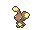

<!-- This file is generated by tools/generate_site.py. Edit the generator, not this file. -->

# #427 Buneary

{ .sprite-lg loading=lazy }

**Rabbit Pokémon**

Normal

[:material-arrow-left: #426 Drifblim](426.md) · [Pokédex](index.md) · [#428 Lopunny :material-arrow-right:](428.md)

!!! info "Changes in Rising Ruby / Sinking Sapphire"

    - **Base friendship:** 0 → **140**

## Location

[Route 104 North](../wild/route_104_north.md)

### Wild encounters

| Area | Method | Level | Note |
| --- | --- | --- | --- |
| [Route 104 North](../wild/route_104_north.md) | Grass | 10 |  |

## Type defenses

| Damage taken | Attacking types |
| --- | --- |
| Immune (×0) | Ghost |
| Neutral (×1) | Normal Flying Poison Ground Rock Bug Steel Fire Water Grass Electric Psychic Ice Dragon Dark Fairy |
| Weak (×2) | Fighting |

## Abilities

| Slot | Ability | Effect | Note |
| --- | --- | --- | --- |
| Ability 1 | **Run Away** | Ensures success fleeing from wild battles. |  |
| Ability 2 | **Klutz** | Prevents the Pokémon from using its held item in battle. |  |
| Hidden | **Limber** | Prevents paralysis. |  |

## Base stats

| Form | HP | Atk | Def | SpA | SpD | Spe | BST |
| --- | --- | --- | --- | --- | --- | --- | --- |
| { .sprite-sm loading=lazy } Normal | 55 | 66 | 44 | 44 | 56 | 85 | **350** |

## Training & breeding

| Property | Value |
| --- | --- |
| EV yield | 1 Spe |
| Catch rate | 190 |
| Base friendship | 140 changed (was 0) |
| Base experience | 70 |
| Growth rate | medium |
| Egg groups | Field, Human-Like |
| Hatch counter | 20 |
| Gender ratio | 50% ♂ / 50% ♀ |
| Height / weight | 0.4 m / 5.5 kg |

## Evolution

- { .icon loading=lazy } **[Buneary](../pokemon/427.md)** → { .icon loading=lazy } [Lopunny](../pokemon/428.md): Happiness

## Wild held items

None.

## Level-up moves { data-search-exclude }

Moves marked &#42; are not normally learned by level up (they come from egg moves, TMs/HMs or tutors in the official games); moves marked &#42;&#42; cannot normally be learned by this Pokémon at all and are omitted from the legal-moves version of the hack.

| Lv. | Move | Type | Cat. | Power | Acc. | PP | Effect | Note |
| --- | --- | --- | --- | --- | --- | --- | --- | --- |
| 1 | Defense Curl | Normal | Status | — | — | 40 | Raises user’s Defense by one stage. |  |
| 1 | Splash | Normal | Status | — | — | 40 | Does nothing. |  |
| 1 | [Pound](../changes/moves.md#pound) changed | Normal | Physical | 50 | 100% | 35 | Inflicts regular damage with no additional effect. |  |
| 1 | Foresight | Normal | Status | — | — | 40 | Forces the target to have no Evade, and allows it to be hit by Normal and Fighting moves even if it’s a Ghost. |  |
| 5 | Endure | Normal | Status | — | — | 10 | Prevents the user’s HP from lowering below 1 this turn. |  |
| 8 | Baby-Doll Eyes | Fairy | Status | — | 100% | 30 | Lowers the target’s Attack by one stage. |  |
| 11 | Frustration | Normal | Physical | — | 100% | 20 | Power increases as happiness decreases, up to a maximum of 102. |  |
| 14 | Quick Attack | Normal | Physical | 40 | 100% | 30 | Inflicts regular damage with no additional effect. |  |
| 17 | Jump Kick | Fighting | Physical | 100 | 95% | 10 | If the user misses, it takes half the damage it would have inflicted in recoil. |  |
| 20 | Baton Pass | Normal | Status | — | — | 40 | Allows the trainer to switch out the user and pass effects along to its replacement. |  |
| 23 | Dizzy Punch | Normal | Physical | 70 | 100% | 10 | Has a chance to confuse the target. |  |
| 26 | Agility | Psychic | Status | — | — | 30 | Raises the user’s Speed by two stages. |  |
| 29 | Bounce | Flying | Physical | 85 | 85% | 5 | User bounces high into the air, dodging all attacks, and hits next turn. |  |
| 32 | After You | Normal | Status | — | — | 15 | Makes the target act next this turn. |  |
| 35 | Charm | Fairy | Status | — | 100% | 20 | Lowers the target’s Attack by two stages. |  |
| 38 | Fake Out | Normal | Physical | 40 | 100% | 10 | Can only be used as the first move after the user enters battle.  Causes the target to flinch. |  |
| 41 | Entrainment | Normal | Status | — | 100% | 15 | Copies the user’s ability onto the target. |  |
| 44 | Healing Wish | Psychic | Status | — | — | 10 | User faints.  Its replacement has its HP fully restored and any major status effect removed. |  |

## TM & HM moves { data-search-exclude }

| Machine | Move | Type | Cat. | Power | Acc. | PP | Effect |
| --- | --- | --- | --- | --- | --- | --- | --- |
| HM01 | [Cut](../changes/moves.md#cut) changed | Grass | Physical | 70 | 100% | 15 | High Critical Rate. High Critical Rate |
| HM06 | [Rock Smash](../changes/moves.md#rock-smash) changed | Fighting | Physical | 65 | 100% | 15 | Has a chance to lower the target’s Defense by one stage. |
| TM06 | Toxic | Poison | Status | — | 90% | 10 | Badly poisons the target, inflicting more damage every turn. |
| TM10 | Hidden Power | Normal | Special | 60 | 100% | 15 | Power and type depend upon user’s IVs.  Power can range from 30 to 70. |
| TM100 | Confide | Normal | Status | — | — | 20 | Lowers the target’s Special Attack by one stage. |
| TM11 | Sunny Day | Fire | Status | — | — | 5 | Changes the weather to sunny for five turns. |
| TM13 | Ice Beam | Ice | Special | 90 | 100% | 10 | Has a chance to freeze the target. |
| TM17 | Protect | Normal | Status | — | — | 10 | Prevents any moves from hitting the user this turn. |
| TM18 | Rain Dance | Water | Status | — | — | 5 | Changes the weather to rain for five turns. |
| TM21 | Frustration | Normal | Physical | — | 100% | 20 | Power increases as happiness decreases, up to a maximum of 102. |
| TM22 | Solar Beam | Grass | Special | 120 | 100% | 10 | Requires a turn to charge before attacking. |
| TM24 | Thunderbolt | Electric | Special | 90 | 100% | 15 | Has a chance to paralyze the target. |
| TM27 | Return | Normal | Physical | — | 100% | 20 | Power increases with happiness, up to a maximum of 102. |
| TM28 | Dig | Ground | Physical | 80 | 100% | 10 | User digs underground, dodging all attacks, and hits next turn. |
| TM30 | Shadow Ball | Ghost | Special | 80 | 100% | 15 | Has a chance to lower the target’s Special Defense by one stage. |
| TM32 | Double Team | Normal | Status | — | — | 15 | Raises the user’s evasion by one stage. |
| TM42 | Facade | Normal | Physical | 70 | 100% | 20 | Power doubles if user is burned, paralyzed, or poisoned. |
| TM44 | Rest | Psychic | Status | — | — | 5 | User sleeps for two turns, completely healing itself. |
| TM45 | Attract | Normal | Status | — | 100% | 15 | Target falls in love if it has the opposite gender, and has a 50% chance to refuse attacking the user. |
| TM48 | Round | Normal | Special | 60 | 100% | 15 | Has double power if it’s used more than once per turn. |
| TM56 | Fling | Dark | Physical | — | 100% | 10 | Throws held item at the target; power depends on the item. |
| TM57 | Charge Beam | Electric | Special | 50 | 90% | 10 | Has a chance to raise the user’s Special Attack by one stage. |
| TM67 | Retaliate | Normal | Physical | 70 | 100% | 5 | Has double power if a friendly Pokémon fainted last turn. |
| TM73 | Thunder Wave | Electric | Status | — | 100% | 20 | Paralyzes the target. |
| TM86 | Grass Knot | Grass | Special | — | 100% | 20 | Inflicts more damage to heavier targets, with a maximum of 120 power. |
| TM87 | Swagger | Normal | Status | — | 90% | 15 | Raises the target’s Attack by two stages and confuses the target. |
| TM88 | Sleep Talk | Normal | Status | — | — | 10 | Randomly uses one of the user’s other three moves.  Only works if the user is sleeping. |
| TM90 | Substitute | Normal | Status | — | — | 10 | Transfers 1/4 of the user’s max HP into a doll, protecting the user from further damage or status changes until it breaks. |
| TM94 | Secret Power | Normal | Physical | 70 | 100% | 20 | Has a chance to inflict a status effect which depends upon the terrain. |
| TM98 | Power-Up Punch | Fighting | Physical | 40 | 100% | 20 | Raises the user’s Attack by one stage after inflicting damage. |

## Move tutor moves { data-search-exclude }

| Move | Type | Cat. | Power | Acc. | PP | Effect |
| --- | --- | --- | --- | --- | --- | --- |
| After You | Normal | Status | — | — | 15 | Makes the target act next this turn. |
| Bounce | Flying | Physical | 85 | 85% | 5 | User bounces high into the air, dodging all attacks, and hits next turn. |
| Covet | Normal | Physical | 60 | 100% | 25 | Takes the target’s item. |
| Drain Punch | Fighting | Physical | 75 | 100% | 10 | Drains half the damage inflicted to heal the user. |
| Endeavor | Normal | Physical | — | 100% | 5 | Lowers the target’s HP to equal the user’s. |
| Fire Punch | Fire | Physical | 75 | 100% | 15 | Has a chance to burn the target. |
| Focus Punch | Fighting | Physical | 150 | 100% | 20 | If the user takes damage before attacking, the attack is canceled. |
| Heal Bell | Normal | Status | — | — | 5 | Cures the entire party of major status effects. |
| Helping Hand | Normal | Status | — | — | 20 | Ally’s next move inflicts half more damage. |
| Hyper Voice | Normal | Special | 90 | 100% | 10 | Inflicts regular damage with no additional effect. |
| Ice Punch | Ice | Physical | 75 | 100% | 15 | Has a chance to freeze the target. |
| Iron Tail | Steel | Physical | 100 | 75% | 15 | Has a chance to lower the target’s Defense by one stage. |
| Last Resort | Normal | Physical | 140 | 100% | 5 | Can only be used after all of the user’s other moves have been used. |
| Low Kick | Fighting | Physical | — | 100% | 20 | Inflicts more damage to heavier targets, with a maximum of 120 power. |
| Magic Coat | Psychic | Status | — | — | 15 | Reflects back the first effect move used on the user this turn. |
| Shock Wave | Electric | Special | 60 | — | 20 | Never misses. |
| Snore | Normal | Special | 50 | 100% | 15 | Has a chance to make the target flinch.  Only works if the user is sleeping. |
| Thunder Punch | Electric | Physical | 75 | 100% | 15 | Has a chance to paralyze the target. |
| Uproar | Normal | Special | 90 | 100% | 10 | Forced to use this move for several turns.  Pokémon cannot fall asleep in that time. |
| Water Pulse | Water | Special | 60 | 100% | 20 | Has a chance to confuse the target. |

## Egg moves { data-search-exclude }

| Move | Type | Cat. | Power | Acc. | PP | Effect |
| --- | --- | --- | --- | --- | --- | --- |
| Circle Throw | Fighting | Physical | 60 | 90% | 10 | Ends wild battles.  Forces trainers to switch Pokémon. |
| Copycat | Normal | Status | — | — | 20 | Uses the target’s last used move. |
| Cosmic Power | Psychic | Status | — | — | 20 | Raises the user’s Defense and Special Defense by one stage. |
| Double Hit | Normal | Physical | 35 | 90% | 10 | Hits twice in one turn. |
| Encore | Normal | Status | — | 100% | 5 | Forces the target to repeat its last used move every turn for 2 to 6 turns. |
| Fake Out | Normal | Physical | 40 | 100% | 10 | Can only be used as the first move after the user enters battle.  Causes the target to flinch. |
| Fake Tears | Dark | Status | — | 100% | 20 | Lowers the target’s Special Defense by two stages. |
| Fire Punch | Fire | Physical | 75 | 100% | 15 | Has a chance to burn the target. |
| Flail | Normal | Physical | — | 100% | 15 | Inflicts more damage when the user has less HP remaining, with a maximum of 200 power. |
| Focus Punch | Fighting | Physical | 150 | 100% | 20 | If the user takes damage before attacking, the attack is canceled. |
| Ice Punch | Ice | Physical | 75 | 100% | 15 | Has a chance to freeze the target. |
| Low Kick | Fighting | Physical | — | 100% | 20 | Inflicts more damage to heavier targets, with a maximum of 120 power. |
| Mud Sport | Ground | Status | — | — | 15 | Halves all Electric-type damage. |
| Sky Uppercut | Fighting | Physical | 85 | 90% | 15 | Inflicts regular damage and can hit Bounce and Fly users. |
| Sweet Kiss | Fairy | Status | — | 75% | 10 | Confuses the target. |
| Switcheroo | Dark | Status | — | 100% | 10 | User and target swap items. |
| Teeter Dance | Normal | Status | — | 100% | 20 | Confuses the target. |
| Thunder Punch | Electric | Physical | 75 | 100% | 15 | Has a chance to paralyze the target. |

??? note "Trainers using Buneary (3)"

    | Area | Trainer | Level |
    | --- | --- | --- |
    | [Route 104 North](../trainers/route_104_north.md#trainers) | Lady Cindy | Lv. 12 |
    | [Route 104 North](../trainers/route_104_north.md#rematches) | Lady Cindy (1) | Lv. 13 |
    | [Route 104 North](../trainers/route_104_north.md#rematches) | Lady Cindy (3) | Lv. 25 |

---

[:material-arrow-left: #426 Drifblim](426.md) · [#428 Lopunny :material-arrow-right:](428.md)
