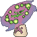

<!-- This file is generated by tools/generate_site.py. Edit the generator, not this file. -->

# #442 Spiritomb

{ .sprite-lg loading=lazy }

**Forbidden Pokémon**

Ghost Dark

[:material-arrow-left: #441 Chatot](441.md) · [Pokédex](index.md) · [#443 Gible :material-arrow-right:](443.md)

!!! info "Changes in Rising Ruby / Sinking Sapphire"

    - **Ability 2:** **Infiltrator** 

## Location

[Sea Mauville](../wild/sea_mauville_outside.md), [Sky Pillar](../wild/sky_pillar.md)

### Wild encounters

| Area | Method | Level | Note |
| --- | --- | --- | --- |
| [Sky Pillar](../wild/sky_pillar.md) | Walking | 67 |  |

### Gift & static encounters

| Category | Encounter | Changes |
| --- | --- | --- |
| Static Encounter Changes | Sea Mauville, Spiritomb | Level increased to 60 |

See [Gifts & Static Encounters](../changes/gifts_and_statics.md) for the full list.

## Type defenses

| Damage taken | Attacking types |
| --- | --- |
| Immune (×0) | Normal Fighting Psychic |
| Resistant (×½) | Poison |
| Neutral (×1) | Flying Ground Rock Bug Ghost Steel Fire Water Grass Electric Ice Dragon Dark |
| Weak (×2) | Fairy |

## Abilities

| Slot | Ability | Effect | Note |
| --- | --- | --- | --- |
| Ability 1 | **Pressure** | Increases the PP cost of moves targetting the Pokémon by one. |  |
| Ability 2 | **Infiltrator** | Bypasses Light Screen, Reflect, and Safeguard. | changed  |
| Hidden | **Infiltrator** | Bypasses Light Screen, Reflect, and Safeguard. |  |

## Base stats

| Form | HP | Atk | Def | SpA | SpD | Spe | BST |
| --- | --- | --- | --- | --- | --- | --- | --- |
| { .sprite-sm loading=lazy } Normal | 50 | 92 | 108 | 92 | 108 | 35 | **485** |

## Training & breeding

| Property | Value |
| --- | --- |
| EV yield | 1 Def, 1 SpD |
| Catch rate | 100 |
| Base friendship | 70 |
| Base experience | 170 |
| Growth rate | medium |
| Egg groups | Amorphous |
| Hatch counter | 30 |
| Gender ratio | 50% ♂ / 50% ♀ |
| Height / weight | 1 m / 108 kg |

## Evolution

This Pokémon does not evolve.

## Wild held items

None.

## Level-up moves { data-search-exclude }

Moves marked &#42; are not normally learned by level up (they come from egg moves, TMs/HMs or tutors in the official games); moves marked &#42;&#42; cannot normally be learned by this Pokémon at all and are omitted from the legal-moves version of the hack.

| Lv. | Move | Type | Cat. | Power | Acc. | PP | Effect | Note |
| --- | --- | --- | --- | --- | --- | --- | --- | --- |
| 1 | Curse | Ghost | Status | — | — | 10 | Ghosts pay half their max HP to hurt the target every turn.  Others decrease Speed but raise Attack and Defense. |  |
| 1 | Pursuit | Dark | Physical | 40 | 100% | 20 | Has double power against, and can hit, Pokémon attempting to switch out. |  |
| 1 | Confuse Ray | Ghost | Status | — | 100% | 10 | Confuses the target. |  |
| 1 | Spite | Ghost | Status | — | 100% | 10 | Lowers the PP of the target’s last used move by 4. |  |
| 1 | Shadow Sneak | Ghost | Physical | 40 | 100% | 30 | Inflicts regular damage with no additional effect. |  |
| 7 | Feint Attack | Dark | Physical | 60 | — | 20 | Never misses. |  |
| 13 | Hypnosis | Psychic | Status | — | 60% | 20 | Puts the target to sleep. |  |
| 19 | Dream Eater | Psychic | Special | 100 | 100% | 15 | Only works on sleeping Pokémon.  Drains half the damage inflicted to heal the user. |  |
| 25 | Ominous Wind | Ghost | Special | 60 | 100% | 5 | Has a chance to raise all of the user’s stats by one stage. |  |
| 31 | Sucker Punch | Dark | Physical | 80 | 100% | 5 | Only works if the target is about to use a damaging move. |  |
| 37 | Nasty Plot | Dark | Status | — | — | 20 | Raises the user’s Special Attack by two stages. |  |
| 43 | Memento | Dark | Status | — | 100% | 10 | Lowers the target’s Attack and Special Attack by two stages.  User faints. |  |
| 49 | Dark Pulse | Dark | Special | 80 | 100% | 15 | Has a chance to make the target flinch. |  |
| 55 | Pain Split | Normal | Status | — | — | 20 | Sets the user’s and targets’s HP to the average of their current HP. | &#42; |

## TM & HM moves { data-search-exclude }

| Machine | Move | Type | Cat. | Power | Acc. | PP | Effect |
| --- | --- | --- | --- | --- | --- | --- | --- |
| TM04 | Calm Mind | Psychic | Status | — | — | 20 | Raises the user’s Special Attack and Special Defense by one stage. |
| TM06 | Toxic | Poison | Status | — | 90% | 10 | Badly poisons the target, inflicting more damage every turn. |
| TM10 | Hidden Power | Normal | Special | 60 | 100% | 15 | Power and type depend upon user’s IVs.  Power can range from 30 to 70. |
| TM100 | Confide | Normal | Status | — | — | 20 | Lowers the target’s Special Attack by one stage. |
| TM11 | Sunny Day | Fire | Status | — | — | 5 | Changes the weather to sunny for five turns. |
| TM12 | Taunt | Dark | Status | — | 100% | 20 | For the next few turns, the target can only use damaging moves. |
| TM15 | Hyper Beam | Normal | Special | 150 | 90% | 5 | User foregoes its next turn to recharge. |
| TM17 | Protect | Normal | Status | — | — | 10 | Prevents any moves from hitting the user this turn. |
| TM18 | Rain Dance | Water | Status | — | — | 5 | Changes the weather to rain for five turns. |
| TM21 | Frustration | Normal | Physical | — | 100% | 20 | Power increases as happiness decreases, up to a maximum of 102. |
| TM27 | Return | Normal | Physical | — | 100% | 20 | Power increases with happiness, up to a maximum of 102. |
| TM29 | Psychic | Psychic | Special | 90 | 100% | 10 | Has a chance to lower the target’s Special Defense by one stage. |
| TM30 | Shadow Ball | Ghost | Special | 80 | 100% | 15 | Has a chance to lower the target’s Special Defense by one stage. |
| TM32 | Double Team | Normal | Status | — | — | 15 | Raises the user’s evasion by one stage. |
| TM39 | Rock Tomb | Rock | Physical | 60 | 95% | 15 | Has a chance to lower the target’s Speed by one stage. |
| TM41 | Torment | Dark | Status | — | 100% | 15 | Prevents the target from using the same move twice in a row. |
| TM42 | Facade | Normal | Physical | 70 | 100% | 20 | Power doubles if user is burned, paralyzed, or poisoned. |
| TM44 | Rest | Psychic | Status | — | — | 5 | User sleeps for two turns, completely healing itself. |
| TM45 | Attract | Normal | Status | — | 100% | 15 | Target falls in love if it has the opposite gender, and has a 50% chance to refuse attacking the user. |
| TM46 | Thief | Dark | Physical | 60 | 100% | 25 | Takes the target’s item. |
| TM48 | Round | Normal | Special | 60 | 100% | 15 | Has double power if it’s used more than once per turn. |
| TM60 | Quash | Dark | Status | — | 100% | 15 | Makes the target act last this turn. |
| TM61 | Will-O-Wisp | Fire | Status | — | 85% | 15 | Burns the target. |
| TM63 | Embargo | Dark | Status | — | 100% | 15 | Target cannot use held items. |
| TM67 | Retaliate | Normal | Physical | 70 | 100% | 5 | Has double power if a friendly Pokémon fainted last turn. |
| TM68 | Giga Impact | Normal | Physical | 150 | 90% | 5 | User foregoes its next turn to recharge. |
| TM70 | Flash | Normal | Status | — | 100% | 20 | Lowers the target’s accuracy by one stage. |
| TM77 | Psych Up | Normal | Status | — | — | 10 | Discards the user’s stat changes and copies the target’s. |
| TM83 | Infestation | Bug | Special | 20 | 100% | 20 | Prevents the target from fleeing and inflicts damage for 2-5 turns. |
| TM85 | Dream Eater | Psychic | Special | 100 | 100% | 15 | Only works on sleeping Pokémon.  Drains half the damage inflicted to heal the user. |
| TM87 | Swagger | Normal | Status | — | 90% | 15 | Raises the target’s Attack by two stages and confuses the target. |
| TM88 | Sleep Talk | Normal | Status | — | — | 10 | Randomly uses one of the user’s other three moves.  Only works if the user is sleeping. |
| TM90 | Substitute | Normal | Status | — | — | 10 | Transfers 1/4 of the user’s max HP into a doll, protecting the user from further damage or status changes until it breaks. |
| TM94 | Secret Power | Normal | Physical | 70 | 100% | 20 | Has a chance to inflict a status effect which depends upon the terrain. |
| TM95 | Snarl | Dark | Special | 55 | 95% | 15 | Has a chance to lower the target’s Special Attack by one stage. |
| TM97 | Dark Pulse | Dark | Special | 80 | 100% | 15 | Has a chance to make the target flinch. |

## Move tutor moves { data-search-exclude }

| Move | Type | Cat. | Power | Acc. | PP | Effect |
| --- | --- | --- | --- | --- | --- | --- |
| Foul Play | Dark | Physical | 95 | 100% | 15 | Calculates damage with the target’s attacking stat. |
| Icy Wind | Ice | Special | 55 | 95% | 15 | Has a chance to lower the target’s Speed by one stage. |
| Pain Split | Normal | Status | — | — | 20 | Sets the user’s and targets’s HP to the average of their current HP. |
| Shock Wave | Electric | Special | 60 | — | 20 | Never misses. |
| Snatch | Dark | Status | — | — | 10 | Steals the target’s move, if it’s self-targeted. |
| Snore | Normal | Special | 50 | 100% | 15 | Has a chance to make the target flinch.  Only works if the user is sleeping. |
| Spite | Ghost | Status | — | 100% | 10 | Lowers the PP of the target’s last used move by 4. |
| Trick | Psychic | Status | — | 100% | 10 | User and target swap items. |
| Uproar | Normal | Special | 90 | 100% | 10 | Forced to use this move for several turns.  Pokémon cannot fall asleep in that time. |
| Water Pulse | Water | Special | 60 | 100% | 20 | Has a chance to confuse the target. |
| Wonder Room | Psychic | Status | — | — | 10 | All Pokémon’s Defense and Special Defense are swapped for 5 turns. |

## Egg moves { data-search-exclude }

| Move | Type | Cat. | Power | Acc. | PP | Effect |
| --- | --- | --- | --- | --- | --- | --- |
| Captivate | Normal | Status | — | 100% | 20 | Lowers the target’s Special Attack by two stages if it’s the opposite gender. |
| Destiny Bond | Ghost | Status | — | — | 5 | If the user faints this turn, the target automatically will, too. |
| Foul Play | Dark | Physical | 95 | 100% | 15 | Calculates damage with the target’s attacking stat. |
| Grudge | Ghost | Status | — | — | 5 | If the user faints this turn, the PP of the move that fainted it drops to 0. |
| Imprison | Psychic | Status | — | — | 10 | Prevents the target from using any moves that the user also knows. |
| Nightmare | Ghost | Status | — | 100% | 15 | Target loses 1/4 its max HP every turn as long as it’s asleep. |
| Pain Split | Normal | Status | — | — | 20 | Sets the user’s and targets’s HP to the average of their current HP. |
| Shadow Sneak | Ghost | Physical | 40 | 100% | 30 | Inflicts regular damage with no additional effect. |
| Smokescreen | Normal | Status | — | 100% | 20 | Lowers the target’s accuracy by one stage. |

??? note "Trainers using Spiritomb (2)"

    | Area | Trainer | Level |
    | --- | --- | --- |
    | [Route 128](../trainers/route_128.md#trainers) | Ace Trainer Cornelius | Lv. 55 |
    | [Battle Resort](../trainers/battle_resort.md#trainers) | Ace Trainer Carnation [Cynthia] | Lv. 86 |

---

[:material-arrow-left: #441 Chatot](441.md) · [#443 Gible :material-arrow-right:](443.md)
