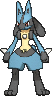
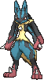

<!-- This file is generated by tools/generate_site.py. Edit the generator, not this file. -->

# #448 Lucario

{ .sprite-lg loading=lazy }

**Aura Pokémon**

Fighting Steel

[:material-arrow-left: #447 Riolu](447.md) · [Pokédex](index.md) · [#449 Hippopotas :material-arrow-right:](449.md)

!!! note "No documented changes"

    Drayano's documentation lists no stat, type, ability, evolution or held item changes for this Pokémon. Its level-up moves are listed below as they appear in the hack.

## Location

Evolve { .icon loading=lazy } [Riolu](../pokemon/447.md) (Happiness @ Day)

## Type defenses

| Damage taken | Attacking types |
| --- | --- |
| Immune (×0) | Poison |
| Very resistant (×¼) | Rock Bug |
| Resistant (×½) | Normal Steel Grass Ice Dragon Dark |
| Neutral (×1) | Flying Ghost Water Electric Psychic Fairy |
| Weak (×2) | Fighting Ground Fire |

## Abilities

| Slot | Ability | Effect | Note |
| --- | --- | --- | --- |
| Ability 1 | **Steadfast** | Raises Speed one stage upon flinching. |  |
| Ability 2 | **Inner Focus** | Prevents flinching. |  |
| Hidden | **Justified** | Raises Attack one stage upon taking damage from a Dark move. |  |

## Base stats

| Form | HP | Atk | Def | SpA | SpD | Spe | BST |
| --- | --- | --- | --- | --- | --- | --- | --- |
| { .sprite-sm loading=lazy } Normal | 70 | 110 | 70 | 115 | 70 | 90 | **525** |
| { .sprite-sm loading=lazy } Mega Lucario | 70 | 145 | 88 | 140 | 70 | 112 | **625** |

## Training & breeding

| Property | Value |
| --- | --- |
| EV yield | 1 Atk, 1 SpA |
| Catch rate | 45 |
| Base friendship | 70 |
| Base experience | 184 |
| Growth rate | medium slow |
| Egg groups | Field, Human-Like |
| Hatch counter | 25 |
| Gender ratio | 87.5% ♂ / 12.5% ♀ |
| Height / weight | 1.2 m / 54 kg |

## Evolution

- { .icon loading=lazy } [Riolu](../pokemon/447.md) → { .icon loading=lazy } **[Lucario](../pokemon/448.md)**: Happiness @ Day
- { .sprite-sm loading=lazy } **Mega Lucario**: Mega Evolves by holding the Lucarioite

## Wild held items

None.

## Level-up moves { data-search-exclude }

Moves marked &#42; are not normally learned by level up (they come from egg moves, TMs/HMs or tutors in the official games); moves marked &#42;&#42; cannot normally be learned by this Pokémon at all and are omitted from the legal-moves version of the hack.

| Lv. | Move | Type | Cat. | Power | Acc. | PP | Effect | Note |
| --- | --- | --- | --- | --- | --- | --- | --- | --- |
| 1 | Extreme Speed | Normal | Physical | 80 | 100% | 5 | Inflicts regular damage with no additional effect. |  |
| 1 | Dragon Pulse | Dragon | Special | 85 | 100% | 10 | Inflicts regular damage with no additional effect. |  |
| 1 | Bullet Punch | Steel | Physical | 40 | 100% | 30 | Inflicts regular damage with no additional effect. | &#42; |
| 1 | Foresight | Normal | Status | — | — | 40 | Forces the target to have no Evade, and allows it to be hit by Normal and Fighting moves even if it’s a Ghost. |  |
| 1 | Quick Attack | Normal | Physical | 40 | 100% | 30 | Inflicts regular damage with no additional effect. |  |
| 1 | Detect | Fighting | Status | — | — | 5 | Prevents any moves from hitting the user this turn. |  |
| 1 | Metal Claw | Steel | Physical | 50 | 95% | 35 | Has a chance to raise the user’s Attack by one stage. |  |
| 6 | Counter | Fighting | Physical | — | 100% | 20 | Inflicts twice the damage the user received from the last physical hit it took. |  |
| 10 | Feint | Normal | Physical | 30 | 100% | 10 | Hits through Protect and Detect. |  |
| 14 | Power-Up Punch | Fighting | Physical | 40 | 100% | 20 | Raises the user’s Attack by one stage after inflicting damage. |  |
| 18 | Swords Dance | Normal | Status | — | — | 20 | Raises the user’s Attack by two stages. |  |
| 22 | Sky Uppercut | Fighting | Physical | 85 | 90% | 15 | Inflicts regular damage and can hit Bounce and Fly users. | &#42; |
| 26 | Metal Sound | Steel | Status | — | 85% | 40 | Lowers the target’s Special Defense by two stages. |  |
| 30 | Bone Rush | Ground | Physical | 25 | 90% | 10 | Hits 2-5 times in one turn. |  |
| 34 | Blaze Kick | Fire | Physical | 85 | 90% | 10 | Has an increased chance for a critical hit and a chance to burn the target. | &#42; |
| 38 | Aura Sphere | Fighting | Special | 80 | — | 20 | Never misses. |  |
| 42 | Quick Guard | Fighting | Status | — | — | 15 | Prevents any priority moves from hitting friendly Pokémon this turn. |  |
| 46 | Me First | Normal | Status | — | — | 20 | Uses the target’s move against it before it attacks, with power increased by half. |  |
| 50 | Calm Mind | Psychic | Status | — | — | 20 | Raises the user’s Special Attack and Special Defense by one stage. |  |
| 54 | Heal Pulse | Psychic | Status | — | — | 10 | Heals the target for half its max HP. |  |
| 58 | Close Combat | Fighting | Physical | 120 | 100% | 5 | Lowers the user’s Defense and Special Defense by one stage after inflicting damage. |  |
| 62 | Dragon Pulse | Dragon | Special | 85 | 100% | 10 | Inflicts regular damage with no additional effect. |  |
| 66 | Extreme Speed | Normal | Physical | 80 | 100% | 5 | Inflicts regular damage with no additional effect. |  |

## TM & HM moves { data-search-exclude }

| Machine | Move | Type | Cat. | Power | Acc. | PP | Effect |
| --- | --- | --- | --- | --- | --- | --- | --- |
| HM04 | [Strength](../changes/moves.md#strength) changed | Normal | Physical | 100 | 100% | 10 | Inflicts regular damage with no additional effect. |
| HM06 | [Rock Smash](../changes/moves.md#rock-smash) changed | Fighting | Physical | 65 | 100% | 15 | Has a chance to lower the target’s Defense by one stage. |
| TM01 | Hone Claws | Dark | Status | — | — | 15 | Raises the user’s Attack and accuracy by one stage. |
| TM04 | Calm Mind | Psychic | Status | — | — | 20 | Raises the user’s Special Attack and Special Defense by one stage. |
| TM05 | Roar | Normal | Status | — | — | 20 | Immediately ends wild battles.  Forces trainers to switch Pokémon. |
| TM06 | Toxic | Poison | Status | — | 90% | 10 | Badly poisons the target, inflicting more damage every turn. |
| TM08 | Bulk Up | Fighting | Status | — | — | 20 | Raises the user’s Attack and Defense by one stage. |
| TM10 | Hidden Power | Normal | Special | 60 | 100% | 15 | Power and type depend upon user’s IVs.  Power can range from 30 to 70. |
| TM100 | Confide | Normal | Status | — | — | 20 | Lowers the target’s Special Attack by one stage. |
| TM11 | Sunny Day | Fire | Status | — | — | 5 | Changes the weather to sunny for five turns. |
| TM15 | Hyper Beam | Normal | Special | 150 | 90% | 5 | User foregoes its next turn to recharge. |
| TM17 | Protect | Normal | Status | — | — | 10 | Prevents any moves from hitting the user this turn. |
| TM18 | Rain Dance | Water | Status | — | — | 5 | Changes the weather to rain for five turns. |
| TM21 | Frustration | Normal | Physical | — | 100% | 20 | Power increases as happiness decreases, up to a maximum of 102. |
| TM26 | Earthquake | Ground | Physical | 100 | 100% | 10 | Inflicts regular damage and can hit Dig users. |
| TM27 | Return | Normal | Physical | — | 100% | 20 | Power increases with happiness, up to a maximum of 102. |
| TM28 | Dig | Ground | Physical | 80 | 100% | 10 | User digs underground, dodging all attacks, and hits next turn. |
| TM29 | Psychic | Psychic | Special | 90 | 100% | 10 | Has a chance to lower the target’s Special Defense by one stage. |
| TM30 | Shadow Ball | Ghost | Special | 80 | 100% | 15 | Has a chance to lower the target’s Special Defense by one stage. |
| TM31 | Brick Break | Fighting | Physical | 75 | 100% | 15 | Destroys Reflect and Light Screen. |
| TM32 | Double Team | Normal | Status | — | — | 15 | Raises the user’s evasion by one stage. |
| TM39 | Rock Tomb | Rock | Physical | 60 | 95% | 15 | Has a chance to lower the target’s Speed by one stage. |
| TM42 | Facade | Normal | Physical | 70 | 100% | 20 | Power doubles if user is burned, paralyzed, or poisoned. |
| TM44 | Rest | Psychic | Status | — | — | 5 | User sleeps for two turns, completely healing itself. |
| TM45 | Attract | Normal | Status | — | 100% | 15 | Target falls in love if it has the opposite gender, and has a 50% chance to refuse attacking the user. |
| TM47 | Low Sweep | Fighting | Physical | 65 | 100% | 20 | Lowers the target’s Speed by one stage. |
| TM48 | Round | Normal | Special | 60 | 100% | 15 | Has double power if it’s used more than once per turn. |
| TM52 | Focus Blast | Fighting | Special | 120 | 70% | 5 | Has a chance to lower the target’s Special Defense by one stage. |
| TM56 | Fling | Dark | Physical | — | 100% | 10 | Throws held item at the target; power depends on the item. |
| TM65 | Shadow Claw | Ghost | Physical | 70 | 100% | 15 | Has an increased chance for a critical hit. |
| TM66 | Payback | Dark | Physical | 50 | 100% | 10 | Power is doubled if the target has already moved this turn. |
| TM67 | Retaliate | Normal | Physical | 70 | 100% | 5 | Has double power if a friendly Pokémon fainted last turn. |
| TM68 | Giga Impact | Normal | Physical | 150 | 90% | 5 | User foregoes its next turn to recharge. |
| TM71 | Stone Edge | Rock | Physical | 100 | 80% | 5 | Has an increased chance for a critical hit. |
| TM75 | Swords Dance | Normal | Status | — | — | 20 | Raises the user’s Attack by two stages. |
| TM78 | Bulldoze | Ground | Physical | 60 | 100% | 20 | Has a chance to lower the target’s Speed by one stage. |
| TM80 | Rock Slide | Rock | Physical | 75 | 90% | 10 | Has a chance to make the target flinch. |
| TM84 | Poison Jab | Poison | Physical | 80 | 100% | 20 | Has a chance to poison the target. |
| TM87 | Swagger | Normal | Status | — | 90% | 15 | Raises the target’s Attack by two stages and confuses the target. |
| TM88 | Sleep Talk | Normal | Status | — | — | 10 | Randomly uses one of the user’s other three moves.  Only works if the user is sleeping. |
| TM90 | Substitute | Normal | Status | — | — | 10 | Transfers 1/4 of the user’s max HP into a doll, protecting the user from further damage or status changes until it breaks. |
| TM91 | Flash Cannon | Steel | Special | 80 | 100% | 10 | Has a chance to lower the target’s Special Defense by one stage. |
| TM94 | Secret Power | Normal | Physical | 70 | 100% | 20 | Has a chance to inflict a status effect which depends upon the terrain. |
| TM97 | Dark Pulse | Dark | Special | 80 | 100% | 15 | Has a chance to make the target flinch. |
| TM98 | Power-Up Punch | Fighting | Physical | 40 | 100% | 20 | Raises the user’s Attack by one stage after inflicting damage. |

## Move tutor moves { data-search-exclude }

| Move | Type | Cat. | Power | Acc. | PP | Effect |
| --- | --- | --- | --- | --- | --- | --- |
| Dragon Pulse | Dragon | Special | 85 | 100% | 10 | Inflicts regular damage with no additional effect. |
| Drain Punch | Fighting | Physical | 75 | 100% | 10 | Drains half the damage inflicted to heal the user. |
| Dual Chop | Dragon | Physical | 40 | 90% | 15 | Hits twice in one turn. |
| Focus Punch | Fighting | Physical | 150 | 100% | 20 | If the user takes damage before attacking, the attack is canceled. |
| Helping Hand | Normal | Status | — | — | 20 | Ally’s next move inflicts half more damage. |
| Ice Punch | Ice | Physical | 75 | 100% | 15 | Has a chance to freeze the target. |
| Iron Defense | Steel | Status | — | — | 15 | Raises the user’s Defense by two stages. |
| Iron Tail | Steel | Physical | 100 | 75% | 15 | Has a chance to lower the target’s Defense by one stage. |
| Low Kick | Fighting | Physical | — | 100% | 20 | Inflicts more damage to heavier targets, with a maximum of 120 power. |
| Magnet Rise | Electric | Status | — | — | 10 | User is immune to Ground moves and effects for five turns. |
| Role Play | Psychic | Status | — | — | 10 | Copies the target’s ability. |
| Snore | Normal | Special | 50 | 100% | 15 | Has a chance to make the target flinch.  Only works if the user is sleeping. |
| Thunder Punch | Electric | Physical | 75 | 100% | 15 | Has a chance to paralyze the target. |
| Water Pulse | Water | Special | 60 | 100% | 20 | Has a chance to confuse the target. |
| Zen Headbutt | Psychic | Physical | 80 | 90% | 15 | Has a chance to make the target flinch. |

## Egg moves { data-search-exclude }

No egg moves.

??? note "Trainers using Lucario (12)"

    | Area | Trainer | Level |
    | --- | --- | --- |
    | [Route 117](../trainers/route_117.md#rematches) | PKMN Breeder Isaac (5) | Lv. 39 |
    | [Route 117](../trainers/route_117.md#rematches) | PKMN Breeder Isaac (7) | Lv. 59 |
    | [Route 117](../trainers/route_117.md#rematches) | PKMN Breeder Isaac (C) | Lv. 75 |
    | [Jagged Pass](../trainers/jagged_pass.md#trainers) | Expert Shelby | Lv. 35 |
    | [Jagged Pass](../trainers/jagged_pass.md#rematches) | Expert Shelby (6) | Lv. 47 |
    | [Jagged Pass](../trainers/jagged_pass.md#rematches) | Expert Shelby (7) | Lv. 59 |
    | [Jagged Pass](../trainers/jagged_pass.md#rematches) | Expert Shelby (8) | Lv. 64 |
    | [Jagged Pass](../trainers/jagged_pass.md#rematches) | Expert Shelby (C) | Lv. 75 |
    | [Meteor Falls 1F-2](../trainers/meteor_falls_1f_2.md#trainers) | Old Couple John & Jay | Lv. 65 |
    | [Meteor Falls 1F-2](../trainers/meteor_falls_1f_2.md#rematches) | Old Couple John & Jay (C) | Lv. 75 |
    | [Battle Resort](../trainers/battle_resort.md#trainers) | Ace Trainer Carnation [Cynthia] | Lv. 86 |
    | [Battle Resort](../trainers/battle_resort.md#trainers) | Leader Felix [Korrina] | Lv. 79 |

---

[:material-arrow-left: #447 Riolu](447.md) · [#449 Hippopotas :material-arrow-right:](449.md)
