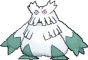
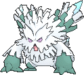

<!-- This file is generated by tools/generate_site.py. Edit the generator, not this file. -->

# #460 Abomasnow

{ .sprite-lg loading=lazy }

**Frost Tree Pokémon**

Grass Ice

[:material-arrow-left: #459 Snover](459.md) · [Pokédex](index.md) · [#461 Weavile :material-arrow-right:](461.md)

!!! info "Changes in Rising Ruby / Sinking Sapphire"

    - **Ability 2:** **Soundproof** 

## Location

### Wild encounters

| Area | Method | Level | Note |
| --- | --- | --- | --- |
| [Shoal Cave B1F, B2F, B3F](../wild/shoal_cave_b1f_b2f_b3f.md) | Walking | 50 |  |
| [Shoal Cave Ice Room](../wild/shoal_cave_ice_room.md) | Walking | 55 |  |

## Type defenses

| Damage taken | Attacking types |
| --- | --- |
| Resistant (×½) | Ground Water Grass Electric |
| Neutral (×1) | Normal Ghost Psychic Ice Dragon Dark Fairy |
| Weak (×2) | Fighting Flying Poison Rock Bug Steel |
| Very weak (×4) | Fire |

## Abilities

| Slot | Ability | Effect | Note |
| --- | --- | --- | --- |
| Ability 1 | **Snow Warning** | Summons hail that lasts indefinitely upon entering battle. |  |
| Ability 2 | **Soundproof** | Protects against sound-based moves. | changed  |
| Hidden | **Soundproof** | Protects against sound-based moves. |  |

## Base stats

| Form | HP | Atk | Def | SpA | SpD | Spe | BST |
| --- | --- | --- | --- | --- | --- | --- | --- |
| { .sprite-sm loading=lazy } Normal | 90 | 92 | 75 | 92 | 85 | 60 | **494** |
| { .sprite-sm loading=lazy } Mega Abomasnow | 90 | 132 | 105 | 132 | 105 | 30 | **594** |

## Training & breeding

| Property | Value |
| --- | --- |
| EV yield | 1 Atk, 1 SpA |
| Catch rate | 60 |
| Base friendship | 70 |
| Base experience | 173 |
| Growth rate | slow |
| Egg groups | Monster, Grass |
| Hatch counter | 20 |
| Gender ratio | 50% ♂ / 50% ♀ |
| Height / weight | 2.2 m / 135.5 kg |

## Evolution

- { .icon loading=lazy } [Snover](../pokemon/459.md) → { .icon loading=lazy } **[Abomasnow](../pokemon/460.md)**: Lv. 40
- { .sprite-sm loading=lazy } **Mega Abomasnow**: Mega Evolves by holding the Abomasnowite

## Wild held items

| Item | Chance | Note |
| --- | --- | --- |
| { .item loading=lazy } Never-Melt Ice | 5% |  |

## Level-up moves { data-search-exclude }

Moves marked &#42; are not normally learned by level up (they come from egg moves, TMs/HMs or tutors in the official games); moves marked &#42;&#42; cannot normally be learned by this Pokémon at all and are omitted from the legal-moves version of the hack.

| Lv. | Move | Type | Cat. | Power | Acc. | PP | Effect | Note |
| --- | --- | --- | --- | --- | --- | --- | --- | --- |
| 1 | Ice Punch | Ice | Physical | 75 | 100% | 15 | Has a chance to freeze the target. |  |
| 1 | Powder Snow | Ice | Special | 40 | 100% | 25 | Has a chance to freeze the target. |  |
| 1 | Leer | Normal | Status | — | 100% | 30 | Lowers the target’s Defense by one stage. |  |
| 4 | Razor Leaf | Grass | Physical | 55 | 95% | 25 | Has an increased chance for a critical hit. |  |
| 8 | Icy Wind | Ice | Special | 55 | 95% | 15 | Has a chance to lower the target’s Speed by one stage. |  |
| 12 | Grass Whistle | Grass | Status | — | 55% | 15 | Puts the target to sleep. |  |
| 16 | Swagger | Normal | Status | — | 90% | 15 | Raises the target’s Attack by two stages and confuses the target. |  |
| 20 | Mist | Ice | Status | — | — | 30 | Protects the user’s stats from being changed by enemy moves. |  |
| 24 | Ice Shard | Ice | Physical | 40 | 100% | 30 | Inflicts regular damage with no additional effect. |  |
| 28 | Avalanche | Ice | Physical | 60 | 100% | 10 | Inflicts double damage if the user takes damage before attacking this turn. | &#42; |
| 32 | Ingrain | Grass | Status | — | — | 20 | Prevents the user from leaving battle.  User regains 1/16 of its max HP every turn. |  |
| 36 | Wood Hammer | Grass | Physical | 120 | 100% | 15 | User receives 1/3 the damage inflicted in recoil. |  |
| 40 | Frost Breath | Ice | Special | 60 | 90% | 10 | Always scores a critical hit. | &#42; |
| 44 | Seed Bomb | Grass | Physical | 80 | 100% | 15 | Inflicts regular damage with no additional effect. | &#42; |
| 48 | Blizzard | Ice | Special | 110 | 70% | 5 | Has a chance to freeze the target. |  |
| 52 | Sheer Cold | Ice | Special | — | 30% | 5 | Causes a one-hit KO. |  |

## TM & HM moves { data-search-exclude }

| Machine | Move | Type | Cat. | Power | Acc. | PP | Effect |
| --- | --- | --- | --- | --- | --- | --- | --- |
| HM04 | [Strength](../changes/moves.md#strength) changed | Normal | Physical | 100 | 100% | 10 | Inflicts regular damage with no additional effect. |
| HM06 | [Rock Smash](../changes/moves.md#rock-smash) changed | Fighting | Physical | 65 | 100% | 15 | Has a chance to lower the target’s Defense by one stage. |
| TM06 | Toxic | Poison | Status | — | 90% | 10 | Badly poisons the target, inflicting more damage every turn. |
| TM07 | Hail | Ice | Status | — | — | 10 | Changes the weather to a hailstorm for five turns. |
| TM10 | Hidden Power | Normal | Special | 60 | 100% | 15 | Power and type depend upon user’s IVs.  Power can range from 30 to 70. |
| TM100 | Confide | Normal | Status | — | — | 20 | Lowers the target’s Special Attack by one stage. |
| TM13 | Ice Beam | Ice | Special | 90 | 100% | 10 | Has a chance to freeze the target. |
| TM14 | Blizzard | Ice | Special | 110 | 70% | 5 | Has a chance to freeze the target. |
| TM15 | Hyper Beam | Normal | Special | 150 | 90% | 5 | User foregoes its next turn to recharge. |
| TM16 | Light Screen | Psychic | Status | — | — | 30 | Reduces damage from special attacks by 50% for five turns. |
| TM17 | Protect | Normal | Status | — | — | 10 | Prevents any moves from hitting the user this turn. |
| TM18 | Rain Dance | Water | Status | — | — | 5 | Changes the weather to rain for five turns. |
| TM20 | Safeguard | Normal | Status | — | — | 25 | Protects the user’s field from major status ailments and confusion for five turns. |
| TM21 | Frustration | Normal | Physical | — | 100% | 20 | Power increases as happiness decreases, up to a maximum of 102. |
| TM22 | Solar Beam | Grass | Special | 120 | 100% | 10 | Requires a turn to charge before attacking. |
| TM26 | Earthquake | Ground | Physical | 100 | 100% | 10 | Inflicts regular damage and can hit Dig users. |
| TM27 | Return | Normal | Physical | — | 100% | 20 | Power increases with happiness, up to a maximum of 102. |
| TM30 | Shadow Ball | Ghost | Special | 80 | 100% | 15 | Has a chance to lower the target’s Special Defense by one stage. |
| TM31 | Brick Break | Fighting | Physical | 75 | 100% | 15 | Destroys Reflect and Light Screen. |
| TM32 | Double Team | Normal | Status | — | — | 15 | Raises the user’s evasion by one stage. |
| TM39 | Rock Tomb | Rock | Physical | 60 | 95% | 15 | Has a chance to lower the target’s Speed by one stage. |
| TM42 | Facade | Normal | Physical | 70 | 100% | 20 | Power doubles if user is burned, paralyzed, or poisoned. |
| TM44 | Rest | Psychic | Status | — | — | 5 | User sleeps for two turns, completely healing itself. |
| TM45 | Attract | Normal | Status | — | 100% | 15 | Target falls in love if it has the opposite gender, and has a 50% chance to refuse attacking the user. |
| TM48 | Round | Normal | Special | 60 | 100% | 15 | Has double power if it’s used more than once per turn. |
| TM52 | Focus Blast | Fighting | Special | 120 | 70% | 5 | Has a chance to lower the target’s Special Defense by one stage. |
| TM53 | Energy Ball | Grass | Special | 90 | 100% | 10 | Has a chance to lower the target’s Special Defense by one stage. |
| TM56 | Fling | Dark | Physical | — | 100% | 10 | Throws held item at the target; power depends on the item. |
| TM68 | Giga Impact | Normal | Physical | 150 | 90% | 5 | User foregoes its next turn to recharge. |
| TM70 | Flash | Normal | Status | — | 100% | 20 | Lowers the target’s accuracy by one stage. |
| TM75 | Swords Dance | Normal | Status | — | — | 20 | Raises the user’s Attack by two stages. |
| TM78 | Bulldoze | Ground | Physical | 60 | 100% | 20 | Has a chance to lower the target’s Speed by one stage. |
| TM79 | Frost Breath | Ice | Special | 60 | 90% | 10 | Always scores a critical hit. |
| TM80 | Rock Slide | Rock | Physical | 75 | 90% | 10 | Has a chance to make the target flinch. |
| TM86 | Grass Knot | Grass | Special | — | 100% | 20 | Inflicts more damage to heavier targets, with a maximum of 120 power. |
| TM87 | Swagger | Normal | Status | — | 90% | 15 | Raises the target’s Attack by two stages and confuses the target. |
| TM88 | Sleep Talk | Normal | Status | — | — | 10 | Randomly uses one of the user’s other three moves.  Only works if the user is sleeping. |
| TM90 | Substitute | Normal | Status | — | — | 10 | Transfers 1/4 of the user’s max HP into a doll, protecting the user from further damage or status changes until it breaks. |
| TM94 | Secret Power | Normal | Physical | 70 | 100% | 20 | Has a chance to inflict a status effect which depends upon the terrain. |

## Move tutor moves { data-search-exclude }

| Move | Type | Cat. | Power | Acc. | PP | Effect |
| --- | --- | --- | --- | --- | --- | --- |
| Block | Normal | Status | — | — | 5 | Prevents the target from leaving battle. |
| Focus Punch | Fighting | Physical | 150 | 100% | 20 | If the user takes damage before attacking, the attack is canceled. |
| Giga Drain | Grass | Special | 75 | 100% | 10 | Drains half the damage inflicted to heal the user. |
| Ice Punch | Ice | Physical | 75 | 100% | 15 | Has a chance to freeze the target. |
| Icy Wind | Ice | Special | 55 | 95% | 15 | Has a chance to lower the target’s Speed by one stage. |
| Iron Tail | Steel | Physical | 100 | 75% | 15 | Has a chance to lower the target’s Defense by one stage. |
| Outrage | Dragon | Physical | 120 | 100% | 10 | Hits every turn for 2-3 turns, then confuses the user. |
| Role Play | Psychic | Status | — | — | 10 | Copies the target’s ability. |
| Seed Bomb | Grass | Physical | 80 | 100% | 15 | Inflicts regular damage with no additional effect. |
| Snore | Normal | Special | 50 | 100% | 15 | Has a chance to make the target flinch.  Only works if the user is sleeping. |
| Synthesis | Grass | Status | — | — | 5 | Heals the user by half its max HP.  Affected by weather. |
| Water Pulse | Water | Special | 60 | 100% | 20 | Has a chance to confuse the target. |
| Worry Seed | Grass | Status | — | 100% | 10 | Changes the target’s ability to Insomnia. |

## Egg moves { data-search-exclude }

No egg moves.

??? note "Trainers using Abomasnow (3)"

    | Area | Trainer | Level |
    | --- | --- | --- |
    | [Mt. Pyre 3F / 4F](../trainers/mt_pyre_3f_4f.md#trainers) | Backpacker Darnell | Lv. 49 |
    | [Battle Resort](../trainers/battle_resort.md#trainers) | Leader Kelvin [Wulfric] | Lv. 79 |
    | [Pokémon League (Post Game)](../trainers/pokemon_league_post_game.md#trainers) | Elite Four Glacia | Lv. 84 |

---

[:material-arrow-left: #459 Snover](459.md) · [#461 Weavile :material-arrow-right:](461.md)
