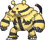

<!-- This file is generated by tools/generate_site.py. Edit the generator, not this file. -->

# #466 Electivire

{ .sprite-lg loading=lazy }

**Thunderbolt Pokémon**

Electric Fighting

Type changed from Electric

[:material-arrow-left: #465 Tangrowth](465.md) · [Pokédex](index.md) · [#467 Magmortar :material-arrow-right:](467.md)

!!! info "Changes in Rising Ruby / Sinking Sapphire"

    - **Type:** Electric → Electric Fighting
    - **Ability 2:** **Vital Spirit** 

## Location

Evolve { .icon loading=lazy } [Electabuzz](../pokemon/125.md) (Electirizer)

## Type defenses

| Damage taken | Attacking types |
| --- | --- |
| Resistant (×½) | Rock Bug Steel Electric Dark |
| Neutral (×1) | Normal Fighting Flying Poison Ghost Fire Water Grass Ice Dragon |
| Weak (×2) | Ground Psychic Fairy |

## Abilities

| Slot | Ability | Effect | Note |
| --- | --- | --- | --- |
| Ability 1 | **Motor Drive** | Absorbs Electric moves, raising Speed one stage. |  |
| Ability 2 | **Vital Spirit** | Prevents sleep. | changed  |
| Hidden | **Vital Spirit** | Prevents sleep. |  |

## Base stats

| Form | HP | Atk | Def | SpA | SpD | Spe | BST |
| --- | --- | --- | --- | --- | --- | --- | --- |
| { .sprite-sm loading=lazy } Normal | 75 | 123 | 67 | 95 | 85 | 95 | **540** |

## Training & breeding

| Property | Value |
| --- | --- |
| EV yield | 3 Atk |
| Catch rate | 30 |
| Base friendship | 70 |
| Base experience | 243 |
| Growth rate | medium |
| Egg groups | Human-Like |
| Hatch counter | 25 |
| Gender ratio | 75% ♂ / 25% ♀ |
| Height / weight | 1.8 m / 138.6 kg |

## Evolution

- { .icon loading=lazy } [Elekid](../pokemon/239.md) → { .icon loading=lazy } [Electabuzz](../pokemon/125.md): Lv. 30
- { .icon loading=lazy } [Electabuzz](../pokemon/125.md) → { .icon loading=lazy } **[Electivire](../pokemon/466.md)**: Electirizer changed <small>(vanilla: Trade holding Electirizer)</small>

## Wild held items

| Item | Chance | Note |
| --- | --- | --- |
| { .item loading=lazy } Electirizer | 5% |  |

## Level-up moves { data-search-exclude }

Moves marked &#42; are not normally learned by level up (they come from egg moves, TMs/HMs or tutors in the official games); moves marked &#42;&#42; cannot normally be learned by this Pokémon at all and are omitted from the legal-moves version of the hack.

| Lv. | Move | Type | Cat. | Power | Acc. | PP | Effect | Note |
| --- | --- | --- | --- | --- | --- | --- | --- | --- |
| 1 | Volt Tackle | Electric | Physical | 120 | 100% | 15 | User takes 1/3 the damage inflicted in recoil.  Has a chance to paralyze the target. | &#42;&#42; |
| 1 | Electric Terrain | Electric | Status | — | — | 10 | For five turns, prevents all Pokémon on the ground from sleeping and strengthens their Electric moves to 1.5× their power. |  |
| 1 | Ion Deluge | Electric | Status | — | — | 25 | Changes all Normal moves to Electric moves for the rest of the turn. |  |
| 1 | Hammer Arm | Fighting | Physical | 100 | 90% | 10 | Lowers user’s Speed by one stage. | &#42; |
| 1 | Fire Punch | Fire | Physical | 75 | 100% | 15 | Has a chance to burn the target. |  |
| 1 | Ice Punch | Ice | Physical | 75 | 100% | 15 | Has a chance to freeze the target. | &#42; |
| 1 | Quick Attack | Normal | Physical | 40 | 100% | 30 | Inflicts regular damage with no additional effect. |  |
| 1 | Leer | Normal | Status | — | 100% | 30 | Lowers the target’s Defense by one stage. |  |
| 5 | Thunder Shock | Electric | Special | 40 | 100% | 30 | Has a chance to paralyze the target. |  |
| 8 | Low Kick | Fighting | Physical | — | 100% | 20 | Inflicts more damage to heavier targets, with a maximum of 120 power. |  |
| 11 | Swift | Normal | Special | 60 | — | 20 | Never misses. |  |
| 14 | Shock Wave | Electric | Special | 60 | — | 20 | Never misses. |  |
| 17 | Thunder Wave | Electric | Status | — | 100% | 20 | Paralyzes the target. |  |
| 20 | Electro Ball | Electric | Special | — | 100% | 10 | Power is higher when the user has greater Speed than the target, up to a maximum of 150. |  |
| 23 | Light Screen | Psychic | Status | — | — | 30 | Reduces damage from special attacks by 50% for five turns. |  |
| 26 | Brick Break | Fighting | Physical | 75 | 100% | 15 | Destroys Reflect and Light Screen. | &#42; |
| 29 | Thunder Punch | Electric | Physical | 75 | 100% | 15 | Has a chance to paralyze the target. |  |
| 33 | Discharge | Electric | Special | 80 | 100% | 15 | Has a chance to paralyze the target. |  |
| 37 | Screech | Normal | Status | — | 85% | 40 | Lowers the target’s Defense by two stages. |  |
| 41 | Thunderbolt | Electric | Special | 90 | 100% | 15 | Has a chance to paralyze the target. |  |
| 45 | Cross Chop | Fighting | Physical | 100 | 80% | 5 | Has an increased chance for a critical hit. | &#42; |
| 49 | Wild Charge | Electric | Physical | 90 | 100% | 15 | User receives 1/4 the damage it inflicts in recoil. | &#42; |
| 53 | Thunder | Electric | Special | 110 | 70% | 10 | Has a chance to paralyze the target. |  |
| 57 | Giga Impact | Normal | Physical | 150 | 90% | 5 | User foregoes its next turn to recharge. |  |
| 61 | Electric Terrain | Electric | Status | — | — | 10 | For five turns, prevents all Pokémon on the ground from sleeping and strengthens their Electric moves to 1.5× their power. |  |
| 65 | Volt Tackle | Electric | Physical | 120 | 100% | 15 | User takes 1/3 the damage inflicted in recoil.  Has a chance to paralyze the target. | &#42;&#42; |

## TM & HM moves { data-search-exclude }

| Machine | Move | Type | Cat. | Power | Acc. | PP | Effect |
| --- | --- | --- | --- | --- | --- | --- | --- |
| HM04 | [Strength](../changes/moves.md#strength) changed | Normal | Physical | 100 | 100% | 10 | Inflicts regular damage with no additional effect. |
| HM06 | [Rock Smash](../changes/moves.md#rock-smash) changed | Fighting | Physical | 65 | 100% | 15 | Has a chance to lower the target’s Defense by one stage. |
| TM06 | Toxic | Poison | Status | — | 90% | 10 | Badly poisons the target, inflicting more damage every turn. |
| TM10 | Hidden Power | Normal | Special | 60 | 100% | 15 | Power and type depend upon user’s IVs.  Power can range from 30 to 70. |
| TM100 | Confide | Normal | Status | — | — | 20 | Lowers the target’s Special Attack by one stage. |
| TM12 | Taunt | Dark | Status | — | 100% | 20 | For the next few turns, the target can only use damaging moves. |
| TM15 | Hyper Beam | Normal | Special | 150 | 90% | 5 | User foregoes its next turn to recharge. |
| TM16 | Light Screen | Psychic | Status | — | — | 30 | Reduces damage from special attacks by 50% for five turns. |
| TM17 | Protect | Normal | Status | — | — | 10 | Prevents any moves from hitting the user this turn. |
| TM18 | Rain Dance | Water | Status | — | — | 5 | Changes the weather to rain for five turns. |
| TM21 | Frustration | Normal | Physical | — | 100% | 20 | Power increases as happiness decreases, up to a maximum of 102. |
| TM24 | Thunderbolt | Electric | Special | 90 | 100% | 15 | Has a chance to paralyze the target. |
| TM25 | Thunder | Electric | Special | 110 | 70% | 10 | Has a chance to paralyze the target. |
| TM26 | Earthquake | Ground | Physical | 100 | 100% | 10 | Inflicts regular damage and can hit Dig users. |
| TM27 | Return | Normal | Physical | — | 100% | 20 | Power increases with happiness, up to a maximum of 102. |
| TM28 | Dig | Ground | Physical | 80 | 100% | 10 | User digs underground, dodging all attacks, and hits next turn. |
| TM29 | Psychic | Psychic | Special | 90 | 100% | 10 | Has a chance to lower the target’s Special Defense by one stage. |
| TM31 | Brick Break | Fighting | Physical | 75 | 100% | 15 | Destroys Reflect and Light Screen. |
| TM32 | Double Team | Normal | Status | — | — | 15 | Raises the user’s evasion by one stage. |
| TM35 | Flamethrower | Fire | Special | 90 | 100% | 15 | Has a chance to burn the target. |
| TM39 | Rock Tomb | Rock | Physical | 60 | 95% | 15 | Has a chance to lower the target’s Speed by one stage. |
| TM41 | Torment | Dark | Status | — | 100% | 15 | Prevents the target from using the same move twice in a row. |
| TM42 | Facade | Normal | Physical | 70 | 100% | 20 | Power doubles if user is burned, paralyzed, or poisoned. |
| TM44 | Rest | Psychic | Status | — | — | 5 | User sleeps for two turns, completely healing itself. |
| TM45 | Attract | Normal | Status | — | 100% | 15 | Target falls in love if it has the opposite gender, and has a 50% chance to refuse attacking the user. |
| TM46 | Thief | Dark | Physical | 60 | 100% | 25 | Takes the target’s item. |
| TM47 | Low Sweep | Fighting | Physical | 65 | 100% | 20 | Lowers the target’s Speed by one stage. |
| TM48 | Round | Normal | Special | 60 | 100% | 15 | Has double power if it’s used more than once per turn. |
| TM52 | Focus Blast | Fighting | Special | 120 | 70% | 5 | Has a chance to lower the target’s Special Defense by one stage. |
| TM56 | Fling | Dark | Physical | — | 100% | 10 | Throws held item at the target; power depends on the item. |
| TM57 | Charge Beam | Electric | Special | 50 | 90% | 10 | Has a chance to raise the user’s Special Attack by one stage. |
| TM68 | Giga Impact | Normal | Physical | 150 | 90% | 5 | User foregoes its next turn to recharge. |
| TM70 | Flash | Normal | Status | — | 100% | 20 | Lowers the target’s accuracy by one stage. |
| TM72 | Volt Switch | Electric | Special | 70 | 100% | 20 | User must switch out after attacking. |
| TM73 | Thunder Wave | Electric | Status | — | 100% | 20 | Paralyzes the target. |
| TM78 | Bulldoze | Ground | Physical | 60 | 100% | 20 | Has a chance to lower the target’s Speed by one stage. |
| TM80 | Rock Slide | Rock | Physical | 75 | 90% | 10 | Has a chance to make the target flinch. |
| TM87 | Swagger | Normal | Status | — | 90% | 15 | Raises the target’s Attack by two stages and confuses the target. |
| TM88 | Sleep Talk | Normal | Status | — | — | 10 | Randomly uses one of the user’s other three moves.  Only works if the user is sleeping. |
| TM90 | Substitute | Normal | Status | — | — | 10 | Transfers 1/4 of the user’s max HP into a doll, protecting the user from further damage or status changes until it breaks. |
| TM93 | Wild Charge | Electric | Physical | 90 | 100% | 15 | User receives 1/4 the damage it inflicts in recoil. |
| TM94 | Secret Power | Normal | Physical | 70 | 100% | 20 | Has a chance to inflict a status effect which depends upon the terrain. |
| TM98 | Power-Up Punch | Fighting | Physical | 40 | 100% | 20 | Raises the user’s Attack by one stage after inflicting damage. |

## Move tutor moves { data-search-exclude }

| Move | Type | Cat. | Power | Acc. | PP | Effect |
| --- | --- | --- | --- | --- | --- | --- |
| Covet | Normal | Physical | 60 | 100% | 25 | Takes the target’s item. |
| Dual Chop | Dragon | Physical | 40 | 90% | 15 | Hits twice in one turn. |
| Electroweb | Electric | Special | 55 | 95% | 15 | Lowers the target’s Speed by one stage. |
| Fire Punch | Fire | Physical | 75 | 100% | 15 | Has a chance to burn the target. |
| Focus Punch | Fighting | Physical | 150 | 100% | 20 | If the user takes damage before attacking, the attack is canceled. |
| Helping Hand | Normal | Status | — | — | 20 | Ally’s next move inflicts half more damage. |
| Ice Punch | Ice | Physical | 75 | 100% | 15 | Has a chance to freeze the target. |
| Iron Tail | Steel | Physical | 100 | 75% | 15 | Has a chance to lower the target’s Defense by one stage. |
| Low Kick | Fighting | Physical | — | 100% | 20 | Inflicts more damage to heavier targets, with a maximum of 120 power. |
| Magnet Rise | Electric | Status | — | — | 10 | User is immune to Ground moves and effects for five turns. |
| Shock Wave | Electric | Special | 60 | — | 20 | Never misses. |
| Signal Beam | Bug | Special | 75 | 100% | 15 | Has a chance to confuse the target. |
| Snore | Normal | Special | 50 | 100% | 15 | Has a chance to make the target flinch.  Only works if the user is sleeping. |
| Thunder Punch | Electric | Physical | 75 | 100% | 15 | Has a chance to paralyze the target. |

## Egg moves { data-search-exclude }

No egg moves.

??? note "Trainers using Electivire (9)"

    | Area | Trainer | Level |
    | --- | --- | --- |
    | [Route 110](../trainers/route_110.md#rematches) | Triathlete Benjamin (6) | Lv. 47 |
    | [Route 110](../trainers/route_110.md#rematches) | Triathlete Benjamin (8) | Lv. 64 |
    | [Route 110](../trainers/route_110.md#rematches) | Triathlete Benjamin (C) | Lv. 75 |
    | [Route 117](../trainers/route_117.md#rematches) | PKMN Breeder Isaac (7) | Lv. 59 |
    | [Route 117](../trainers/route_117.md#rematches) | PKMN Breeder Isaac (C) | Lv. 75 |
    | [Route 126](../trainers/route_126.md#trainers) | Ace Trainer Leopold | Lv. 55 |
    | [Victory Road B1F](../trainers/victory_road_b1f.md#trainers) | Ace Duo Jude & Rory | Lv. 65 |
    | [Victory Road B1F](../trainers/victory_road_b1f.md#rematches) | Ace Duo Jude & Rory | Lv. 75 |
    | [Battle Resort](../trainers/battle_resort.md#trainers) | Leader Kelvin [Clemont] | Lv. 77 |

---

[:material-arrow-left: #465 Tangrowth](465.md) · [#467 Magmortar :material-arrow-right:](467.md)
