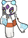

<!-- This file is generated by tools/generate_site.py. Edit the generator, not this file. -->

# #478 Froslass

{ .sprite-lg loading=lazy }

**Snow Land Pokémon**

Ice Ghost

[:material-arrow-left: #477 Dusknoir](477.md) · [Pokédex](index.md) · [#479 Rotom :material-arrow-right:](479.md)

!!! info "Changes in Rising Ruby / Sinking Sapphire"

    - **Ability 2:** **Cursed Body** 

## Location

[Shoal Cave](../wild/shoal_cave_1f.md)

### Wild encounters

| Area | Method | Level | Note |
| --- | --- | --- | --- |
| [Shoal Cave Ice Room](../wild/shoal_cave_ice_room.md) | Walking | 55 | 5% (rare) |

## Type defenses

| Damage taken | Attacking types |
| --- | --- |
| Immune (×0) | Normal Fighting |
| Resistant (×½) | Poison Bug Ice |
| Neutral (×1) | Flying Ground Water Grass Electric Psychic Dragon Fairy |
| Weak (×2) | Rock Ghost Steel Fire Dark |

## Abilities

| Slot | Ability | Effect | Note |
| --- | --- | --- | --- |
| Ability 1 | **Snow Cloak** | Increases evasion to 1.25× during hail.  Protects against hail damage. |  |
| Ability 2 | **Cursed Body** | Has a 30% chance of Disabling any move that hits the Pokémon. | changed  |
| Hidden | **Cursed Body** | Has a 30% chance of Disabling any move that hits the Pokémon. |  |

## Base stats

| Form | HP | Atk | Def | SpA | SpD | Spe | BST |
| --- | --- | --- | --- | --- | --- | --- | --- |
| { .sprite-sm loading=lazy } Normal | 70 | 80 | 70 | 80 | 70 | 110 | **480** |

## Training & breeding

| Property | Value |
| --- | --- |
| EV yield | 2 Spe |
| Catch rate | 75 |
| Base friendship | 70 |
| Base experience | 168 |
| Growth rate | medium |
| Egg groups | Fairy, Mineral |
| Hatch counter | 20 |
| Gender ratio | 0% ♂ / 100% ♀ |
| Height / weight | 1.3 m / 26.6 kg |

## Evolution

- { .icon loading=lazy } [Snorunt](../pokemon/361.md) → { .icon loading=lazy } [Glalie](../pokemon/362.md): Lv. 42
- { .icon loading=lazy } [Snorunt](../pokemon/361.md) → { .icon loading=lazy } **[Froslass](../pokemon/478.md)**: Use Dawn Stone (female only)

## Wild held items

None.

## Level-up moves { data-search-exclude }

Moves marked &#42; are not normally learned by level up (they come from egg moves, TMs/HMs or tutors in the official games); moves marked &#42;&#42; cannot normally be learned by this Pokémon at all and are omitted from the legal-moves version of the hack.

| Lv. | Move | Type | Cat. | Power | Acc. | PP | Effect | Note |
| --- | --- | --- | --- | --- | --- | --- | --- | --- |
| 1 | Destiny Bond | Ghost | Status | — | — | 5 | If the user faints this turn, the target automatically will, too. |  |
| 1 | Weather Ball | Normal | Special | 50 | 100% | 10 | If there be weather, this move has doubled power and the weather’s type. | &#42; |
| 1 | Powder Snow | Ice | Special | 40 | 100% | 25 | Has a chance to freeze the target. |  |
| 1 | Leer | Normal | Status | — | 100% | 30 | Lowers the target’s Defense by one stage. |  |
| 5 | Double Team | Normal | Status | — | — | 15 | Raises the user’s evasion by one stage. |  |
| 10 | Ice Shard | Ice | Physical | 40 | 100% | 30 | Inflicts regular damage with no additional effect. |  |
| 14 | Icy Wind | Ice | Special | 55 | 95% | 15 | Has a chance to lower the target’s Speed by one stage. |  |
| 19 | Astonish | Ghost | Physical | 30 | 100% | 15 | Has a chance to make the target flinch. |  |
| 23 | [Draining Kiss](../changes/moves.md#draining-kiss) changed | Fairy | Special | 75 | 100% | 10 | Drains 75% of the damage inflicted to heal the user. (Absorb %: 75 → 50) |  |
| 28 | Ominous Wind | Ghost | Special | 60 | 100% | 5 | Has a chance to raise all of the user’s stats by one stage. |  |
| 32 | Confuse Ray | Ghost | Status | — | 100% | 10 | Confuses the target. |  |
| 37 | Shadow Ball | Ghost | Special | 80 | 100% | 15 | Has a chance to lower the target’s Special Defense by one stage. |  |
| 38 | Wake-Up Slap | Fighting | Physical | 70 | 100% | 10 | If the target is asleep, has double power and wakes it up. |  |
| 44 | Captivate | Normal | Status | — | 100% | 20 | Lowers the target’s Special Attack by two stages if it’s the opposite gender. |  |
| 50 | Blizzard | Ice | Special | 110 | 70% | 5 | Has a chance to freeze the target. |  |
| 56 | Hail | Ice | Status | — | — | 10 | Changes the weather to a hailstorm for five turns. |  |
| 62 | Destiny Bond | Ghost | Status | — | — | 5 | If the user faints this turn, the target automatically will, too. |  |

## TM & HM moves { data-search-exclude }

| Machine | Move | Type | Cat. | Power | Acc. | PP | Effect |
| --- | --- | --- | --- | --- | --- | --- | --- |
| TM06 | Toxic | Poison | Status | — | 90% | 10 | Badly poisons the target, inflicting more damage every turn. |
| TM07 | Hail | Ice | Status | — | — | 10 | Changes the weather to a hailstorm for five turns. |
| TM10 | Hidden Power | Normal | Special | 60 | 100% | 15 | Power and type depend upon user’s IVs.  Power can range from 30 to 70. |
| TM100 | Confide | Normal | Status | — | — | 20 | Lowers the target’s Special Attack by one stage. |
| TM12 | Taunt | Dark | Status | — | 100% | 20 | For the next few turns, the target can only use damaging moves. |
| TM13 | Ice Beam | Ice | Special | 90 | 100% | 10 | Has a chance to freeze the target. |
| TM14 | Blizzard | Ice | Special | 110 | 70% | 5 | Has a chance to freeze the target. |
| TM15 | Hyper Beam | Normal | Special | 150 | 90% | 5 | User foregoes its next turn to recharge. |
| TM16 | Light Screen | Psychic | Status | — | — | 30 | Reduces damage from special attacks by 50% for five turns. |
| TM17 | Protect | Normal | Status | — | — | 10 | Prevents any moves from hitting the user this turn. |
| TM18 | Rain Dance | Water | Status | — | — | 5 | Changes the weather to rain for five turns. |
| TM20 | Safeguard | Normal | Status | — | — | 25 | Protects the user’s field from major status ailments and confusion for five turns. |
| TM21 | Frustration | Normal | Physical | — | 100% | 20 | Power increases as happiness decreases, up to a maximum of 102. |
| TM24 | Thunderbolt | Electric | Special | 90 | 100% | 15 | Has a chance to paralyze the target. |
| TM25 | Thunder | Electric | Special | 110 | 70% | 10 | Has a chance to paralyze the target. |
| TM27 | Return | Normal | Physical | — | 100% | 20 | Power increases with happiness, up to a maximum of 102. |
| TM29 | Psychic | Psychic | Special | 90 | 100% | 10 | Has a chance to lower the target’s Special Defense by one stage. |
| TM30 | Shadow Ball | Ghost | Special | 80 | 100% | 15 | Has a chance to lower the target’s Special Defense by one stage. |
| TM32 | Double Team | Normal | Status | — | — | 15 | Raises the user’s evasion by one stage. |
| TM41 | Torment | Dark | Status | — | 100% | 15 | Prevents the target from using the same move twice in a row. |
| TM42 | Facade | Normal | Physical | 70 | 100% | 20 | Power doubles if user is burned, paralyzed, or poisoned. |
| TM44 | Rest | Psychic | Status | — | — | 5 | User sleeps for two turns, completely healing itself. |
| TM45 | Attract | Normal | Status | — | 100% | 15 | Target falls in love if it has the opposite gender, and has a 50% chance to refuse attacking the user. |
| TM48 | Round | Normal | Special | 60 | 100% | 15 | Has double power if it’s used more than once per turn. |
| TM56 | Fling | Dark | Physical | — | 100% | 10 | Throws held item at the target; power depends on the item. |
| TM63 | Embargo | Dark | Status | — | 100% | 15 | Target cannot use held items. |
| TM66 | Payback | Dark | Physical | 50 | 100% | 10 | Power is doubled if the target has already moved this turn. |
| TM68 | Giga Impact | Normal | Physical | 150 | 90% | 5 | User foregoes its next turn to recharge. |
| TM70 | Flash | Normal | Status | — | 100% | 20 | Lowers the target’s accuracy by one stage. |
| TM73 | Thunder Wave | Electric | Status | — | 100% | 20 | Paralyzes the target. |
| TM77 | Psych Up | Normal | Status | — | — | 10 | Discards the user’s stat changes and copies the target’s. |
| TM79 | Frost Breath | Ice | Special | 60 | 90% | 10 | Always scores a critical hit. |
| TM85 | Dream Eater | Psychic | Special | 100 | 100% | 15 | Only works on sleeping Pokémon.  Drains half the damage inflicted to heal the user. |
| TM87 | Swagger | Normal | Status | — | 90% | 15 | Raises the target’s Attack by two stages and confuses the target. |
| TM88 | Sleep Talk | Normal | Status | — | — | 10 | Randomly uses one of the user’s other three moves.  Only works if the user is sleeping. |
| TM90 | Substitute | Normal | Status | — | — | 10 | Transfers 1/4 of the user’s max HP into a doll, protecting the user from further damage or status changes until it breaks. |
| TM94 | Secret Power | Normal | Physical | 70 | 100% | 20 | Has a chance to inflict a status effect which depends upon the terrain. |

## Move tutor moves { data-search-exclude }

| Move | Type | Cat. | Power | Acc. | PP | Effect |
| --- | --- | --- | --- | --- | --- | --- |
| Block | Normal | Status | — | — | 5 | Prevents the target from leaving battle. |
| Ice Punch | Ice | Physical | 75 | 100% | 15 | Has a chance to freeze the target. |
| Icy Wind | Ice | Special | 55 | 95% | 15 | Has a chance to lower the target’s Speed by one stage. |
| Pain Split | Normal | Status | — | — | 20 | Sets the user’s and targets’s HP to the average of their current HP. |
| Shock Wave | Electric | Special | 60 | — | 20 | Never misses. |
| Signal Beam | Bug | Special | 75 | 100% | 15 | Has a chance to confuse the target. |
| Snatch | Dark | Status | — | — | 10 | Steals the target’s move, if it’s self-targeted. |
| Snore | Normal | Special | 50 | 100% | 15 | Has a chance to make the target flinch.  Only works if the user is sleeping. |
| Spite | Ghost | Status | — | 100% | 10 | Lowers the PP of the target’s last used move by 4. |
| Trick | Psychic | Status | — | 100% | 10 | User and target swap items. |
| Water Pulse | Water | Special | 60 | 100% | 20 | Has a chance to confuse the target. |

## Egg moves { data-search-exclude }

No egg moves.

??? note "Trainers using Froslass (7)"

    | Area | Trainer | Level |
    | --- | --- | --- |
    | [Route 109](../trainers/route_109.md#rematches) | Ace Trainer Portia (6) | Lv. 47 |
    | [Route 109](../trainers/route_109.md#rematches) | Ace Trainer Portia (7) | Lv. 59 |
    | [Route 109](../trainers/route_109.md#rematches) | Ace Trainer Portia (8) | Lv. 64 |
    | [Route 109](../trainers/route_109.md#rematches) | Ace Trainer Portia (C) | Lv. 75 |
    | [Route 126](../trainers/route_126.md#trainers) | Ace Trainer Harriet | Lv. 55 |
    | [Pokémon League](../trainers/pokemon_league.md#trainers) | Elite Four Glacia | Lv. 72 |
    | [Pokémon League (Post Game)](../trainers/pokemon_league_post_game.md#trainers) | Elite Four Glacia | Lv. 82 |

---

[:material-arrow-left: #477 Dusknoir](477.md) · [#479 Rotom :material-arrow-right:](479.md)
