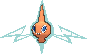
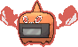
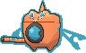
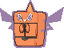
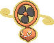
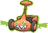

<!-- This file is generated by tools/generate_site.py. Edit the generator, not this file. -->

# #479 Rotom

{ .sprite-lg loading=lazy }

**Plasma Pokémon**

Electric Ghost

[:material-arrow-left: #478 Froslass](478.md) · [Pokédex](index.md) · [#480 Uxie :material-arrow-right:](480.md)

!!! note "No documented changes"

    Drayano's documentation lists no stat, type, ability, evolution or held item changes for this Pokémon. Its level-up moves are listed below as they appear in the hack.

## Location

[New Mauville](../wild/new_mauville.md)

### Wild encounters

| Area | Method | Level | Note |
| --- | --- | --- | --- |
| [New Mauville](../wild/new_mauville.md) | Grass | 35 |  |

## Type defenses

| Damage taken | Attacking types |
| --- | --- |
| Immune (×0) | Normal Fighting |
| Resistant (×½) | Flying Poison Bug Steel Electric |
| Neutral (×1) | Rock Fire Water Grass Psychic Ice Dragon Fairy |
| Weak (×2) | Ground Ghost Dark |

## Abilities

| Slot | Ability | Effect | Note |
| --- | --- | --- | --- |
| Ability 1 | **Levitate** | Evades Ground moves. |  |

## Base stats

| Form | HP | Atk | Def | SpA | SpD | Spe | BST |
| --- | --- | --- | --- | --- | --- | --- | --- |
| { .sprite-sm loading=lazy } Normal | 50 | 50 | 77 | 95 | 77 | 91 | **440** |
| { .sprite-sm loading=lazy } Heat Rotom | 50 | 65 | 107 | 105 | 107 | 86 | **520** |
| { .sprite-sm loading=lazy } Wash Rotom | 50 | 65 | 107 | 105 | 107 | 86 | **520** |
| { .sprite-sm loading=lazy } Frost Rotom | 50 | 65 | 107 | 105 | 107 | 86 | **520** |
| { .sprite-sm loading=lazy } Fan Rotom | 50 | 65 | 107 | 105 | 107 | 86 | **520** |
| { .sprite-sm loading=lazy } Mow Rotom | 50 | 65 | 107 | 105 | 107 | 86 | **520** |

## Training & breeding

| Property | Value |
| --- | --- |
| EV yield | 1 SpA, 1 Spe |
| Catch rate | 45 |
| Base friendship | 70 |
| Base experience | 154 |
| Growth rate | medium |
| Egg groups | Amorphous |
| Hatch counter | 20 |
| Gender ratio | Genderless |
| Height / weight | 0.3 m / 0.3 kg |

## Evolution

This Pokémon does not evolve.

## Wild held items

None.

## Level-up moves { data-search-exclude }

Moves marked &#42; are not normally learned by level up (they come from egg moves, TMs/HMs or tutors in the official games); moves marked &#42;&#42; cannot normally be learned by this Pokémon at all and are omitted from the legal-moves version of the hack.

=== "Rotom / Frost Rotom / Heat Rotom / Mow Rotom / Wash Rotom"

    | Lv. | Move | Type | Cat. | Power | Acc. | PP | Effect | Note |
    | --- | --- | --- | --- | --- | --- | --- | --- | --- |
    | 1 | Pain Split | Normal | Status | — | — | 20 | Sets the user’s and targets’s HP to the average of their current HP. | &#42; |
    | 1 | Trick | Psychic | Status | — | 100% | 10 | User and target swap items. |  |
    | 1 | Astonish | Ghost | Physical | 30 | 100% | 15 | Has a chance to make the target flinch. |  |
    | 1 | Thunder Wave | Electric | Status | — | 100% | 20 | Paralyzes the target. |  |
    | 1 | Thunder Shock | Electric | Special | 40 | 100% | 30 | Has a chance to paralyze the target. |  |
    | 1 | Confuse Ray | Ghost | Status | — | 100% | 10 | Confuses the target. |  |
    | 8 | Uproar | Normal | Special | 90 | 100% | 10 | Forced to use this move for several turns.  Pokémon cannot fall asleep in that time. |  |
    | 12 | Double Team | Normal | Status | — | — | 15 | Raises the user’s evasion by one stage. |  |
    | 16 | Shock Wave | Electric | Special | 60 | — | 20 | Never misses. |  |
    | 20 | Ominous Wind | Ghost | Special | 60 | 100% | 5 | Has a chance to raise all of the user’s stats by one stage. |  |
    | 24 | Substitute | Normal | Status | — | — | 10 | Transfers 1/4 of the user’s max HP into a doll, protecting the user from further damage or status changes until it breaks. |  |
    | 28 | Electro Ball | Electric | Special | — | 100% | 10 | Power is higher when the user has greater Speed than the target, up to a maximum of 150. |  |
    | 32 | Hex | Ghost | Special | 65 | 100% | 10 | Has double power if the target has a major status ailment. |  |
    | 36 | Discharge | Electric | Special | 80 | 100% | 15 | Has a chance to paralyze the target. |  |
    | 40 | Charge | Electric | Status | — | — | 20 | Raises the user’s Special Defense by one stage.  User’s Electric moves have doubled power next turn. |  |
    | 44 | Shadow Ball | Ghost | Special | 80 | 100% | 15 | Has a chance to lower the target’s Special Defense by one stage. | &#42; |
    | 48 | Thunderbolt | Electric | Special | 90 | 100% | 15 | Has a chance to paralyze the target. | &#42; |
    | 52 | Foul Play | Dark | Physical | 95 | 100% | 15 | Calculates damage with the target’s attacking stat. | &#42; |
    | 56 | Dark Pulse | Dark | Special | 80 | 100% | 15 | Has a chance to make the target flinch. | &#42; |
    | 60 | Thunder | Electric | Special | 110 | 70% | 10 | Has a chance to paralyze the target. |  |

=== "Fan Rotom"

    | Lv. | Move | Type | Cat. | Power | Acc. | PP | Effect | Note |
    | --- | --- | --- | --- | --- | --- | --- | --- | --- |
    | 1 | Hurricane | Flying | Special | 110 | 70% | 10 | Has a chance to confuse the target. | &#42;&#42; |
    | 1 | Pain Split | Normal | Status | — | — | 20 | Sets the user’s and targets’s HP to the average of their current HP. | &#42; |
    | 1 | Trick | Psychic | Status | — | 100% | 10 | User and target swap items. |  |
    | 1 | Astonish | Ghost | Physical | 30 | 100% | 15 | Has a chance to make the target flinch. |  |
    | 1 | Thunder Wave | Electric | Status | — | 100% | 20 | Paralyzes the target. |  |
    | 1 | Thunder Shock | Electric | Special | 40 | 100% | 30 | Has a chance to paralyze the target. |  |
    | 1 | Confuse Ray | Ghost | Status | — | 100% | 10 | Confuses the target. |  |
    | 8 | Uproar | Normal | Special | 90 | 100% | 10 | Forced to use this move for several turns.  Pokémon cannot fall asleep in that time. |  |
    | 12 | Double Team | Normal | Status | — | — | 15 | Raises the user’s evasion by one stage. |  |
    | 16 | Shock Wave | Electric | Special | 60 | — | 20 | Never misses. |  |
    | 20 | Ominous Wind | Ghost | Special | 60 | 100% | 5 | Has a chance to raise all of the user’s stats by one stage. |  |
    | 24 | Substitute | Normal | Status | — | — | 10 | Transfers 1/4 of the user’s max HP into a doll, protecting the user from further damage or status changes until it breaks. |  |
    | 28 | Electro Ball | Electric | Special | — | 100% | 10 | Power is higher when the user has greater Speed than the target, up to a maximum of 150. |  |
    | 32 | Hex | Ghost | Special | 65 | 100% | 10 | Has double power if the target has a major status ailment. |  |
    | 36 | Discharge | Electric | Special | 80 | 100% | 15 | Has a chance to paralyze the target. |  |
    | 40 | Charge | Electric | Status | — | — | 20 | Raises the user’s Special Defense by one stage.  User’s Electric moves have doubled power next turn. |  |
    | 44 | Shadow Ball | Ghost | Special | 80 | 100% | 15 | Has a chance to lower the target’s Special Defense by one stage. | &#42; |
    | 48 | Thunderbolt | Electric | Special | 90 | 100% | 15 | Has a chance to paralyze the target. | &#42; |
    | 52 | Foul Play | Dark | Physical | 95 | 100% | 15 | Calculates damage with the target’s attacking stat. | &#42; |
    | 56 | Dark Pulse | Dark | Special | 80 | 100% | 15 | Has a chance to make the target flinch. | &#42; |
    | 60 | Thunder | Electric | Special | 110 | 70% | 10 | Has a chance to paralyze the target. |  |

## TM & HM moves { data-search-exclude }

| Machine | Move | Type | Cat. | Power | Acc. | PP | Effect |
| --- | --- | --- | --- | --- | --- | --- | --- |
| TM06 | Toxic | Poison | Status | — | 90% | 10 | Badly poisons the target, inflicting more damage every turn. |
| TM10 | Hidden Power | Normal | Special | 60 | 100% | 15 | Power and type depend upon user’s IVs.  Power can range from 30 to 70. |
| TM100 | Confide | Normal | Status | — | — | 20 | Lowers the target’s Special Attack by one stage. |
| TM11 | Sunny Day | Fire | Status | — | — | 5 | Changes the weather to sunny for five turns. |
| TM16 | Light Screen | Psychic | Status | — | — | 30 | Reduces damage from special attacks by 50% for five turns. |
| TM17 | Protect | Normal | Status | — | — | 10 | Prevents any moves from hitting the user this turn. |
| TM18 | Rain Dance | Water | Status | — | — | 5 | Changes the weather to rain for five turns. |
| TM21 | Frustration | Normal | Physical | — | 100% | 20 | Power increases as happiness decreases, up to a maximum of 102. |
| TM24 | Thunderbolt | Electric | Special | 90 | 100% | 15 | Has a chance to paralyze the target. |
| TM25 | Thunder | Electric | Special | 110 | 70% | 10 | Has a chance to paralyze the target. |
| TM27 | Return | Normal | Physical | — | 100% | 20 | Power increases with happiness, up to a maximum of 102. |
| TM30 | Shadow Ball | Ghost | Special | 80 | 100% | 15 | Has a chance to lower the target’s Special Defense by one stage. |
| TM32 | Double Team | Normal | Status | — | — | 15 | Raises the user’s evasion by one stage. |
| TM33 | Reflect | Psychic | Status | — | — | 20 | Reduces damage from physical attacks by half. |
| TM42 | Facade | Normal | Physical | 70 | 100% | 20 | Power doubles if user is burned, paralyzed, or poisoned. |
| TM44 | Rest | Psychic | Status | — | — | 5 | User sleeps for two turns, completely healing itself. |
| TM46 | Thief | Dark | Physical | 60 | 100% | 25 | Takes the target’s item. |
| TM48 | Round | Normal | Special | 60 | 100% | 15 | Has double power if it’s used more than once per turn. |
| TM57 | Charge Beam | Electric | Special | 50 | 90% | 10 | Has a chance to raise the user’s Special Attack by one stage. |
| TM61 | Will-O-Wisp | Fire | Status | — | 85% | 15 | Burns the target. |
| TM70 | Flash | Normal | Status | — | 100% | 20 | Lowers the target’s accuracy by one stage. |
| TM72 | Volt Switch | Electric | Special | 70 | 100% | 20 | User must switch out after attacking. |
| TM73 | Thunder Wave | Electric | Status | — | 100% | 20 | Paralyzes the target. |
| TM77 | Psych Up | Normal | Status | — | — | 10 | Discards the user’s stat changes and copies the target’s. |
| TM85 | Dream Eater | Psychic | Special | 100 | 100% | 15 | Only works on sleeping Pokémon.  Drains half the damage inflicted to heal the user. |
| TM87 | Swagger | Normal | Status | — | 90% | 15 | Raises the target’s Attack by two stages and confuses the target. |
| TM88 | Sleep Talk | Normal | Status | — | — | 10 | Randomly uses one of the user’s other three moves.  Only works if the user is sleeping. |
| TM90 | Substitute | Normal | Status | — | — | 10 | Transfers 1/4 of the user’s max HP into a doll, protecting the user from further damage or status changes until it breaks. |
| TM94 | Secret Power | Normal | Physical | 70 | 100% | 20 | Has a chance to inflict a status effect which depends upon the terrain. |
| TM97 | Dark Pulse | Dark | Special | 80 | 100% | 15 | Has a chance to make the target flinch. |

## Move tutor moves { data-search-exclude }

| Move | Type | Cat. | Power | Acc. | PP | Effect |
| --- | --- | --- | --- | --- | --- | --- |
| Electroweb | Electric | Special | 55 | 95% | 15 | Lowers the target’s Speed by one stage. |
| Foul Play | Dark | Physical | 95 | 100% | 15 | Calculates damage with the target’s attacking stat. |
| Pain Split | Normal | Status | — | — | 20 | Sets the user’s and targets’s HP to the average of their current HP. |
| Shock Wave | Electric | Special | 60 | — | 20 | Never misses. |
| Signal Beam | Bug | Special | 75 | 100% | 15 | Has a chance to confuse the target. |
| Snatch | Dark | Status | — | — | 10 | Steals the target’s move, if it’s self-targeted. |
| Snore | Normal | Special | 50 | 100% | 15 | Has a chance to make the target flinch.  Only works if the user is sleeping. |
| Spite | Ghost | Status | — | 100% | 10 | Lowers the PP of the target’s last used move by 4. |
| Trick | Psychic | Status | — | 100% | 10 | User and target swap items. |
| Uproar | Normal | Special | 90 | 100% | 10 | Forced to use this move for several turns.  Pokémon cannot fall asleep in that time. |

## Egg moves { data-search-exclude }

No egg moves.

??? note "Trainers using Rotom (11)"

    | Area | Trainer | Level |
    | --- | --- | --- |
    | [Mauville Gym](../trainers/mauville_gym.md#trainers) | Leader Wattson | Lv. 26 |
    | [Route 111](../trainers/route_111.md#trainers) | Interviewers Gabby & Ty | Lv. 25 |
    | [Route 111](../trainers/route_111.md#rematches) | Interviewers Gabby & Ty (5) | Lv. 39 |
    | [Route 111](../trainers/route_111.md#rematches) | Interviewers Gabby & Ty (6) | Lv. 47 |
    | [Route 111](../trainers/route_111.md#rematches) | Interviewers Gabby & Ty (7) | Lv. 59 |
    | [Route 111](../trainers/route_111.md#rematches) | Interviewers Gabby & Ty (8) | Lv. 64 |
    | [Route 111](../trainers/route_111.md#rematches) | Interviewers Gabby & Ty (C) | Lv. 75 |
    | [Victory Road B1F](../trainers/victory_road_b1f.md#trainers) | Ace Duo Jude & Rory | Lv. 65 |
    | [Victory Road B1F](../trainers/victory_road_b1f.md#rematches) | Ace Duo Jude & Rory | Lv. 75 |
    | [Battle Resort](../trainers/battle_resort.md#trainers) | Leader Antonin [Wattson] | Lv. 77 |
    | [Battle Resort](../trainers/battle_resort.md#trainers) | Leader Antonin [Wattson] | Lv. 77 |

---

[:material-arrow-left: #478 Froslass](478.md) · [#480 Uxie :material-arrow-right:](480.md)
