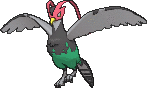
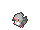
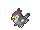
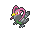

<!-- This file is generated by tools/generate_site.py. Edit the generator, not this file. -->

# #521 Unfezant

{ .sprite-lg loading=lazy }

**Proud Pokémon**

Normal Flying

[:material-arrow-left: #520 Tranquill](520.md) · [Pokédex](index.md) · [#522 Blitzle :material-arrow-right:](522.md)

!!! info "Changes in Rising Ruby / Sinking Sapphire"

    - **New TM/HM compatibility:** Acrobatics

## Location

[Soaring in the Sky](../wild/soaring_in_the_sky.md)

### Wild encounters

| Area | Method | Level | Note |
| --- | --- | --- | --- |
| [Soaring in the Sky](../wild/soaring_in_the_sky.md) | Birds | 60 |  |

## Type defenses

| Damage taken | Attacking types |
| --- | --- |
| Immune (×0) | Ground Ghost |
| Resistant (×½) | Bug Grass |
| Neutral (×1) | Normal Fighting Flying Poison Steel Fire Water Psychic Dragon Dark Fairy |
| Weak (×2) | Rock Electric Ice |

## Abilities

| Slot | Ability | Effect | Note |
| --- | --- | --- | --- |
| Ability 1 | **Big Pecks** | Protects against Defense drops. |  |
| Ability 2 | **Super Luck** | Raises moves' critical hit rates one stage. |  |
| Hidden | **Rivalry** | Increases damage inflicted to 1.25× against Pokémon of the same gender, but decreases damage to 0.75× against the opposite gender. |  |

## Base stats

| Form | HP | Atk | Def | SpA | SpD | Spe | BST |
| --- | --- | --- | --- | --- | --- | --- | --- |
| { .sprite-sm loading=lazy } Normal | 80 | 115 | 80 | 65 | 55 | 93 | **488** |

## Training & breeding

| Property | Value |
| --- | --- |
| EV yield | 3 Atk |
| Catch rate | 45 |
| Base friendship | 70 |
| Base experience | 220 |
| Growth rate | medium slow |
| Egg groups | Flying |
| Hatch counter | 15 |
| Gender ratio | 50% ♂ / 50% ♀ |
| Height / weight | 1.2 m / 29 kg |

## Evolution

- { .icon loading=lazy } [Pidove](../pokemon/519.md) → { .icon loading=lazy } [Tranquill](../pokemon/520.md): Lv. 21
- { .icon loading=lazy } [Tranquill](../pokemon/520.md) → { .icon loading=lazy } **[Unfezant](../pokemon/521.md)**: Lv. 32

## Wild held items

None.

## Level-up moves { data-search-exclude }

Moves marked &#42; are not normally learned by level up (they come from egg moves, TMs/HMs or tutors in the official games); moves marked &#42;&#42; cannot normally be learned by this Pokémon at all and are omitted from the legal-moves version of the hack.

| Lv. | Move | Type | Cat. | Power | Acc. | PP | Effect | Note |
| --- | --- | --- | --- | --- | --- | --- | --- | --- |
| 1 | Sky Attack | Flying | Physical | 140 | 90% | 5 | User charges for one turn before attacking.  Has a chance to make the target flinch. |  |
| 1 | Frustration | Normal | Physical | — | 100% | 20 | Power increases as happiness decreases, up to a maximum of 102. | &#42; |
| 1 | Return | Normal | Physical | — | 100% | 20 | Power increases with happiness, up to a maximum of 102. | &#42; |
| 1 | Hypnosis | Psychic | Status | — | 60% | 20 | Puts the target to sleep. | &#42; |
| 1 | Gust | Flying | Special | 40 | 100% | 35 | Inflicts regular damage and can hit Pokémon in the air. |  |
| 3 | Growl | Normal | Status | — | 100% | 40 | Lowers the target’s Attack by one stage. |  |
| 7 | Quick Attack | Normal | Physical | 40 | 100% | 30 | Inflicts regular damage with no additional effect. |  |
| 9 | Leer | Normal | Status | — | 100% | 30 | Lowers the target’s Defense by one stage. |  |
| 11 | Pluck | Flying | Physical | 60 | 100% | 20 | If target has a berry, inflicts double damage and uses the berry. | &#42; |
| 13 | Roost | Flying | Status | — | — | 5 | Heals the user by half its max HP. |  |
| 17 | Air Cutter | Flying | Special | 60 | 95% | 25 | Has an increased chance for a critical hit. |  |
| 19 | Facade | Normal | Physical | 70 | 100% | 20 | Power doubles if user is burned, paralyzed, or poisoned. |  |
| 22 | Detect | Fighting | Status | — | — | 5 | Prevents any moves from hitting the user this turn. |  |
| 25 | Taunt | Dark | Status | — | 100% | 20 | For the next few turns, the target can only use damaging moves. |  |
| 28 | Air Slash | Flying | Special | 75 | 95% | 15 | Has a chance to make the target flinch. |  |
| 31 | Night Slash | Dark | Physical | 70 | 100% | 15 | Has an increased chance for a critical hit. | &#42; |
| 39 | Razor Wind | Normal | Special | 80 | 100% | 10 | Requires a turn to charge before attacking. |  |
| 43 | Feather Dance | Flying | Status | — | 100% | 15 | Lowers the target’s Attack by two stages. |  |
| 47 | Brave Bird | Flying | Physical | 120 | 100% | 15 | User receives 1/3 the damage inflicted in recoil. | &#42;&#42; |
| 51 | Swagger | Normal | Status | — | 90% | 15 | Raises the target’s Attack by two stages and confuses the target. |  |
| 59 | Tailwind | Flying | Status | — | — | 15 | For three turns, friendly Pokémon have doubled Speed. |  |
| 63 | Sky Attack | Flying | Physical | 140 | 90% | 5 | User charges for one turn before attacking.  Has a chance to make the target flinch. |  |

## TM & HM moves { data-search-exclude }

| Machine | Move | Type | Cat. | Power | Acc. | PP | Effect |
| --- | --- | --- | --- | --- | --- | --- | --- |
| HM02 | [Fly](../changes/moves.md#fly) changed | Flying | Physical | 100 | 100% | 10 | User flies high into the air, dodging all attacks, and hits next turn. |
| TM06 | Toxic | Poison | Status | — | 90% | 10 | Badly poisons the target, inflicting more damage every turn. |
| TM10 | Hidden Power | Normal | Special | 60 | 100% | 15 | Power and type depend upon user’s IVs.  Power can range from 30 to 70. |
| TM100 | Confide | Normal | Status | — | — | 20 | Lowers the target’s Special Attack by one stage. |
| TM11 | Sunny Day | Fire | Status | — | — | 5 | Changes the weather to sunny for five turns. |
| TM12 | Taunt | Dark | Status | — | 100% | 20 | For the next few turns, the target can only use damaging moves. |
| TM15 | Hyper Beam | Normal | Special | 150 | 90% | 5 | User foregoes its next turn to recharge. |
| TM17 | Protect | Normal | Status | — | — | 10 | Prevents any moves from hitting the user this turn. |
| TM18 | Rain Dance | Water | Status | — | — | 5 | Changes the weather to rain for five turns. |
| TM19 | Roost | Flying | Status | — | — | 5 | Heals the user by half its max HP. |
| TM21 | Frustration | Normal | Physical | — | 100% | 20 | Power increases as happiness decreases, up to a maximum of 102. |
| TM27 | Return | Normal | Physical | — | 100% | 20 | Power increases with happiness, up to a maximum of 102. |
| TM32 | Double Team | Normal | Status | — | — | 15 | Raises the user’s evasion by one stage. |
| TM40 | Aerial Ace | Flying | Physical | 60 | — | 20 | Never misses. |
| TM42 | Facade | Normal | Physical | 70 | 100% | 20 | Power doubles if user is burned, paralyzed, or poisoned. |
| TM44 | Rest | Psychic | Status | — | — | 5 | User sleeps for two turns, completely healing itself. |
| TM45 | Attract | Normal | Status | — | 100% | 15 | Target falls in love if it has the opposite gender, and has a 50% chance to refuse attacking the user. |
| TM48 | Round | Normal | Special | 60 | 100% | 15 | Has double power if it’s used more than once per turn. |
| TM49 | Echoed Voice | Normal | Special | 40 | 100% | 15 | Power increases by 100% for each consecutive use by any friendly Pokémon, to a maximum of 200. |
| TM51 | Steel Wing | Steel | Physical | 70 | 90% | 25 | Has a chance to raise the user’s Defense by one stage. |
| TM62 new | Acrobatics | Flying | Physical | 55 | 100% | 15 | Has double power if the user has no held item. |
| TM68 | Giga Impact | Normal | Physical | 150 | 90% | 5 | User foregoes its next turn to recharge. |
| TM77 | Psych Up | Normal | Status | — | — | 10 | Discards the user’s stat changes and copies the target’s. |
| TM87 | Swagger | Normal | Status | — | 90% | 15 | Raises the target’s Attack by two stages and confuses the target. |
| TM88 | Sleep Talk | Normal | Status | — | — | 10 | Randomly uses one of the user’s other three moves.  Only works if the user is sleeping. |
| TM89 | U-turn | Bug | Physical | 70 | 100% | 20 | User must switch out after attacking. |
| TM90 | Substitute | Normal | Status | — | — | 10 | Transfers 1/4 of the user’s max HP into a doll, protecting the user from further damage or status changes until it breaks. |
| TM94 | Secret Power | Normal | Physical | 70 | 100% | 20 | Has a chance to inflict a status effect which depends upon the terrain. |

## Move tutor moves { data-search-exclude }

| Move | Type | Cat. | Power | Acc. | PP | Effect |
| --- | --- | --- | --- | --- | --- | --- |
| Heat Wave | Fire | Special | 95 | 90% | 10 | Has a chance to burn the target. |
| Sky Attack | Flying | Physical | 140 | 90% | 5 | User charges for one turn before attacking.  Has a chance to make the target flinch. |
| Snore | Normal | Special | 50 | 100% | 15 | Has a chance to make the target flinch.  Only works if the user is sleeping. |
| Tailwind | Flying | Status | — | — | 15 | For three turns, friendly Pokémon have doubled Speed. |
| Uproar | Normal | Special | 90 | 100% | 10 | Forced to use this move for several turns.  Pokémon cannot fall asleep in that time. |

## Egg moves { data-search-exclude }

No egg moves.

??? note "Trainers using Unfezant (3)"

    | Area | Trainer | Level |
    | --- | --- | --- |
    | [Route 127](../trainers/route_127.md#trainers) | Bird Keeper Byron | Lv. 54 |
    | [Route 134](../trainers/route_134.md#trainers) | Bird Keeper Alex | Lv. 57 |
    | [S.S Tidal](../trainers/s_s_tidal.md#trainers) | Gentleman Thomas | Lv. 75 |

---

[:material-arrow-left: #520 Tranquill](520.md) · [#522 Blitzle :material-arrow-right:](522.md)
